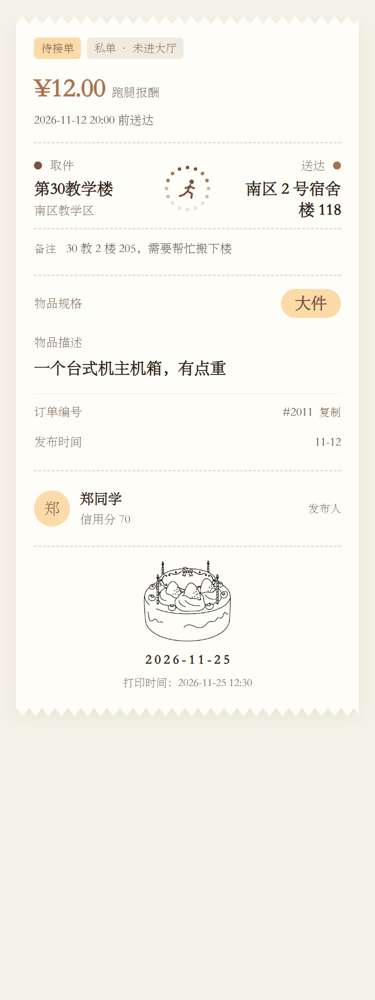
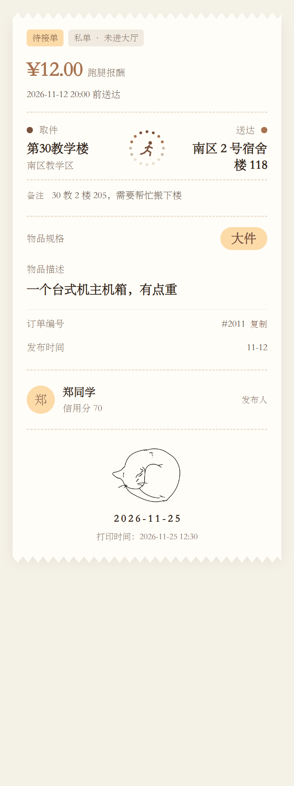

# 小票式详情页 UI + 落款图案随机切换（B → A 交接，2026-11-25）

> 给 A：这一份可以**直接照抄移植**到你的页面（比如二手商品详情页）。
> 代码全部来自 B 侧已上线的代取订单详情页（`pages/errand/detail.*`），逐字复制即可，
> 每一段都标了「粘到哪个文件哪里」。第五节是踩坑清单，**移植前先读一遍**，尤其第 1 条。

## 一、效果

代取订单详情页的四张卡片不再各自漂浮，而是连成**一张小票**：

- 纸面底色 `#FFFDF7`（比纯白略暖，压在页面底色 `#F4F1E7` 上有「一张纸」的层次）；
- 上下各一条**细锯齿撕纸边**（齿距 26rpx / 齿高 16rpx，纯 CSS 三角，零图片）；
- 卡片之间的 20rpx 间距换成**虚线撕线**；
- 发布者下方是**落款区**：随机线条图案（打开页面随机抽一张）+ 当日日期 + 「打印时间」。

两张实拍渲染图（同一页面、两次打开，图案随机不同）：




## 二、组成与改动清单

| 块 | 涉及文件 | 内容 |
|---|---|---|
| ① 纸面外壳 + 锯齿 | `app.wxss`（1 行令牌）+ 页面 wxss / wxml | `.receipt` 外壳 + 两条齿条 |
| ② 四卡连票 | 页面 wxml / wxss | 内层 `.card` 降级 + 虚线撕线 |
| ③ 落款随机图案 | 页面 js / wxml / wxss + `assets/receipt/*.png` | `DOODLE_IMAGES` 随机抽一张 |

## 三、代码（逐字可抄）

### 3.1 `app.wxss`：纸面令牌（加在 `page {` 的颜色区）

```css
  /* 小票纸面（11-25）：比纯白偏暖一点点，压在 --color-bg 上才有「一张纸」的层次 */
  --color-paper: #FFFDF7;
```

### 3.2 页面 wxss：小票外壳 + 卡片降级（整段粘到页面 wxss 顶部区域）

```css
/* ---------------- 小票外壳（11-25 用户预览确认「细锯齿」版） ----------------
   纸面 --color-paper 压在 --color-bg 上，上下各一条锯齿边：
   齿距 26rpx（左右各 13rpx 透明 border）、齿高 16rpx，纯 CSS 三角、不用图片。
   rpx 下纸面宽度恒为 686rpx（750 - 两侧 32rpx），27 齿共 702rpx，末齿被 overflow 裁掉。
   四张卡片进小票后变成透明分段，卡片间距换成一条虚线撕线 */
.receipt {
  position: relative;
}
.receipt__body {
  padding: 26rpx 36rpx 34rpx;
  background-color: var(--color-paper);
  box-shadow: var(--shadow-card);
}
.receipt__saw {
  display: flex;
  height: 16rpx;
  overflow: hidden;
}
/* 齿：26×16rpx 的盒子里只留一个 13rpx+13rpx 宽的三角（border-box 下内容区为 0）。
   box-sizing 必须在这里显式声明——不能赌 app.wxss 的全局 border-box 规则一直在；
   否则 content-box 下盒子会变成 26×32，超出 .receipt__saw 的 16rpx 高被整条裁没 */
.receipt__tooth {
  flex: none;
  box-sizing: border-box;
  width: 26rpx;
  height: 16rpx;
  border-left: 13rpx solid transparent;
  border-right: 13rpx solid transparent;
}
/* 上齿：底边贴着纸面、齿尖朝上；下齿反过来（齿尖朝下） */
.receipt__tooth--top {
  border-bottom: 16rpx solid var(--color-paper);
}
.receipt__tooth--bottom {
  border-top: 16rpx solid var(--color-paper);
}
/* 小票内卡片不再是独立浮层：去底色 / 圆角 / 阴影 / 内边距（内边距交给 .receipt__body 与小票分段） */
.receipt__body .card {
  padding: 0;
  background-color: transparent;
  border-radius: 0;
  box-shadow: none;
}
.receipt__body .card + .card {
  margin-top: 0;
}
/* 分段之间：虚线与上下留白（3rpx dashed 沿用路线卡备注的口径） */
.receipt__body .receipt__sec + .receipt__sec {
  margin-top: 26rpx;
  padding-top: 26rpx;
  border-top: 3rpx dashed var(--color-border);
}

/* ---------------- 小票落款：装饰图案 + 日期 + 打印时间 ---------------- */
.receipt-doodle {
  display: flex;
  flex-direction: column;
  align-items: center;
}
.receipt-doodle__img {
  width: 176rpx;
  height: 176rpx;
}
.receipt-doodle__date {
  /* 字距会让末字多出一格，用等量左外边距把视觉重新居中 */
  margin: 4rpx 0 0 6rpx;
  font-size: 26rpx;
  font-weight: 600;
  letter-spacing: 6rpx;
  color: var(--color-text);
}
.receipt-doodle__print {
  margin-top: 10rpx;
  font-size: var(--font-xs);
  color: var(--color-text-3);
}
```

### 3.3 页面 wxml：结构骨架（把要连成一张票的卡片包进去）

```xml
<view class="receipt">
  <!-- 上齿条：27 齿由 js 给 SAW_TEETH，末齿被 overflow 裁掉 -->
  <view class="receipt__saw receipt__saw--top">
    <view wx:for="{{sawTeeth}}" wx:key="*this" class="receipt__tooth receipt__tooth--top"></view>
  </view>

  <view class="receipt__body">
    <!-- （可选）顶部预览图段：对齐二手详情页「预览图在上、详情在下」。
         样式 .detail-hero（614rpx 等宽正方形、防溢出、aspectFill 满铺），
         图源 js 里 heroImage: errandUtil.categoryIcon(order)——
         这是 B 侧代取专用的品类插画派生（utils/errand.js，因为代取表没有图片字段）；
         你的页面有真图，直接 src 真图即可 -->
    <view class="card detail-hero receipt__sec">
      <image class="detail-hero__img" src="{{heroImage}}" mode="aspectFill" />
    </view>

    <!-- 每张要进小票的卡片：保留原 class，追加 receipt__sec；
         第一段不用特殊处理，其余段之间自动出现虚线撕线 -->
    <view class="card 你的卡片一 receipt__sec">…原有内容不动…</view>
    <view class="card 你的卡片二 receipt__sec">…</view>

    <!-- 落款区（可选）：随机图案 + 当日日期 + 打印时间 -->
    <view class="receipt__sec receipt-doodle">
      <image class="receipt-doodle__img" src="{{receiptImage}}" mode="aspectFit" />
      <text class="receipt-doodle__date">{{receiptDate}}</text>
      <text class="receipt-doodle__print">打印时间：{{receiptPrintTime}}</text>
    </view>
  </view>

  <view class="receipt__saw receipt__saw--bottom">
    <view wx:for="{{sawTeeth}}" wx:key="*this" class="receipt__tooth receipt__tooth--bottom"></view>
  </view>
</view>
```

### 3.4 页面 js：三处

```js
// ① 常量（放 Page() 外面，模块级只算一次）
const SAW_TEETH = [];
for (let i = 0; i < 27; i++) SAW_TEETH.push(i);

// 随机落款图案：512×512 黑线条透明底 PNG，按内容语义命名
const DOODLE_IMAGES = [
  '/assets/receipt/cat.png',
  '/assets/receipt/mouse.png',
  '/assets/receipt/cake.png',
  '/assets/receipt/umbrella.png',
  '/assets/receipt/trees.png'
];

// ② data 里加两个字段
data: {
  sawTeeth: SAW_TEETH,
  receiptImage: DOODLE_IMAGES[0],
  // receiptDate / receiptPrintTime 在每次拉到数据时刷新（见 ③）
},

// ③ onLoad 里随机抽一张——只在这里抽，之后刷新/回跳不重抽（防图案闪变）
onLoad(options) {
  // …原有逻辑…
  this.setData({
    receiptImage: DOODLE_IMAGES[Math.floor(Math.random() * DOODLE_IMAGES.length)]
  });
},

// ③' 日期与打印时间：取「此刻」且只 new Date() 一次（防止两处跨分钟不一致）
//    放在你组装展示数据的函数里（B 侧是 apply()）：
//    const printAt = new Date();
//    receiptDate: util.formatTime(printAt, false),      // '2026-11-25'
//    receiptPrintTime: util.formatTime(printAt),        // '2026-11-25 13:22'
```

## 四、移植步骤（以你的二手商品详情页为例）

1. `app.wxss` 加 `--color-paper` 令牌（3.1，一次全局）。
2. 页面 wxss 粘 3.2 整段（类名不用改，避免和你页面现有类冲突——`receipt` 前缀是新的）。
3. 页面 wxml 用 3.3 的骨架把要连票的卡片包起来；每张卡片追加 `receipt__sec`。
4. 要落款就粘 3.4；不要落款就删掉 `receipt-doodle` 那一小节（锯齿和撕线不受影响）。
5. 素材：把 `miniprogram/assets/receipt/` 的 5 张 PNG 拷走或换你的图（见第六节）。

## 五、踩坑清单（移植前必读）

1. **齿形盒子必须显式 `box-sizing: border-box`**。用无头浏览器做过对照实验：
   content-box 下齿盒会变成 26×32rpx，被 16rpx 高的齿条 `overflow: hidden` **整条裁没**，
   页面上就是一条直线、什么都没有。这条已写进样式里，抄的时候别删。
2. **齿数 27 是按纸面 686rpx 算的**（750 − 页面两侧 padding 32×2）。你的页面如果
   左右 padding 不是 32rpx，重算：`齿数 = ceil(纸面宽 / 26) + 1`，多出来的被裁掉，不会出错。
3. **图案 `image` 必须显式给宽高**（`aspectFit` 需要一个已知盒子才能等比缩放居中）；
   不给尺寸会按原图 512×512 渲染，直接撑爆纸面。
4. **随机只放 `onLoad`**，别放在拉接口的函数里——否则下拉刷新 / 从聊天页回来图案会闪变。
5. `.receipt__body .card` 的降级覆盖（透明/无阴影/无内边距）**优先级高于 `.card`**，
   会作用于小票里所有 `.card`。如果你的卡片依赖 `.card` 的白底+阴影，包进小票后自然消失——
   这正是「连成一张票」的机制，不是 bug；但小票里就不要再放需要独立白底的浮层卡了。
6. 图案素材要求：**PNG、透明底、黑色（或深色）线条、≥256×256**；带白底的图会盖住纸面纹理。
7. 日期的字距（`letter-spacing`）会让末字多出一格导致视觉偏左，用等量 `margin-left` 补回（已在样式里）。

## 六、素材清单与加图

当前 5 张（都在 `miniprogram/assets/receipt/`，512×512 黑线条透明底，约 70KB）：

| 文件 | 内容 |
|---|---|
| `cat.png` | 睡觉蜷成一团的猫 |
| `mouse.png` | 直立的老鼠 |
| `cake.png` | 蜡烛草莓蛋糕 |
| `umbrella.png` | 雨中撑伞踩水的人 |
| `trees.png` | 三棵树丛 |

加新图两步：图拷进 `miniprogram/assets/receipt/`（按内容语义命名，如 `milk-tea.png`），
再往 `DOODLE_IMAGES` 追加一行路径，样式零改动。

## 七、真机自检清单

- [ ] 上下锯齿在低分屏（375 以下逻辑宽）仍清晰、不断齿；
- [ ] 虚线撕线左右贯通、与两侧纸边对齐；
- [ ] 杀掉小程序重进详情页 → 图案会换（随机）；下拉刷新 / 聊天页返回 → 图案不换；
- [ ] 图案完整显示无裁切，日期 / 打印时间居中；
- [ ] 长地点名换行后撕线位置正常（内容变高小票自动变高，锯齿跟着走）。

## 八、B 侧验证记录（供参考）

- 冒烟测试 `scripts/smoke/smoke_detail.js` [14] 节 14 条断言（外壳结构 / 齿几何 / box-sizing
  回归闸 / 卡片降级 / 撕线 / 图案随机与防闪变 / 条码残留防回闸）→ **74/0**；
  12 个冒烟脚本合计 **578/0**，mock 契约 **168/0**，wxml_check PASS。
- 无真机的视觉回归方法：把 wxss 逐字转 CSS（rpx×0.5）+ 同名 class 的 HTML mock，
  本机浏览器无头截图逐像素核对——本文档两张预览图即由此产出，齿边几何问题就是它抓出来的。
- 更完整的背景（含条形码方案被毙的原因：太像真码会引起扫码/支付误会）见
  `docs/UI改动同步-B-2026-11-25.md` 第八节与 `docs/开发日志.md` v0.37~v0.40。
