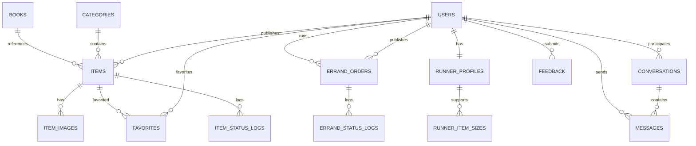
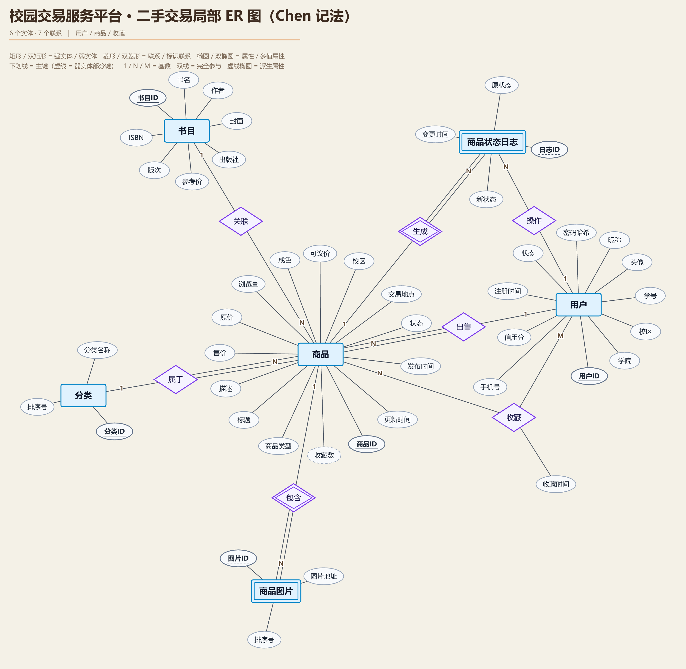
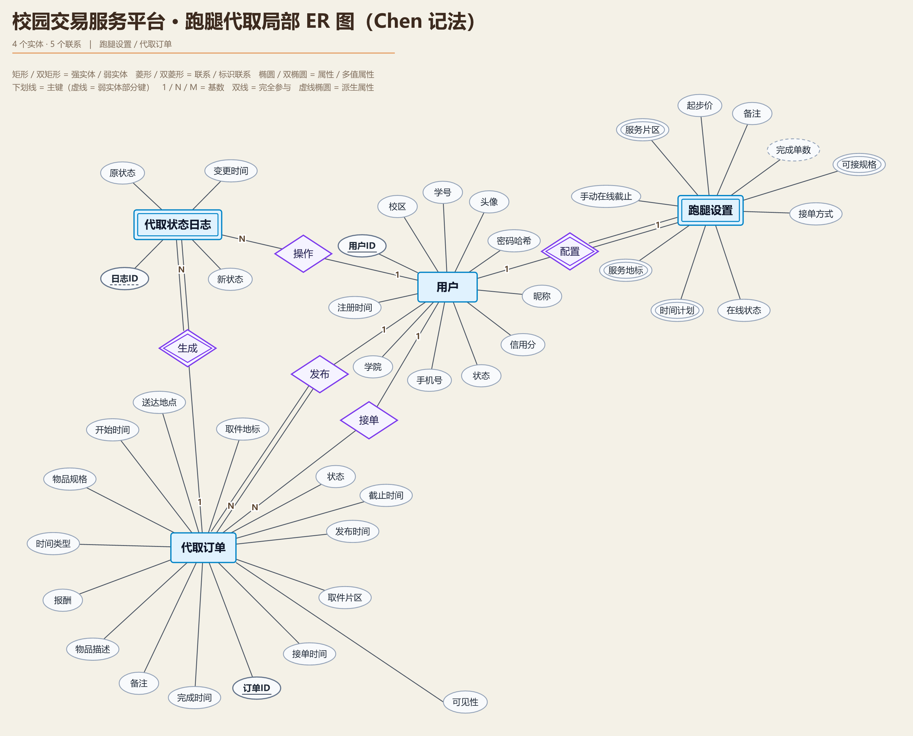
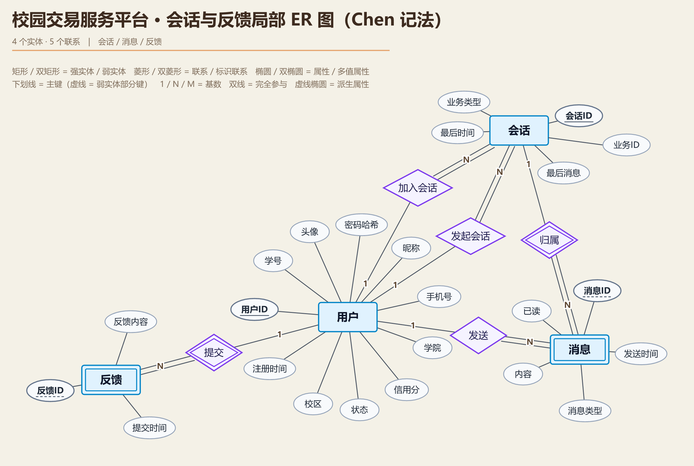
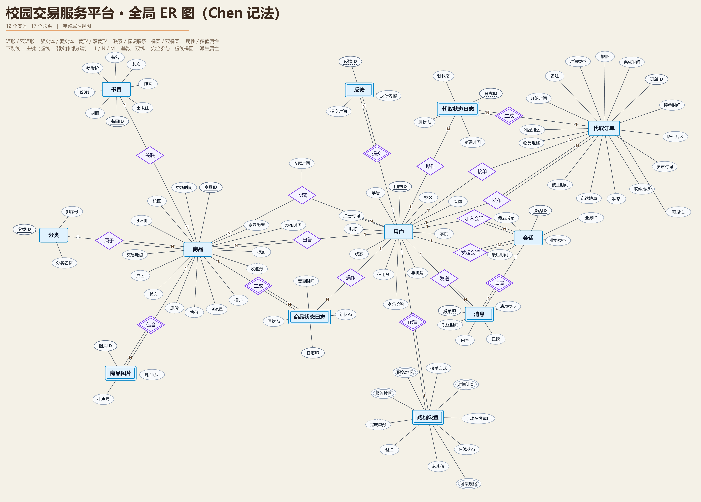
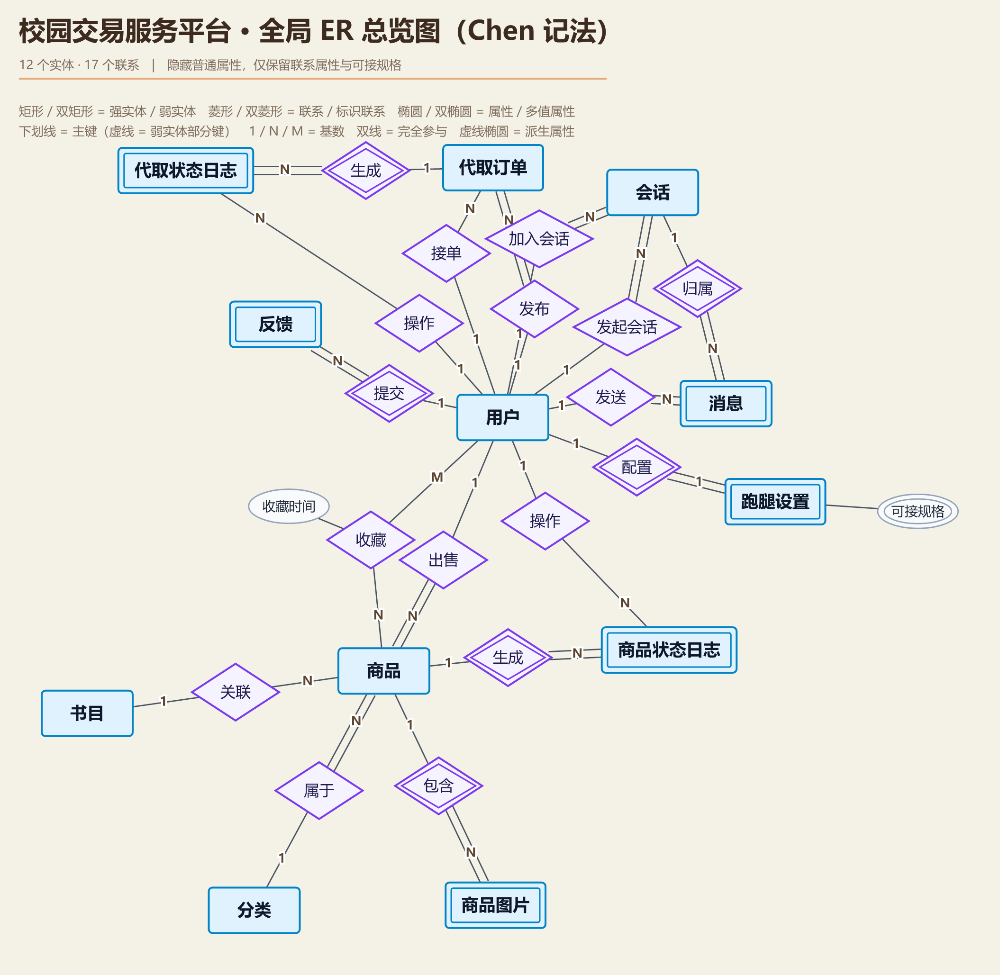

# 校园交易服务平台 · 14 张表设计详解（答辩学习版）

> 适用对象：成员 A
> 口径来源：`docs/课程设计开发计划.md` 第 3 章、`docs/A成员开发计划与Git协作手册.md` 第 5 章
> 说明：本文是“学习 + 答辩”版，字段类型是建表基线；最终以 `database/schema.sql` 为准。表、主键、外键和表之间的关系不会变。

### 怎么读这份文档

- **第一遍（建立全局）**：读第 0、1、2、9 章，知道 14 张表分四条主线，会看 Chen 记法 ER 图，每张表一句话。
- **第二遍（逐表理解）**：读 3.1～3.14，重点看每张表的“作用、主键、外键、为什么这样设计”。
- **第三遍（串起来）**：读第 4、5、6 章，理解发布、收藏、接单、聊天的跨表流程，以及 3NF 和冗余。
- **答辩前**：背第 7 章的问答和第 9 章的口述稿；建表时再看附录 A 的 DDL。

---

## 0. 先看懂 8 个词

如果只看一句话，请先记住下面这张表。后面所有内容都是围绕这些词展开的。

| 概念 | 一句话解释 | 在本项目中的例子 |
| --- | --- | --- |
| 表（table） | 一类数据的集合，像 Excel 的一张 sheet | `users` 存用户，`items` 存商品 |
| 行（row） | 表里的一条记录 | 一个用户、一个商品、一条消息 |
| 列（column） | 记录的一个属性 | `nickname`、`price`、`status` |
| 主键（Primary Key） | 这一行唯一的“身份证号”，不能重复、不能为空 | `users.user_id`、`items.item_id` |
| 外键（Foreign Key） | 这一列的值必须来自另一张表的主键，用来保证“引用的人/商品真的存在” | `items.seller_id → users.user_id` |
| 唯一键（Unique Key） | 这一列（或几列组合）不能重复，但可以有空值 | `users.student_no`、`books.isbn` |
| 索引（Index） | 像书的目录，加快按某列查找；但会占空间、拖慢写入 | `items(status, created_at)` |
| 约束（Constraint） | 给列定的规矩：不能空、不能为负、只能是某几个值 | `NOT NULL`、`CHECK`、`ENUM` |

### 0.1 主键、外键、唯一键的区别

用学校举例：

- **主键** = 身份证号：每个人唯一，不能没有。
- **唯一键** = 学号：也唯一，但身份证号才是数据库内部真正用来定位人的那个。
- **外键** = 在别的表里写“这个人的身份证号”：保证这个人真的存在。

在本项目里：

- `users.user_id` 是主键，数据库内部用它定位用户。
- `users.student_no` 是唯一键，登录时用学号，但外键引用用户时用 `user_id`。
- `items.seller_id` 是外键，指向 `users.user_id`，表示“这个商品是谁发布的”。

### 0.2 为什么主键用 `BIGINT AUTO_INCREMENT`

- `BIGINT` 能存很大的整数，避免以后用户/商品多了不够用。
- `AUTO_INCREMENT` 让 MySQL 自动生成 1、2、3……不用自己算。
- 用自增数字而不是学号/ISBN 做主键，是因为业务字段可能变化，而且字符串做主键占空间、索引更慢。
- 业务字段的唯一性用 `UNIQUE` 单独保证。

### 0.3 为什么金额用 `DECIMAL` 不用 `FLOAT`

`FLOAT` 是二进制浮点数，可能出现 `0.1 + 0.2 = 0.30000000000000004` 这种误差。金额必须精确，所以用 `DECIMAL(10,2)`：

- 总共 10 位数字；
- 小数点后 2 位；
- 最大可以存 `99,999,999.99`。

### 0.4 为什么用 `InnoDB` 和 `utf8mb4`

- `InnoDB` 支持事务、行锁、外键，代取接单的并发控制必须用它。
- `utf8mb4` 支持中文、emoji，不会出现乱码。
- `utf8mb4_0900_ai_ci` 是 MySQL 8 的默认排序规则，比较时不区分大小写和重音。

### 0.5 什么是 3NF（先有个印象）

- **1NF**：每列只放一个值，不能把多张图片、多个规格塞进一个字段。
- **2NF**：在复合主键的表里，非主键字段必须依赖整个主键，不能只依赖其中一部分。
- **3NF**：非主键字段不能通过另一个非主键字段“间接”依赖主键。

本项目的做法：

- 书目信息拆到 `books`，商品只存 `book_id`；
- 商品图片拆到 `item_images`；
- 跑腿设置拆到 `runner_profiles`；
- 可接规格拆到 `runner_item_sizes`；
- 状态变更拆到日志表。

后面第 5 章会详细解释。

---

## 1. 全局图景：14 张表分四条主线

### 1.1 四条主线

| 主线 | 包含的表 | 解决的问题 |
| --- | --- | --- |
| 用户与二手 | `users`、`books`、`categories`、`items`、`item_images`、`favorites`、`item_status_logs` | 谁在卖、卖什么、属于哪类、有哪些图、谁收藏了、状态怎么变 |
| 代取 | `runner_profiles`、`runner_item_sizes`、`errand_orders`、`errand_status_logs` | 谁可以接单、能接多大件、订单怎么发布/接单/完成、状态怎么变 |
| 聊天 | `conversations`、`messages` | 谁和谁、因为哪个商品/订单聊天、聊了什么、读没读 |
| 反馈 | `feedback` | 用户在帮助页提交的意见 |

数量核对：

```text
用户与二手 7 张
代取       4 张
聊天       2 张
反馈       1 张
合计      14 张
```

### 1.2 全局关系图



### 1.3 关系图怎么读

- `||--o{`：左边 1 条，对应右边 0 条或多条。例如一个用户可以发布 0 个或多个商品。
- `||--||`：一对一。例如一个用户最多有一条跑腿设置。
- `}o--o{`：多对多。本项目没有直接画多对多，而是用 `favorites` 这种“中间表”拆成两个一对多。

> 这里的 mermaid 是“表与外键”的简图，不是 Chen 概念图；正式的 Chen 记法 ER 图、弱实体和多值属性见第 2 章。

### 1.4 一句话总览

| # | 表 | 一句话作用 | 主键 | 关键外键 |
| --- | --- | --- | --- | --- |
| 1 | `users` | 用户账号与资料 | `user_id` | 无 |
| 2 | `books` | 书目库，供书籍卡片和联想 | `book_id` | 无 |
| 3 | `categories` | 二手分类 | `category_id` | 无 |
| 4 | `items` | 商品主表 | `item_id` | `seller_id → users`、`category_id → categories`、`book_id → books` |
| 5 | `item_images` | 商品图片 | `image_id` | `item_id → items` |
| 6 | `favorites` | 用户收藏商品 | `(user_id, item_id)` | `user_id → users`、`item_id → items` |
| 7 | `errand_orders` | 代取订单 | `order_id` | `publisher_id → users`、`runner_id → users` |
| 8 | `runner_profiles` | 跑腿接单设置 | `user_id` | `user_id → users` |
| 9 | `runner_item_sizes` | 跑腿可接规格 | `(user_id, item_size)` | `user_id → runner_profiles` |
| 10 | `conversations` | 会话 | `conversation_id` | `user_a_id/user_b_id → users` |
| 11 | `messages` | 消息 | `message_id` | `conversation_id → conversations`、`sender_id → users` |
| 12 | `item_status_logs` | 商品状态变更日志 | `log_id` | `item_id → items`、`changed_by → users` |
| 13 | `errand_status_logs` | 代取状态变更日志 | `log_id` | `order_id → errand_orders`、`changed_by → users` |
| 14 | `feedback` | 用户反馈 | `feedback_id` | `user_id → users` |

---

## 2. 概念模型：Chen 记法 ER 图（先学会看图）

> 这一章解决三个问题：
> 1. Chen 记法的每种图形是什么意思；
> 2. 我们项目的 5 张 ER 图分别画了什么、为什么这样画；
> 3. 图上的 12 个实体，怎么变成数据库里的 14 张表。
>
> 读这一章不需要会 SQL，只要会“顺着菱形读一句话”，就能看懂每张图。

### 2.1 先分清：ER 图不是表

盖房子先画户型图，再砌墙、走水电。数据库也一样：

- **ER 图（概念模型）**：回答“系统里有哪些对象、对象之间有什么关系”。它不写字段类型、不写索引，也不写 `CREATE TABLE`。
- **14 张表（逻辑模型 / 物理模型）**：把 ER 图翻译成 MySQL 能执行的建表语句。

因此，图上的东西不总和表一一对应：

- **收藏**在图上是一条菱形（M:N 联系），落到数据库才变成 `favorites` 表；
- **可接规格**在图上是一个双椭圆（多值属性），落到数据库才变成 `runner_item_sizes` 表。

这就是“图上 12 个实体、数据库 14 张表”的来源：12 个实体各对应一张表，再加“收藏”和“可接规格”这两张表，正好 14 张。2.8 节会把这笔账算清楚。

### 2.2 Chen 记法符号速查表

每张 ER 图的左上角都印了图例，下表是展开版。先认形状，再记含义。

| 图形 | 名称 | 一句话含义 | 本项目例子 |
| --- | --- | --- | --- |
| 矩形 | 强实体 | 能独立存在的一类对象 | 用户、商品、代取订单、会话 |
| 双矩形 | 弱实体 | 离开父对象就没有独立身份的对象 | 商品图片、消息、状态日志、反馈、跑腿设置 |
| 椭圆 | 属性 | 实体或联系的一个特征 | 昵称、售价、收藏时间 |
| 双椭圆 | 多值属性 | 同一个对象可以取多个值 | 服务片区、服务地标、时间计划、可接规格 |
| 虚线椭圆 | 派生属性 | 可以由别的数据算出来的属性 | 收藏数、完成单数 |
| 菱形 | 联系 | 两个实体之间的一次业务关系 | 出售、接单、收藏、发送 |
| 双菱形 | 标识联系 | 弱实体“靠谁”确定身份的联系 | 包含、生成、配置、归属、提交 |
| 实线下划线 | 主键 | 能唯一确定一条记录的属性 | 用户ID、商品ID、订单ID |
| 虚线下划线 | 部分键 | 弱实体自己的“半个身份证” | 图片ID、日志ID、消息ID、反馈ID |
| 线上的 1 / N / M | 基数 | 一端对应另一端几条记录 | 用户 1 — N 商品 |
| 双线 | 完全参与 | 这一端必须参加，不能为空 | 商品必须有卖家 |
| 单线 | 部分参与 | 这一端可以不参加 | 用户可以不发布商品 |

补充三个容易混淆的点：

- **1 和 N 不是“数量多少”，而是“对应几条”**。`用户 1 — N 商品` 的意思是：一个用户对应多个商品，但一个商品只对应一个用户。
- **M:N 一定需要中间表**。`用户 M — N 商品` 落到数据库，就是 `favorites` 表；两个外键组成复合主键。
- **双线画在哪一端，就说明哪一端“必须有”**。不是整条线都双线，要看清楚双线靠近哪个实体。

画完一张 Chen 图，可以用下面 7 条自检：

1. 实体用矩形、联系用菱形、属性用椭圆，三种形状不能混用；
2. 每个强实体至少有一个主键，主键写在属性椭圆里并加实线下划线；
3. 每条联系的两端都要标基数，`1`、`N`、`M` 写在对应实体那一端；
4. 弱实体用双矩形，标识联系用双菱形，弱实体的部分键用虚线下划线；
5. 多值属性用双椭圆，派生属性用虚线椭圆；
6. 完全参与用双线，部分参与用单线；
7. 外键不画成属性，用联系线表达。

### 2.3 三条读图规则（不会看图就先背这三条）

#### 规则一：基数标签靠近谁，就描述谁

以报告图 3-1 的这条线为例：

```text
用户 —1— 出售 —N— 商品
```

- `1` 靠近用户：一个用户是“1”；
- `N` 靠近商品：一个用户可以对应“N 个商品”。

读成：“一个用户可以出售多个商品。”

再从商品那端读：“一个商品只由一个用户出售。”

`N` 不表示“很多个”，只表示“可以有多条”。即使实际只有 0 条或 1 条，也仍然记作 N 端。

#### 规则二：双线靠近谁，谁就必须参加

- `商品 —出售— 用户` 的**商品端**是双线：每个商品必须有卖家；
- `用户 —出售— 商品` 的**用户端**是单线：一个用户可以不卖任何东西；
- `用户 —接单— 订单` 的**订单端**是单线：订单可以暂时没人接。

“必须参加”在数据库里通常对应非空外键；“可以不参加”对应可空外键，或者这一端根本没有外键。

#### 规则三：看到双矩形，就找双菱形和虚线下划线

以“商品图片”为例：

- 双矩形 = 弱实体；
- 连着的双菱形 = 标识联系 `包含`；
- `图片ID` 虚线下划线 = 部分键，单靠它不能定位，必须加上商品ID。

三件套合起来表示：图片不能独立存在，必须挂在商品下。

#### 一条完整的读图示范

以 `商品 1 — 包含 — N 商品图片` 为例，按顺序读五件事：

1. **实体**：商品是强实体（单矩形），商品图片是弱实体（双矩形）；
2. **基数**：一个商品对应多张图片，一张图片只属于一个商品；
3. **参与**：图片端双线，说明图片必须属于一个商品；商品端单线，说明商品可以没有图片；
4. **键**：图片ID 是部分键，加上商品ID 才能唯一确定一张图片；
5. **落表**：`item_images(item_id, url, sort_no)`，`item_id` 是外键，`ON DELETE CASCADE`。

以后看任何一条联系，都可以套这五步。

### 2.4 我们项目的画图约定（为什么图长这样）

这一节解释“图上为什么没有外键”“为什么有的实体是双框”“为什么收藏数用虚线”等问题。答辩时被问“你这张图为什么这么画”，答案主要在这里。

**1. 只画主键，不画外键属性。**

商品表里有 `seller_id`、`category_id`、`book_id`，但商品椭圆里没有这三个属性。因为它们表达的是“关系”，图上已经用 `出售`、`属于`、`关联` 三条线画出来了。外键是落表后的实现细节；概念图里用联系代替外键，图才不会被字段线淹没。

答辩说法：“ER 图表达语义，外键是物理实现；概念图里用联系线表达外键。”

**2. 主键实线下划线，弱实体部分键虚线下划线。**

强实体的主键（用户ID、商品ID、订单ID）是实线下划线；弱实体的部分键（图片ID、日志ID、消息ID、反馈ID）是虚线下划线。虚线表示：单靠它不能唯一确定一条记录，必须加上父实体的主键。

**3. 弱实体按“语义依赖”判定，不按“有没有自增 ID”判定。**

实际建表时，`item_images`、`messages`、`item_status_logs`、`errand_status_logs`、`feedback` 都用了自增主键，看起来不像“弱”。但概念图上仍然画成弱实体，因为它们离开父对象就没有业务意义。概念模型表达“语义”，物理表可以选择“自增代理键 + 外键”的实现方式。

答辩时不要说“有自增主键所以不是弱实体”，要说“概念上依附，物理上用代理键实现”。

**4. 多值属性用双椭圆。**

跑腿设置里的服务片区、服务地标、时间计划、可接规格，一个跑腿可以填多个值，所以画双椭圆。落表有两种做法：可接规格拆成 `runner_item_sizes` 子表；其余三个用 JSON 数组存（`service_areas`、`service_places`、`time_slots`）。严格 1NF 会把它们都拆成子表，但会超过 14 张表的口径；为什么可以接受 JSON，见第 5 章 5.5。

**5. 派生属性用虚线椭圆。**

收藏数 = 该商品被多少人收藏；完成单数 = 该跑腿完成多少单。它们都能由别的表算出来，所以画虚线椭圆。数据库里 `items.favorite_count`、`runner_profiles.completed_count` 是为了列表页性能缓存的冗余列，由触发器/存储过程维护；原始数据仍然在 `favorites` 和 `errand_orders` 里。会话的“最后消息/最后时间”也是同类冗余，但它们是“带内容的缓存快照”，不是简单计数，所以按普通属性画，见第 5 章 5.4。

**6. 联系属性只画真正属于“关系”的属性。**

收藏时间不属于用户，也不属于商品，而是“这次收藏”的属性，所以挂在 `收藏` 菱形上。日志的变更时间没有挂在 `生成` 菱形上，因为日志本身是弱实体，变更时间是日志自己的属性；图上选择了“日志实体携带时间”的画法，和表结构一致。

**7. 日志用两条二元联系，不用一个三元联系。**

一次状态变更同时涉及“商品/订单、用户、日志”三方，画成三元联系也说得通。但我们把它拆成 `商品—生成—日志` 和 `用户—操作—日志` 两条二元联系，原因有两个：

- 日志表的 `item_id`/`order_id` 是 `NOT NULL`，而 `changed_by` 允许为空（定时任务、系统触发器、用户注销后 `SET NULL`），三元联系不方便表达“操作者可以为空”；
- 两条二元联系正好对应日志表的两个外键，落表更直接。

因此 `用户—操作—日志` 的用户端是单线（部分参与），不是双线。

**8. 二人会话用两条 1:N，而不是一条 M:N。**

会话表用 `user_a_id`、`user_b_id` 两个外键存两个参与者。如果画成 `用户 M—参与—N 会话`，落表就需要一张“会话参与者”中间表，会变成 15 张表。现在用 `发起会话`（发起者）和 `加入会话`（加入者）两条 1:N，合起来仍然表示“一个会话正好两个人”，而且直接对应会话表的两个外键。两条线的会话端都是双线，表示每个会话必须同时有发起者和加入者。图上的“发起/加入”只是概念角色，物理表不保存谁发起、谁加入；`user_a_id`、`user_b_id` 按用户 ID 大小归一化，只表示两个参与者。

**9. 多态引用不画成外键或联系。**

会话表的 `biz_id` 可能指向商品，也可能指向代取订单，取决于 `biz_type`。MySQL 的外键只能指向一张表，所以 `biz_id` 没有外键，Chen 图上也不画“会话—商品/订单”的联系。查询业务卡片时由后端按 `biz_type` 再查一次；业务被删除时返回空摘要，不影响聊天。这是“为什么没有外键”的标准答案。

**10. 局部图 + 全局图 + 总览图分工。**

局部图按三条业务主线拆开，每张 4～6 个实体，保证在 A4 纸上能看清；全局图把 12 个实体、17 条联系放在一起，回答“整个系统怎么连”；总览图隐藏普通属性，只留联系属性和可接规格，用于 PPT 和答辩开场。三张局部图的实体数是 6 + 4 + 4 = 14，但去重后是 12，因为“用户”在三张图里都出现了一次。

---

### 2.5 报告图 3-1：二手交易局部 ER 图



*报告图 3-1：6 个实体、7 条联系，覆盖用户、商品、收藏和商品状态日志。*

#### 图上有什么

| 实体 | 类型 | 一句话说明 | 主键 / 部分键 |
| --- | --- | --- | --- |
| 用户 | 强实体 | 买家、卖家、跑腿共用一张账号表 | 用户ID（实线下划线） |
| 书目 | 强实体 | 书的公共信息，供同书多卖复用 | 书目ID（实线下划线） |
| 分类 | 强实体 | 二手分类，如教材、数码、生活用品 | 分类ID（实线下划线） |
| 商品 | 强实体 | 一次具体的二手交易 | 商品ID（实线下划线） |
| 商品图片 | 弱实体（双矩形） | 商品的图片，业务上限 3 张 | 图片ID（虚线下划线，部分键） |
| 商品状态日志 | 弱实体（双矩形） | 商品每次状态变化写一条 | 日志ID（虚线下划线，部分键） |

#### 7 条联系逐条读

| 联系（菱形） | 两端 | 基数 | 读成一句话 | 设计理由 |
| --- | --- | --- | --- | --- |
| 关联 | 书目 — 商品 | 1:N | 一本书目可以被多个商品关联；一个商品最多关联一本书 | 普通物品可以不关联书，商品端是单线，`book_id` 可空 |
| 属于 | 分类 — 商品 | 1:N | 一个分类下有多个商品；一个商品必须选一个分类 | 商品端双线：发布接口强制选分类；数据库列可空只是兜底 |
| 出售 | 用户 — 商品 | 1:N | 一个用户可以发布多个商品；一个商品只有一个卖家 | 商品端双线：`seller_id NOT NULL`；用户端单线：可以不卖 |
| 收藏 | 用户 — 商品 | M:N | 一个用户收藏多个商品；一个商品可被多个用户收藏 | 全项目唯一 M:N；收藏时间挂在菱形上；落表为 `favorites` |
| 包含 | 商品 — 商品图片 | 1:N | 一个商品包含多张图片；一张图片只属于一个商品 | 弱实体三件套：双矩形 + 双菱形 + 图片端双线 |
| 生成 | 商品 — 商品状态日志 | 1:N | 一个商品生成多条日志；一条日志只属于一个商品 | 弱实体三件套；日志端双线 |
| 操作 | 用户 — 商品状态日志 | 1:N | 一个用户操作多条日志；一条日志最多一个操作者 | 用户端单线：`changed_by` 可空，删号后 `SET NULL` |

#### 图上的特殊符号

- **双矩形**：商品图片、商品状态日志；
- **虚线下划线**：图片ID、日志ID；
- **双菱形**：包含、生成；
- **双线**：商品端（出售、属于）、图片端（包含）、日志端（生成）；
- **虚线椭圆**：收藏数（派生属性）；
- **双椭圆**：本图没有，二手主线的属性都是单值。

#### 为什么这样画

- **为什么书目要单独一张表**：同一本书（书名、作者、出版社、ISBN）可以被多个卖家发布；如果每条商品都重复存书名作者，既冗余又容易不一致，所以拆成书目，商品只存 `book_id`。这是 3NF。
- **为什么分类要单独一张表**：分类名称只存一次，改分类名不用改所有商品；商品只存 `category_id`。
- **为什么收藏不画成实体**：收藏没有自己的身份，身份就是“谁 + 哪个商品”；收藏时间属于这次关系。落到数据库才变成 `favorites` 中间表，复合主键 `(user_id, item_id)`。
- **为什么图片和日志是弱实体**：离开商品就没有意义；父商品删除时级联删除（`ON DELETE CASCADE`）。
- **为什么商品端在“属于”上画双线**：业务上每个商品发布时必须选分类（发布接口强制 `categoryId`）；数据库列允许 `NULL` 只是给“分类被删除时 `SET NULL`”留余地，不代表业务可以不分分类。
- **为什么商品端在“关联”上是单线**：普通物品（如台灯、球拍）可以不关联书目，只有二手书才需要 `book_id`。
- **为什么收藏数用虚线椭圆**：它等于 `COUNT(favorites)`，是算出来的；表里的 `favorite_count` 是缓存冗余，不是原始数据。
- **为什么用户端在“出售”上是单线**：用户可以只买不卖，所以不是每个用户都必须出现在“出售”联系里。

#### 答辩一句话

> 二手主线是：用户出售商品，商品属于分类、可关联书目、包含多张图片、可被多个用户收藏，每次状态变化生成一条日志；图片和日志是弱实体，收藏是多对多联系。

### 2.6 报告图 3-2：跑腿代取局部 ER 图



*报告图 3-2：4 个实体、5 条联系，覆盖跑腿设置、代取订单和代取状态日志。*

#### 图上有什么

| 实体 | 类型 | 一句话说明 | 主键 / 部分键 |
| --- | --- | --- | --- |
| 用户 | 强实体 | 发布者、跑腿共用一张账号表 | 用户ID（实线下划线） |
| 跑腿设置 | 弱实体（双矩形） | 一个用户最多一条接单配置 | 无独立主键，靠用户ID 以 1:1 标识 |
| 代取订单 | 强实体 | 一次代取需求 | 订单ID（实线下划线） |
| 代取状态日志 | 弱实体（双矩形） | 订单每次状态变化写一条 | 日志ID（虚线下划线，部分键） |

#### 5 条联系逐条读

| 联系（菱形） | 两端 | 基数 | 读成一句话 | 设计理由 |
| --- | --- | --- | --- | --- |
| 配置 | 用户 — 跑腿设置 | 1:1 | 一个用户最多一条跑腿设置；一条设置只属于一个用户 | 弱实体；设置端双线；`runner_profiles.user_id` 既是主键又是外键 |
| 发布 | 用户 — 代取订单 | 1:N | 一个用户可以发布多单；每单只有一个发布者 | 订单端双线：`publisher_id NOT NULL` |
| 接单 | 用户 — 代取订单 | 1:N | 一个跑腿可以接多单；每单最多一个接单者 | 订单端单线：可以还没人接（`runner_id NULL`） |
| 生成 | 代取订单 — 代取状态日志 | 1:N | 一单生成多条日志；一条日志只属于一单 | 弱实体三件套；日志端双线 |
| 操作 | 用户 — 代取状态日志 | 1:N | 一个用户操作多条日志；一条日志最多一个操作者 | 用户端单线：`changed_by` 可空 |

#### 图上的特殊符号

- **双矩形**：跑腿设置、代取状态日志；
- **虚线下划线**：日志ID（跑腿设置没有部分键，因为它靠用户ID 以 1:1 标识）；
- **双菱形**：配置、生成；
- **双线**：跑腿设置端（配置）、订单端（发布）、日志端（生成）；
- **双椭圆**：服务片区、服务地标、时间计划、可接规格；
- **虚线椭圆**：完成单数（派生属性）。

#### 为什么这样画

- **为什么跑腿设置是弱实体**：设置没有独立的业务身份，主键就是 `user_id`；用户删除，设置级联删除。它和用户是 1:1，所以没有自己的部分键。
- **为什么代取订单是强实体**：订单有自己的 `order_id`，是独立业务对象；发布者账号被禁用后，历史订单仍然存在，数据库也不允许直接删除还有订单的用户（`publisher_id` 外键 `ON DELETE RESTRICT`）。强/弱看“有没有独立身份”，不看“是否依赖别人”。
- **为什么可接规格是双椭圆、又单独变成一张表**：一个跑腿可以接小、中、大件中的多个，所以是多值属性；接单匹配要按规格过滤，拆成 `runner_item_sizes` 子表更好查，复合主键 `(user_id, item_size)`。服务片区、服务地标、时间计划也是多值，但它们总是整份设置一起读写，用 JSON 数组更省表，见第 5 章 5.5。
- **为什么“接单”的订单端是单线**：订单发布后可以一直没人接，`runner_id` 允许 `NULL`；只有被接单后，这条联系才真正建立。
- **为什么“发布”的订单端是双线**：每个订单必须有发布者，`publisher_id NOT NULL`。
- **为什么完成单数用虚线椭圆**：它等于该跑腿 `completed` 订单的数量；表里的 `completed_count` 是完成订单时由存储过程维护的缓存列。
- **为什么订单要画时间类型、开始时间、截止时间三个属性**：对应 `asap`、`deadline`、`range` 三种时间要求；三列之间“哪种组合合法”由表里的 `CHECK` 约束保证，图上不画 `CHECK`。
- **为什么订单要画“可见性”属性**：对应 `visibility`，区分私单（`private`）和已发布到大厅（`hall`）。它与 `status` 正交：私单转大厅只改可见性，状态仍是 `pending`，不新增第五个状态。

#### 答辩一句话

> 代取主线是：用户配置跑腿设置（服务片区、地标、时间计划、可接规格），发布代取订单，跑腿接单；订单每次状态变化生成日志。跑腿设置是 1:1 弱实体，订单是强实体，接单者可以为空。

### 2.7 报告图 3-3：会话与反馈局部 ER 图



*报告图 3-3：4 个实体、5 条联系，覆盖会话、消息和反馈。*

#### 图上有什么

| 实体 | 类型 | 一句话说明 | 主键 / 部分键 |
| --- | --- | --- | --- |
| 用户 | 强实体 | 会话参与者、消息发送者、反馈提交者 | 用户ID（实线下划线） |
| 会话 | 强实体 | 两个人围绕一个商品或订单的聊天 | 会话ID（实线下划线） |
| 消息 | 弱实体（双矩形） | 会话里的一条消息 | 消息ID（虚线下划线，部分键） |
| 反馈 | 弱实体（双矩形） | 用户提交的一条意见 | 反馈ID（虚线下划线，部分键） |

#### 5 条联系逐条读

| 联系（菱形） | 两端 | 基数 | 读成一句话 | 设计理由 |
| --- | --- | --- | --- | --- |
| 发起会话 | 用户 — 会话 | 1:N | 一个用户可以发起多个会话；一个会话只有一个发起者 | 会话端双线；逻辑上的发起方；物理列 `user_a_id` 只是较小的用户 ID |
| 加入会话 | 用户 — 会话 | 1:N | 一个用户可以加入多个会话；一个会话只有一个加入者 | 会话端双线；逻辑上的加入方；物理列 `user_b_id` 只是较大的用户 ID |
| 归属 | 会话 — 消息 | 1:N | 一个会话包含多条消息；一条消息只属于一个会话 | 弱实体三件套；消息端双线 |
| 发送 | 用户 — 消息 | 1:N | 一个用户发送多条消息；一条消息只有一个发送者 | 消息端双线：`sender_id NOT NULL` |
| 提交 | 用户 — 反馈 | 1:N | 一个用户提交多条反馈；一条反馈只属于一个用户 | 弱实体三件套；反馈端双线 |

#### 图上的特殊符号

- **双矩形**：消息、反馈；
- **虚线下划线**：消息ID、反馈ID；
- **双菱形**：归属、提交；
- **双线**：会话端（发起会话、加入会话）、消息端（归属、发送）、反馈端（提交）；
- **双椭圆 / 虚线椭圆**：本图没有，会话和反馈的属性都是单值。

#### 为什么这样画

- **为什么会话是强实体**：会话有自己的 `conversation_id`；即使关联的商品或订单被删除，会话仍然保留（`biz_id` 不是外键），所以它是独立实体。
- **为什么用“发起会话 + 加入会话”两条 1:N，而不是一条 M:N**：这是二人会话，会话表用 `user_a_id`、`user_b_id` 两个外键存两个参与者。两条 1:N 分别对应“发起者”和“加入者”，落表最直接；如果画 M:N，就要多一张“会话参与者”表，变成 15 张表。两条线的会话端都是双线：每个会话必须同时有发起者和加入者。注意这只是概念角色，物理上两列按用户 ID 大小排序，不记录谁先发起。
- **为什么消息是弱实体**：消息离开会话没有意义；`conversation_id` 外键 `ON DELETE CASCADE`，删会话就删消息。消息ID 是部分键，物理表用自增 `message_id` 实现。
- **为什么反馈是弱实体**：反馈必须由用户提交，离开用户没有意义；`user_id` 外键 `ON DELETE CASCADE`。反馈ID 是部分键，物理表用自增 `feedback_id` 实现。
- **为什么消息端在“发送”上画双线**：每条消息必须有发送者，`sender_id NOT NULL`；用户端单线，表示用户可以不发消息。
- **为什么 `biz_id` 不画成外键或联系**：它可能指向商品，也可能指向代取订单，是“多态引用”，MySQL 外键只能指向一张表。会话和商品、订单之间因此没有画联系；聊天页顶部卡片由后端按 `biz_type` 再查。
- **为什么“最后消息、最后时间”是会话的属性**：会话列表要显示最后一条消息和时间；它们从 `messages` 汇总而来，但为了列表性能冗余存一份，见第 5 章 5.4。

#### 答辩一句话

> 聊天主线是：用户发起或加入会话，会话包含多条消息，消息记录发送者和已读状态；反馈由用户提交。消息和反馈都是弱实体，会话的两个参与者用两条 1:N 联系表达。

---

### 2.8 报告图 3-4：全局 ER 图与总览图



*报告图 3-4：12 个实体、17 条联系，完整属性视图，是报告第 3 章的主 ER 图。*



*报告图 3-4 总览图：隐藏普通属性，只保留联系属性和可接规格，适合 PPT 和答辩开场。*

#### 两张图有什么区别

- **完整全局图**：12 个实体、全部属性、17 条联系。用来回答“系统里到底有哪些东西、每个东西有哪些字段、彼此怎么连”。
- **总览图**：隐藏普通属性，只留“收藏时间”和“可接规格”（以及实体和联系）。为什么留这两个？收藏时间是全项目唯一的联系属性；可接规格是唯一“多值属性变成表”的例子，正好用来说明 12 个实体怎么变 14 张表。
- 局部图与全局图不是重复：局部图把跨主线的线剪掉，方便看清细节；全局图把“用户”合并成一个，方便看整体。三张局部图的实体数相加是 14，去重“用户”后是 12。

#### 17 条联系总表

| # | 联系 | 两端实体 | 基数 | 类型 | 对应表 / 外键 |
| --- | --- | --- | --- | --- | --- |
| 1 | 关联 | 书目 — 商品 | 1:N | 普通联系 | `items.book_id` |
| 2 | 属于 | 分类 — 商品 | 1:N | 普通联系 | `items.category_id` |
| 3 | 出售 | 用户 — 商品 | 1:N | 普通联系 | `items.seller_id` |
| 4 | 收藏 | 用户 — 商品 | M:N | 普通联系 | `favorites(user_id, item_id)` |
| 5 | 包含 | 商品 — 商品图片 | 1:N | 标识联系 | `item_images.item_id` |
| 6 | 生成 | 商品 — 商品状态日志 | 1:N | 标识联系 | `item_status_logs.item_id` |
| 7 | 操作 | 用户 — 商品状态日志 | 1:N | 普通联系 | `item_status_logs.changed_by` |
| 8 | 配置 | 用户 — 跑腿设置 | 1:1 | 标识联系 | `runner_profiles.user_id` |
| 9 | 发布 | 用户 — 代取订单 | 1:N | 普通联系 | `errand_orders.publisher_id` |
| 10 | 接单 | 用户 — 代取订单 | 1:N | 普通联系 | `errand_orders.runner_id` |
| 11 | 生成 | 代取订单 — 代取状态日志 | 1:N | 标识联系 | `errand_status_logs.order_id` |
| 12 | 操作 | 用户 — 代取状态日志 | 1:N | 普通联系 | `errand_status_logs.changed_by` |
| 13 | 发起会话 | 用户 — 会话 | 1:N | 普通联系 | `conversations.user_a_id` |
| 14 | 加入会话 | 用户 — 会话 | 1:N | 普通联系 | `conversations.user_b_id` |
| 15 | 归属 | 会话 — 消息 | 1:N | 标识联系 | `messages.conversation_id` |
| 16 | 发送 | 用户 — 消息 | 1:N | 普通联系 | `messages.sender_id` |
| 17 | 提交 | 用户 — 反馈 | 1:N | 标识联系 | `feedback.user_id` |

这张表建议和全局图对照看：图上的每条菱形，都能在表里找到一行。反过来，表里的外键基本都能在图上找到对应的联系；唯一的例外是 `runner_item_sizes.user_id`，它是“可接规格”这个多值属性落表后产生的外键，图上没有单独画一条联系。

#### 数量核对（答辩可以主动说）

```text
强实体 6 个：用户、书目、分类、商品、代取订单、会话
弱实体 6 个：商品图片、商品状态日志、跑腿设置、代取状态日志、消息、反馈
实体合计 12 个

联系 17 条：局部图 7 + 5 + 5 = 17
标识联系 6 条：包含、生成（商品）、配置、生成（代取）、归属、提交
M:N 联系 1 条：收藏
多值属性 4 个：服务片区、服务地标、时间计划、可接规格
派生属性 2 个：收藏数、完成单数
```

记不住就用下面这句口诀：

> **12 实体、17 联系、6 弱实体；收藏变表、规格变表，12 + 2 = 14。**

#### 为什么局部图加起来是 14 个实体，全局图只有 12 个

因为“用户”在二手、代取、聊天三张局部图里各出现一次：6 + 4 + 4 = 14，减去重复的 2 个“用户”，就是 12 个不同的实体。局部图为了让每张图都能独立看懂，必须把“用户”画进去；全局图只画一次。

#### 和 1.2 的 mermaid 图有什么区别

1.2 的 mermaid 是“表与外键”的简图，不是 Chen 概念图，所以数量不同是正常的。mermaid 一共 16 行联系，差异如下：

- mermaid 把收藏的两个外键画成两条线，Chen 图合并成一条 M:N 菱形（-1）；
- mermaid 没有画日志的 `changed_by` 外键，Chen 图画出“用户—操作—日志”（+2）；
- mermaid 把会话参与者画成一条线，Chen 图拆成“发起、加入”两条（+1）；
- mermaid 把可接规格画成一个实体，Chen 图把它当多值属性（-1）。

所以 16 - 1 + 2 + 1 - 1 = 17 条联系。答辩时以本章的 Chen 图为准；mermaid 只用来快速看表之间的关系。

#### 12 个实体怎么变成 14 张表

| ER 图上的对象 | 类别 | 落地表 | 关键说明 |
| --- | --- | --- | --- |
| 用户 | 强实体 | `users` | 主键 `user_id` |
| 书目 | 强实体 | `books` | 主键 `book_id` |
| 分类 | 强实体 | `categories` | 主键 `category_id` |
| 商品 | 强实体 | `items` | 三个外键来自关联、属于、出售 |
| 商品图片 | 弱实体 | `item_images` | `item_id` 外键；图片ID 部分键 → `image_id` 自增 |
| 商品状态日志 | 弱实体 | `item_status_logs` | `item_id` 外键；`changed_by` 来自“操作”联系 |
| 跑腿设置 | 弱实体 | `runner_profiles` | `user_id` 外键兼主键 |
| 可接规格（多值属性） | 多值属性 | `runner_item_sizes` | 复合主键 `(user_id, item_size)` |
| 代取订单 | 强实体 | `errand_orders` | `publisher_id`、`runner_id` 来自“发布、接单” |
| 代取状态日志 | 弱实体 | `errand_status_logs` | `order_id` 外键 |
| 会话 | 强实体 | `conversations` | `user_a_id`、`user_b_id` 来自“发起、加入” |
| 消息 | 弱实体 | `messages` | `conversation_id`、`sender_id` 两个外键 |
| 反馈 | 弱实体 | `feedback` | `user_id` 外键 |
| 收藏（M:N 联系） | 联系 | `favorites` | 复合主键 `(user_id, item_id)`；收藏时间 → `created_at` |

数一遍：12 个实体对应 12 张表，加上“收藏”和“可接规格”这 2 张，正好 14 张。

#### 从 ER 图到表的 8 条映射规则

1. **强实体 → 一张表**，主键照搬；例如用户 → `users`。
2. **1:N 联系 → 把 1 端主键放到 N 端做外键**；例如“用户 1 — N 商品”变成 `items.seller_id`。
3. **1:1 联系 → 一方主键放到另一方做外键并加唯一约束**；本项目直接让 `runner_profiles.user_id` 既是主键又是外键。
4. **M:N 联系 → 单独一张中间表**，两个外键组成复合主键；例如收藏 → `favorites`。
5. **多值属性 → 单独子表或 JSON 数组**；可接规格 → `runner_item_sizes`，服务片区等 → JSON 列。
6. **弱实体 → 概念上用“父键 + 部分键”定位**；物理上可以用自增代理键 + 父键外键，本项目 `item_images`、`messages`、两张日志表、`feedback` 都这样做；`runner_profiles` 是例外，它直接把父键 `user_id` 当主键。
7. **派生属性 → 不建列，查询时算**；本项目为了性能把 `favorite_count`、`completed_count` 做成缓存列，属于有意冗余。
8. **联系属性 → 放进联系对应的表**；收藏时间 → `favorites.created_at`。

#### 两个具体例子：联系线怎么变成外键

**例 1：商品表的三个外键。**

```text
用户 1 —出售— N 商品   →  items.seller_id
分类 1 —属于— N 商品   →  items.category_id
书目 1 —关联— N 商品   →  items.book_id
```

三条联系都是 1:N，所以都把“1 端”的主键放到“N 端”的商品表里。商品端在“出售、属于”上是双线，所以 `seller_id` 非空、发布时 `categoryId` 必填；商品端在“关联”上是单线，所以 `book_id` 可空。

**例 2：日志表的两个外键和删除动作。**

```text
商品 1 —生成— N 商品状态日志   →  item_status_logs.item_id（非空，ON DELETE CASCADE）
用户 1 —操作— N 商品状态日志   →  item_status_logs.changed_by（可空，ON DELETE SET NULL）
```

“生成”是标识联系，日志是弱实体：商品删除，日志没有存在意义，所以级联删除。“操作”的用户端是单线（部分参与）：操作者可以没有，用户注销后把 `changed_by` 置空，日志仍然保留。

#### 为什么收藏和可接规格不在 12 个实体里

- **收藏是 M:N 联系，不是实体**：收藏没有独立身份，它的身份就是“谁收藏了哪个商品”；它唯一的属性“收藏时间”挂在菱形上。落到数据库才变成 `favorites` 中间表。
- **可接规格是多值属性，不是实体**：一个跑腿可以接多个规格，所以画在跑腿设置的双椭圆里。落到数据库才变成 `runner_item_sizes` 子表。

所以“12 实体 + 2 张由联系、多值属性变来的表 = 14 张表”。

### 2.9 为什么这样画：整体设计取舍

- **为什么用 Chen 记法**：教材和课程答辩都用这套符号，老师最熟悉；它能画出弱实体、多值属性、派生属性这些概念，正好覆盖本项目的情况。Crow's Foot 更适合画“表和键”，讲概念模型时不如 Chen 直观。
- **为什么拆成三张局部图 + 一张全局图 + 一张总览图**：全局图 12 个实体、17 条联系，直接塞进一页 A4 会看不清；三张局部图每张 4～6 个实体，分别对应二手、代取、聊天三条主线，报告里可以逐张讲；全局图负责总览；总览图负责 PPT。
- **为什么概念图不按 14 张表画**：概念模型不是表的照搬。收藏提升为 M:N 联系、可接规格压缩成多值属性，图更简洁；落表时再用 2.8 的映射规则展开成 14 张表。这正是概念模型的价值。
- **为什么弱实体多**：图片、日志、消息、反馈、跑腿设置都是“依附型数据”，用弱实体能准确表达“父对象没了，它们也没有意义”，并且和表里的 `ON DELETE CASCADE` 对应。
- **为什么校区字段画在图上但业务不用**：`users.campus`、`items.campus` 是预留字段，MVP 只在北碚校区试点，注册和发布都不采集，保持 `NULL`；它们只是普通属性，不参与任何联系，所以不影响图的结构。答辩时说明“预留、可空、当前不采集”即可。

### 2.10 答辩怎么讲（1 分钟稿 + 追问）

#### 1 分钟口述稿

> 我们的概念模型采用 Chen 记法，共 12 个实体、17 条联系，其中 6 个弱实体、1 个多对多联系。二手主线是用户出售商品，商品属于分类、可关联书目、包含图片、被收藏、状态写日志；代取主线是用户配置跑腿设置、发布订单、跑腿接单，订单状态写日志；聊天主线是用户发起或加入会话，会话包含消息；反馈由用户提交。ER 图不是 14 张表的照搬：收藏是 M:N 联系，可接规格是多值属性，落到逻辑模型才变成 `favorites` 和 `runner_item_sizes` 两张表，所以 12 个实体最终映射成 14 张表。日志采用“对象—生成—日志”和“用户—操作—日志”两条二元联系，因为操作者 `changed_by` 允许为空。

#### 常见追问

| 老师可能问 | 怎么答 |
| --- | --- |
| 为什么收藏不画成实体？ | 收藏没有独立身份，身份是“谁收藏了哪个商品”；它是 M:N 联系，收藏时间挂在菱形上；落表才是 `favorites`。 |
| 为什么消息、日志、反馈是弱实体？ | 离开父对象无法独立定位；双矩形、双菱形、虚线下划线三件套；父对象删除时级联删除。 |
| 为什么 12 个实体是 14 张表？ | 12 个实体各一张，加上“收藏”和“可接规格”两张，12 + 2 = 14。 |
| 为什么用户和代取订单之间有两条联系？ | 发布者和接单者是两种角色；落表是 `publisher_id` 和 `runner_id` 两个外键。 |
| 为什么日志是两条二元联系，不是一个三元联系？ | `changed_by` 可空；两条二元联系正好对应两个外键，落表更直接。 |
| 为什么会话是两条 1:N，不是 M:N？ | 二人会话，`user_a_id`、`user_b_id` 两个外键；M:N 会多一张参与者表，超过 14 张。 |
| 双线是什么意思？ | 完全参与；商品必须有卖家、消息必须有会话和发送者、日志必须属于对象；用户侧单线表示可选。 |
| 为什么 `biz_id` 没有外键？ | 多态引用，可能指向商品或订单；MySQL 外键只能指向一张表。 |

### 2.11 30 秒自测

| 问题 | 答案 |
| --- | --- |
| `用户 —1— 出售 —N— 商品` 怎么读？ | 一个用户可以出售多个商品；一个商品只有一个卖家。 |
| 双矩形、双菱形、虚线下划线分别表示什么？ | 弱实体、标识联系、弱实体的部分键。 |
| 为什么收藏没有画成矩形实体？ | 收藏是 M:N 联系，没有独立身份；落表才是 `favorites` 中间表。 |
| 为什么 12 个实体能变成 14 张表？ | 12 个实体各一张，加上“收藏”和“可接规格”两张。 |
| 为什么 `用户—操作—日志` 的用户端是单线？ | `changed_by` 可空，操作者可以没有；删号后 `SET NULL`。 |
| 为什么会话用两条 1:N 而不是一条 M:N？ | 二人会话只有两个参与者，分别对应 `user_a_id`、`user_b_id`；M:N 会多一张表。 |

#### 图片文件在哪

- 成品 PNG：`report/assets/ch3/fig3-1_local-er-user-item.png`、`fig3-2_local-er-runner-errand.png`、`fig3-3_local-er-chat-feedback.png`、`fig3-4_global-er.png`、`fig3-4_global-er-overview.png`；
- SVG 源：`report/assets/source/` 下的同名 `.svg` 文件；
- 报告排版时直接引用这些图，不要改名、不要重复导出；确需改图，先改 SVG 源再重新导出 PNG。

---

## 3. 逐表详解
> 下面每张表都按“作用 → 字段 → 主键/外键/索引 → 为什么这样设计 → 答辩一句话”的顺序讲。
> 字段类型是建议基线，最终以 `database/schema.sql` 为准。

### 3.1 `users`：用户表
#### 作用

存所有用户的基本账号信息。登录、个人中心、信用分、账号禁用都靠它。

#### 字段

| 字段 | 类型 | 约束/默认值 | 说明 |
| --- | --- | --- | --- |
| `user_id` | `BIGINT` | 主键，自增 | 用户内部编号 |
| `student_no` | `VARCHAR(20)` | 非空，唯一 | 学号，登录账号 |
| `password_hash` | `VARCHAR(100)` | 非空 | bcrypt 哈希后的密码，绝不存明文 |
| `nickname` | `VARCHAR(50)` | 非空 | 昵称 |
| `avatar_url` | `VARCHAR(255)` | 可空 | 头像相对路径 |
| `campus` | `VARCHAR(50)` | 可空 | 校区（多校区预留字段；MVP 只在北碚校区试点，不采集，保持 `NULL`） |
| `college` | `VARCHAR(100)` | 可空 | 学院 |
| `phone` | `VARCHAR(20)` | 可空 | 联系方式 |
| `credit_score` | `INT` | 非空，默认 60 | 信用分 |
| `status` | `ENUM('active','disabled')` | 非空，默认 `active` | 账号状态 |
| `created_at` | `DATETIME` | 非空，默认当前时间 | 注册时间 |

#### 主键、外键、索引

- **主键**：`user_id`。
- **唯一键**：`student_no`。
- **外键**：无。`users` 是被其他表引用的“根表”。
- **索引**：`student_no` 的唯一索引，登录和防重复注册都靠它。

#### 为什么这样设计

1. **用 `user_id` 做主键，学号做唯一键**：学号是业务字段，以后格式可能变；`user_id` 是数据库内部编号，稳定、短、索引快。其他表引用用户时只存 `user_id`。
2. **密码只存哈希**：`bcryptjs` 加盐哈希，数据库泄露也拿不到明文密码。`VARCHAR(100)` 足够存 bcrypt 的 60 字符结果。
3. **资料字段可空**：注册时只要求学号、密码、昵称，学院/手机号可以后补；MVP 只在北碚校区试点，不采集校区，`campus` 作为多校区预留字段保持 `NULL`。
4. **`credit_score` 默认 60**：新用户有基础信用分；完成代取单后由存储过程加分，最高 100。
5. **`status` 控制禁用**：不是物理删除用户，而是把状态改成 `disabled`，登录时拒绝，历史数据还在。

#### 答辩一句话

> `users` 用自增 `user_id` 做主键、学号做唯一键，既保证登录唯一，又避免用可能变化的业务字段做外键；密码只存 bcrypt 哈希。

#### 易错点

- `student_no` 不要设成主键。否则其他表都要存学号，字符串外键又长又慢，学号变了还要级联改。
- 不要把密码明文存进 `password_hash`。
- `status` 不要用中文，数据库存 `active/disabled`，前端映射成“正常/禁用”。

---

### 3.2 `books`：书目表
#### 作用

存书的公共信息：ISBN、书名、作者、出版社、版次、参考价、封面。搜索时的“书籍卡片”和发布时的“书名联想”都查这张表。

#### 字段

| 字段 | 类型 | 约束/默认值 | 说明 |
| --- | --- | --- | --- |
| `book_id` | `BIGINT` | 主键，自增 | 书目内部编号 |
| `isbn` | `VARCHAR(20)` | 可空，唯一 | ISBN，书的业务唯一标识；手动书目允许没有 ISBN |
| `title` | `VARCHAR(200)` | 非空 | 书名 |
| `author` | `VARCHAR(100)` | 可空 | 作者 |
| `publisher` | `VARCHAR(100)` | 可空 | 出版社 |
| `edition` | `VARCHAR(50)` | 可空 | 版次 |
| `price_ref` | `DECIMAL(10,2)` | 可空 | 参考价/定价，不是实际售价 |
| `cover_url` | `VARCHAR(255)` | 可空 | 封面相对路径，没有就显示占位图 |

#### 主键、外键、索引

- **主键**：`book_id`。
- **唯一键**：`isbn`。
- **外键**：无。`books` 被 `items` 引用。
- **索引**：
  - `UNIQUE(isbn)`：按 ISBN 精确查书。
  - `INDEX(title(50))`：按书名前缀联想，例如输入“高等数学”匹配“高等数学（上册）”。

#### 为什么这样设计

1. **书目独立成表，避免重复**：同一本《高等数学》可能被 20 个卖家发布。如果把书名、作者、出版社都塞进 `items`，同一本书的信息要重复 20 次；出版社改名就要改 20 行，容易改漏。拆到 `books` 后，`items` 只存 `book_id`，这是 3NF 的典型做法。
2. **ISBN 做唯一键，但允许为空**：ISBN 标识一个版本，能防止同一本书被重复录入。手动录入的书可能没有 ISBN，所以 `isbn` 可空；MySQL 的唯一索引允许多个 `NULL` 共存，不会因为多条“无 ISBN”书目互相冲突。搜索时先按 ISBN 精确查，查不到再按书名联想。
3. **`price_ref` 不是售价**：它只是参考价，实际卖多少钱在 `items.price`。两者含义不同，不能混。
4. **`cover_url` 可空**：不是每本书都有封面；为空时前端显示默认图，不影响发布。
5. **`title(50)` 是前缀索引**：只索引书名前 50 个字符，节省空间；适合“输入开头几个字联想”的场景，不适合 `%关键词%` 的模糊搜索。

#### 答辩一句话

> `books` 把书目公共信息独立出来，`items` 只引用 `book_id`，避免同一本书的信息在每条商品里重复，满足 3NF；ISBN 唯一，书名前缀索引用于联想。

#### 易错点

- 不要把这本表的 `title` 和 `items.title` 搞混：`books.title` 是书名，`items.title` 是卖家给商品起的标题（可能写“高数上册 九成新”）。
- 本课程允许手动录入没有 ISBN 的书目，所以 `isbn` 可空；唯一索引允许多个 `NULL`，这是 MySQL 的特性，答辩时可以主动提。

---

### 3.3 `categories`：二手分类表
#### 作用

存二手商品的分类，例如教材、电子产品、生活用品、运动器材。首页筛选和发布页选择分类都用它。

#### 字段

| 字段 | 类型 | 约束/默认值 | 说明 |
| --- | --- | --- | --- |
| `category_id` | `INT` | 主键，自增 | 分类编号 |
| `name` | `VARCHAR(50)` | 非空，唯一 | 分类名称 |
| `sort_no` | `INT` | 非空，默认 0 | 显示顺序，越小越靠前 |

#### 主键、外键、索引

- **主键**：`category_id`。
- **唯一键**：`name`，防止重复分类。
- **外键**：无。被 `items.category_id` 引用。
- **索引**：`name` 的唯一索引。

#### 为什么这样设计

1. **分类单独成表**：如果直接在 `items` 里写“教材”“电子产品”，容易出现“教材”“教科书”“书本”三种写法，统计和筛选都乱。单独建表后，分类名统一，改名字只改一行。
2. **`category_id` 用 `INT` 就够了**：分类通常只有几十个，不需要 `BIGINT`。
3. **`sort_no` 控制顺序**：前端按 `sort_no` 排序，不用按名字拼音猜顺序。
4. **和 `items` 是一对多**：一个分类下有多个商品；一个商品只属于一个分类（本课程不做多分类）。

#### 答辩一句话

> `categories` 把分类名从商品表里抽出来，避免重复和命名不一致；`items.category_id` 外键引用它，一个分类对应多个商品。

#### 易错点

- 分类名不要用中文逗号拼接多个分类；一个商品只选一个分类。
- 如果以后要“一个商品多个标签”，需要再加一张中间表，不能把多个分类塞进一个字段。

---

### 3.4 `items`：商品主表
#### 作用

二手交易的核心表。一个卖家发布一个商品，就在这张表里多一行。首页列表、搜索结果、商品详情、我的发布都查它。

#### 字段

| 字段 | 类型 | 约束/默认值 | 说明 |
| --- | --- | --- | --- |
| `item_id` | `BIGINT` | 主键，自增 | 商品编号 |
| `seller_id` | `BIGINT` | 非空，外键 | 卖家，指向 `users.user_id` |
| `category_id` | `INT` | 可空，外键（发布接口要求必填） | 分类，指向 `categories.category_id` |
| `book_id` | `BIGINT` | 可空，外键 | 如果卖的是书，指向 `books.book_id` |
| `item_type` | `ENUM('normal','book')` | 非空，默认 `normal` | 普通商品 / 书籍 |
| `title` | `VARCHAR(100)` | 非空 | 商品标题 |
| `description` | `TEXT` | 可空 | 商品描述 |
| `price` | `DECIMAL(10,2)` | 非空，`CHECK >= 0`（接口要求 > 0） | 售价 |
| `original_price` | `DECIMAL(10,2)` | 可空 | 原价，用于显示“原价多少” |
| `condition_level` | `ENUM('new','like_new','good','fair')` | 非空，默认 `good` | 新旧程度 |
| `negotiable` | `TINYINT(1)` | 非空，默认 0 | 是否可议价：0 否，1 是 |
| `campus` | `VARCHAR(50)` | 可空 | 校区（多校区预留字段；MVP 只在北碚校区试点，不采集，保持 `NULL`） |
| `location` | `VARCHAR(100)` | 可空 | 交易地点 |
| `status` | `ENUM('on_sale','reserved','sold','off_shelf')` | 非空，默认 `on_sale` | 商品状态 |
| `view_count` | `INT` | 非空，默认 0 | 浏览次数 |
| `favorite_count` | `INT` | 非空，默认 0，`CHECK >= 0` | 收藏数（冗余字段） |
| `created_at` | `DATETIME` | 非空，默认当前时间 | 发布时间 |
| `updated_at` | `DATETIME` | 非空，自动更新 | 最后修改时间 |

#### 主键、外键、索引

- **主键**：`item_id`。
- **外键**：
  - `seller_id → users.user_id`，删除用户时 `RESTRICT`（有商品就不让删）。
  - `category_id → categories.category_id`，删除分类时 `SET NULL`（商品保留，分类清空）。
  - `book_id → books.book_id`，删除书目时 `SET NULL`（商品保留，书目引用清空）。
- **索引**：
  - `(status, created_at)`：首页查“在售”，按时间倒序。
  - `(book_id, status, created_at)`：搜索结果页“同书商品优先”。
  - `(category_id, price)`：分类 + 价格筛选。
  - `(seller_id, status)`：我的发布，按状态筛选。

#### 为什么这样设计

1. **`seller_id` 是外键**：保证商品一定属于一个真实用户；`RESTRICT` 防止删用户后商品变成“孤儿”。
2. **`category_id`、`book_id` 可空**：表结构允许空，主要是为了支持“分类/书目被删除后 `SET NULL`”，避免商品被连带删除；但发布接口会校验分类必填，书籍模式还要求 `book_id` 非空。数据库宽松、业务层严格，是常见分工。
3. **`item_type` 区分普通商品和书籍**：书籍要多展示书籍卡片，普通商品不用；用 ENUM 比再加一堆布尔字段清楚。
4. **金额用 `DECIMAL(10,2)`**：避免浮点误差；`CHECK (price >= 0)` 防止负价格，发布接口还会要求 `price > 0`，数据库约束只是兜底。
5. **`condition_level` 用 ENUM**：固定四档，数据库层限制取值，前端映射成“全新/几乎全新/成色良好/有使用痕迹”。
6. **`status` 是状态机**：`on_sale`（在售）→ `reserved`（已预订）/ `sold`（已售出）/ `off_shelf`（已下架）；`reserved` 只能取消预订回 `on_sale` 或标记售出，`off_shelf` 可以重新上架，`sold` 是终态。预订只改状态，不记录预订人，买家线下沟通、卖家在「我的发布」操作。
7. **`favorite_count` 是故意冗余**：列表页要显示收藏数，如果每行都 `COUNT(*)` 会很慢；用触发器在收藏/取消收藏时维护，属于“用一点冗余换查询性能”。
8. **`view_count` 记录热度**：详情页打开时 +1，用于排序或展示，不是核心一致性字段。
9. **`campus` 只预留不启用**：MVP 只在西南大学北碚校区试点，发布和注册都不采集校区；保留字段是为了以后扩展多校区时不改表结构，当前所有记录保持 `NULL`，也不参与筛选和展示。南区/北区属于北碚校区内部的取件片区，只用于代取定位，不是两个独立校区。

#### 答辩一句话

> `items` 是二手商品主表，`seller_id` 外键保证卖家真实存在，`book_id` 可空用来兼容普通商品；金额用 `DECIMAL`，状态用 ENUM，`favorite_count` 是触发器维护的冗余字段，用空间换列表查询性能。

#### 易错点

- 不要把多张图片塞进 `items` 的 `image1/image2/image3` 字段，图片在 `item_images`。
- 不要把书名、作者、出版社塞进 `items`，这些在 `books`。
- `original_price` 可以为空，但不要填负数；`price` 必填且不能为负。
- 删除商品时，图片和收藏会 `CASCADE` 一起删；这是有意的，测试时注意。

---

### 3.5 `item_images`：商品图片表
#### 作用

一个商品可以有多张图。表里一行就是一张图，详情页轮播、列表首图都从这里取。

#### 字段

| 字段 | 类型 | 约束/默认值 | 说明 |
| --- | --- | --- | --- |
| `image_id` | `BIGINT` | 主键，自增 | 图片编号 |
| `item_id` | `BIGINT` | 非空，外键 | 属于哪个商品 |
| `url` | `VARCHAR(255)` | 非空 | 图片相对路径 |
| `sort_no` | `INT` | 非空，默认 0 | 排序号，越小越靠前 |

#### 主键、外键、索引

- **主键**：`image_id`。
- **外键**：`item_id → items.item_id`，`ON DELETE CASCADE`。
- **索引**：`(item_id, sort_no)`，用于取首图和按顺序取详情图。

#### 为什么这样设计

1. **满足 1NF**：如果商品表里写 `image1`、`image2`、`image3`，这是“重复组”，而且最多只能存 3 张；拆成一行一张图，想存几张存几张。
2. **`ON DELETE CASCADE`**：商品删了，图片记录没有存在意义，跟着删，避免孤儿数据。
3. **`sort_no` 决定首图**：首图取 `ORDER BY sort_no ASC, image_id ASC LIMIT 1`；卖家可以调整顺序。
4. **`url` 存相对路径**：数据库不存图片二进制，图片放 `server/uploads/`，数据库只存路径；备份和迁移更轻。
5. **表结构不限制张数，业务层限制最多 3 张**：发布页 `wx.chooseMedia` 限制 3 张，数据库仍可存更多；以后放宽限制只改前端，不用改表。

#### 答辩一句话

> `item_images` 把“一对多”的图片拆成独立表，满足 1NF；`item_id` 外键加 `CASCADE`，商品删除时图片自动清理，`sort_no` 控制首图和轮播顺序。

#### 易错点

- 不要把图片二进制直接存进数据库（`BLOB`），课程项目用文件系统 + 路径更简单。
- 首图不是 `image_id` 最小的，而是 `sort_no` 最小的；排序号相同再按 `image_id`。

---

### 3.6 `favorites`：收藏表
#### 作用

记录“哪个用户收藏了哪个商品”。个人中心的“我的收藏”查这张表。

#### 字段

| 字段 | 类型 | 约束/默认值 | 说明 |
| --- | --- | --- | --- |
| `user_id` | `BIGINT` | 非空，外键，复合主键之一 | 收藏人 |
| `item_id` | `BIGINT` | 非空，外键，复合主键之一 | 被收藏的商品 |
| `created_at` | `DATETIME` | 非空，默认当前时间 | 收藏时间 |

#### 主键、外键、索引

- **主键**：`(user_id, item_id)` 复合主键。
- **外键**：
  - `user_id → users.user_id`，`CASCADE`。
  - `item_id → items.item_id`，`CASCADE`。
- **索引**：
  - 复合主键 `(user_id, item_id)` 本身就是一个索引，按用户查收藏很快。
  - `item_id` 上的外键会自动创建索引，用于按商品反查收藏、以及维护收藏数。

#### 为什么这样设计

1. **多对多关系用中间表**：一个用户能收藏多个商品，一个商品能被多个用户收藏；`favorites` 就是拆开后的中间表。
2. **复合主键防重复**：`(user_id, item_id)` 一起做主键，同一个用户对同一个商品只能有一行，数据库层直接防止重复收藏，不需要先在代码里查一遍。
3. **不额外加自增 `favorite_id`**：本课程没有“通过收藏 ID 引用某条收藏”的需求，复合主键更自然，还少一个索引。如果以后要给收藏加“备注”“分组”，再考虑加代理主键。
4. **`created_at` 用于排序**：我的收藏按收藏时间倒序。
5. **两个外键都 `CASCADE`**：用户注销或商品删除，收藏记录跟着清理，避免脏数据。

#### 答辩一句话

> `favorites` 是用户和商品的多对多中间表，用 `(user_id, item_id)` 复合主键天然防重复收藏；两个外键都级联删除，收藏数由触发器维护。

#### 易错点

- 不要用“先查有没有，再插入”的方式防重复；并发下仍可能重复，复合主键才是最终保证。
- 取消收藏时，`DELETE` 影响的 `affectedRows` 为 1 才说明真的删了，触发器也只在真正删除时减收藏数。

---

### 3.7 `errand_orders`：代取订单表
#### 作用

代取业务的核心表。用户发布一个代取需求，就在这张表里多一行；跑腿接单、完成、撤回、释放、取消都改它的状态。

#### 字段

| 字段 | 类型 | 约束/默认值 | 说明 |
| --- | --- | --- | --- |
| `order_id` | `BIGINT` | 主键，自增 | 订单编号 |
| `publisher_id` | `BIGINT` | 非空，外键 | 发布者，指向 `users.user_id` |
| `runner_id` | `BIGINT` | 可空，外键 | 接单跑腿，未接单时为 `NULL` |
| `pickup_area` | `VARCHAR(20)` | 非空 | 取件点所属片区，取值来自固定片区列表；找跑腿的第一级匹配字段 |
| `pickup_place` | `VARCHAR(50)` | 非空 | 取件地标名，取值来自固定地标列表；只选片区不选地标时等于片区名；找跑腿的第二级匹配字段 |
| `delivery_location` | `VARCHAR(100)` | 非空 | 送达地点 |
| `item_size` | `ENUM('small','medium','large')` | 非空 | 物品规格：小/中/大件 |
| `item_desc` | `VARCHAR(500)` | 可空 | 物品描述 |
| `remark` | `VARCHAR(255)` | 可空 | 订单备注：取件详细地址、交付要求等（自由文本）；前端输入框用灰色小字提示填写 |
| `reward` | `DECIMAL(10,2)` | 非空，`CHECK >= 0` | 报酬 |
| `time_type` | `ENUM('asap','deadline','range')` | 非空，默认 `asap` | 时间要求类型：尽快 / 截止时间 / 时间范围 |
| `time_start` | `DATETIME` | 可空 | 时间范围的开始时间；只有 `range` 使用 |
| `deadline` | `DATETIME` | 可空 | 截止时间；`deadline` 和 `range` 使用，`asap` 为 `NULL` |
| `status` | `ENUM('pending','taken','completed','cancelled')` | 非空，默认 `pending` | 订单状态 |
| `visibility` | `ENUM('private','hall')` | 非空，默认 `hall` | 订单可见性：私单 / 已发布到大厅；与 `status` 正交 |
| `created_at` | `DATETIME` | 非空，默认当前时间 | 发布时间 |
| `taken_at` | `DATETIME` | 可空 | 接单时间 |
| `completed_at` | `DATETIME` | 可空 | 完成时间 |

#### 主键、外键、索引

- **主键**：`order_id`。
- **外键**：
  - `publisher_id → users.user_id`，`RESTRICT`（有订单的用户不让直接删）。
  - `runner_id → users.user_id`，`SET NULL`（跑腿账号删了，订单保留，接单人清空）。
- **索引**：
  - `(visibility, status, created_at)`：代取大厅只查 `visibility='hall' AND status='pending'`，按时间排序；`visibility` 放在最左列，私单不会混进大厅扫描。
  - `(publisher_id, status)`：我发布的代取（含未发布的私单）。
  - `(runner_id, status)`：我接的代取。

#### 为什么这样设计

1. **两个用户外键**：`publisher_id` 是发布者，`runner_id` 是接单者。一个人既可以发布也可以接单，所以不能只用一个 `user_id`；两个外键分别表达两种角色。
2. **`runner_id` 可空**：刚发布时还没人接单，必须是 `NULL`；接单后才写入跑腿的 `user_id`。
3. **`item_size` 是单值**：一个订单只对应一个物品规格（小/中/大）；跑腿能接多种规格，那是供给方的 `runner_item_sizes`，两者不要混。
4. **`status` 是状态机**：`pending`（待接单）→ `taken`（已接单，订单被锁住）→ `completed`（已完成）；发布者可以取消 `pending` 订单（`cancelled`）；`taken` 可以由发布者撤回或接单者释放，退回 `pending`。`taken` 状态本身就是锁定，不需要再加一个 `hung` 状态。用 ENUM 而不是多个布尔字段，避免出现“已完成又待接单”这种非法组合。
5. **`visibility` 和 `status` 正交**：`visibility` 只回答“这单现在有没有进大厅”，不回答“这单进行到哪一步”。`pending + private` 是已创建但只给聊过的跑腿看的私单；`pending + hall` 是所有人可接的大厅单；`taken/completed/cancelled` 都保留原可见性。把“是否公开”做成字段而不是新状态，状态机仍然是四态，历史日志和已有接口不用重写。私单的接单授权不额外建表，直接复用 `conversations(biz_type='errand', biz_id=order_id)`：与该单有会话的跑腿才能接，多个跑腿共用同一私单，先接先得。
6. **三个时间戳**：`created_at` 记录发布，`taken_at` 记录接单，`completed_at` 记录完成；报告和纠纷排查都要用。
7. **`reward` 用 `DECIMAL`**：报酬是钱，不能有浮点误差；`CHECK >= 0` 防止负报酬。
8. **时间要求用三列表达三种模式**：`time_type='asap'` 表示尽快，`time_start` 和 `deadline` 都为空；`time_type='deadline'` 只填 `deadline`；`time_type='range'` 同时填 `time_start` 和 `deadline`。用一条条件 `CHECK` 保证三列的组合合法，避免出现“尽快却填了截止时间”这种矛盾数据。数据库默认值 `asap` 只是兜底，发布接口要求用户必须明确三选一。
9. **`deadline` 只是参考时间，不参与“是否超时”的判定**：代取是否按时完成由交易双方协商，系统不因为过了 `deadline` 自动改状态，也不因此自动取消订单。`deadline` 的真正用途是发布时展示给接单者看，以及“找跑腿”时和跑腿的在线计划做重叠匹配。
10. **取件地点用两列做匹配，详细地址写备注**：`pickup_area` 存片区（如“桃园”“北区教学区”），是找跑腿的粗筛单位；`pickup_place` 存受控地标名（如“第16教学楼”），是细筛单位。用户只选片区、不选具体地标时，`pickup_place` 直接等于片区名，这样匹配时不会出现 `NULL` 分支，也不会把“只接某栋楼”的跑腿误匹配进来。接口层还要校验：`pickup_place` 所属的片区必须等于 `pickup_area`，避免片区和地标对不上。门牌号、取件时间等细节统一写在 `remark`，避免再设第二个自由文本地址字段造成语义重叠。
11. **`remark` 和 `item_desc` 分开**：`item_desc` 描述物品本身（“一台 24 寸显示器”），`remark` 放取件详细地址和交付要求（“第16教学楼 301 门口，到了打电话”）。用户只选片区时，具体门牌、时间要求等细节也写在 `remark` 里，不污染受控字段。

#### 状态机（答辩要能画出来）

```text
pending（待接单） → taken（已接单，锁单）
pending → cancelled（发布者取消，终态）
taken → pending（发布者撤回 / 接单者释放，清空 runner_id、taken_at）
taken → completed（发布者确认完成，终态）
completed / cancelled 是终态

可见性不参与状态迁移：private 私单→发布到大厅只改 visibility，仍是 pending；
taken → pending 时保留原 visibility（大厅单回大厅，私单仍只对聊过的跑腿开放）。
```

注意：`taken` 不能直接到 `cancelled`。发布者要取消已接单的订单，先退回 `pending`，再取消；这样“结束这次接单”和“取消整张订单”是两条可追溯的记录。

#### 答辩一句话

> `errand_orders` 用 `publisher_id` 和可空的 `runner_id` 分别表示发布者和接单者；`status` 用 ENUM 表达完整状态机，`visibility` 单独表示私单/大厅；时间要求用 `time_type + time_start + deadline` 三列表达“尽快 / 截止时间 / 时间范围”；取件地点用 `pickup_area`（片区，粗筛）+ `pickup_place`（地标，细筛）两列做匹配，详细地址和交付要求写 `remark`；接单时用事务 + `SELECT ... FOR UPDATE` + 条件更新，并校验私单会话，保证两个人同时抢单只有一个成功。

#### 易错点

- 不要用 `is_taken`、`is_completed` 两个布尔字段代替 `status`，否则会出现“已接单又未接单”的矛盾状态。
- 接单不是先查再改，必须用事务和行锁；否则两个请求可能同时看到 `pending`。
- `taken` 本身就是锁单：订单不能被其他跑腿接；只有退回 `pending` 才能重新被接。`cancelled` 是最终状态，不能再变回 `pending`。
- `visibility` 不是状态：不要把“私单”做成第五个 `status`。私单转大厅只改 `visibility`，状态仍是 `pending`；否则状态机和日志会出现两套维度混在一起。
- 私单接单必须校验 `conversations` 中是否存在 `biz_type='errand' AND biz_id=order_id` 且双方匹配的会话；不能只看 `visibility='private'` 就放行。
- `deadline` 不是“超时自动取消”的依据。系统没有超时事件，过了时间订单仍然是原状态，由双方自行协商。
- `time_type='asap'` 时 `time_start` 和 `deadline` 必须都为 `NULL`；三列组合由 `CHECK` 约束兜底，接口层也要校验。
- `pickup_area` 是片区（粗筛），`pickup_place` 是地标（细筛），两者都存受控名称；不要把“桃园”这种片区名塞进自由文本里当片区用，也不要把门牌号写进 `pickup_place`，否则匹配会失准。详细地址统一写 `remark`，不要再拆出独立的详细地址列。
- `pickup_place` 必须始终有值：只选片区时填片区名，不要留 `NULL`；否则匹配 SQL 要多写一套 `NULL` 分支。

---

### 3.8 `runner_profiles`：跑腿接单设置表
#### 作用

存跑腿的接单设置：是否在线、可代取片区、可代取的具体地标、在线计划（单次日期或按星期循环）、基础报价、备注、完成单数。个人页“接单设置”和代取页“上线/下线”进的是同一份资料。

#### 字段

| 字段 | 类型 | 约束/默认值 | 说明 |
| --- | --- | --- | --- |
| `user_id` | `BIGINT` | 主键，外键 | 既是用户 ID，也是本表主键 |
| `is_online` | `TINYINT(1)` | 非空，默认 0 | 当前实际是否在线接单；`slot` 模式由定时任务自动切换，`now` 模式由用户手动切换 |
| `availability_type` | `ENUM('slot','now')` | 非空，默认 `slot` | 接单模式：`slot` 按在线计划自动上下线；`now` 现在上线（手动保持） |
| `service_areas` | `JSON` | 非空 | 可代取片区数组，至少一个，例如 `["桃园","李园","北区教学区"]` |
| `service_places` | `JSON` | 非空，默认 `[]` | 可代取的具体地标数组；空数组表示“只按片区接单”；元素可以是地标名（如“第16教学楼”）或片区名（表示整个片区） |
| `time_slots` | `JSON` | 非空，默认 `[]` | 在线计划数组；`once` 是具体日期的单次计划，`weekly` 是按星期循环的计划；`now` 模式下保留但暂停 |
| `manual_until` | `DATETIME` | 可空 | 手动覆盖截止时间；取“下一个计划边界”和“当天 23:59”中较早者；为空表示没有手动覆盖 |
| `base_price` | `DECIMAL(10,2)` | 可空，`CHECK >= 0` | 基础报价 |
| `remark` | `VARCHAR(255)` | 可空 | 备注 |
| `completed_count` | `INT` | 非空，默认 0，`CHECK >= 0` | 完成单数（冗余字段） |

#### 主键、外键、索引

- **主键**：`user_id`。
- **外键**：`user_id → users.user_id`，`ON DELETE CASCADE`。
- **索引**：`(is_online)` 用于 `asap` 找跑腿先按在线状态缩小范围；`(availability_type)` 用于 `deadline`/`range` 取 `slot` 候选和自动任务扫描；片区和地标都是 JSON 数组，用 `JSON_CONTAINS` 过滤，普通 B 树索引无法直接按数组成员建索引。课程数据量小，先筛候选再逐行判断足够；数据量大时可以加 MySQL 8 多值索引。

#### 为什么这样设计

1. **和 `users` 一对一**：不是所有用户都跑腿，如果把 `is_online`、`service_areas` 这些字段塞进 `users`，普通用户就会有大量 `NULL`。拆成 `runner_profiles`，只有跑腿才有记录。
2. **`user_id` 既是主键又是外键**：一个用户最多一条跑腿资料，天然保证一对一；不用再建 `profile_id`。
3. **`is_online` 和 `availability_type` 分开**：
   - `is_online` 是当前实际状态，决定能否接新单；`asap` 找跑腿只取在线，`deadline`/`range` 还会匹配未来计划重叠的 `slot` 跑腿；自动下线不影响已接订单。
   - `availability_type='slot'`：系统按 `time_slots` 自动切换 `is_online`，计划开始上线、结束下线；手动操作可以临时覆盖。
   - `availability_type='now'`：现在上线，不排班，由用户手动上下线；已保存的 `time_slots` 保留但暂停，切回 `slot` 后恢复。
4. **`service_areas` + `service_places` 用 JSON 存多选**：一个跑腿可能同时覆盖“桃园”和“李园”，也可能只接“第16教学楼”“第25教学楼”两栋楼、甚至跨南北区，所以片区和具体地标都要能多选。`service_areas` 是必填的粗筛范围（25 个固定片区，至少一个）；`service_places` 是可选细筛，空数组表示“这个片区内哪栋楼都接”，非空时元素可以是具体地标名，也可以直接写片区名表示“整个片区”。严格按 1NF 应拆 `runner_service_areas` 和 `runner_service_places` 子表，但这样会变成第 15、16 张表，超出课程约定，所以用 JSON 数组 + `JSON_CONTAINS` 做精确匹配。片区和地标取值都由后端按固定列表校验，避免出现“桃园”和“桃园园区”两种写法。值直接用中文名称，它不是状态枚举，不需要英文代码；前端和后端各保存一份清单，改清单时同步。
5. **`time_slots` 存两种在线计划**：单次 `{"id":"o1","type":"once","date":"2026-11-09","start":"14:00","end":"18:00"}`，不选日期默认当天，当天时段已过则提示改日期、不自动顺延，多选几天就生成多条；循环 `{"id":"w1","type":"weekly","weekdays":[1,3,5],"start":"18:00","end":"22:00","from":"2026-11-09"}`，`weekdays` 用 1=周一……7=周日，从 `from` 起长期有效，取消即结束。每条计划有稳定 `id`，前端按 `id` 修改/取消。同一天内要求 `start < end`，暂不支持跨天；同一时间不允许两条计划重叠，避免“提前下线”时不知道结束哪条。
6. **`manual_until` 存手动覆盖的截止时间**：手动上线/下线时，取“下一个计划边界”和“当天 23:59”中较早者，到期后自动计划重新接管。正在进行循环计划时选择“只提前结束这一次”，把覆盖设到本次结束时间；选择“取消之后所有循环”，删除该循环规则并立即下线。切到 `now` 模式时清空该字段。修改/删除正在进行的 `weekly` 计划时，先把 `manual_until` 设为旧计划本次 occurrence 的结束时间，再保存新计划，保证当前这次不受影响、下一次按新计划执行。
7. **自动上下线用 Node 定时任务，不用 MySQL 事件**：`time_slots` 是 JSON，在 SQL 里解析日期、星期和时段很别扭；用 `node-cron` 每分钟在应用层计算，数据库仍然是 **0 个事件**。代价是服务器不运行时不会自动切换，重启后下一分钟补算。
8. **`time_slots` 用 JSON 是有意的 1NF 权衡**：课程 MVP 数据量小、计划总是整组读写，用 JSON 少一张表和一次关联。严格 1NF 应拆成 `runner_online_schedules` 和 `runner_schedule_weekdays` 两张子表，但会超出 14 张表的约定；答辩时主动说明这个权衡。
9. **`base_price`、`remark` 选填**：用户可以先上线，报价和备注以后再补；保存时保留上次填写值。
10. **`completed_count` 是冗余字段**：个人页要显示完成单数，如果每次 `COUNT(*)` 查订单表也能算，但用存储过程在完成订单时 +1 更快；代价是要保证一致性。

#### 答辩一句话

> `runner_profiles` 与 `users` 一对一，`user_id` 既是主键又是外键；接单模式只有 `slot`（按具体日期或星期循环自动上下线）和 `now`（手动上线）两种；`time_slots` 用 JSON 存单次/循环计划，`manual_until` 记录手动覆盖截止时间，是 MVP 的 1NF 权衡。

#### 易错点

- 不要给 `runner_profiles` 再加一个自增 `profile_id`，然后让 `user_id` 做普通唯一键；`user_id` 直接做主键更简单，天然一对一。
- 下线不是删除资料，只是 `is_online=0`；下次上线还能回显上次填的片区数组、地标数组、在线计划、规格、报价、备注。
- `time_slots` 不是 `["08:00-12:00"]`：单次计划要有 `date`，循环计划要有 `weekdays` 和 `from`；不要把它理解成“每天重复”。
- `slot` 模式至少要有一条未来计划；`now` 模式可以没有计划，但已保存的计划要保留，切回 `slot` 后继续生效。数据库 CHECK 只保证 `slot` 的 `time_slots` 非空，“是否在未来”由接口校验。
- 自动下线只改 `is_online`，不要动 `errand_orders` 的状态；已接订单必须能正常完成。
- 修改正在进行的循环计划只影响下一次；当前这次要结束，用“提前下线”，前端要弹窗提醒。
- 不要把片区用逗号拼成一个字符串再用 `LIKE` 查；`LIKE '%桃园%'` 既慢又容易误匹配。用 JSON 数组 + `JSON_CONTAINS`。
- `service_places` 为空数组时表示“整个片区都接”，不要用 `NULL` 表达同一含义；`NULL` 和 `[]` 混用会让匹配 SQL 多出无意义的分支。

---

### 3.9 `runner_item_sizes`：跑腿可接规格表
#### 作用

一个跑腿可以同时接小件、中件、大件，所以用这张表存多选结果。找跑腿时按规格筛选。

#### 字段

| 字段 | 类型 | 约束/默认值 | 说明 |
| --- | --- | --- | --- |
| `user_id` | `BIGINT` | 非空，外键，复合主键之一 | 跑腿用户 ID |
| `item_size` | `ENUM('small','medium','large')` | 非空，复合主键之一 | 可接规格 |

#### 主键、外键、索引

- **主键**：`(user_id, item_size)` 复合主键。
- **外键**：`user_id → runner_profiles.user_id`，`ON DELETE CASCADE`。
- **索引**：`(item_size, user_id)`，用于按规格反查“哪些跑腿能接大件”。

#### 为什么这样设计

1. **多选不能放一个字段**：如果存成 `"small,medium"` 字符串，想查“能接中件的人”只能用 `LIKE '%medium%'`，既慢又容易误匹配（`small` 里也包含 `mall` 之类的子串）。拆成一行一个规格，才能用索引精确查。
2. **复合主键防重复**：同一个跑腿不能重复登记“小件”两次；`(user_id, item_size)` 一起唯一。
3. **外键指向 `runner_profiles` 而不是 `users`**：只有跑腿才有接单资料；先有资料，才能有规格，保证不会出现“普通用户也有可接规格”的脏数据。
4. **`CASCADE`**：删除跑腿资料时，规格一起删。
5. **和订单的 `item_size` 不矛盾**：订单是需求方，一个订单只有一个规格；跑腿是供给方，可以接多个规格。一个是单值，一个是多值，合理。

#### 答辩一句话

> `runner_item_sizes` 用 `(user_id, item_size)` 复合主键存跑腿的多选规格，满足 1NF，能按规格走索引；外键指向 `runner_profiles`，保证只有跑腿才有规格。

#### 易错点

- 不要用 JSON 数组存规格；虽然能存，但按规格筛选、去重、外键约束都不如独立表。
- 不要忘了 `(item_size, user_id)` 索引；复合主键的前缀是 `user_id`，按规格查用不上。

---

### 3.10 `conversations`：会话表
#### 作用

表示“两个用户因为某个商品或某个代取订单建立的一段聊天”。消息列表页查这张表。

#### 字段

| 字段 | 类型 | 约束/默认值 | 说明 |
| --- | --- | --- | --- |
| `conversation_id` | `BIGINT` | 主键，自增 | 会话编号 |
| `user_a_id` | `BIGINT` | 非空，外键 | 参与者 A |
| `user_b_id` | `BIGINT` | 非空，外键 | 参与者 B |
| `biz_type` | `ENUM('item','errand')` | 非空 | 会话关联的业务类型：商品/代取 |
| `biz_id` | `BIGINT` | 非空，默认 0 | 关联的业务 ID：商品 ID 或订单 ID |
| `last_message` | `VARCHAR(255)` | 可空 | 最后一条消息预览（冗余字段） |
| `last_time` | `DATETIME` | 可空 | 最后一条消息时间（冗余字段） |

#### 主键、外键、索引

- **主键**：`conversation_id`。
- **唯一键**：`(user_a_id, user_b_id, biz_type, biz_id)`，防止同一对用户、同一个业务重复建会话。
- **外键**：
  - `user_a_id → users.user_id`，`RESTRICT`。
  - `user_b_id → users.user_id`，`RESTRICT`。
- **索引**：唯一键本身就是一个复合索引，按 `user_a_id` 查会话很快；`user_b_id` 上的外键会自动建索引。

#### 为什么这样设计

1. **两个用户列**：本课程只做一对一聊天，所以直接放 `user_a_id`、`user_b_id` 两列，简单、查询快。如果以后做群聊，需要改成“会话表 + 参与者表”，那是另一个设计。
2. **用户 ID 归一化**：存储过程 `sp_get_or_create_conversation` 会把两个用户 ID 排序，小的放 `user_a_id`，大的放 `user_b_id`，保证 `(A,B)` 和 `(B,A)` 被当成同一个会话，不会建出两条。因此 ER 图上的“发起会话/加入会话”只是逻辑角色，数据库不保存谁发起、谁加入。
3. **`biz_type`、`biz_id` 绑定业务**：同一对用户可能因为不同商品、不同订单聊天；如果唯一键只有两个人，这些聊天会混成一个会话。加上业务类型和业务 ID，才能一个商品/订单一个会话。
4. **`biz_id` 用 `NOT NULL DEFAULT 0`**：MySQL 的唯一索引里，多个 `NULL` 会被当成互不相等，可能导致重复会话；用 0 代替 NULL，唯一键才真正生效。
5. **`last_message`、`last_time` 是冗余字段**：消息列表要显示“最后一条说了什么、什么时候”，如果每个会话都去 `messages` 查最后一条，会话多了会慢；用触发器在插入消息后更新这两个字段，属于用冗余换列表性能。触发器写入 `last_message` 时要用 `LEFT(NEW.content, 255)` 截断，否则超长消息可能因为 `VARCHAR(255)` 放不下而报错。
6. **外键 `RESTRICT`**：聊天记录是历史，用户有会话时不允许直接删用户；课程里也不做物理删除用户。
7. **`biz_id` 没有外键，是多态引用**：它可能指向 `items.item_id`，也可能指向 `errand_orders.order_id`；MySQL 一个外键只能指向一张表，所以数据库层不做外键，由应用层按 `biz_type` 校验。这是为了同时支持“商品会话”和“代取会话”的权衡，答辩时要能解释。
8. **聊天页顶部业务卡片复用这两列**：卡片按 `biz_type`、`biz_id` 查商品/订单摘要，不需要新增表或字段；`biz_id` 无外键，业务行被删除或查不到时返回空摘要，前端降级显示“商品已下架 / 订单不存在”。卡片只展示和导航，状态变更仍走商品/订单详情页的原有接口。

#### 答辩一句话

> `conversations` 用两个用户列表示一对一聊天，唯一键包含 `biz_type`、`biz_id`，保证同一对用户在不同商品/订单下不会串会话；`biz_id` 默认 0 是为了让唯一键对 NULL 也生效。

#### 易错点

- 不要把 `(user_a_id, user_b_id)` 直接做唯一键，否则同一对用户买两个不同商品只能有一个会话。
- 不要在插入前用 `SELECT` 判断会话是否存在；并发下会重复，应该用唯一键 + `INSERT ... ON DUPLICATE KEY UPDATE`（存储过程负责）。
- `last_message` 只存预览，可能截断；完整内容在 `messages.content`。

---

### 3.11 `messages`：消息表
#### 作用

存每一条聊天消息。聊天页按会话拉取消息，消息列表显示未读数。

#### 字段

| 字段 | 类型 | 约束/默认值 | 说明 |
| --- | --- | --- | --- |
| `message_id` | `BIGINT` | 主键，自增 | 消息编号 |
| `conversation_id` | `BIGINT` | 非空，外键 | 属于哪个会话 |
| `sender_id` | `BIGINT` | 非空，外键 | 谁发的 |
| `msg_type` | `ENUM('text','image')` | 非空，默认 `text` | 消息类型 |
| `content` | `TEXT` | 非空 | 文本内容；图片消息存上传后的相对路径（如 `/uploads/xxx.jpg`），不存二进制 |
| `is_read` | `TINYINT(1)` | 非空，默认 0 | 对方是否已读 |
| `created_at` | `DATETIME` | 非空，默认当前时间 | 发送时间 |

#### 主键、外键、索引

- **主键**：`message_id`。
- **外键**：
  - `conversation_id → conversations.conversation_id`，`CASCADE`。
  - `sender_id → users.user_id`，`RESTRICT`。
- **索引**：`(conversation_id, message_id)`，用于按会话增量拉取消息（`message_id > 上次最大 ID`）。

#### 为什么这样设计

1. **消息属于会话**：`conversation_id` 外键保证消息不会挂到一个不存在的会话；会话删除时消息 `CASCADE` 清理。
2. **`sender_id` 记录发送者**：聊天页要区分“我”和“对方”，未读数也要排除自己发的消息。
3. **`msg_type` 支持文本/图片**：两种消息都进入本期范围；图片先走 `POST /api/upload` 拿到相对路径，再以 `msgType='image'` 发送。服务端校验 `msgType` 取值和 `content` 前缀，`conversations.last_message` 由触发器统一写 `[图片]`。
4. **`content` 用 `TEXT`**：文本可能较长，`TEXT` 比 `VARCHAR(255)` 更宽松；如果是图片消息，只存上传后的相对路径，不存二进制。
5. **`is_read` 每条消息一个标志**：一对一聊天里，接收方读后把对方发的消息标记已读；未读数用 `COUNT(*) WHERE conversation_id=? AND sender_id<>? AND is_read=0`。
6. **`created_at` 用于展示**：消息顺序优先用 `message_id`（自增、单调），`created_at` 只用于显示时间，避免同一秒多条消息排序不稳定。
7. **索引 `(conversation_id, message_id)`**：3 秒轮询只需要拉“比上次 ID 更大的消息”，这个索引能直接定位。

#### 答辩一句话

> `messages` 通过 `conversation_id` 归属会话、`sender_id` 记录发送者；`is_read` 按消息记录已读状态，未读数按“不是我发的且未读”统计；索引 `(conversation_id, message_id)` 支持增量轮询。

#### 易错点

- 不要用会话表的一个 `is_read` 字段代替每条消息的已读状态，否则无法知道哪几条没读。
- 消息顺序用 `message_id`，不要只按 `created_at`；同一秒内的消息时间可能相同。
- 图片消息的 `content` 只存上传后的相对路径，不要把二进制、base64 或外链塞进 `TEXT`；服务端要校验 `content` 以 `/uploads/` 开头，避免把任意地址渲染成图片。

---

### 3.12 `item_status_logs`：商品状态变更日志表
#### 作用

记录商品状态每次变化：谁把哪个商品从什么状态改成了什么状态、什么时候改的。用于审计和报告演示触发器。

#### 字段

| 字段 | 类型 | 约束/默认值 | 说明 |
| --- | --- | --- | --- |
| `log_id` | `BIGINT` | 主键，自增 | 日志编号 |
| `item_id` | `BIGINT` | 非空，外键 | 哪个商品 |
| `old_status` | `ENUM('on_sale','reserved','sold','off_shelf')` | 可空 | 改之前的状态 |
| `new_status` | `ENUM('on_sale','reserved','sold','off_shelf')` | 非空 | 改之后的状态 |
| `changed_by` | `BIGINT` | 可空，外键 | 谁改的；手工 SQL 未传操作人时为 `NULL` |
| `changed_at` | `DATETIME` | 非空，默认当前时间 | 改动时间 |

#### 主键、外键、索引

- **主键**：`log_id`。
- **外键**：
  - `item_id → items.item_id`，`CASCADE`。
  - `changed_by → users.user_id`，`SET NULL`。
- **索引**：`(item_id, changed_at)`，按商品查变更历史。

#### 为什么这样设计

1. **日志表只追加，不修改**：商品当前状态在 `items.status`，历史在日志表；这样既能快速查当前状态，又能保留完整变更轨迹。
2. **`old_status`、`new_status` 用 ENUM**：和商品状态保持同一套值，避免日志里出现不存在的状态。
3. **`changed_by` 允许 `NULL`**：MySQL 触发器里拿不到应用的 `req.user`；接口会在同一连接上 `SET @current_user_id = ?`，触发器读取它。在 Navicat 里手工执行 SQL 时没有这个变量，就写 `NULL`，表示操作人未知。
4. **`changed_by` 外键 `SET NULL`**：用户被删除时，日志保留，操作人清空；如果设成 `RESTRICT`，删用户会被日志挡住。
5. **`item_id` 外键 `CASCADE`**：商品删除，日志一起清理；课程演示数据经常重置，这样方便。如果真实系统要求审计记录永久保留，应改成 `RESTRICT` 并做软删除，这是权衡。

#### 答辩一句话

> `item_status_logs` 用触发器记录商品状态的每次变化；`changed_by` 允许 NULL，因为触发器没有应用上下文，接口通过 `@current_user_id` 会话变量传入操作人，手工 SQL 未传时为 NULL。

#### 易错点

- 不要在应用层“手动插日志”代替触发器；触发器能保证任何状态变更都被记录，包括直接执行 SQL 的情况。
- `SET @current_user_id` 和 `UPDATE` 必须在同一个数据库连接上；连接池两次 `query` 可能换连接，变量会丢。
- 触发器里要判断 `OLD.status <> NEW.status`，否则每次更新其他字段也会插一条日志。

---

### 3.13 `errand_status_logs`：代取状态变更日志表
#### 作用

记录代取订单状态的每次变化，例如待接单 → 已接单 → 已完成，或已接单 → 待接单（撤回/释放）。用于审计、报告和答辩演示。

#### 字段

| 字段 | 类型 | 约束/默认值 | 说明 |
| --- | --- | --- | --- |
| `log_id` | `BIGINT` | 主键，自增 | 日志编号 |
| `order_id` | `BIGINT` | 非空，外键 | 哪个代取订单 |
| `old_status` | `ENUM('pending','taken','completed','cancelled')` | 可空 | 改之前的状态 |
| `new_status` | `ENUM('pending','taken','completed','cancelled')` | 非空 | 改之后的状态 |
| `changed_by` | `BIGINT` | 可空，外键 | 谁改的；手工 SQL 未传操作人时为 `NULL` |
| `changed_at` | `DATETIME` | 非空，默认当前时间 | 改动时间 |

#### 主键、外键、索引

- **主键**：`log_id`。
- **外键**：
  - `order_id → errand_orders.order_id`，`CASCADE`。
  - `changed_by → users.user_id`，`SET NULL`。
- **索引**：`(order_id, changed_at)`，按订单查状态历史。

#### 为什么这样设计

1. **和商品日志分开**：代取订单的状态枚举和商品不同，外键也不同；合成一张“通用日志表”会出现 `item_id`、`order_id` 二选一为空，外键和约束都变复杂。分开更清晰。
2. **保留完整状态机轨迹**：报告里可以展示“pending → taken → completed”的日志，证明状态机确实在运行。
3. **`changed_by` 可空**：和商品日志一样，触发器读 `@current_user_id`；在 Navicat 里手工改数据、没有设置会话变量时写 `NULL`，表示“操作人未知”。接口发起的正常状态变更都会写入真实用户。
4. **`order_id` 外键 `CASCADE`**：订单删除，日志一起清理；课程演示方便。
5. **`old_status` 可空**：极端情况下手工插入或初始化数据时没有旧状态；正常触发器更新时都有旧状态。

#### 答辩一句话

> `errand_status_logs` 用触发器记录代取订单的状态机轨迹；和商品日志分开是因为状态枚举、外键和业务含义都不同；`changed_by` 可空是为了兼容手工 SQL 和用户注销后的 `SET NULL`。

#### 易错点

- 不要用商品日志表存代取状态；枚举值不匹配，外键也指不过去。
- 并发接单时，只有真正更新成功的那次才会触发日志；失败的回滚不会留下日志。

---

### 3.14 `feedback`：用户反馈表
#### 作用

帮助页的“意见反馈”把用户提交的内容存到这里。课程里是很简单的表，不涉及回复流程。

#### 字段

| 字段 | 类型 | 约束/默认值 | 说明 |
| --- | --- | --- | --- |
| `feedback_id` | `BIGINT` | 主键，自增 | 反馈编号 |
| `user_id` | `BIGINT` | 非空，外键 | 提交人 |
| `content` | `TEXT` | 非空 | 反馈内容 |
| `created_at` | `DATETIME` | 非空，默认当前时间 | 提交时间 |

#### 主键、外键、索引

- **主键**：`feedback_id`。
- **外键**：`user_id → users.user_id`，`CASCADE`。
- **索引**：`(user_id, created_at)`，按用户和时间查反馈。

#### 为什么这样设计

1. **独立成表**：反馈不是聊天消息，也不是商品描述；单独一张表语义清楚，统计也方便。
2. **`user_id` 非空**：课程要求登录后才能提交，能追溯到人；如果以后允许匿名，再改成可空。
3. **`content` 用 `TEXT`**：反馈可能较长，`TEXT` 足够。
4. **只存不回复**：MVP 不做“反馈处理状态/管理员回复”；如果以后要做，可以加 `status`、`reply`、`replied_at` 字段，或拆回复表。
5. **`CASCADE`**：用户删除，反馈一起清理；课程里用户不物理删除，影响不大。

#### 答辩一句话

> `feedback` 是帮助页的简单反馈表，记录提交人和内容；MVP 不做回复流程，所以只有四个字段，后续可以扩展状态和回复。

#### 易错点

- 不要把反馈塞进 `messages` 或 `conversations`；那会把“用户与用户聊天”和“用户与平台反馈”混在一起。
- 如果老师要求“反馈可回复”，再加字段或表，不要现在过度设计。

---

## 4. 跨表业务流程
这一章把 14 张表串起来。答辩时如果能画出流程，比背字段更加分。

### 4.1 发布商品
涉及表：`users`、`categories`、`books`、`items`、`item_images`。

步骤：

1. 校验登录用户存在（`users`）。
2. 如果是书籍商品，先按 ISBN 查 `books`；没有就插入一条书目。
3. 插入 `items`，写入 `seller_id`、`category_id`、`book_id`、`title`、`price`、`status='on_sale'`。
4. 插入多张 `item_images`，按 `sort_no` 排序。
5. 第 3、4 步放在同一个事务里（存储过程 `sp_publish_item`），要么全成功，要么全失败，避免“商品有了但图片没存”。

### 4.2 收藏与取消收藏
涉及表：`favorites`、`items`、触发器。

收藏：

1. `INSERT INTO favorites (user_id, item_id) VALUES (?, ?)`。
2. 如果重复，复合主键报唯一冲突，接口返回“已收藏”。
3. 插入成功后，触发器 `trg_fav_after_insert` 把 `items.favorite_count + 1`。

取消收藏：

1. `DELETE FROM favorites WHERE user_id=? AND item_id=?`。
2. 只有 `affectedRows=1` 才说明真的删了。
3. 触发器 `trg_fav_after_delete` 把 `items.favorite_count` 减 1，并用 `GREATEST(...,0)` 防止减成负数。

### 4.3 代取接单
涉及表：`errand_orders`、`errand_status_logs`、`users`、`runner_profiles`、`conversations`。

核心步骤（存储过程 `sp_take_errand`）：

```sql
START TRANSACTION;

SELECT publisher_id, status, visibility
INTO @publisher_id, @status, @visibility
FROM errand_orders
WHERE order_id = ?
FOR UPDATE;

-- 不存在 -> 404；自己发的单 -> 403；不是 pending -> 409
-- 私单：再查 conversations 是否存在该订单会话；没有 -> 4031
SET @current_user_id = ?;

UPDATE errand_orders
SET runner_id = ?, status = 'taken', taken_at = NOW()
WHERE order_id = ? AND status = 'pending';

-- 检查 ROW_COUNT() = 1 再 COMMIT，否则 ROLLBACK
COMMIT;
```

要点：

- `FOR UPDATE` 锁住这一行，两个跑腿同时接单时，后一个会等前一个提交。
- `WHERE status='pending'` 是第二道保险；即使锁没拦住，条件更新也只有一个能成功。
- 更新成功后，触发器 `trg_errand_status_log` 写入状态日志。
- 只有 `ROW_COUNT()=1` 才能提交，否则回滚并返回 409。
- **大厅单**（`visibility='hall'`）任意非发布者都能接；**私单**（`visibility='private'`）只有与该单存在会话的跑腿能接，校验条件为 `biz_type='errand' AND biz_id=order_id AND user_a_id=LEAST(发布者,跑腿) AND user_b_id=GREATEST(发布者,跑腿)`。多个跑腿可以分别与发布者聊同一私单，谁先抢到 `status='pending'` 的条件更新谁成功。

### 4.4 完成代取
涉及表：`errand_orders`、`runner_profiles`、`users`、`errand_status_logs`。

存储过程 `sp_complete_errand` 由发布者调用，做五件事：

1. 校验订单是 `taken`，且当前用户是发布者（不是发布者返回 403）。
2. 把 `errand_orders.status` 改成 `completed`，写 `completed_at`。
3. 接单者的 `runner_profiles.completed_count + 1`。
4. 接单者的 `users.credit_score` 增加（不超过 100）。
5. 触发器写状态日志。

这五步放在一个事务里，保证“订单完成、完成数、信用分”一致。完成是发布者确认的动作，接单者不能自己点完成。

### 4.5 取消、撤回与释放
涉及表：`errand_orders`、`errand_status_logs`。

取消和撤回由发布者操作，释放由接单者操作：

- **发布者撤回**（`POST /api/errands/:id/cancel`）：
  - `pending` → `cancelled`，订单结束。
  - `taken` → `pending`，清空 `runner_id`、`taken_at`，可见性不变：大厅单回大厅，私单仍只对聊过的跑腿开放。
- **接单者释放**（`POST /api/errands/:id/release`）：
  - `taken` → `pending`，清空 `runner_id`、`taken_at`，可见性不变。

实现要点：

```sql
START TRANSACTION;

SELECT publisher_id, runner_id, status
FROM errand_orders
WHERE order_id = ?
FOR UPDATE;

-- 校验角色：撤回必须是 publisher_id，释放必须是 runner_id
-- 校验状态：撤回允许 pending/taken；释放只允许 taken
SET @current_user_id = ?;

UPDATE errand_orders
SET status = 'pending', runner_id = NULL, taken_at = NULL
WHERE order_id = ? AND status = 'taken';

COMMIT;
```

- 两条路径都是“退回待接单”，不是把订单作废；可见性不变（大厅单回大厅，私单仍只对聊过的跑腿开放）。发布者如果不想继续找人，可以在退回 `pending` 后再调一次撤回，变成 `cancelled`。
- `taken` 不能一步直接到 `cancelled`，必须先回 `pending`，这样状态机不会出现“已完成的接单关系被直接抹掉”的歧义。
- 清空 `runner_id` 后，`taken_at` 也要清空；否则会出现“没接单人却有接单时间”的矛盾数据。
- 触发器 `trg_errand_status_log` 会记录这次变化，`changed_by` 是实际操作人（发布者或接单者），报告里能区分是谁撤回/释放的。

### 4.6 找跑腿时怎么按片区、地标和时间匹配
涉及表：`errand_orders`、`runner_profiles`、`runner_item_sizes`。

**三级模型：分类、片区、地标**

- **分类**：前端分组标题（宿舍园、教学区、图书馆、运动场、校医院、校外、其他），只决定选择器怎么分组，不落库、不参与匹配。
- **片区**：匹配的粗筛单位，固定 25 个，落库到 `errand_orders.pickup_area` 和 `runner_profiles.service_areas`：
  - 宿舍园 8 个：桃园、李园、橘园、楠园、梅园、竹园、杏园、茶园；
  - 教学区 2 个：北区教学区、南区教学区；
  - 图书馆 3 个：中心图书馆、北区图书馆、南区图书馆；
  - 运动场 5 个：第一运动场、第二运动场、第三运动场、第四运动场、第五运动场；
  - 校医院 2 个：北区校医院、南区校医院；
  - 校外 3 个：一号门外/吾悦广场、二号门外、校外其他；
  - 其他 2 个：北区其他、南区其他。
- **地标**：具体选项（如“第16教学楼”“行署楼”），存受控名称字符串，不建表；参与细筛。完整清单（北区教学区 27 条、南区教学区 20 条、北区其他/南区其他 5 条，共 52 条）见《A成员开发计划与Git协作手册》附录。每条地标同时带 `zone`（所属片区）和 `aliases`（别名，如“16教”“求实楼”“药化大楼”），用户搜别名也能选中。
- 前端常量放 `miniprogram/utils/campus.js`，导出 `GROUPS`、`ZONES`、`LANDMARKS`；后端校验放 `server/src/utils/campus.js`，导出同一份清单和 `isValidZone`、`isValidPlace`、`zoneOfPlace`。两份清单必须同步改。
- 发布代取时，用户先选片区，再选该片区下的具体地标；也可以只选片区、不选地标。只选片区时 `pickup_place` 填片区名。取件详细地址（如“第16教学楼 301 门口”）、交付要求等统一写在 `remark`；前端备注框用灰色小字提示“填写取件详细地址、交付要求等”，不再单独设详细地址输入框。
- 跑腿在接单设置里多选片区，存 `service_areas`（至少一个）；再可选多选具体地标，存 `service_places`。`service_places` 为空数组表示“只按片区接单，这个片区内哪栋楼都接”；非空时可以只勾某几栋楼，也可以勾“整个片区”（元素直接写片区名），且允许跨片区勾选。
- 数据库存的是受控名称，不存地标的门牌号；地标显示名不变时，历史订单的匹配口径不受影响。

**两级匹配规则**

订单的 `pickup_area` 必须命中跑腿的 `service_areas`（第一级，硬条件）；然后看 `pickup_place` 是否命中跑腿的 `service_places`（第二级）：

| 跑腿设置 | 订单只选片区（`pickup_place` = 片区名） | 订单选了具体地标（`pickup_place` = 地标名） |
| --- | --- | --- |
| `service_places = []`（只按片区） | 匹配 | 匹配 |
| `service_places` 含“整个片区”（含片区名） | 匹配 | 匹配 |
| `service_places` 只勾了某几栋楼 | 不匹配 | 只有勾了该地标才匹配 |

这样设计的原因：只接某栋楼的跑腿不应该被“只写了片区、没写楼栋”的订单打扰；而只接整个片区的跑腿应该能接到片区内任何具体地标的订单。发布前的“找跑腿”预览如果只传了片区，就把 `pickup_place` 视为等于 `pickup_area`，匹配口径和“只选片区”的订单一致。

**匹配顺序**

1. 先按时间要求确定候选跑腿的在线条件：
   - `asap`：只取 `is_online = 1`；
   - `deadline`/`range`：取 `availability_type='slot'`（之后按计划判断重叠，不要求当前在线）或 `availability_type='now' AND is_online=1`。
2. 按取件片区、可接规格、具体地标做筛选：
   - 片区：`JSON_CONTAINS(rp.service_areas, JSON_QUOTE(?))`，`? = 订单的 pickup_area`；
   - 地标：`service_places` 为空数组，或包含订单的 `pickup_place`，或包含订单的 `pickup_area`；
   - 规格：`EXISTS (SELECT 1 FROM runner_item_sizes ...)`。
3. 再按时间做重叠判断：
   - `time_type='asap'`：只要在线即可，不做时间过滤。
   - `time_type='deadline'`：需求窗口是 `[NOW(), deadline]`。
   - `time_type='range'`：需求窗口是 `[time_start, deadline]`。
4. 跑腿的 `time_slots` 是具体的在线计划，不是“每天重复”：
   - `once`：`date + start + end`，只在当天这个区间有效；
   - `weekly`：`weekdays + start + end + from`，在 `from` 之后、命中星期几的当天这个区间有效；
   - 订单需求窗口和任一计划区间有重叠即可；`now` 模式没有未来计划，必须当前在线。
   - `slot` 的 `is_online` 由 Node 定时任务按计划维护；`now` 由用户手动维护。

片区、地标和规格可以在 SQL 里筛，示例：

```sql
SELECT rp.user_id, u.nickname, rp.service_areas, rp.service_places, rp.base_price
FROM runner_profiles rp
JOIN users u ON u.user_id = rp.user_id
WHERE rp.is_online = 1                              -- asap 的在线条件
  AND JSON_CONTAINS(rp.service_areas, JSON_QUOTE(?))  -- 1) 订单 pickup_area
  AND (
    JSON_LENGTH(rp.service_places) = 0                 -- 2) 只按片区接单
    OR JSON_CONTAINS(rp.service_places, JSON_QUOTE(?)) -- 3) 勾了该地标（订单 pickup_place）
    OR JSON_CONTAINS(rp.service_places, JSON_QUOTE(?)) -- 4) 勾了整个片区（订单 pickup_area）
  )
  AND EXISTS (
    SELECT 1 FROM runner_item_sizes ris
    WHERE ris.user_id = rp.user_id AND ris.item_size = ?
  );
-- deadline / range 时把第一行在线条件换成：
--   (rp.availability_type = 'slot' OR (rp.availability_type = 'now' AND rp.is_online = 1))
-- 再在 Node 层按 time_slots 的实际 occurrence 与需求窗口判断重叠。
```

课程项目里，第 3、4 步放在 Node 层做即可：先查出候选跑腿，再解析 JSON 判断重叠。数据量小，逻辑比写 `JSON_TABLE` 更直观，也方便写单元测试。限制是只比较“同一天内的时刻”，跨天场景（例如 23:00-次日 01:00）不展开，报告里说明即可。

订单按**取件片区 + 具体地标**两级匹配，因为跑腿要先到取件点取件；送达地址在详情里展示，不参与硬筛选。如果以后要按取送两个片区匹配，再加 `delivery_area`，当前不展开。

### 4.7 私单与发布到大厅
涉及表：`errand_orders`、`conversations`、`users`。

发布页有两个出口：直接发布到大厅，或先找跑腿。先找跑腿不会另建一套“意向单”表，而是立即落一条 `visibility='private'` 的 `pending` 订单，后续所有动作都围绕同一个 `order_id`：

1. 发布页点“先找跑腿”：`POST /api/errands` 带 `visibility='private'`，得到 `orderId`；该单不出现在大厅。
2. 进入找跑腿页，点“联系 TA”：`POST /api/conversations` 传 `bizType='errand'`、`bizId=orderId`，与每个候选跑腿各建一条会话；多个跑腿共用同一私单。
3. 跑腿在聊天页点顶部订单卡片进入代取详情，点“接单”：`sp_take_errand` 先确认该跑腿与发布者就该单存在会话，再走 `pending → taken` 的条件更新；谁先接谁成功。
4. 没谈妥：发布者返回发布页（携带 `orderId`），用 `GET /api/errands/:id` 回填原表单；可改字段用 `PUT /api/errands/:id` 保存，确认后 `POST /api/errands/:id/publish` 把同一单的 `visibility` 改成 `'hall'`，状态仍是 `pending`。
5. 发布到大厅后，所有用户都能在大厅看到并接单；之前聊过的跑腿也仍然可以接，规则与普通大厅单一致。

这样设计的好处：订单从第一次创建起就有稳定的 `order_id`，聊天会话、状态日志、详情页都不需要“私单转正式单”时换 ID；`visibility` 只控制是否进大厅，不改变状态机。

私单的访问控制分两层：`GET /api/errands/:id` 对非发布者、非接单者要求存在该单会话，否则按 404 处理；`sp_take_errand` 再在事务内校验一次会话，防止“看过详情”被当成“有权接单”。

### 4.8 聊天
涉及表：`conversations`、`messages`、`users`。

1. 用户点“联系 TA”，调用 `sp_get_or_create_conversation(p_user1, p_user2, p_biz_type, p_biz_id, OUT p_conversation_id)`。
2. 存储过程把两个用户 ID 排序（小的在前），用唯一键 + `INSERT ... ON DUPLICATE KEY UPDATE` 防重复。
3. 发消息：`INSERT INTO messages (conversation_id, sender_id, msg_type, content) VALUES (...)`。
4. 触发器 `trg_message_after_insert` 更新 `conversations.last_message`、`last_time`：`text` 用 `LEFT(NEW.content, 255)` 截断，`image` 固定写 `[图片]`。
5. 未读数：`fn_unread_count(conversation_id, user_id)` 统计 `sender_id <> user_id AND is_read=0`。
6. 已读：`UPDATE messages SET is_read=1 WHERE conversation_id=? AND sender_id<>? AND is_read=0`。

### 4.9 状态日志
涉及表：`items` / `errand_orders` + 两张日志表。

- 商品状态变化 → 触发器 `trg_item_status_log` 写 `item_status_logs`。
- 代取状态变化 → 触发器 `trg_errand_status_log` 写 `errand_status_logs`。
- 日志表只追加，不更新；当前状态仍在主表，查询快。

---

## 5. 为什么这样设计：3NF 与冗余
### 5.1 1NF：每列只放一个值
反例（错误做法）：

```text
items(item_id, title, image1, image2, image3)
runner_profiles(user_id, item_sizes = "small,medium")
```

问题：

- 图片最多只能存 3 张，想加第 4 张就要改表结构。
- 规格存成字符串，查“能接中件的人”只能用 `LIKE '%medium%'`，无法走索引，还容易误匹配。

正确做法：

- 图片拆到 `item_images`，一行一张。
- 规格拆到 `runner_item_sizes`，一行一个规格。

### 5.2 2NF：复合主键表里，非主键字段要依赖整个主键
本项目的复合主键表：

- `favorites(user_id, item_id)`：非主键只有 `created_at`，它依赖“这个用户收藏这个商品”这个事件，依赖整个主键，没问题。
- `runner_item_sizes(user_id, item_size)`：没有非主键字段，天然满足。
- `conversations` 的唯一键是复合的，但主键是自增 `conversation_id`，所以 2NF 主要看 `favorites` 和 `runner_item_sizes`。

### 5.3 3NF：非主键字段不能间接依赖主键
反例（错误做法）：

```text
items(item_id, title, price, book_title, book_author, book_publisher, book_isbn)
```

这里：

```text
item_id → book_isbn → book_title / book_author / book_publisher
```

书名、作者、出版社通过 ISBN 间接依赖商品 ID，这就是传递依赖，不满足 3NF。后果：

- 同一本书的 20 条商品重复存 20 份书名/作者/出版社；
- 出版社改名要改 20 行，容易漏；
- 插入一本新书但没有商品时，没地方存书目信息（插入异常）；
- 删除最后一个商品时，书目信息也没了（删除异常）。

正确做法：

- `books` 存书目公共信息；
- `items` 只存 `book_id`。

同理：

- 分类拆到 `categories`，`items` 只存 `category_id`；
- 跑腿设置拆到 `runner_profiles`，`users` 不塞接单字段；
- 状态历史拆到日志表，不覆盖主表。

### 5.4 故意保留的冗余
3NF 不是“绝对不能有冗余”。为了查询性能，本项目有意保留几个冗余字段，并用触发器/存储过程维护：

| 冗余字段 | 存在哪里 | 为什么不每次算 | 怎么保证一致 |
| --- | --- | --- | --- |
| `favorite_count` | `items` | 列表页每行都 `COUNT(*)` 收藏表太慢 | 收藏/取消收藏触发器 +1/-1 |
| `last_message` | `conversations` | 会话列表每行都查最后一条消息太慢 | 插入消息触发器更新 |
| `last_time` | `conversations` | 同上 | 插入消息触发器更新 |
| `completed_count` | `runner_profiles` | 个人页显示完成单数，`COUNT(*)` 订单表慢 | `sp_complete_errand` 完成时 +1 |
| `view_count` | `items` | 详情页展示热度 | 详情接口 `UPDATE ... +1` |

答辩时要主动说：

> 这些是“有意的反规范化”，用一点冗余换列表查询性能；代价是触发器/存储过程必须正确，否则冗余会不一致。报告里会把这个权衡写清楚。

### 5.5 `time_slots` 的 JSON 是否符合 1NF
严格说，`time_slots` 存 `[{ "id": "o1", "type": "once", "date": "...", "start": "...", "end": "..." }]` 是一个复合属性，不符合“每列只放一个原子值”的严格 1NF。

为什么还这么设计：

- 课程 MVP 数据量小；
- 在线计划总是整组读写，不需要单独按某一天或某个时段查询；
- 用 JSON 减少两张表和两次关联。

如果老师追问，回答：

> 这是有意识的权衡，不是设计疏漏。严格 1NF 可以拆成 `runner_online_schedules`（一行一条计划）和 `runner_schedule_weekdays`（一行一个重复星期）；当前为了不超过 14 张表，用 JSON 存整组计划，报告里会说明替代方案。

---

## 6. 主键、外键、约束、索引
### 6.1 主键策略
| 表 | 主键 | 类型 | 为什么 |
| --- | --- | --- | --- |
| `users` | `user_id` | 自增 BIGINT | 稳定、短、索引快 |
| `books` | `book_id` | 自增 BIGINT | 同上 |
| `categories` | `category_id` | 自增 INT | 分类少，INT 足够 |
| `items` | `item_id` | 自增 BIGINT | 同上 |
| `item_images` | `image_id` | 自增 BIGINT | 同上 |
| `favorites` | `(user_id, item_id)` | 复合主键 | 天然防重复，不需要额外 ID |
| `errand_orders` | `order_id` | 自增 BIGINT | 同上 |
| `runner_profiles` | `user_id` | 外键兼主键 | 一对一，天然唯一 |
| `runner_item_sizes` | `(user_id, item_size)` | 复合主键 | 天然防重复 |
| `conversations` | `conversation_id` | 自增 BIGINT | 会话被消息引用，需要稳定 ID |
| `messages` | `message_id` | 自增 BIGINT | 消息增量拉取需要单调 ID |
| `item_status_logs` | `log_id` | 自增 BIGINT | 日志只追加 |
| `errand_status_logs` | `log_id` | 自增 BIGINT | 同上 |
| `feedback` | `feedback_id` | 自增 BIGINT | 同上 |

一句话原则：

> 有独立生命周期、被其他表引用的实体，用自增代理主键；纯关系表（收藏、跑腿规格）用复合主键；一对一资料表用外键兼主键。

### 6.2 外键动作
| 外键 | 动作 | 理由 |
| --- | --- | --- |
| `items.seller_id → users` | `RESTRICT` | 有商品的用户不能直接删，避免商品失去卖家 |
| `items.category_id → categories` | `SET NULL` | 分类删了，商品保留，分类置空 |
| `items.book_id → books` | `SET NULL` | 书目删了，商品保留，书目引用置空 |
| `item_images.item_id → items` | `CASCADE` | 商品删了，图片记录一起删 |
| `favorites.user_id → users` | `CASCADE` | 用户删了，收藏一起删 |
| `favorites.item_id → items` | `CASCADE` | 商品删了，收藏一起删 |
| `runner_profiles.user_id → users` | `CASCADE` | 用户删了，跑腿资料一起删 |
| `runner_item_sizes.user_id → runner_profiles` | `CASCADE` | 资料删了，规格一起删 |
| `errand_orders.publisher_id → users` | `RESTRICT` | 有订单的用户不能直接删 |
| `errand_orders.runner_id → users` | `SET NULL` | 跑腿账号删了，订单保留，接单人清空 |
| `conversations.user_a_id/user_b_id → users` | `RESTRICT` | 有聊天记录的用户不能直接删 |
| `messages.conversation_id → conversations` | `CASCADE` | 会话删了，消息一起删 |
| `messages.sender_id → users` | `RESTRICT` | 保留消息发送者历史 |
| `item_status_logs.item_id → items` | `CASCADE` | 商品删了，日志一起清 |
| `item_status_logs.changed_by → users` | `SET NULL` | 操作人删了，日志保留 |
| `errand_status_logs.order_id → errand_orders` | `CASCADE` | 订单删了，日志一起清 |
| `errand_status_logs.changed_by → users` | `SET NULL` | 操作人删了，日志保留 |
| `feedback.user_id → users` | `CASCADE` | 用户删了，反馈一起清 |

答辩要点：

> `RESTRICT` 保护历史数据，`CASCADE` 方便清理子记录，`SET NULL` 保留主记录但断开引用。不是所有外键都适合 `CASCADE`，否则可能误删历史。

### 6.3 索引清单
| 表 | 索引 | 用途 |
| --- | --- | --- |
| `users` | `UNIQUE(student_no)` | 登录、防重复注册 |
| `books` | `UNIQUE(isbn)`、`INDEX(title(50))` | ISBN 精确查、书名前缀联想 |
| `items` | `(status, created_at)` | 首页在售列表按时间排序 |
| `items` | `(book_id, status, created_at)` | 搜索结果“同书商品优先” |
| `items` | `(category_id, price)` | 分类 + 价格筛选 |
| `items` | `(seller_id, status)` | 我的发布 |
| `item_images` | `(item_id, sort_no)` | 首图、详情图 |
| `runner_profiles` | `(is_online)`、`(availability_type)` | `asap` 按在线筛；`deadline`/`range` 按 `availability_type` 取候选并算计划重叠；定时任务按 `availability_type` 扫描 `slot` 用户；片区用 `JSON_CONTAINS(service_areas, ...)`，地标用 `JSON_CONTAINS(service_places, ...)` |
| `runner_item_sizes` | `(item_size, user_id)` | 按规格筛选跑腿 |
| `errand_orders` | `(visibility, status, created_at)` | 代取大厅只查 `visibility='hall' AND status='pending'`，私单不进入大厅扫描 |
| `errand_orders` | `(publisher_id, status)`、`(runner_id, status)` | 我的代取 |
| `messages` | `(conversation_id, message_id)` | 增量拉取消息 |
| `conversations` | `UNIQUE(user_a_id, user_b_id, biz_type, biz_id)` | 防重复会话 |
| `favorites` | `PRIMARY KEY(user_id, item_id)` | 防重复收藏 |

### 6.4 索引的三个原则
1. **给 WHERE、ORDER BY、JOIN 用到的列建索引**：例如首页查 `status='on_sale' ORDER BY created_at DESC`，就建 `(status, created_at)`。
2. **复合索引遵守最左前缀**：`(status, created_at)` 能用于 `WHERE status=?`，也能用于 `WHERE status=? ORDER BY created_at`；但不能只用于 `WHERE created_at=?`。
3. **索引不是越多越好**：每个索引都占空间，插入/更新时也要维护；低选择性的列（例如只有两个值的布尔列）单独建索引意义不大。

### 6.5 索引的局限
- `LIKE '%关键词%'` 前面的 `%` 会让 B 树索引失效；本课程数据量小，可以接受，报告里写“搜索用 LIKE，未上全文索引”。
- `title(50)` 是前缀索引，适合 `LIKE '高数%'`，不适合 `%高数%`。
- `time_slots`、`service_areas`、`service_places` 是 JSON，不能直接按数组元素建普通索引；`asap` 找跑腿先用 `(is_online)` 缩小范围，`deadline`/`range` 先用 `(availability_type)` 取候选，片区和地标用 `JSON_CONTAINS` 精确筛，在线计划在应用层解析日期、星期和时段。数据量大时可以给 `service_areas`、`service_places` 加 MySQL 8 多值索引；课程数据量下不做。
- 索引是否生效要用 `EXPLAIN` 看，不能凭感觉。

### 6.6 约束清单
| 约束 | 用在哪里 | 作用 |
| --- | --- | --- |
| `PRIMARY KEY` | 每张表 | 唯一标识一行 |
| `FOREIGN KEY` | 所有引用列 | 保证引用存在 |
| `UNIQUE` | `student_no`、`isbn`、`category.name`、会话唯一键、收藏/规格复合主键 | 业务唯一 |
| `NOT NULL` | 必填字段 | 不允许空 |
| `DEFAULT` | 状态、计数、时间 | 给默认值 |
| `CHECK` | 价格、报酬、计数、布尔值、代取时间组合 | 限制范围 |
| `ENUM` | 状态、规格、类型 | 限制取值 |

---

## 7. 答辩问答（建议背熟）
### Q1：为什么是 14 张表？

> 按四条主线组织：用户与二手 7 张（用户、书目、分类、商品、图片、收藏、商品状态日志），代取 4 张（跑腿资料、可接规格、订单、订单状态日志），聊天 2 张（会话、消息），反馈 1 张。每张表只负责一件事，避免一张表什么都存。

### Q2：为什么用户表不直接存跑腿字段？

> 不是所有用户都是跑腿。如果把这些字段放 `users`，普通用户会有大量 NULL；拆成 `runner_profiles` 一对一表，只有跑腿才有记录，用户表更干净，也符合 3NF。

### Q3：为什么书的信息不直接放商品表？

> 同一本书可能被很多卖家发布。如果每条商品都存书名、作者、出版社，会重复存储；出版社改名要改很多行，还会出现插入/删除异常。拆到 `books`，商品只存 `book_id`，满足 3NF。

### Q4：为什么图片要单独一张表？

> 一个商品有多张图，如果把 `image1/image2/image3` 放在商品表，是重复组，违反 1NF，而且最多只能存固定张数。拆成 `item_images`，一行一张，想存几张存几张，还能用 `sort_no` 排序。

### Q5：为什么收藏表用复合主键？

> `favorites` 是用户和商品的多对多中间表，`(user_id, item_id)` 一起唯一，数据库层直接防止重复收藏；不需要额外的自增 ID，也少一个索引。如果以后要给收藏加备注/分组，再考虑代理主键。

### Q6：为什么商品表的 `category_id`、`book_id` 可以为空？

> 表结构允许空，是为了分类/书目删除后能 `SET NULL`，不把商品一起删；但发布接口会校验分类必填，如果 `item_type='book'`，还要求 `book_id` 非空。也就是“数据库保留灵活性，业务层负责必填校验”。

### Q7：为什么金额用 `DECIMAL` 不用 `FLOAT`？

> `FLOAT` 是二进制浮点数，有精度误差；金额必须精确到分，所以用 `DECIMAL(10,2)`。`10` 是总位数，`2` 是小数位。

### Q8：为什么主键用自增 `BIGINT`，不用学号/ISBN？

> 学号、ISBN 是业务字段，可能变化，而且字符串做主键占空间、索引慢；自增 `BIGINT` 稳定、短、插入快。业务唯一性用 `UNIQUE` 单独保证。

### Q9：为什么状态用 `ENUM`，不用布尔字段？

> 状态有多个值，而且有合法转换顺序。用 `is_taken`、`is_completed` 两个布尔字段会出现“已完成又待接单”这种非法组合；ENUM 把状态限制在有限集合里，配合应用层状态机校验，更清晰。

### Q10：为什么有 `favorite_count` 这种冗余字段？

> 列表页要显示收藏数，如果每行都 `COUNT(*)` 收藏表会很慢；用触发器在收藏/取消收藏时维护计数，用一点冗余换查询性能。代价是触发器必须正确，否则计数会不一致。

### Q11：`time_slots` 用 JSON 符合 1NF 吗？

> 严格说不符合，它是一个复合属性。这是有意识的权衡：课程数据量小，在线计划总是整组读写，用 JSON 简化 MVP。严格 1NF 可以拆成 `runner_online_schedules`（一行一条计划）和 `runner_schedule_weekdays`（一行一个重复星期）；但会超过 14 张表，所以报告里作为权衡说明。

### Q12：订单的 `item_size` 是单值，跑腿规格是多值，矛盾吗？

> 不矛盾。订单是需求方，一个订单只对应一个物品规格；跑腿是供给方，可以同时接小/中/大件，所以用 `runner_item_sizes` 一行一个规格。一个是单值，一个是多值，分别建模。

### Q13：会话唯一键为什么包含 `biz_type`、`biz_id`？

> 同一对用户可能因为不同商品、不同订单聊天；如果唯一键只有两个用户，这些聊天会混成一个会话。加上业务类型和业务 ID，才能一个商品/订单一个会话，互不串。

### Q14：为什么 `biz_id` 默认 0，不用 NULL？

> MySQL 的唯一索引里，多个 NULL 会被当成互不相等，可能导致重复会话；用 `NOT NULL DEFAULT 0`，唯一键才能真正去重。没有关联业务时用 0 表示“无”。

### Q15：为什么日志表的 `changed_by` 可以为空？

> MySQL 触发器里没有应用的 `req.user`，接口会在同一连接上 `SET @current_user_id = ?`，触发器读取它；在 Navicat 里手工执行 SQL 时没有设置这个变量，就写 NULL 表示“操作人未知”。外键设成 `SET NULL`，用户删除时日志还能保留。

### Q16：触发器怎么知道是谁改的状态？

> 应用层在执行 UPDATE 的同一个数据库连接上设置会话变量 `@current_user_id`，触发器里读取这个变量写入 `changed_by`。关键是“同一个连接”，连接池两次 query 可能换连接，变量会丢。

### Q17：两个人同时接同一单，怎么保证只有一个成功？

> 用事务 + `SELECT ... FOR UPDATE` 锁住订单行，再执行 `UPDATE ... WHERE status='pending'`，检查 `ROW_COUNT()=1` 才提交。后一个请求要么等锁，要么条件更新影响 0 行，回滚返回 409。

### Q18：聊天未读数怎么算？

> `messages` 里每条消息有 `is_read`；未读数 = 当前会话中 `sender_id <> 当前用户 AND is_read=0` 的消息数。函数 `fn_unread_count` 封装这个查询，消息列表直接调用。

### Q19：为什么消息顺序用 `message_id`，不用 `created_at`？

> `message_id` 是自增的，单调递增，能稳定排序；`created_at` 只精确到秒，同一秒多条消息可能顺序不稳定。增量拉取也用 `message_id > 上次最大 ID`，索引更直接。

### Q20：索引是不是越多越好？

> 不是。索引占空间，插入/更新时也要维护；低选择性列单独建索引意义不大。本项目只给高频查询建复合索引，例如 `(status, created_at)`、`(conversation_id, message_id)`，并用 `EXPLAIN` 验证。

### Q21：为什么商品日志和代取日志不合成一张表？

> 两者状态枚举不同、外键不同、业务含义不同。合成一张“通用日志表”会出现 `item_id`、`order_id` 二选一为空，外键和约束都变复杂；分开更清晰，也更能体现数据库设计能力。

### Q22：如果要加群聊/评价/支付，怎么扩展？

> 群聊：把 `conversations` 的两个用户列拆成 `conversation_participants(conversation_id, user_id)`；评价：加 `reviews(order_id, reviewer_id, target_user_id, rating, content)`；支付：加 `payments(order_id, amount, status, paid_at)`，并与订单表关联。现有表的主外键不需要推翻，属于增量扩展。

### Q23：ISBN 允许为空，唯一键还有什么意义？

> 有 ISBN 的书目必须唯一，防止同一本书重复录入；没有 ISBN 的手动书目存 `NULL`，MySQL 的唯一索引允许多个 `NULL`，所以多条“无 ISBN”记录可以共存。业务层只对“填了 ISBN”的情况做唯一校验，这正好符合“有则唯一、无则允许”的需求。

### Q24：为什么 `biz_id` 不做外键？

> 它是多态引用：`biz_type='item'` 时指向 `items.item_id`，`biz_type='errand'` 时指向 `errand_orders.order_id`。MySQL 一个外键只能指向一张表，所以数据库层不做外键，由应用层按 `biz_type` 校验；这是为了同时支持商品会话和代取会话的权衡。

### Q25：为什么代取时间要拆成 `time_type + time_start + deadline` 三列？

> 代取有三种时间要求：“尽快”“截止时间”“时间范围”。只用一个 `deadline` 表达不了“尽快”，也表达不了开始时间；如果再加两个可空列却不加约束，又会出现“尽快却填了截止时间”的矛盾数据。所以用 `time_type` 明确模式，`time_start` 只给范围用，`deadline` 给截止/范围用，再用一条条件 `CHECK` 锁死三种合法组合。查询时也能按类型走不同逻辑。

### Q26：为什么 `deadline` 不做超时自动取消？

> 代取是否按时完成受很多现实因素影响，系统硬性超时取消容易误伤正在进行的订单。课程设计把 `deadline` 定为“参考时间”：只用于展示和找跑腿时的在线计划匹配，不判断是否超时，也不自动改状态。是否继续、是否完成由交易双方协商；不满意时发布者可以撤回接单，接单者也可以释放接单，订单退回待接单且可见性不变。这样状态变化都有明确的操作人，日志也可追溯。

### Q27：为什么发布者撤回、接单者释放都退回 `pending`，而不是直接 `cancelled`？

> `taken → cancelled` 一步会把“谁接的单、为什么结束”混在一起，状态机也少了一次可追溯的转换。退回 `pending` 表达的是“这单还没完成，重新找人”，发布者如果确实不想发了，再从 `pending` 撤回成 `cancelled`。两步分开，状态含义清楚，日志里也能看到“撤回/释放”和“取消”是两件事。

### Q28：为什么没有单独的“挂起”状态？

> “挂起”要表达的效果——一个人接单后，别人不能再接、订单也不再出现在大厅——已经由 `taken` 状态实现了：大厅只查 `visibility='hall' AND status='pending'`，订单一变 `taken` 就消失。再加一个 `hung` 只会多一个需要维护、需要按钮、需要写日志的状态，却没有新的业务含义。双方不想继续时，直接把 `taken` 退回 `pending` 即可。

### Q29：为什么片区、地标都不单独建表？

> 片区只有固定 25 个（8 个宿舍园、南北教学区、3 个图书馆、5 个运动场、2 个校医院、3 个校外片区、北区其他/南区其他），属于静态字典；地标共 52 条，更新少，也不参与事务和外键。把地标做成表会变成第 15 张表，超出课程约定；所以地标放在前后端各一份常量清单里，每条带所属片区和别名，数据库只存受控名称：订单存 `pickup_area + pickup_place`，跑腿存 `service_areas + service_places`。这样既能按楼栋细筛，又不会因为展示名调整影响历史订单。代价是清单改动要前后端同步；如果以后要做后台可编辑地标，再单独加表。

### Q30：为什么需要 `availability_type`、`time_slots`、`manual_until` 三个字段？

> 三个字段分工不同：`availability_type` 决定接单模式（`slot` 自动 / `now` 手动）；`time_slots` 存具体在线计划（`once` 单次日期、`weekly` 星期循环）；`manual_until` 记录手动操作临时覆盖到什么时候。只有 `time_slots` 无法表达“现在临时上线/提前下线”，只有 `is_online` 又无法知道未来什么时候该自动上线，所以拆成三个字段。

### Q31：预定时间自动上下线为什么不用 MySQL 事件？

> `time_slots` 是 JSON，在 SQL 里解析日期、星期和 occurrence 不方便；用 Node `node-cron` 每分钟在应用层计算，逻辑集中、方便测试，也保持数据库“0 事件”的答辩口径。代价是服务器不运行时不会自动切换，重启后下一分钟补算。自动下线只改 `is_online`，不影响已接订单。

### Q32：聊天图片存在数据库里吗？

> 不存。图片先通过 `POST /api/upload` 落到 `server/uploads/`，`messages.content` 只存相对路径；`msg_type='image'` 区分类型，前端用 `BASE_URL + content` 渲染并支持点击预览。数据库只存字符，表体积和 3 秒轮询的带宽都可控。会话列表的最后一条预览由触发器固定写 `[图片]`，不会显示一长串上传路径。

### Q33：商品“预订”为什么不记录预订人？

> 因为 MVP 的预订只是卖家给自己看的状态标记：买家在聊天里谈好，卖家去「我的发布」或商品详情页标记「已预订」，商品就从首页和搜索里消失，避免继续被咨询；谈崩了再「取消预订」回到在售。要做到记录预订人，得加 `reserver_id`、`reserved_at`，还要处理预订人注销、超时自动释放、同一商品重复预订等边界，表和接口都会变复杂。轻量版只复用已有的 `status` 字段和 `item_status_logs` 触发器，零结构变更，答辩时也容易解释清楚。如果以后要支持“预订后锁定给某人”，再给 `items` 加 `reserver_id`、`reserved_at` 两列，并在定时任务里加超时释放即可。

### Q34：聊天页顶部的商品/订单卡片需要新增表或字段吗？

> 不需要。`conversations` 已经有 `biz_type` 和 `biz_id`，卡片只是按这两列查一次商品/订单摘要；商品状态继续读 `items.status`，订单状态继续读 `errand_orders.status`。卡片是只读导航，不直接改状态；点进详情后，卖家/发布者/接单者按角色调用原有状态接口。`biz_id` 没有外键，商品或订单不存在时返回 `bizSummary = null`，前端显示“商品已下架 / 订单不存在”，不要让聊天页 404。商品详情接口只增加一个计算字段 `isOwner`，不新增列。

---

## 8. 在 Navicat 里怎么验证
### 8.1 建表顺序
必须按“被引用的表先建”的顺序执行：

```text
users
books
categories
items
item_images
favorites
runner_profiles
runner_item_sizes
errand_orders
conversations
messages
item_status_logs
errand_status_logs
feedback
```

如果把 `items` 放在 `users` 前面，会报“外键引用的表不存在”。

### 8.2 建完先看 5 件事
```sql
USE campus_service;

-- 1. 14 张表都在
SHOW TABLES;

-- 2. 看表结构
DESC users;
DESC items;
DESC errand_orders;
DESC runner_profiles;

-- 3. 看完整建表语句（含外键、索引）
SHOW CREATE TABLE items\G
SHOW CREATE TABLE favorites\G
SHOW CREATE TABLE conversations\G

-- 4. 看外键
SELECT TABLE_NAME, CONSTRAINT_NAME, REFERENCED_TABLE_NAME
FROM information_schema.KEY_COLUMN_USAGE
WHERE TABLE_SCHEMA='campus_service' AND REFERENCED_TABLE_NAME IS NOT NULL;

-- 5. 看索引
SHOW INDEX FROM items;
```

### 8.3 七个必做测试
| 测试 | SQL/操作 | 预期 |
| --- | --- | --- |
| 重复学号 | 插入两条相同 `student_no` | 报唯一冲突（1062） |
| 负价格 | `INSERT INTO items (..., price) VALUES (..., -1)` | 报 CHECK 失败（3819） |
| 无效外键 | 插入 `seller_id=999999` 的商品 | 报外键失败（1452） |
| 级联删除 | 删除一个商品，查它的 `item_images`、`favorites` | 子记录一起没了 |
| 触发器 | 收藏一个商品，查 `items.favorite_count` | 数量 +1；取消后 -1 |
| 时间组合 | `time_type='asap'` 却填了 `deadline` | 报 CHECK 失败（3819） |
| 截止时间参考性 | 造一条 `deadline` 已过的 `pending` 订单，等待并查询 | 状态仍是 `pending`，不会被自动取消 |

### 8.4 并发接单测试
开两个 Navicat 查询窗口，模拟两个跑腿同时接同一单：

- 窗口 A：`CALL sp_take_errand(1, 2, @code); SELECT @code;`
- 窗口 B：`CALL sp_take_errand(1, 3, @code); SELECT @code;`
- 预期：一个返回成功，另一个返回 409/失败；`errand_orders.status` 只变成一次 `taken`。

---

## 9. 一页速记
### 9.1 14 张表一句话
| 表 | 一句话 | 主键 |
| --- | --- | --- |
| `users` | 用户账号与资料 | `user_id` |
| `books` | 书目公共信息 | `book_id` |
| `categories` | 二手分类 | `category_id` |
| `items` | 商品主表 | `item_id` |
| `item_images` | 商品图片，一行一张 | `image_id` |
| `favorites` | 用户收藏商品，防重复 | `(user_id, item_id)` |
| `errand_orders` | 代取订单、时间要求、可见性与状态机 | `order_id` |
| `runner_profiles` | 跑腿接单设置，与用户一对一 | `user_id` |
| `runner_item_sizes` | 跑腿可接规格，多选 | `(user_id, item_size)` |
| `conversations` | 一对一聊天会话 | `conversation_id` |
| `messages` | 聊天消息 | `message_id` |
| `item_status_logs` | 商品状态变更历史 | `log_id` |
| `errand_status_logs` | 代取状态变更历史 | `log_id` |
| `feedback` | 用户反馈 | `feedback_id` |

### 9.2 六句核心话
1. **14 张表按四条主线组织**：用户与二手 7、代取 4、聊天 2、反馈 1。
2. **满足 3NF**：书目、图片、跑腿资料、可接规格、状态日志都拆成独立表，避免传递依赖。
3. **主键用自增 BIGINT**：稳定、短、索引快；业务唯一性用 UNIQUE 单独保证。
4. **有意的冗余**：`favorite_count`、`last_message/last_time`、`completed_count` 用触发器/存储过程维护，用冗余换列表性能。
5. **并发接单用事务 + 行锁 + 条件更新**：`FOR UPDATE` + `WHERE status='pending'` + `ROW_COUNT()=1`，保证只有一个人成功。
6. **代取时间有三种模式**：`time_type` 区分尽快/截止/范围，`deadline` 只作参考并参与找跑腿的在线计划匹配，不做超时自动取消；双方都能撤回/释放接单，订单退回 `pending`。`visibility` 区分“私单”和“大厅单”，发布到大厅只改可见性，不新增状态。

### 9.3 2 分钟答辩口述稿
> 本系统数据库共 14 张表，按四条主线组织：用户与二手 7 张、代取 4 张、聊天 2 张、反馈 1 张。
>
> 用户与二手部分，`users` 存账号，`books` 存书目公共信息，`categories` 存分类，`items` 是商品主表，`item_images` 存多图，`favorites` 用复合主键防重复收藏，`item_status_logs` 记录商品状态变化。
>
> 代取部分，`runner_profiles` 和用户一对一存接单设置，`runner_item_sizes` 存多选规格，`errand_orders` 用 `publisher_id` 和可空的 `runner_id` 表示发布者和接单者，`visibility` 区分私单和已发布到大厅的订单，`errand_status_logs` 记录状态机轨迹。
>
> 聊天部分，`conversations` 用两个用户列和 `biz_type/biz_id` 表示“因为哪个商品/订单聊天”，`messages` 存消息和已读状态。
>
> 设计满足 3NF：书目、图片、跑腿资料、规格、日志都独立成表，避免重复和传递依赖。为了列表性能，保留了 `favorite_count`、`last_message`、`completed_count` 等冗余字段，用触发器或存储过程维护，这是有意的权衡。
>
> 关键并发点是代取接单：用事务、`SELECT ... FOR UPDATE`、条件更新和 `ROW_COUNT()` 检查，保证两个人同时接单只有一个成功。
>
> 代取时间用“类型 + 开始 + 截止”三列表达尽快/截止/范围，截止时间只作参考，不自动取消；发布者撤回和接单者释放都会把订单退回 `pending`，可见性保持不变，状态变化由日志表完整记录。

---

## 附录 A：14 张表参考 DDL

> 用途：理解字段、主外键和约束；也可以先在空库里试跑。
> **警告**：下面的 `DROP TABLE` 会清空这些表，已有数据先备份。
> 最终以 `database/schema.sql` 为准；如果本文与 `schema.sql` 有差异，以 `schema.sql` 为准。

```sql
-- 仅用于空库试跑；已有数据请先备份
SET FOREIGN_KEY_CHECKS = 0;
DROP TABLE IF EXISTS feedback;
DROP TABLE IF EXISTS errand_status_logs;
DROP TABLE IF EXISTS item_status_logs;
DROP TABLE IF EXISTS messages;
DROP TABLE IF EXISTS conversations;
DROP TABLE IF EXISTS errand_orders;
DROP TABLE IF EXISTS runner_item_sizes;
DROP TABLE IF EXISTS runner_profiles;
DROP TABLE IF EXISTS favorites;
DROP TABLE IF EXISTS item_images;
DROP TABLE IF EXISTS items;
DROP TABLE IF EXISTS categories;
DROP TABLE IF EXISTS books;
DROP TABLE IF EXISTS users;
SET FOREIGN_KEY_CHECKS = 1;

-- 1. 用户
CREATE TABLE users (
  user_id BIGINT PRIMARY KEY AUTO_INCREMENT,
  student_no VARCHAR(20) NOT NULL,
  password_hash VARCHAR(100) NOT NULL,
  nickname VARCHAR(50) NOT NULL,
  avatar_url VARCHAR(255) NULL,
  campus VARCHAR(50) NULL,
  college VARCHAR(100) NULL,
  phone VARCHAR(20) NULL,
  credit_score INT NOT NULL DEFAULT 60,
  status ENUM('active','disabled') NOT NULL DEFAULT 'active',
  created_at DATETIME NOT NULL DEFAULT CURRENT_TIMESTAMP,
  UNIQUE KEY uk_users_student_no (student_no),
  CONSTRAINT chk_users_credit CHECK (credit_score BETWEEN 0 AND 100)
) ENGINE=InnoDB DEFAULT CHARSET=utf8mb4 COLLATE=utf8mb4_0900_ai_ci;

-- 2. 书目
CREATE TABLE books (
  book_id BIGINT PRIMARY KEY AUTO_INCREMENT,
  isbn VARCHAR(20) NULL,
  title VARCHAR(200) NOT NULL,
  author VARCHAR(100) NULL,
  publisher VARCHAR(100) NULL,
  edition VARCHAR(50) NULL,
  price_ref DECIMAL(10,2) NULL,
  cover_url VARCHAR(255) NULL,
  UNIQUE KEY uk_books_isbn (isbn),
  KEY idx_books_title (title(50)),
  CONSTRAINT chk_books_price_ref CHECK (price_ref IS NULL OR price_ref >= 0)
) ENGINE=InnoDB DEFAULT CHARSET=utf8mb4 COLLATE=utf8mb4_0900_ai_ci;

-- 3. 分类
CREATE TABLE categories (
  category_id INT PRIMARY KEY AUTO_INCREMENT,
  name VARCHAR(50) NOT NULL,
  sort_no INT NOT NULL DEFAULT 0,
  UNIQUE KEY uk_categories_name (name)
) ENGINE=InnoDB DEFAULT CHARSET=utf8mb4 COLLATE=utf8mb4_0900_ai_ci;

-- 4. 商品
CREATE TABLE items (
  item_id BIGINT PRIMARY KEY AUTO_INCREMENT,
  seller_id BIGINT NOT NULL,
  category_id INT NULL,
  book_id BIGINT NULL,
  item_type ENUM('normal','book') NOT NULL DEFAULT 'normal',
  title VARCHAR(100) NOT NULL,
  description TEXT NULL,
  price DECIMAL(10,2) NOT NULL,
  original_price DECIMAL(10,2) NULL,
  condition_level ENUM('new','like_new','good','fair') NOT NULL DEFAULT 'good',
  negotiable TINYINT(1) NOT NULL DEFAULT 0,
  campus VARCHAR(50) NULL,
  location VARCHAR(100) NULL,
  status ENUM('on_sale','reserved','sold','off_shelf') NOT NULL DEFAULT 'on_sale',
  view_count INT NOT NULL DEFAULT 0,
  favorite_count INT NOT NULL DEFAULT 0,
  created_at DATETIME NOT NULL DEFAULT CURRENT_TIMESTAMP,
  updated_at DATETIME NOT NULL DEFAULT CURRENT_TIMESTAMP ON UPDATE CURRENT_TIMESTAMP,
  CONSTRAINT fk_items_seller FOREIGN KEY (seller_id) REFERENCES users(user_id)
    ON DELETE RESTRICT ON UPDATE CASCADE,
  CONSTRAINT fk_items_category FOREIGN KEY (category_id) REFERENCES categories(category_id)
    ON DELETE SET NULL ON UPDATE CASCADE,
  CONSTRAINT fk_items_book FOREIGN KEY (book_id) REFERENCES books(book_id)
    ON DELETE SET NULL ON UPDATE CASCADE,
  CONSTRAINT chk_items_price CHECK (price >= 0),
  CONSTRAINT chk_items_original_price CHECK (original_price IS NULL OR original_price >= 0),
  CONSTRAINT chk_items_favorite_count CHECK (favorite_count >= 0),
  CONSTRAINT chk_items_view_count CHECK (view_count >= 0),
  CONSTRAINT chk_items_negotiable CHECK (negotiable IN (0,1)),
  KEY idx_items_status_created (status, created_at),
  KEY idx_items_book_status_created (book_id, status, created_at),
  KEY idx_items_category_price (category_id, price),
  KEY idx_items_seller_status (seller_id, status)
) ENGINE=InnoDB DEFAULT CHARSET=utf8mb4 COLLATE=utf8mb4_0900_ai_ci;

-- 5. 商品图片
CREATE TABLE item_images (
  image_id BIGINT PRIMARY KEY AUTO_INCREMENT,
  item_id BIGINT NOT NULL,
  url VARCHAR(255) NOT NULL,
  sort_no INT NOT NULL DEFAULT 0,
  CONSTRAINT fk_item_images_item FOREIGN KEY (item_id) REFERENCES items(item_id)
    ON DELETE CASCADE ON UPDATE CASCADE,
  KEY idx_item_images_item_sort (item_id, sort_no)
) ENGINE=InnoDB DEFAULT CHARSET=utf8mb4 COLLATE=utf8mb4_0900_ai_ci;

-- 6. 收藏
CREATE TABLE favorites (
  user_id BIGINT NOT NULL,
  item_id BIGINT NOT NULL,
  created_at DATETIME NOT NULL DEFAULT CURRENT_TIMESTAMP,
  PRIMARY KEY (user_id, item_id),
  CONSTRAINT fk_favorites_user FOREIGN KEY (user_id) REFERENCES users(user_id)
    ON DELETE CASCADE ON UPDATE CASCADE,
  CONSTRAINT fk_favorites_item FOREIGN KEY (item_id) REFERENCES items(item_id)
    ON DELETE CASCADE ON UPDATE CASCADE
) ENGINE=InnoDB DEFAULT CHARSET=utf8mb4 COLLATE=utf8mb4_0900_ai_ci;

-- 7. 跑腿资料
CREATE TABLE runner_profiles (
  user_id BIGINT PRIMARY KEY,
  is_online TINYINT(1) NOT NULL DEFAULT 0,
  availability_type ENUM('slot','now') NOT NULL DEFAULT 'slot',
  service_areas JSON NOT NULL,
  service_places JSON NOT NULL DEFAULT (JSON_ARRAY()),
  time_slots JSON NOT NULL DEFAULT (JSON_ARRAY()),
  manual_until DATETIME NULL,
  base_price DECIMAL(10,2) NULL,
  remark VARCHAR(255) NULL,
  completed_count INT NOT NULL DEFAULT 0,
  CONSTRAINT fk_runner_profiles_user FOREIGN KEY (user_id) REFERENCES users(user_id)
    ON DELETE CASCADE ON UPDATE CASCADE,
  CONSTRAINT chk_runner_online CHECK (is_online IN (0,1)),
  CONSTRAINT chk_runner_base_price CHECK (base_price IS NULL OR base_price >= 0),
  CONSTRAINT chk_runner_completed_count CHECK (completed_count >= 0),
  CONSTRAINT chk_runner_service_areas CHECK (
    JSON_TYPE(service_areas) = 'ARRAY' AND JSON_LENGTH(service_areas) >= 1
  ),
  CONSTRAINT chk_runner_service_places CHECK (
    JSON_TYPE(service_places) = 'ARRAY'
  ),
  CONSTRAINT chk_runner_time_slots CHECK (
    JSON_TYPE(time_slots) = 'ARRAY'
  ),
  CONSTRAINT chk_runner_slot_requires_schedule CHECK (
    availability_type <> 'slot' OR JSON_LENGTH(time_slots) >= 1
  ),
  KEY idx_runner_online (is_online),
  KEY idx_runner_availability (availability_type)
) ENGINE=InnoDB DEFAULT CHARSET=utf8mb4 COLLATE=utf8mb4_0900_ai_ci;

-- 8. 跑腿可接规格
CREATE TABLE runner_item_sizes (
  user_id BIGINT NOT NULL,
  item_size ENUM('small','medium','large') NOT NULL,
  PRIMARY KEY (user_id, item_size),
  CONSTRAINT fk_runner_sizes_profile FOREIGN KEY (user_id) REFERENCES runner_profiles(user_id)
    ON DELETE CASCADE ON UPDATE CASCADE,
  KEY idx_runner_sizes_size_user (item_size, user_id)
) ENGINE=InnoDB DEFAULT CHARSET=utf8mb4 COLLATE=utf8mb4_0900_ai_ci;

-- 9. 代取订单
CREATE TABLE errand_orders (
  order_id BIGINT PRIMARY KEY AUTO_INCREMENT,
  publisher_id BIGINT NOT NULL,
  runner_id BIGINT NULL,
  pickup_area VARCHAR(20) NOT NULL,
  pickup_place VARCHAR(50) NOT NULL,
  delivery_location VARCHAR(100) NOT NULL,
  item_size ENUM('small','medium','large') NOT NULL,
  item_desc VARCHAR(500) NULL,
  remark VARCHAR(255) NULL,
  reward DECIMAL(10,2) NOT NULL,
  time_type ENUM('asap','deadline','range') NOT NULL DEFAULT 'asap',
  time_start DATETIME NULL,
  deadline DATETIME NULL,
  status ENUM('pending','taken','completed','cancelled') NOT NULL DEFAULT 'pending',
  visibility ENUM('private','hall') NOT NULL DEFAULT 'hall',
  created_at DATETIME NOT NULL DEFAULT CURRENT_TIMESTAMP,
  taken_at DATETIME NULL,
  completed_at DATETIME NULL,
  CONSTRAINT fk_errands_publisher FOREIGN KEY (publisher_id) REFERENCES users(user_id)
    ON DELETE RESTRICT ON UPDATE CASCADE,
  CONSTRAINT fk_errands_runner FOREIGN KEY (runner_id) REFERENCES users(user_id)
    ON DELETE SET NULL ON UPDATE CASCADE,
  CONSTRAINT chk_errands_reward CHECK (reward >= 0),
  CONSTRAINT chk_errands_time CHECK (
    (time_type = 'asap' AND time_start IS NULL AND deadline IS NULL)
    OR (time_type = 'deadline' AND time_start IS NULL AND deadline IS NOT NULL)
    OR (time_type = 'range' AND time_start IS NOT NULL AND deadline IS NOT NULL AND time_start < deadline)
  ),
  KEY idx_errands_visibility_status_created (visibility, status, created_at),
  KEY idx_errands_publisher_status (publisher_id, status),
  KEY idx_errands_runner_status (runner_id, status)
) ENGINE=InnoDB DEFAULT CHARSET=utf8mb4 COLLATE=utf8mb4_0900_ai_ci;

-- 10. 会话
CREATE TABLE conversations (
  conversation_id BIGINT PRIMARY KEY AUTO_INCREMENT,
  user_a_id BIGINT NOT NULL,
  user_b_id BIGINT NOT NULL,
  biz_type ENUM('item','errand') NOT NULL,
  biz_id BIGINT NOT NULL DEFAULT 0,
  last_message VARCHAR(255) NULL,
  last_time DATETIME NULL,
  CONSTRAINT fk_conversations_user_a FOREIGN KEY (user_a_id) REFERENCES users(user_id)
    ON DELETE RESTRICT ON UPDATE RESTRICT,
  CONSTRAINT fk_conversations_user_b FOREIGN KEY (user_b_id) REFERENCES users(user_id)
    ON DELETE RESTRICT ON UPDATE RESTRICT,
  CONSTRAINT chk_conversations_user_order CHECK (user_a_id < user_b_id),
  UNIQUE KEY uk_conversations_pair_biz (user_a_id, user_b_id, biz_type, biz_id)
) ENGINE=InnoDB DEFAULT CHARSET=utf8mb4 COLLATE=utf8mb4_0900_ai_ci;

-- 11. 消息
CREATE TABLE messages (
  message_id BIGINT PRIMARY KEY AUTO_INCREMENT,
  conversation_id BIGINT NOT NULL,
  sender_id BIGINT NOT NULL,
  msg_type ENUM('text','image') NOT NULL DEFAULT 'text',
  content TEXT NOT NULL,
  is_read TINYINT(1) NOT NULL DEFAULT 0,
  created_at DATETIME NOT NULL DEFAULT CURRENT_TIMESTAMP,
  CONSTRAINT fk_messages_conversation FOREIGN KEY (conversation_id) REFERENCES conversations(conversation_id)
    ON DELETE CASCADE ON UPDATE CASCADE,
  CONSTRAINT fk_messages_sender FOREIGN KEY (sender_id) REFERENCES users(user_id)
    ON DELETE RESTRICT ON UPDATE CASCADE,
  CONSTRAINT chk_messages_is_read CHECK (is_read IN (0,1)),
  KEY idx_messages_conv_msg (conversation_id, message_id)
) ENGINE=InnoDB DEFAULT CHARSET=utf8mb4 COLLATE=utf8mb4_0900_ai_ci;

-- 12. 商品状态日志
CREATE TABLE item_status_logs (
  log_id BIGINT PRIMARY KEY AUTO_INCREMENT,
  item_id BIGINT NOT NULL,
  old_status ENUM('on_sale','reserved','sold','off_shelf') NULL,
  new_status ENUM('on_sale','reserved','sold','off_shelf') NOT NULL,
  changed_by BIGINT NULL,
  changed_at DATETIME NOT NULL DEFAULT CURRENT_TIMESTAMP,
  CONSTRAINT fk_item_logs_item FOREIGN KEY (item_id) REFERENCES items(item_id)
    ON DELETE CASCADE ON UPDATE CASCADE,
  CONSTRAINT fk_item_logs_user FOREIGN KEY (changed_by) REFERENCES users(user_id)
    ON DELETE SET NULL ON UPDATE CASCADE,
  KEY idx_item_logs_item_time (item_id, changed_at)
) ENGINE=InnoDB DEFAULT CHARSET=utf8mb4 COLLATE=utf8mb4_0900_ai_ci;

-- 13. 代取状态日志
CREATE TABLE errand_status_logs (
  log_id BIGINT PRIMARY KEY AUTO_INCREMENT,
  order_id BIGINT NOT NULL,
  old_status ENUM('pending','taken','completed','cancelled') NULL,
  new_status ENUM('pending','taken','completed','cancelled') NOT NULL,
  changed_by BIGINT NULL,
  changed_at DATETIME NOT NULL DEFAULT CURRENT_TIMESTAMP,
  CONSTRAINT fk_errand_logs_order FOREIGN KEY (order_id) REFERENCES errand_orders(order_id)
    ON DELETE CASCADE ON UPDATE CASCADE,
  CONSTRAINT fk_errand_logs_user FOREIGN KEY (changed_by) REFERENCES users(user_id)
    ON DELETE SET NULL ON UPDATE CASCADE,
  KEY idx_errand_logs_order_time (order_id, changed_at)
) ENGINE=InnoDB DEFAULT CHARSET=utf8mb4 COLLATE=utf8mb4_0900_ai_ci;

-- 14. 反馈
CREATE TABLE feedback (
  feedback_id BIGINT PRIMARY KEY AUTO_INCREMENT,
  user_id BIGINT NOT NULL,
  content TEXT NOT NULL,
  created_at DATETIME NOT NULL DEFAULT CURRENT_TIMESTAMP,
  CONSTRAINT fk_feedback_user FOREIGN KEY (user_id) REFERENCES users(user_id)
    ON DELETE CASCADE ON UPDATE CASCADE,
  KEY idx_feedback_user_time (user_id, created_at)
) ENGINE=InnoDB DEFAULT CHARSET=utf8mb4 COLLATE=utf8mb4_0900_ai_ci;
```

### 附录 A.1 说明

- 这份 DDL 是“参考基线”，字段和关系与两份计划书一致；最终 `database/schema.sql` 可以在此基础上补 `DROP`、`USE`、字符集设置等。
- `books.isbn` 可空但 UNIQUE：有 ISBN 的书必须唯一，没有 ISBN 的手动书目存 `NULL`，MySQL 允许多个 `NULL` 共存。
- `items.category_id` 可空是为了分类删除时 `SET NULL`；发布接口会校验分类必填，正常商品不会为空。
- `CHECK` 约束需要 MySQL 8.0.16 及以上；本项目 MySQL 8.0.44 满足。
- `utf8mb4_0900_ai_ci` 是 MySQL 8 的排序规则；如果换到 MySQL 5.7，要改成 `utf8mb4_general_ci`，但本项目不要求兼容 5.7。
- 如果老师要求“严格 1NF”，把 `runner_profiles.time_slots` 拆成 `runner_online_schedules` 和 `runner_schedule_weekdays` 两张表；当前方案在报告里作为权衡说明。
- 如果以后做群聊，把 `conversations` 的两个用户列拆成参与者表；当前方案只支持一对一。
- `conversations` 的两个用户外键用 `ON UPDATE RESTRICT`：这两列参与 `CHECK (user_a_id < user_b_id)`，MySQL 8 禁止此类列的外键使用 `ON UPDATE CASCADE`（报错 3823）；`users.user_id` 是自增主键、从不更新，因此没有实际影响。
