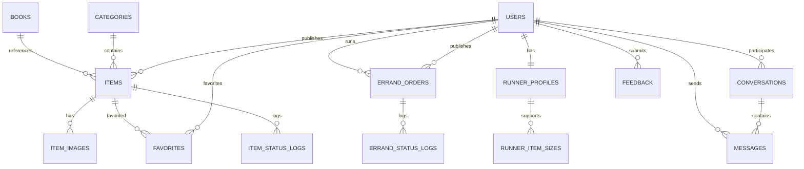

# 校园服务平台微信小程序 · 26 天开发计划

> 课程：《数据库原理与应用》课程设计
> 项目：校园服务平台（二手交易 + 代取 + 简易聊天）
> 小组：2 人（老师要求 1~2 人一组，符合要求）
> 周期：2026-11-05 ~ 2026-11-30（26 个自然日，含提交日）
> 技术栈：原生微信小程序 + Node.js/Express + MySQL 8
> 截止：2026-11-30（第十四周最后一次实验课）提交源码压缩包、报告、答辩 PPT、系统视频
>
> **口径说明：** 全项目 **20 个页面**（A 6 页 / B 14 页，P0 14 页 / P1 6 页），数据库 **14 张表**。本文与 `docs/A成员开发计划与Git协作手册.md` 保持一致；两处冲突时以 A 手册为准。

---

## 0. 先看这一页

### 0.1 最终做什么、不做什么

**MVP 范围（必须完成）**

- 登录 / 注册（学号 + 密码）
- 二手交易：首页、独立搜索结果页（书籍卡片 + 同书商品优先）、筛选、详情、发布（普通商品 / 书籍）、收藏、我的发布（下架 / 重新上架 / 标记售出 / 标记预订 / 取消预订）、我的收藏
- 代取服务：大厅、发布订单（含“先找跑腿”入口）、找跑腿匹配、接单、完成、撤回 / 释放、取消、我的订单、跑腿上线 / 下线与接单设置（同一页两个入口；在线计划按具体日期或星期循环，自动上下线）
- 简易聊天：会话列表、文字与图片消息、3 秒轮询、未读数
- 个人中心：资料、我的发布、我的收藏、我的代取、接单设置、设置、帮助
- 数据库对象：视图、存储过程、函数、触发器、事务、索引、权限
- 课程材料：报告、PPT、系统视频、源码压缩包、readme

**明确不做（写进报告“不足与展望”）**

- 搭子 / 招募模块（只在数据库和报告中提“未来扩展”）
- 平台担保交易、微信支付、广告
- 管理员后台、实名认证、举报审核
- WebSocket 实时聊天（用轮询替代）
- 按真实定位距离排序（课程设计只做关键词、分类、价格筛选）
- 大模型 API 接入（“大模型辅助”按 AI 辅助开发来体现）

> 砍掉这些不是偷懒，而是把有限时间投到占分最高的数据库设计（40 分）和文档（30 分）上。功能多但数据库单薄、报告赶工，分数反而低。

### 0.2 六个不能错过的日期

| 日期 | 里程碑 | 验收标准 |
| --- | --- | --- |
| 11-07（六） | M0 环境与登录打通 | 两个账号能登录，14 张表在 Navicat 建好，小程序能带 token 请求 `/api/auth/me` |
| 11-11（三） | M1 二手闭环 | 注册 → 发布 → 独立搜索结果页（书籍卡片 + 同书优先）→ 详情 → 收藏 → 标记预订 → 取消预订 → 下架全流程可用 |
| 11-16（一） | M2 代取 + 聊天闭环 | 两个账号能完成发单、找跑腿、按在线计划自动上下线或现在上线、接单、完成、互发文字与图片消息 |
| 11-21（六） | M3 功能冻结 | 核心功能全部可用，数据库对象齐全，只修 bug 不加功能 |
| 11-26（四） | M4 材料齐套 | 报告、PPT、视频、源码包、readme 全部初版完成 |
| 11-29（日） | M5 彩排完成 | 按答辩流程完整走 2 遍，U 盘 + 网盘双备份 |
| 11-30（一） | 提交与现场演示 | 按老师要求提交并演示 |

### 0.3 得分策略（按 100 分权重倒推）

| 评分项 | 分值 | 对应动作 |
| --- | --- | --- |
| 数据库设计规范、多种数据库对象 | 40 | 14 张表 + 4 视图 + 5 存储过程 + 2 函数 + 5 触发器 + 事务 + 索引 + 权限 + 测试数据，全部在系统中真实使用 |
| 文档撰写完善、规范 | 30 | 第一天就建报告骨架，边开发边截图边写；严格按毕业设计排版 |
| 界面美观 | 20 | 统一颜色 / 字号 / 间距，所有页面有加载、空、错误三种状态，拒绝默认样式 |
| 课程设计分析、总结 | 10 | 写清楚难点、分工、AI 辅助、不足与展望，不写空话 |

### 0.4 两个人怎么分

本计划按你担任成员 A（数据库 + 二手全栈 + 代取后端）、队友担任 B 编写；分工已确认，不再互换。

| 角色 | 负责内容 | 主要产出 |
| --- | --- | --- |
| 成员 A（数据库 + 二手全栈 + 代取后端） | 数据库设计、DDL、视图 / 过程 / 触发器 / 事务、Express 基础设施、鉴权、上传、二手模块 6 个页面（首页 / 详情 / 发布 / 搜索 / 我的发布 / 我的收藏）、代取后端、联调排错 | `database/`、`server/` 大部分、二手页面、报告数据库章节 |
| 成员 B（小程序公共层 + 登录 / 个人中心 + 代取前端 + 聊天全栈 + 材料） | 小程序基础设施、全局样式、组件、登录 / 注册 / 个人中心 / 个人资料 / 设置 / 帮助、代取 5 个页面（大厅 / 发布 / 详情 / 找跑腿 / 我的代取）、接单设置 / 上线页、聊天前后端、UI 走查、截图、PPT、视频 | 小程序公共层、代取与聊天页面、`docs/`、报告系统实现章节、PPT、视频 |
| 共同 | 需求确认、接口文档、测试、集成、答辩演练 | `docs/接口文档.md`、测试用例、答辩稿 |

分工原则：

1. **接口先行**：先定接口文档，再各自写代码，避免互相等待。
2. **模块纵向到底**：每个人对自己模块的前端、后端、SQL 负责，减少“前后端互相甩锅”。
3. **数据库只有 A 能改**：B 需要加字段先提需求，A 统一改 DDL，防止两边数据库结构不一致。
4. **`app.json` 只有 B 能改**：A 在 11-07 把 6 个页面路径发给 B，B 一次性注册完全部 20 个页面。
5. **聊天分工**：会话 / 消息表、存储过程、函数、触发器由 A 交付；`routes/chat.js` 和聊天页面由 B 写。
6. **文档 B 主笔、A 校对**：A 写数据库设计与实施，B 写系统实现与使用简介，最后互改。
7. **每天 15 分钟同步**：21:30 对进度、对接口、对明天任务；阻塞超过 30 分钟立即在群里说。

### 0.5 计划成立的前提（如果不成立要调整）

- 两人每天能投入 4~5 小时（含周末），合计约 100~130 小时 / 人。
- 演示在**微信开发者工具 + 本机后端**完成，不要求公网部署、域名备案、真机上线。
- 已有可用的小程序 AppID，不需要提交审核。
- 老师所说的“大模型辅助”指**用大模型辅助开发**；如果老师实际要求产品内接入 AI 功能，需要从 11-21 后额外加 2~3 天，届时再调整范围。

---

## 1. 功能与页面范围

### 1.1 功能优先级

| 优先级 | 功能 | 说明 |
| --- | --- | --- |
| P0 必须 | 登录注册、二手首页 / 独立搜索结果页 / 详情 / 发布 / 收藏操作、代取大厅 / 发布（含“先找跑腿”入口）/ 接单 / 完成 / 撤回 / 释放 / 取消 / 上线与接单设置 / 我的代取、聊天会话 / 文字与图片消息、个人中心（设置 / 帮助入口为 P0，页面本身为 P1） | 缺一个都会影响演示闭环 |
| P1 应该 | 我的发布、我的收藏、找跑腿匹配、设置、帮助、个人资料、书籍卡片 / ISBN 联想、多图上传、未读红点、状态日志、数据统计视图 | 时间允许就做，能显著提升报告素材 |
| P2 可选 | 多校区筛选（未来扩展）、AI 生成商品描述、WebSocket | 只在 11-21 前提前完成时做 |
| 不做 | 搭子模块、支付、后台、实名认证、距离排序 | 写进“未来工作” |

### 1.2 页面清单

| # | 模块 | 页面 | 路径 | 优先级 | 负责人 | 核心功能 |
| --- | --- | --- | --- | --- | --- | --- |
| 1 | 登录注册 | 登录 | `pages/login/login` | P0 | B | 学号 + 密码登录、跳注册 |
| 2 | 登录注册 | 注册 | `pages/register/register` | P0 | B | 学号、昵称、密码 |
| 3 | 二手 | 二手首页 | `pages/index/index` | P0 | A | 列表、搜索入口、分类、排序、刷新、加载；右下角圆形加号“我要卖” |
| 4 | 二手 | 商品详情 | `pages/item/detail` | P0 | A | 图片轮播、价格、卖家、收藏、联系卖家；卖家本人可见状态管理（标记预订 / 取消预订 / 售出 / 下架 / 重新上架） |
| 5 | 二手 | 发布商品 | `pages/item/publish` | P0 | A | 普通 / 书籍模式、图片上传、表单校验 |
| 6 | 二手 | 搜索结果 | `pages/search/result` | P0 | A | 顶部搜索框；书籍卡片（封面 / 书名 / 出版社 / 作者 / ISBN）；同书商品优先，下面才是其他商品推荐 |
| 7 | 二手 | 我的发布 | `pages/mine/items` | P1 | A | 在售 / 已预订 / 已售 / 已下架、修改状态 |
| 8 | 二手 | 我的收藏 | `pages/mine/favorites` | P1 | A | 收藏列表、取消收藏 |
| 9 | 代取 | 代取大厅 | `pages/errand/hall` | P0 | B | 待接单列表、筛选、接单入口；右下角圆形加号“找代取” |
| 10 | 代取 | 发布代取 | `pages/errand/publish` | P0 | B | 先选片区、再选具体地标（也可只选片区），填物品规格、报酬、时间要求（尽快 / 截止 / 范围）；备注框用灰色小字提示填写取件详细地址、交付要求等；“先找跑腿”入口 |
| 11 | 代取 | 代取详情 | `pages/errand/detail` | P0 | B | 订单信息、接单 / 完成 / 撤回 / 释放、联系对方 |
| 12 | 代取 | 找跑腿匹配 | `pages/errand/runners` | P1 | B | 按取件片区 + 具体地标 / 时间要求 / 可接规格筛选可接单跑腿（`asap` 在线，未来单可含计划重叠的 `slot` 跑腿）；看信息、联系 TA；不满意再去大厅发布 |
| 13 | 代取 | 我的代取 | `pages/mine/errands` | P0 | B | 我发布的 / 我接的、状态操作 |
| 14 | 代取 | 接单设置 / 上线 | `pages/mine/runner` | P0 | B | 同一页两个入口：个人页“接单设置”不带参数；代取页“上线 / 下线”带 `?mode=online`；服务片区（多选）、具体地标（多选，可为空）；在线计划按具体日期或星期循环（或“现在上线”）；规格 / 报价 / 备注选填；计划列表可改/删，进行中循环下线要询问范围 |
| 15 | 聊天 | 消息列表 | `pages/chat/list` | P0 | B | 会话列表、最后一条消息、未读数 |
| 16 | 聊天 | 聊天页 | `pages/chat/detail` | P0 | B | 顶部商品 / 订单卡片（展示摘要与状态，点击进详情）、文字 / 图片消息、3 秒轮询、发送、已读 |
| 17 | 个人中心 | 个人中心 | `pages/mine/index` | P0 | B | 资料、入口聚合（我的发布 / 我的收藏 / 我的代取 / 接单设置 / 设置 / 帮助）、退出登录 |
| 18 | 个人中心 | 个人资料 | `pages/mine/profile` | P1 | B | 昵称、头像、联系方式 |
| 19 | 个人中心 | 设置 | `pages/mine/settings` | P1 | B | 退出登录、清除缓存、关于 |
| 20 | 个人中心 | 帮助 | `pages/mine/help` | P1 | B | 常见问题、意见反馈、联系方式 |

共 **20 个页面**：A 6 页、B 14 页；P0 14 页、P1 6 页。底部 tabBar 仍是 4 个（首页、代取、消息、我的），**不新增“上线”板块**；“上线”不是独立页面，而是 `pages/mine/runner?mode=online`。页面不要贪多，先把 P0 做扎实。

**页面 14 的在线计划交互规则**

- 单次计划：选具体日期，不选默认当天，可多选几天；同一天内要求 `start < end`，不支持跨天。
- 循环计划：勾选周一至周日中的若干天，再选 `start` / `end`，从起始日期起长期有效，取消即结束。
- 未开始的计划可修改、可取消；修改循环计划只影响下一次，当前这次要结束用“提前下线”。
- 进行中的单次计划可直接提前下线；进行中的循环计划下线时弹窗二选一：“只提前结束这一次”或“取消之后所有循环”。
- 修改进行中的循环计划时，前端必须弹窗提醒“只影响下一次，当前这次要结束请用提前下线”。
- 不选日期默认当天；若当天计划时段已过，提示改日期，不自动顺延。同一时间不允许两条计划重叠。

### 1.3 进度落后时的砍功能顺序

按以下顺序砍，砍到哪一档就停：

1. 未读红点
2. 书籍 ISBN 联想（保留手动填写）
3. 帮助页（保留反馈接口）
4. 设置页（保留退出登录）
5. 个人资料编辑（保留默认资料）

**绝对不能砍**：登录、二手首页 / 独立搜索结果页 / 详情 / 发布、代取大厅 / 发布（含找跑腿入口）/ 接单 / 上线 / 我的代取、聊天（含图片消息）、数据库对象、报告。我的发布 / 我的收藏入口按用户要求保留，页面可以做成最简列表。

---

## 2. 技术架构与工程规范

### 2.1 总体架构

```text
微信小程序（原生 WXML / WXSS / JS）
        │  HTTP + JSON，JWT 放在 Authorization 头
        ▼
Node.js 20/22/24 + Express
        │  mysql2 连接池，手写参数化 SQL
        ▼
MySQL 8（InnoDB / utf8mb4）
        │
        └── 图片：wx.uploadFile → multer → server/uploads → /uploads/xxx.png
```

开发期：

```text
微信开发者工具（详情 → 本地设置 → 勾选“不校验合法域名”）
        │  http://127.0.0.1:3000
        ▼
本机 Express + 本机 MySQL
```

不需要买服务器、不需要域名、不需要备案。答辩在本机演示即可。真机预览时把 `BASE_URL` 换成本机局域网 IP（手机和电脑同一 Wi-Fi），但**默认以开发者工具演示为准**，避免网络问题。

### 2.2 为什么这样选

| 选择 | 理由 |
| --- | --- |
| MySQL 关系型数据库 | 课程要求数据库设计，关系模型、3NF、视图、存储过程、触发器、事务都能完整展示 |
| Express + 手写 SQL | 不引入 ORM，所有 SQL 都能写进报告；避免 Sequelize 的学习成本；数据库对象调用更直接 |
| 原生小程序 | 不引入 Vant / TypeScript / npm 构建，减少环境坑；26 天内稳定优先 |
| JWT + 学号密码 | readme 要求写“系统登录的用户名和密码”，学号密码最直接；也方便演示 |
| 本地图片存储 | 不依赖云存储和网络，压缩包自带演示数据 |
| 轮询聊天 | 实现简单、可演示；WebSocket 写进展望 |

### 2.3 目录结构

```text
Campus Services/
├─ docs/
│  ├─ 课程设计开发计划.md
│  ├─ A成员开发计划与Git协作手册.md
│  ├─ 接口文档.md
│  ├─ 测试用例.md
│  └─ AI辅助开发记录.md
├─ database/
│  ├─ schema.sql          # 建库、建表、索引、约束
│  ├─ objects.sql         # 视图、函数、存储过程、触发器
│  ├─ seed.sql            # 分类、书籍等静态数据
│  └─ er_diagram.png      # ER 图导出
├─ server/
│  ├─ src/
│  │  ├─ app.js
│  │  ├─ db.js
│  │  ├─ middleware/auth.js
│  │  ├─ routes/
│  │  │  ├─ auth.js
│  │  │  ├─ users.js
│  │  │  ├─ items.js
│  │  │  ├─ favorites.js
│  │  │  ├─ errands.js
│  │  │  ├─ chat.js
│  │  │  └─ upload.js
│  │  └─ utils/response.js
│  ├─ scripts/seed.js     # 用 bcrypt 生成账号、插入演示数据
│  ├─ uploads/
│  ├─ .env.example
│  └─ package.json
├─ miniprogram/
│  ├─ app.js / app.json / app.wxss
│  ├─ config.js
│  ├─ utils/request.js
│  ├─ components/
│  │  ├─ item-card/
│  │  ├─ empty-state/
│  │  └─ status-tag/
│  └─ pages/...
├─ report/
│  ├─ 报告.docx
│  ├─ 答辩PPT.pptx
│  └─ 系统演示.mp4
└─ readme.txt
```

微信开发者工具打开 `miniprogram/` 目录，`project.config.json` 放在里面。

### 2.4 版本与工具

| 工具 | 版本 / 说明 |
| --- | --- |
| Node.js | 20 LTS / 22 LTS / 24 LTS（本机为 24.18.0；遇到原生模块问题再降到 20） |
| MySQL | 8.0.x，字符集 `utf8mb4`，排序规则 `utf8mb4_0900_ai_ci` |
| 数据库客户端 | **Navicat**（本机已安装，不要求 MySQL Workbench） |
| 微信开发者工具 | 稳定版，登录自己的 AppID |
| 编辑器 | VS Code，装 ESLint（可选） |
| 接口调试 | Thunder Client（VS Code 插件）或 Postman / Apifox |
| 画图 | draw.io / ProcessOn 画 ER 图、架构图、时序图 |
| 录屏 | OBS Studio 或 Windows 自带 Xbox Game Bar |
| 版本管理 | Git + GitHub 私有仓库（`afresh-breeze/Campus_Trading_Service_Platform`） |

### 2.5 统一约定（先定好，后面少吵架）

**接口响应格式**

```json
{ "code": 0, "message": "ok", "data": {} }
```

- `code = 0` 成功；非 0 失败。
- HTTP 状态码同时使用：400 参数错误、401 未登录、403 无权限、404 不存在、409 状态冲突、500 服务器错误。
- 分页统一返回：`{ "list": [], "total": 0, "page": 1, "pageSize": 10 }`。

**其他约定**

- 鉴权：请求头 `Authorization: Bearer <token>`。
- 时间：数据库用 `DATETIME`，接口返回 `YYYY-MM-DD HH:mm:ss` 字符串。
- 金额：数据库 `DECIMAL(10,2)`，接口返回数字。
- 枚举：数据库存英文（`on_sale`、`taken`），前端映射成中文，便于代码维护。
- 命名：数据库表 / 字段用 `snake_case`，接口字段用 `camelCase`，在路由层转换。
- 密码：`bcryptjs` 加盐哈希，绝不存明文。
- SQL：全部使用 `?` 占位符，禁止字符串拼接。
- 密钥：`.env` 不提交 Git，仓库只提交 `.env.example`。

**Git 规范**

- 仓库已建好，`dev` 已设为默认集成分支；`main` 只放能跑通的里程碑版本。
- 日常从 `dev` 切短分支：`feature/*`、`fix/*`、`docs/*`、`chore/*`；完成后开 PR 合并回 `dev`。
- 里程碑时 `dev` → `main`，打 tag：`v0.1-m0`、`v0.2-m1`、`v0.3-m2`、`v1.0-m3`、`v1.0-m4`、`v1.0-final`；打完 tag 再把 `main` 合回 `dev`。
- 每天至少 commit 一次，commit message 写清楚做了什么，例如 `feat(item): 完成商品发布接口`。
- 合并前先 `git pull origin dev`，有冲突当面一起解决，不要强推。
- `.gitignore` 必须包含：`node_modules/`、`.env`、`uploads/*`（保留 `.gitkeep`）、`miniprogram_npm/`。
- **`database/` 只有 A 能改，`miniprogram/app.json` 只有 B 能改**；需要变更先在群里说。

---

## 3. 数据库设计（11-06 定稿）

### 3.1 设计原则

1. 满足 3NF：书目信息、商品图片、跑腿资料、可接规格、状态日志分别独立成表，避免传递依赖。
2. 所有表使用 InnoDB，保证事务和外键。
3. 字符集 `utf8mb4`，避免中文和 emoji 乱码。
4. 主键统一 `BIGINT AUTO_INCREMENT`，业务唯一键加 `UNIQUE`。
5. 金额用 `DECIMAL(10,2)`，不用 `FLOAT`。
6. 状态用 `ENUM`，并写清楚状态机。
7. 外键约束 + `CHECK` 约束 + 必要索引，保证数据一致性。
8. 适度冗余（收藏数、最后一条消息），用触发器维护，写进报告作为设计权衡。

### 3.2 表清单（14 张）

| # | 表名 | 作用 | 关键字段 |
| --- | --- | --- | --- |
| 1 | `users` | 用户 | `user_id`、`student_no` 唯一、`password_hash`、`nickname`、`avatar_url`、`campus`、`college`、`phone`、`credit_score`、`status` |
| 2 | `books` | 书目库，用于书名 / ISBN 联想和书籍卡片 | `book_id`、`isbn` 唯一、`title`、`author`、`publisher`、`edition`、`price_ref`、`cover_url` 可空 |
| 3 | `categories` | 二手分类 | `category_id`、`name`、`sort_no` |
| 4 | `items` | 商品主表 | `item_id`、`seller_id`、`category_id`、`book_id` 可空、`item_type`、`title`、`description`、`price`、`original_price`、`condition_level`、`negotiable`、`campus`、`location`、`status`、`view_count`、`favorite_count`、`created_at` |
| 5 | `item_images` | 商品图片 | `image_id`、`item_id`、`url`、`sort_no` |
| 6 | `favorites` | 收藏，复合主键防重复 | `user_id`、`item_id`、`created_at`，主键 `(user_id, item_id)` |
| 7 | `errand_orders` | 代取订单 | `order_id`、`publisher_id`、`runner_id` 可空、`pickup_area`、`pickup_place`、`delivery_location`、`item_size` 单值、`item_desc`、`remark`、`reward`、`time_type`（`asap` / `deadline` / `range`）、`time_start` 可空、`deadline` 可空、`status`、`created_at`、`taken_at`、`completed_at` |
| 8 | `runner_profiles` | 跑腿接单设置，与用户一对一 | `user_id` 主键、`is_online`、`availability_type`（`slot` / `now`）、`service_areas` JSON、`service_places` JSON、`time_slots` JSON、`manual_until`、`base_price`、`remark`、`completed_count` |
| 9 | `runner_item_sizes` | 跑腿可接规格，多选 | `user_id`、`item_size`（`small` / `medium` / `large`），复合主键 `(user_id, item_size)` |
| 10 | `conversations` | 会话 | `conversation_id`、`user_a_id`、`user_b_id`、`biz_type`、`biz_id`、`last_message`、`last_time`，唯一键 `(user_a_id, user_b_id, biz_type, biz_id)` |
| 11 | `messages` | 消息 | `message_id`、`conversation_id`、`sender_id`、`msg_type`、`content`、`is_read`、`created_at` |
| 12 | `item_status_logs` | 商品状态变更日志 | `log_id`、`item_id`、`old_status`、`new_status`、`changed_by`、`changed_at` |
| 13 | `errand_status_logs` | 代取状态变更日志 | `log_id`、`order_id`、`old_status`、`new_status`、`changed_by`、`changed_at` |
| 14 | `feedback` | 用户反馈 / 帮助（设置、帮助页使用） | `feedback_id`、`user_id`、`content`、`created_at` |

> `users.campus`、`items.campus` 是多校区预留字段。MVP 只在西南大学北碚校区试点，注册、发布、列表和详情都不采集/筛选/展示校区，记录保持 `NULL`；南区/北区只用于代取取件片区和地标定位。

### 3.3 ER 图（初稿，11-06 用 draw.io 重画导出 PNG）



报告里需要两张图：局部 ER 图（用户 / 商品 / 收藏）和全局 ER 图。不要只放一张截图，画图工具导出的黑白或单色图更符合毕业设计排版。

### 3.4 数据库对象清单（对应 40 分）

| 类型 | 名称 | 作用 | 在系统中的使用位置 |
| --- | --- | --- | --- |
| 视图 | `v_item_list` | 商品列表：商品 + 卖家 + 分类 + 书目 + 首图 | 首页列表、我的发布、收藏列表 |
| 视图 | `v_errand_hall` | 代取大厅：待接单 + 发布者信息 | 代取大厅 |
| 视图 | `v_conversation_base` | 会话 + 双方昵称头像 | 消息列表 |
| 视图 | `v_user_summary` | 用户维度统计：发布数、收藏数、完成单数 | 个人中心、报告统计 |
| 存储过程 | `sp_publish_item` | 事务：插入商品 + 多张图片 | 发布商品 |
| 存储过程 | `sp_take_errand` | 事务 + 行锁：接单，防止并发重复接单 | 代取接单 |
| 存储过程 | `sp_complete_errand` | 完成订单、更新跑腿完成数、信用分 | 确认完成 |
| 存储过程 | `sp_get_or_create_conversation` | 获取或创建会话（用户 ID 归一化） | 点“联系 TA” |
| 存储过程 | `sp_refresh_user_credit` | 游标：按完成单数刷新信用分 | 演示 / 后台维护 |
| 函数 | `fn_unread_count` | 查询某会话未读数 | 消息列表 |
| 函数 | `fn_completed_errands` | 查询用户完成单数 | 个人中心 |
| 触发器 | `trg_fav_after_insert` | 收藏后 `favorite_count + 1` | 收藏 |
| 触发器 | `trg_fav_after_delete` | 取消收藏后 `favorite_count - 1` | 取消收藏 |
| 触发器 | `trg_item_status_log` | 商品状态变更写日志 | 下架 / 售出 |
| 触发器 | `trg_errand_status_log` | 代取状态变更写日志 | 接单 / 完成 / 撤回 / 释放 / 取消 |
| 触发器 | `trg_message_after_insert` | 更新会话最后一条消息和时间；文本截断到 255 字符，图片消息预览固定写 `[图片]` | 聊天 |
| 事务 | 发布商品、接单、完成订单 | 保证多表一致性 | 核心业务 |
| 索引 | 见 3.5 | 列表、搜索、聊天性能 | 全局 |
| 权限 | `cs_app`、`cs_readonly` | 应用账号、只读演示账号 | 数据库安全演示 |
| 约束 | 主键、外键、唯一、CHECK | 数据完整性 | 全局 |

> 报告里每个对象都要有：作用、创建语句、测试结果截图。不要只贴代码，要说明“解决了什么问题”。

### 3.5 关键设计说明（直接写进报告）

**为什么满足 3NF**

- 书目信息（书名、作者、出版社、ISBN、封面）独立成 `books`，商品只存 `book_id`，避免同一本书的信息在每条商品里重复。
- 商品图片独立成 `item_images`，一个商品多张图，不违反 1NF。
- 跑腿服务设置独立成 `runner_profiles`，与用户一对一，避免用户表里塞大量接单字段。
- 跑腿可接规格（小 / 中 / 大件多选）独立成 `runner_item_sizes`，用复合主键 `(user_id, item_size)`，不把多个规格塞进一个字段。
- 状态变更独立成日志表，保留历史，不覆盖原状态。
- 每个非主属性都完全依赖于主键，不存在传递依赖。

**关于 `time_slots`、`availability_type` 与 `manual_until` 的说明**

`runner_profiles.availability_type` 只有两个取值：`slot`（按在线计划自动上下线）和 `now`（现在上线，手动保持）。`time_slots` 是在线计划数组，不是 `"HH:mm-HH:mm"` 字符串：

```json
[
  { "id": "o1", "type": "once", "date": "2026-11-09", "start": "14:00", "end": "18:00" },
  { "id": "o2", "type": "once", "date": "2026-11-10", "start": "14:00", "end": "18:00" },
  { "id": "w1", "type": "weekly", "weekdays": [1, 3, 5], "start": "18:00", "end": "22:00", "from": "2026-11-09" }
]
```

`once` 只在指定日期生效，多选日期生成多条；`weekly` 从 `from` 起长期有效，`weekdays` 用 `1`=周一……`7`=周日，取消即结束。每条计划有稳定 `id`，前端按 `id` 修改或取消。

`manual_until` 记录手动覆盖的截止时间：普通手动上线/下线后，取“下一个计划边界”和“当天 23:59”中较早者；进行中的循环选择“只提前结束这一次”时，设为本次 occurrence 的结束时间。`manual_until > NOW()` 时自动任务不覆盖手动状态。`slot` 模式的 `is_online` 由 Node `node-cron` 每分钟按计划重算；`now` 模式由用户手动维护，不自动重算。数据库仍是 **0 个 MySQL 事件**。

报告里要主动说明：严格按 1NF 可以拆成 `runner_online_schedules` + `runner_schedule_weekdays`，一行一个计划/星期；当前数据量小、按整组读写，用 JSON 属于有意识的权衡，不是设计疏漏；代价是在应用层解析日期、星期和时段。

**关于 `service_areas`、`service_places` 与地标**

`runner_profiles.service_areas` 用 JSON 存跑腿可服务的片区数组，至少一个，例如 `["桃园","北区教学区"]`；`service_places` 存更细的具体地标数组，可为空数组。空数组表示“只按片区接单，这个片区内哪栋楼都接”；非空时元素可以是具体地标名（如“第16教学楼”），也可以直接写片区名（表示整个片区），并允许跨片区勾选。一个跑腿可以覆盖多个片区、多栋楼，所以不能只存一个字符串。严格按 1NF 可以拆成 `runner_service_areas(user_id, area)` 和 `runner_service_places(user_id, place)`，但会变成第 15、16 张表，超出 14 张表的课程约定，因此用 JSON + `JSON_CONTAINS` 是主动权衡。

片区、地标是三级模型中的后两级：**分类**（宿舍园、教学区、图书馆、运动场、校医院、校外、其他）只是前端分组标题，不落库、不参与匹配；**片区**固定 25 个，落库并做匹配粗筛；**地标**存受控名称，不建表，做匹配细筛。

- 宿舍园 8 个：桃园、李园、橘园、楠园、梅园、竹园、杏园、茶园；
- 教学区 2 个：北区教学区、南区教学区；
- 图书馆 3 个：中心图书馆、北区图书馆、南区图书馆；
- 运动场 5 个：第一至第五运动场；
- 校医院 2 个：北区校医院、南区校医院；
- 校外 3 个：一号门外/吾悦广场、二号门外、校外其他；
- 其他 2 个：北区其他、南区其他。

地标共 52 条（北区教学区 27 条教学楼、南区教学区 20 条教学楼、北区其他/南区其他 5 条单体楼），完整清单见《A成员开发计划与Git协作手册》11.9。每条地标带 `name`、`zone`、`aliases`，用户搜正式名或别名都能选中。当前宿舍园、图书馆、运动场、校医院、校外片区暂不细分地标，选中片区即视为 `pickupPlace = 片区名`。

发布代取时，用户先选片区，再选该片区下的具体地标；也可以只选片区、不选地标。数据库用两列做匹配：`pickup_area` 存片区（粗筛），`pickup_place` 存地标名（细筛；只选片区时等于片区名）。门牌号、取件详细地址、时间等细节统一写 `remark`，不再单独设详细地址列；发布页备注框用灰色小字提示“填写取件详细地址、交付要求等”。数据库不建地标表，地标显示名不变时历史订单的匹配口径不受影响。

找跑腿时先按片区粗筛，再按地标细筛：

1. 订单 `pickup_area` 必须命中跑腿 `service_areas`；
2. 跑腿 `service_places` 为空数组，或包含订单 `pickup_place`，或包含订单 `pickup_area`（整片区），才算地标级匹配；
3. 只接某栋楼的跑腿，不匹配“只填片区”的订单；接整个片区（或只按片区）的跑腿，能匹配片区内任何具体地标的订单。

清单在 11-08 定稿，11-12 前分别落到前端 `miniprogram/utils/campus.js`（`GROUPS` + `ZONES` + `LANDMARKS`）和后端 `server/src/utils/campus.js`（同一份清单 + `isValidZone`、`isValidPlace`、`zoneOfPlace`）；两份清单必须同步改。

**为什么有冗余字段**

- `items.favorite_count`：列表页要显示收藏数，每次 `COUNT(*)` 太慢，用触发器维护。
- `conversations.last_message` / `last_time`：消息列表要显示最后一条，用触发器更新；文本用 `LEFT(NEW.content, 255)` 截断，图片消息统一写 `[图片]`，避免列表里出现一长串上传路径。
- 代价：触发器逻辑必须正确，否则冗余会不一致。报告里要写这个权衡，答辩很可能问。

**状态机**

商品 `items.status`：

```text
on_sale（在售） → reserved（已预订） → sold（已售出）
on_sale → sold（已售出）
on_sale → off_shelf（已下架）
off_shelf → on_sale
reserved → on_sale（取消预订）
```

MVP 实现：在售 ↔ 已预订、在售 → 已售出 / 已下架、已下架 → 重新上架；已预订只能取消预订或标记售出，已售出是终态。预订只改状态，不记录预订人。卖家可在「我的发布」或商品详情页改状态，两处共用 `PUT /api/items/:id/status`；详情页只对 `isOwner=true` 的卖家显示管理按钮，买家只读。

代取 `errand_orders.status`：

```text
pending（待接单，显示在大厅） → taken（已接单，锁单并从大厅消失）
pending → cancelled（发布者取消，终态）
taken → pending（发布者撤回 / 接单者释放，清空 runner_id、taken_at）
taken → completed（发布者确认完成，终态）
completed / cancelled 是终态
```

注意：`taken` 状态本身就是“锁单”，订单不再出现在大厅，其他跑腿也不能接；不需要额外设置“挂起”状态。`taken` 不能直接到 `cancelled`：发布者要取消已接单的订单，先退回 `pending`，再取消。

**代取时间要求与匹配**

`errand_orders` 用三列表达三种时间要求：

| `time_type` | `time_start` | `deadline` | 含义 |
| --- | --- | --- | --- |
| `asap` | `NULL` | `NULL` | 尽快，不限定时间 |
| `deadline` | `NULL` | 非空 | 在某个时间点前完成 |
| `range` | 非空 | 非空 | 在某个时间范围内完成，且 `time_start < deadline` |

- `time_type` 在发布接口里必填：页面必须让用户三选一（尽快 / 截止时间 / 时间范围），不能省略；数据库默认值只作兜底。
- `deadline` 只是参考时间，不检查订单是否超时，也不自动取消；是否继续、是否完成由交易双方协商。
- “找跑腿”时，先按接单模式 + 时间要求、取件片区 + 具体地标、可接规格粗筛，再按时间重叠过滤：片区用 `JSON_CONTAINS(service_areas, ...)` 判断，地标用 `service_places` 为空数组 / 包含 `pickup_place` / 包含 `pickup_area` 判断，规格查 `runner_item_sizes`。
  - `asap`：不筛时间，`slot` 与 `now` 都只要 `is_online = 1`；
  - `deadline`：`[NOW(), deadline]` 与跑腿的实际在线 occurrence 有重叠；
  - `range`：`[time_start, deadline]` 与跑腿的实际在线 occurrence 有重叠。
- `slot` 跑腿把 `once` 按具体日期展开、`weekly` 按 `weekdays` 展开，再判断与订单窗口是否重叠；`deadline`/`range` 不要求 `slot` 跑腿当前在线，只要求计划窗口重叠；`now` 跑腿没有未来计划，必须当前在线。自动下线只影响“找跑腿”和接新单，不影响已接订单。

**并发接单**

两个跑腿同时点“接单”，只能有一个成功。实现：

```sql
START TRANSACTION;
SELECT status FROM errand_orders WHERE order_id = ? FOR UPDATE;
-- 如果 status != 'pending'，回滚并返回 409
UPDATE errand_orders
SET runner_id = ?, status = 'taken', taken_at = NOW()
WHERE order_id = ? AND status = 'pending';
-- 检查 affectedRows == 1 再 COMMIT
COMMIT;
```

**索引设计**

| 表 | 索引 | 用途 |
| --- | --- | --- |
| `users` | `UNIQUE(student_no)` | 登录、防重复注册 |
| `books` | `UNIQUE(isbn)`、`INDEX(title(50))` | ISBN 精确查、书名联想 |
| `items` | `(status, created_at)` | 首页在售列表按时间排序 |
| `items` | `(book_id, status, created_at)` | 搜索结果页“同书商品优先” |
| `items` | `(category_id, price)` | 分类 + 价格筛选 |
| `items` | `(seller_id, status)` | 我的发布 |
| `item_images` | `(item_id, sort_no)` | 取首图、详情图 |
| `runner_profiles` | `(is_online)`、`(availability_type)` | `asap` 先筛在线；`deadline`/`range` 按 `availability_type` 取候选跑腿再算计划重叠；自动任务按 `availability_type='slot'` 扫描；片区与地标分别用 `JSON_CONTAINS(service_areas, ...)`、`JSON_CONTAINS(service_places, ...)` |
| `runner_item_sizes` | `(item_size, user_id)` | 按规格筛选跑腿 |
| `errand_orders` | `(status, created_at)` | 代取大厅 |
| `errand_orders` | `(publisher_id, status)`、`(runner_id, status)` | 我的代取 |
| `messages` | `(conversation_id, message_id)` | 增量拉取消息 |
| `conversations` | `UNIQUE(user_a_id, user_b_id, biz_type, biz_id)` | 防重复会话 |
| `favorites` | `PRIMARY KEY(user_id, item_id)` | 防重复收藏 |

**安全设计**

- 密码 `bcryptjs` 加盐哈希。
- JWT 设置过期时间（如 7 天），前端 401 自动跳登录。
- 所有写操作校验身份：只有卖家能改商品，只有发布者能完成 / 撤回 / 取消，只有接单者能释放，只有会话参与者能看消息。
- 参数化查询防 SQL 注入。
- 上传限制类型（jpg/png/webp）和大小（5MB）。
- 数据库建两个账号：`cs_app` 只有业务库 CRUD 权限，`cs_readonly` 只有 SELECT 权限，报告里演示权限控制。

### 3.6 初始化顺序

```bash
# 1. 建库、建表、索引、约束
mysql -u root -p < database/schema.sql

# 2. 建视图、函数、存储过程、触发器
mysql -u root -p campus_service < database/objects.sql

# 3. 插入分类、书籍等静态数据
mysql -u root -p campus_service < database/seed.sql

# 4. 用 Node 脚本插入用户（bcrypt 哈希）和演示商品 / 订单
cd server
npm run seed
```

> 用户密码不要写死在 SQL 里。用 `server/scripts/seed.js` 调 `bcrypt.hashSync('123456', 10)` 生成哈希，保证能登录。
>
> 用 Navicat 时：先建连接和 `campus_service` 库，再在查询窗口依次执行 `schema.sql` → `objects.sql` → `seed.sql`，最后在 `server/` 下运行 `npm run seed`。`DELIMITER` 是客户端指令，Navicat 查询窗口可以直接执行。

### 3.7 演示账号（写进 readme）

| 学号 | 密码 | 角色 | 用途 |
| --- | --- | --- | --- |
| 2023001 | 123456 | 买家 | 浏览、收藏、发消息、发代取单 |
| 2023002 | 123456 | 卖家 / 跑腿 | 发布商品、上线接单、完成订单 |
| 2023003 | 123456 | 第三用户 | 演示并发接单、多会话 |

演示时准备两个开发者工具窗口或两台设备，分别登录 2023001 和 2023002，效果最好。

---

## 4. 接口清单（v0.1，11-05 先定，之后只增不改）

### 4.1 认证与用户

| 方法 | 路径 | 鉴权 | 说明 |
| --- | --- | --- | --- |
| POST | `/api/auth/register` | 否 | 学号、昵称、密码注册 |
| POST | `/api/auth/login` | 否 | 学号 + 密码登录，返回 token |
| GET | `/api/auth/me` | 是 | 当前用户信息 |
| GET | `/api/users/:id` | 是 | 公开资料（昵称、头像、信用分） |
| PUT | `/api/users/me` | 是 | 修改昵称、头像、联系方式 |
| GET | `/api/users/me/runner-profile` | 是 | 接单设置回显；无记录返回默认值，不返回 404；含 `isOnline`、`manualUntil` |
| PUT | `/api/users/me/runner-profile` | 是 | 保存跑腿设置：服务片区（多选）、具体地标（多选，可为空）、在线计划（`once` / `weekly`）、可接规格多选、报价、备注；保存后清空旧的手动覆盖，`slot` 立即重算 `is_online`，`now` 保持当前状态；修改进行中 `weekly` 时写入当前 occurrence 结束时间的保护值 |
| PUT | `/api/users/me/online` | 是 | 上线 / 下线，body `{ "isOnline": true, "availabilityType": "now" }`；进行中循环下线时传 `scope:"once"\|"future"` 与 `scheduleId`；切到 `now` 时清空 `manual_until` |
| GET | `/api/runners?area=&place=&timeType=&timeStart=&deadline=&itemSize=&page=&pageSize=` | 是 | 找跑腿匹配；`asap` 只返回在线，`deadline`/`range` 允许“未来计划重叠但当前不在线”的 `slot` 跑腿；按取件片区 + 具体地标、规格、时间重叠筛选，不直接改订单状态 |

`PUT /api/users/me/runner-profile` 请求体：

```json
{
  "serviceAreas": ["桃园", "北区教学区"],
  "servicePlaces": ["第16教学楼", "第25教学楼"],
  "availabilityType": "slot",
  "timeSlots": [
    { "id": "o1", "type": "once", "date": "2026-11-09", "start": "14:00", "end": "18:00" },
    { "id": "o2", "type": "once", "date": "2026-11-10", "start": "14:00", "end": "18:00" },
    { "id": "w1", "type": "weekly", "weekdays": [1, 3, 5], "start": "18:00", "end": "22:00", "from": "2026-11-09" }
  ],
  "itemSizes": ["small", "medium"],
  "basePrice": 5.00,
  "remark": "可代取快递"
}
```

- `availabilityType` 只取 `slot`（按在线计划自动上下线）或 `now`（现在上线，手动保持），不再有 `long_term`。
- `timeSlots` 是在线计划数组，每条计划有稳定 `id`，前端按 `id` 修改/取消：
  - `once`：`{ id, type:"once", date:"YYYY-MM-DD", start:"HH:mm", end:"HH:mm" }`，只在指定日期生效，多选几天就生成多条。
  - `weekly`：`{ id, type:"weekly", weekdays:[1..7], start:"HH:mm", end:"HH:mm", from:"YYYY-MM-DD" }`，`1`=周一……`7`=周日，从 `from` 起长期有效，取消即结束。
- 同一天内要求 `start < end`，不支持跨天；同一时间不允许两条计划重叠；不选日期默认当天，当天时段已过时提示改日期，不自动顺延。
- `slot` 模式至少保留一条未来计划；`now` 模式可以为空，但保留已有计划暂停使用。
- `GET /api/runners` 的时间参数跟订单一致：`timeType=asap` 不筛时间；`timeType=deadline` 用 `[NOW(), deadline]`；`timeType=range` 用 `[timeStart, deadline]`。`slot` 跑腿按 `once` 的具体日期和 `weekly` 的星期展开后判断重叠；`now` 跑腿只看在线。
- 普通手动上线/下线后，`manual_until = min(下一个计划边界, 当天 23:59)`；`manual_until > NOW()` 时 `node-cron` 不覆盖手动状态。
- 进行中的循环计划下线：`scope:"once"` 把 `manual_until` 设为本次 occurrence 结束时间，规则保留；`scope:"future"` 删除该 `scheduleId` 规则并立即下线。
- 修改进行中的循环计划只影响下一次，当前这次要结束用“提前下线”；前端必须弹窗提醒这一点。后端若检测到被修改/删除的 `weekly` 计划正处于本次 occurrence 中，先用旧计划算出本次结束时间并写入 `manual_until`，再保存新计划；当前这次保持原状态到旧结束时间。
- `itemSizes` 多选，取 `small` / `medium` / `large`，存 `runner_item_sizes` 关联表。
- `serviceAreas` 是片区数组，至少选一个，取值来自 25 个固定片区（见 3.2 后的说明）。
- `servicePlaces` 是具体地标数组，可为空：空数组表示只按片区接单；非空时每个元素是受控地标名或片区名，且所属片区必须在 `serviceAreas` 内。
- `GET /api/runners` 的 `place` 可省略；省略时按 `place = area` 处理（用户只选了片区），不会把只接某栋楼的跑腿匹配进来。
- `availabilityType` 必填；`itemSizes`、`basePrice`、`remark` 选填，保存时保留上次填写值。
- 发布代取时 `pickupArea`、`pickupPlace` 都必填：用户先选片区，再选该片区下的具体地标；只选片区不选地标时，前端把 `pickupPlace` 传成片区名。取件详细地址、交付要求等统一写 `remark`；发布页备注框用灰色小字提示“填写取件详细地址、交付要求等”，不再单独设详细地址输入框。
- 再次进入 `pages/mine/runner?mode=online` 时显示“下线”，调用 `PUT /api/users/me/online` 传 `{ "isOnline": false }`。
- 保存过的资料要能回显，用户下次上线不必全部重填。

### 4.2 二手商品

| 方法 | 路径 | 鉴权 | 说明 |
| --- | --- | --- | --- |
| GET | `/api/categories` | 是 | 分类列表，首页筛选和发布页使用 |
| GET | `/api/books/search?keyword=` | 是 | 书名 / ISBN / 作者联想；返回 `bookId`、`isbn`、`title`、`author`、`publisher`、`coverUrl` |
| POST | `/api/books` | 是 | 手动新增书目；ISBN 已存在则返回已有 `bookId` |
| GET | `/api/items` | 是 | 列表，支持 `keyword/bookId/categoryId/minPrice/maxPrice/sort/page/pageSize`；`bookId` 用于搜索结果页“同书商品优先” |
| GET | `/api/items/:id` | 是 | 详情，含卖家、图片、是否已收藏、`isOwner`（是否本人发布，详情页据此显示卖家管理） |
| POST | `/api/items` | 是 | 发布，调 `sp_publish_item` |
| PUT | `/api/items/:id/status` | 是 | 上架 / 下架 / 售出 / 标记预订 / 取消预订；仅卖家本人，非法跳转 409；详情页和「我的发布」共用 |
| GET | `/api/items/mine` | 是 | 我的发布 |
| POST | `/api/items/:id/favorite` | 是 | 收藏 |
| DELETE | `/api/items/:id/favorite` | 是 | 取消收藏 |
| GET | `/api/favorites` | 是 | 我的收藏 |
| POST | `/api/upload` | 是 | 上传图片，返回 URL |

搜索结果页的调用顺序：先 `GET /api/books/search?keyword=` 显示书籍卡片；用户点击卡片后按 `bookId` 请求 `GET /api/items?bookId=`；下方商品区默认先请求同书商品，再请求关键词商品并去重，保证“同书优先”。

### 4.3 代取

| 方法 | 路径 | 鉴权 | 说明 |
| --- | --- | --- | --- |
| GET | `/api/errands` | 是 | 大厅，`status=pending`，支持分页 |
| POST | `/api/errands` | 是 | 发布代取单 |
| GET | `/api/errands/:id` | 是 | 详情；返回 `canTake`、`canComplete`、`canCancel`、`canRelease`，页面据此显示按钮 |
| POST | `/api/errands/:id/take` | 是 | 接单，调 `sp_take_errand`；成功后订单从大厅消失 |
| POST | `/api/errands/:id/complete` | 是 | 确认完成，调 `sp_complete_errand`；发布者操作 |
| POST | `/api/errands/:id/cancel` | 是 | 发布者撤回：`pending → cancelled`；`taken → pending` 退回大厅，清空接单人 |
| POST | `/api/errands/:id/release` | 是 | 接单者释放：`taken → pending` 退回大厅，清空接单人 |
| GET | `/api/errands/mine?role=publisher\|runner` | 是 | 我的代取 |

`POST /api/errands` 的关键字段：`pickupArea`（片区，必填）、`pickupPlace`（地标名，必填，且所属片区必须等于 `pickupArea`；只选片区时等于片区名）、`deliveryLocation`（送达地点，必填）、`itemSize`、`itemDesc`、`remark`（订单备注，取件详细地址与交付要求写这里，≤255 字）、`reward`、`timeType`、`timeStart`、`deadline`。

角色规则：

- 接单：除发布者外的登录用户，订单状态必须是 `pending`；接单成功后状态变 `taken`，订单只在接单者的“我的代取”里，不再出现在大厅。
- 完成：只有发布者可以确认完成，状态必须是 `taken`。
- 发布者撤回：`pending → cancelled`；`taken → pending`，清空 `runner_id`、`taken_at`，订单回大厅。
- 接单者释放：`taken → pending`，清空 `runner_id`、`taken_at`，订单回大厅。
- `taken` 不能直接变 `cancelled`；发布者要先退回 `pending`，再取消。
- 所有写操作先查订单，校验角色和状态；角色不符返回 403，状态不符返回 409。
- 找跑腿匹配页只展示可接单跑腿信息并跳聊天，**不直接改订单状态**；订单仍发布到大厅，通过 `sp_take_errand` 接单。

### 4.4 聊天

| 方法 | 路径 | 鉴权 | 说明 |
| --- | --- | --- | --- |
| GET | `/api/conversations` | 是 | 会话列表 + 未读数 |
| POST | `/api/conversations` | 是 | 获取或创建会话，`{ peerId, bizType, bizId }` |
| GET | `/api/conversations/:id/context` | 是 | 聊天页顶部业务卡片摘要；仅会话参与者 |
| GET | `/api/conversations/:id/messages?afterId=0` | 是 | 增量拉消息 |
| POST | `/api/conversations/:id/messages` | 是 | 发送消息，body `{ msgType, content }`；`msgType` 取 `text` / `image`，缺省 `text` |
| PUT | `/api/conversations/:id/read` | 是 | 标记已读 |

> 图片消息流程：先调 `POST /api/upload` 拿到 `/uploads/xxx.jpg`，再以 `msgType='image'`、`content=该路径` 发送；服务端校验 `msgType` 取值、`content` 非空且以 `/uploads/` 开头，禁止存二进制、base64 或外链。会话列表的最后一条预览由触发器固定写 `[图片]`。
>
> 聊天页顶部固定一张业务卡片：商品会话显示封面、标题、价格、状态，代取会话显示规格、取片区 / 地标、报酬、状态；点击卡片跳对应详情页。卡片只展示和导航，不放状态按钮；卖家在商品详情页、发布者 / 接单者在代取详情页按角色操作，买家 / 对方只读。聊天页 `onShow` 重新拉 `GET /api/conversations/:id/context`，从详情返回后卡片状态立即更新；`bizSummary` 为 `null` 时显示“商品已下架 / 订单不存在”，不可跳转，但不影响继续聊天。

### 4.5 其他

| 方法 | 路径 | 鉴权 | 说明 |
| --- | --- | --- | --- |
| GET | `/api/health` | 否 | 健康检查，联调第一步 |
| POST | `/api/feedback` | 是 | 意见反馈，帮助页使用；body `{ "content": "..." }` |

### 4.6 页面跳转参数（A/B 必须一致）

```text
/pages/search/result?keyword=高数
/pages/errand/runners?area=北区教学区&place=第16教学楼&timeType=deadline&deadline=2026-11-20 18:00:00&itemSize=small
/pages/mine/runner?mode=online
/pages/chat/detail?peerId=<对方userId>&bizType=item&bizId=<商品id>
/pages/chat/detail?peerId=<对方userId>&bizType=errand&bizId=<订单id>
```

- A 的首页搜索框跳 `pages/search/result`；结果页用 `keyword` 请求书目和商品。
- B 的发布代取页“先找跑腿”跳 `pages/errand/runners`；参数只用于预填筛选条件，用户可以修改。
- B 的代取页“上线 / 下线”跳 `pages/mine/runner?mode=online`；个人页“接单设置”跳 `pages/mine/runner`（不带参数）。
- 商品详情 / 代取详情的“联系 TA”跳聊天页，带 `peerId`、`bizType`、`bizId` 三个参数。
- 聊天页顶部业务卡片：商品会话跳 `/pages/item/detail?id=<bizId>`，代取会话跳 `/pages/errand/detail?id=<bizId>`；卡片摘要由 `GET /api/conversations/:id/context` 提供。

接口文档要求：每个接口写清 **请求方法、路径、鉴权、请求参数、成功响应、失败情况**。示例：

```md
### POST /api/auth/login
- 鉴权：否
- 请求：{ "studentNo": "2023001", "password": "123456" }
- 成功：{ "code": 0, "message": "ok", "data": { "token": "...", "user": { "userId": 1, "nickname": "小明" } } }
- 失败：401 学号或密码错误；400 参数缺失
```

---

## 5. 26 天详细排期

> 每天默认按 6 小时有效工作安排。课多的时候把任务挪到晚上，但**里程碑不能挪**。

### 阶段 0：立项、环境、登录（11-05 ~ 11-07，3 天）

> Git 仓库、B 的协作者邀请、`dev` 默认分支已经在 11-05 前完成，不再重复；11-06 的建表任务顺延到 11-07 一起完成，M0 验收不变。

| 日期 | 成员 A（数据库 + 后端） | 成员 B（前端 + 材料） | 当日验收 |
| --- | --- | --- | --- |
| 11-05 四 | 读课程要求；确定 **14 张表**清单；装 MySQL 8、Node；建 `campus_service` 库 | 装微信开发者工具；新建小程序项目；跑通空白页；收藏 3 个同类小程序截图做 UI 参考；建 `docs/` | 本机 MySQL 能登录；小程序能编译；Git 仓库可用（已完成） |
| 11-06 五 | 完成 14 张表 DDL v1（主外键、索引、CHECK）；写 `schema.sql`；搭 Express 骨架 + `/api/health` + MySQL 连接池 | 配 `app.json`、tabBar、全局样式；写登录页静态结构；写 `utils/request.js` 草稿 | 小程序请求 `/api/health` 成功 |
| 11-07 六 | 用 Navicat 建 14 张表；注册 / 登录 API（bcryptjs + JWT）；鉴权中间件；统一响应与错误处理；`seed.js` 生成演示账号；把 A 的 **6 个页面路径**发给 B | 登录 / 注册页交互；token 存本地；401 跳登录；个人中心骨架；**一次性注册全部 20 个页面** | 账号 2023001 能登录并请求 `/api/auth/me`；14 张表在 Navicat 可见；M0 |

**阶段产出**：可登录的项目骨架、14 张表 DDL v1、接口文档 v0.1、Git 仓库（已完成）、20 个页面全部注册。

### 阶段 1：二手交易闭环（11-08 ~ 11-11，4 天）

> 二手 6 个页面全部由 A 做，B 这 4 天继续公共层、登录 / 个人中心和代取页面静态结构，不要抢二手页面。

| 日期 | 成员 A | 成员 B | 当日验收 |
| --- | --- | --- | --- |
| 11-08 日 | `GET /api/categories`、`GET /api/books/search`（含 `coverUrl`）、`GET /api/items`（分页 / 筛选 / `bookId` / 排序）；建 `v_item_list`；二手首页（列表、分类、排序、刷新、加载更多、右下角圆形加号“我要卖”） | 登录 / 注册收尾；个人中心骨架；全局样式与 `item-card` / `empty-state` 组件；确认 20 个页面已全部注册 | 首页显示 seed 商品；搜索框跳独立结果页；加号能进发布页 |
| 11-09 一 | `POST /api/upload`、`POST /api/books`、`POST /api/items` + `sp_publish_item`（事务 + 多图）；发布页普通 / 书籍两种模式 | 代取大厅 / 发布页静态结构（先用假数据）；聊天页静态结构；统一表单和按钮样式 | 发布后列表可见，图片能显示 |
| 11-10 二 | 商品详情 API（卖家、图片、收藏状态）；收藏 / 取消收藏 API + 触发器；详情页（轮播、卖家卡片、收藏、联系卖家） | 代取详情 / 我的代取静态结构；继续公共组件；准备聊天接口文档 | 收藏数增减正确；详情页可跳聊天占位页 |
| 11-11 三 | 我的发布 / 我的收藏 API；商品状态修改 + `trg_item_status_log`；我的发布、我的收藏、搜索结果页（书籍卡片 + 同书商品优先）；全流程联调，M1 | 个人中心入口（我的发布 / 我的收藏 / 我的代取 / 接单设置 / 设置 / 帮助）；代取页面进度；UI 走查 | 二手闭环全流程通过，M1 |

**阶段产出**：二手 6 个页面可用；搜索结果页书籍卡片与同书优先；报告“需求分析”初稿（B）；截图 10 张以上。

### 阶段 2：代取 + 聊天（11-12 ~ 11-16，5 天）

> 分工口径：A 做代取后端和聊天数据库对象；B 做代取 5 个页面、接单设置 / 上线页，以及聊天前后端。A 在 11-13 前把聊天数据库对象交给 B。

| 日期 | 成员 A | 成员 B | 当日验收 |
| --- | --- | --- | --- |
| 11-12 四 | `GET/PUT /api/users/me/runner-profile`、`PUT /api/users/me/online`（含 `scope` / `scheduleId`）；`server/src/jobs/runnerOnline.js` 用 `node-cron` 每分钟自动上下线；`GET /api/runners`（片区 + 地标 / 时间要求 / 规格）；发布代取、大厅列表 API；`v_errand_hall` 视图 | 代取大厅（含右下角加号“找代取”）、发布页（含“先找跑腿”）、代取详情页；接单设置 / 上线页（两个入口，含日期多选、星期循环、计划列表、提前下线与循环下线弹窗） | 大厅显示 pending 订单；上下线状态保存；跑腿资料能回显；计划到点自动上下线、重启后补算正确 |
| 11-13 五 | 接单 API；`sp_take_errand` 事务 + `FOR UPDATE`；`trg_errand_status_log`；我的代取 API；聊天数据库对象交付 B（`sp_get_or_create_conversation`、`fn_unread_count`、`trg_message_after_insert`、`v_conversation_base`） | 代取详情 / 我的代取页操作按钮；找跑腿匹配页；聊天会话列表和聊天页开始联调 | 两账号并发接单只有一个成功；B 拿到聊天对象能开始写 `chat.js` |
| 11-14 六 | 完成 / 撤回 / 释放 / 取消 API；`sp_complete_errand`；完成数、信用分更新；修 bug | 聊天全栈：会话列表、聊天页（含顶部业务卡片）、3 秒轮询、发送文字 / 图片消息（先上传再发送）、已读；找跑腿匹配页完善 | 状态机全路径跑通；两账号 5 秒内收到消息 |
| 11-15 日 | 代取联调；`v_user_summary`、`fn_completed_errands`、`sp_refresh_user_credit` 初版；接口文档更新 | 设置页、帮助页；聊天入口打通（商品 / 订单“联系 TA”）；UI 统一 | 代取 + 聊天主流程可用；设置 / 帮助入口可点 |
| 11-16 一 | 全流程联调；检查 N+1 查询和慢 SQL；M2 | 聊天 / 代取收尾；报告“系统功能”草稿；截图 | 代取 + 聊天闭环通过，M2 |

**阶段产出**：核心业务全部闭环；找跑腿匹配、上线设置、设置 / 帮助可用；演示脚本 v1（B 写，A 演）。

### 阶段 3：数据库对象、测试、UI 打磨（11-17 ~ 11-21，5 天）

| 日期 | 成员 A | 成员 B | 当日验收 |
| --- | --- | --- | --- |
| 11-17 二 | 完成 4 个视图、5 个存储过程、2 个函数；每个对象写测试 SQL 并截图 | UI 统一：颜色、字号、圆角、间距；加载 / 空 / 错误状态；收集页面截图 | 所有数据库对象能在 Navicat 跑通 |
| 11-18 三 | 5 个触发器；测试事务隔离；造 1000 商品、5000 消息；用 `EXPLAIN` 验证索引 | 全页面走查，修样式问题；整理截图清单；写测试用例初稿 | 触发器效果可见；列表查询走索引 |
| 11-19 四 | 安全加固：参数化、输入校验、越权测试、上传限制；统一错误码 | 交互优化：防重复点击、返回刷新、表单提示、空状态文案 | 越权请求被拒绝；无 500 报错 |
| 11-20 五 | 回归测试；Postman 集合；测试用例表；修 P0 bug | 按测试用例执行 UI 测试，记录 bug；补截图；报告“系统实现”草稿 | 核心用例通过率 100% |
| 11-21 六 | 修 P0 bug；导出数据库 dump；合并 `dev` → `main`，打 tag `v1.0-m3` | 修 UI bug；确认截图齐全；和 A 一起冻结功能 | M3 功能冻结，不再加功能 |

**阶段产出**：数据库对象齐全、测试记录、完整截图、可演示版本。

### 阶段 4：报告、PPT、视频（11-22 ~ 11-26，5 天）

| 日期 | 成员 A | 成员 B | 当日验收 |
| --- | --- | --- | --- |
| 11-22 日 | 报告第 1 章项目概况、第 2 章需求分析、第 3 章概念设计（ER 图） | 报告第 4 章逻辑设计（关系模式、3NF、表结构） | 报告完成约 40% |
| 11-23 一 | 报告第 5 章物理设计、第 6 章数据库实施（DDL、对象、截图） | 报告第 7 章系统实现（架构、核心代码、界面截图）、第 8 章测试 | 报告完成约 75% |
| 11-24 二 | 报告第 9 章总结与展望、参考文献；校对所有 SQL | 报告第 10 章使用简介、AI 辅助开发章节；全文排版、目录、页码、图表编号 | 报告初稿完整 |
| 11-25 三 | 和 B 合稿、通读、统一术语；准备答辩讲稿的数据部分 | PPT 初稿 12 页；和 A 一起过一遍 | 报告定稿候选、PPT 初稿 |
| 11-26 四 | readme；清理源码；打包；数据库备份；检查压缩包 | PPT 美化 + 讲稿；录制系统视频；剪辑字幕 | 四类材料初版齐全，M4 |

**阶段产出**：报告、PPT、视频、源码包、readme。

### 阶段 5：彩排与提交（11-27 ~ 11-30，4 天）

| 日期 | 任务 | 验收 |
| --- | --- | --- |
| 11-27 五 | 按 8~10 分钟计时彩排 2 次；互相问 15 个答辩问题；记录卡壳点 | 能脱稿讲完 |
| 11-28 六 | 在“干净环境”重装依赖、重新导入数据库、重新跑一遍；修演示阻碍 | 从零启动只要 10 分钟 |
| 11-29 日 | 最终检查清单；U 盘、网盘、邮箱三处备份；完整 dry run | 断网也能放视频 |
| 11-30 一 | 提交源码压缩包、报告、PPT、视频；现场演示 | 按时提交，演示不慌 |

---

## 6. 每个阶段怎么做（新手操作手册）

### 6.1 第一天环境搭建

```bash
# 检查版本
node -v
npm -v
mysql --version

# 后端初始化
cd server
npm init -y
npm i express mysql2 dotenv bcryptjs jsonwebtoken multer cors
npm i -D nodemon
```

`server/package.json` 加：

```json
{
  "scripts": {
    "dev": "nodemon src/app.js",
    "start": "node src/app.js",
    "seed": "node scripts/seed.js"
  }
}
```

`server/.env.example`：

```ini
PORT=3000
DB_HOST=127.0.0.1
DB_PORT=3306
DB_USER=cs_app
DB_PASSWORD=change_me
DB_NAME=campus_service
JWT_SECRET=change_me_to_a_long_random_string
```

复制成 `.env`，填自己的密码。`.env` 不提交。

### 6.2 数据库连接池

`server/src/db.js`：

```js
const mysql = require('mysql2/promise');
require('dotenv').config();

const pool = mysql.createPool({
  host: process.env.DB_HOST,
  port: Number(process.env.DB_PORT || 3306),
  user: process.env.DB_USER,
  password: process.env.DB_PASSWORD,
  database: process.env.DB_NAME,
  waitForConnections: true,
  connectionLimit: 10,
  charset: 'utf8mb4',
  timezone: '+08:00',
  dateStrings: true,
  decimalNumbers: true,
});

module.exports = pool;
```

### 6.3 最小后端服务

`server/src/app.js`：

```js
const express = require('express');
const path = require('path');
const app = express();

app.use(express.json());
app.use('/uploads', express.static(path.join(__dirname, '../uploads')));

app.get('/api/health', async (req, res) => {
  res.json({ code: 0, message: 'ok', data: { time: new Date().toISOString() } });
});

app.use('/api/auth', require('./routes/auth'));
// 其他路由按同样方式挂载

app.use((err, req, res, next) => {
  console.error(err);
  const status = err.status || 500;
  res.status(status).json({ code: status, message: err.message || '服务器错误', data: null });
});

app.listen(process.env.PORT || 3000, () => {
  console.log('server running on http://127.0.0.1:3000');
});
```

先只做 `/api/health`，跑通再往下写。**不要一次性写完所有接口。**

### 6.4 登录流程

1. 小程序提交学号 + 密码。
2. 后端 `SELECT` 用户，`bcrypt.compare` 校验。
3. 校验通过，`jwt.sign({ userId, studentNo }, JWT_SECRET, { expiresIn: '7d' })`。
4. 小程序把 token 存 `wx.setStorageSync('token', token)`。
5. 之后每个请求带 `Authorization: Bearer <token>`。
6. 后端 `jwt.verify` 失败返回 401，小程序清 token 并跳登录。

鉴权中间件：

```js
const jwt = require('jsonwebtoken');

module.exports = (req, res, next) => {
  const auth = req.headers.authorization || '';
  const token = auth.startsWith('Bearer ') ? auth.slice(7) : '';
  if (!token) {
    return res.status(401).json({ code: 401, message: '请先登录', data: null });
  }
  try {
    req.user = jwt.verify(token, process.env.JWT_SECRET);
    next();
  } catch (e) {
    res.status(401).json({ code: 401, message: '登录已过期', data: null });
  }
};
```

### 6.5 小程序请求封装

`miniprogram/utils/request.js`：

```js
const BASE_URL = 'http://127.0.0.1:3000';

function request({ url, method = 'GET', data = {}, auth = true }) {
  return new Promise((resolve, reject) => {
    const header = { 'Content-Type': 'application/json' };
    if (auth) {
      const token = wx.getStorageSync('token');
      if (token) header.Authorization = `Bearer ${token}`;
    }
    wx.request({
      url: BASE_URL + url,
      method,
      data,
      header,
      success(res) {
        if (res.statusCode === 401) {
          wx.removeStorageSync('token');
          wx.reLaunch({ url: '/pages/login/login' });
          reject(new Error('请先登录'));
          return;
        }
        if (res.statusCode >= 200 && res.statusCode < 300 && res.data.code === 0) {
          resolve(res.data.data);
        } else {
          wx.showToast({ title: res.data.message || '请求失败', icon: 'none' });
          reject(new Error(res.data.message || '请求失败'));
        }
      },
      fail(err) {
        wx.showToast({ title: '网络错误，请检查后端是否启动', icon: 'none' });
        reject(err);
      },
    });
  });
}

module.exports = { request, BASE_URL };
```

注意：登录页本身不要无限跳登录，401 时判断当前页面路径。

### 6.6 图片上传

小程序端：

```js
wx.chooseMedia({
  count: 3,
  mediaType: ['image'],
  success: (res) => {
    res.tempFiles.forEach((file) => {
      wx.uploadFile({
        url: `${BASE_URL}/api/upload`,
        filePath: file.tempFilePath,
        name: 'file',
        header: { Authorization: `Bearer ${wx.getStorageSync('token')}` },
        success: (r) => {
          const body = JSON.parse(r.data);
          if (body.code === 0) {
            // body.data.url 收进表单
          }
        },
      });
    });
  },
});
```

后端：

```js
const multer = require('multer');
const path = require('path');

const storage = multer.diskStorage({
  destination: (req, file, cb) => cb(null, path.join(__dirname, '../uploads')),
  filename: (req, file, cb) => {
    const ext = path.extname(file.originalname).toLowerCase();
    cb(null, `${Date.now()}-${Math.random().toString(16).slice(2)}${ext}`);
  },
});

const upload = multer({
  storage,
  limits: { fileSize: 5 * 1024 * 1024 },
  fileFilter: (req, file, cb) => {
    const ok = ['image/jpeg', 'image/png', 'image/webp'].includes(file.mimetype);
    cb(ok ? null : new Error('只允许上传图片'), ok);
  },
});
```

注意 `uploads/` 目录要存在，`.gitignore` 忽略里面内容但保留 `.gitkeep`。

### 6.7 发布商品：存储过程 + 事务

`sp_publish_item` 用 `JSON_TABLE` 一次插入多张图片，是报告里的亮点：

```sql
DELIMITER $$
CREATE PROCEDURE sp_publish_item(
  IN p_seller_id BIGINT,
  IN p_category_id INT,
  IN p_book_id BIGINT,
  IN p_item_type VARCHAR(10),
  IN p_title VARCHAR(100),
  IN p_description TEXT,
  IN p_price DECIMAL(10,2),
  IN p_condition_level VARCHAR(20),
  IN p_images JSON,
  OUT p_item_id BIGINT
)
BEGIN
  DECLARE EXIT HANDLER FOR SQLEXCEPTION
  BEGIN
    ROLLBACK;
    RESIGNAL;
  END;

  START TRANSACTION;
  INSERT INTO items (seller_id, category_id, book_id, item_type, title, description,
                     price, condition_level, status, created_at)
  VALUES (p_seller_id, p_category_id, p_book_id, p_item_type, p_title, p_description,
          p_price, p_condition_level, 'on_sale', NOW());

  SET p_item_id = LAST_INSERT_ID();

  INSERT INTO item_images (item_id, url, sort_no)
  SELECT p_item_id, jt.url, jt.sort_no
  FROM JSON_TABLE(p_images, '$[*]' COLUMNS (
    url VARCHAR(255) PATH '$.url',
    sort_no INT PATH '$.sort_no'
  )) AS jt;

  COMMIT;
END$$
DELIMITER ;
```

Node 调用：

```js
const [rows] = await pool.query(
  'CALL sp_publish_item(?, ?, ?, ?, ?, ?, ?, ?, ?, @item_id)',
  [sellerId, categoryId, bookId, itemType, title, description, price, condition, JSON.stringify(images)]
);
const [[{ item_id }]] = await pool.query('SELECT @item_id AS item_id');
```

先在 Navicat 查询窗口里用假数据测通，再接 Node。**不要直接在接口里调一个没测过的存储过程。**

### 6.8 接单：防并发重复接单

Node 里用连接对象手动事务：

```js
const conn = await pool.getConnection();
try {
  await conn.beginTransaction();

  const [rows] = await conn.query(
    'SELECT order_id, publisher_id, status FROM errand_orders WHERE order_id = ? FOR UPDATE',
    [orderId]
  );
  if (!rows.length) throw Object.assign(new Error('订单不存在'), { status: 404 });

  const order = rows[0];
  if (order.publisher_id === userId) {
    throw Object.assign(new Error('不能接自己发布的单'), { status: 403 });
  }
  if (order.status !== 'pending') {
    throw Object.assign(new Error('订单已被接走'), { status: 409 });
  }

  const [result] = await conn.query(
    `UPDATE errand_orders
     SET runner_id = ?, status = 'taken', taken_at = NOW()
     WHERE order_id = ? AND status = 'pending'`,
    [userId, orderId]
  );
  if (result.affectedRows !== 1) {
    throw Object.assign(new Error('接单失败，请重试'), { status: 409 });
  }

  await conn.commit();
  res.json({ code: 0, message: 'ok', data: null });
} catch (e) {
  await conn.rollback();
  next(e);
} finally {
  conn.release();
}
```

测试方法：Postman 开两个标签页，用两个账号的 token 同时点接单，预期一个 200、一个 409，数据库只写一个 `runner_id`。

### 6.9 聊天轮询

```js
Page({
  data: { messages: [], lastId: 0, input: '' },

  onShow() {
    this.loadMessages();
    this.timer = setInterval(() => this.loadMessages(), 3000);
  },

  onHide() {
    clearInterval(this.timer);
  },

  onUnload() {
    clearInterval(this.timer);
  },

  async loadMessages() {
    const list = await request({
      url: `/api/conversations/${this.data.conversationId}/messages?afterId=${this.data.lastId}`,
    });
    if (!list.length) return;
    const lastId = list[list.length - 1].messageId;
    this.setData({ messages: this.data.messages.concat(list), lastId });
    // 滚动到底部
  },
});
```

注意：`onHide` 和 `onUnload` 都要清定时器，否则切页面后还在请求。

### 6.10 视图、函数、触发器示例

视图：

```sql
CREATE OR REPLACE VIEW v_item_list AS
SELECT
  i.item_id, i.title, i.price, i.condition_level, i.status,
  i.favorite_count, i.created_at,
  u.user_id AS seller_id, u.nickname AS seller_nickname, u.avatar_url AS seller_avatar,
  c.name AS category_name,
  b.title AS book_title, b.author, b.publisher, b.isbn,
  (SELECT img.url FROM item_images img
   WHERE img.item_id = i.item_id ORDER BY img.sort_no LIMIT 1) AS cover_url
FROM items i
JOIN users u ON u.user_id = i.seller_id
LEFT JOIN categories c ON c.category_id = i.category_id
LEFT JOIN books b ON b.book_id = i.book_id;
```

触发器：

```sql
DELIMITER $$
CREATE TRIGGER trg_fav_after_insert
AFTER INSERT ON favorites
FOR EACH ROW
BEGIN
  UPDATE items SET favorite_count = favorite_count + 1 WHERE item_id = NEW.item_id;
END$$

CREATE TRIGGER trg_fav_after_delete
AFTER DELETE ON favorites
FOR EACH ROW
BEGIN
  UPDATE items SET favorite_count = GREATEST(favorite_count - 1, 0) WHERE item_id = OLD.item_id;
END$$
DELIMITER ;
```

函数：

```sql
DELIMITER $$
CREATE FUNCTION fn_unread_count(p_conversation_id BIGINT, p_user_id BIGINT)
RETURNS INT
READS SQL DATA
BEGIN
  DECLARE v_count INT;
  SELECT COUNT(*) INTO v_count
  FROM messages
  WHERE conversation_id = p_conversation_id
    AND sender_id <> p_user_id
    AND is_read = 0;
  RETURN v_count;
END$$
DELIMITER ;
```

游标存储过程：

```sql
DELIMITER $$
CREATE PROCEDURE sp_refresh_user_credit()
BEGIN
  DECLARE done INT DEFAULT 0;
  DECLARE v_user_id BIGINT;
  DECLARE v_count INT;
  DECLARE cur CURSOR FOR
    SELECT user_id, COUNT(*) FROM errand_orders
    WHERE status = 'completed' GROUP BY user_id;
  DECLARE CONTINUE HANDLER FOR NOT FOUND SET done = 1;

  OPEN cur;
  read_loop: LOOP
    FETCH cur INTO v_user_id, v_count;
    IF done = 1 THEN LEAVE read_loop; END IF;
    UPDATE users SET credit_score = LEAST(100, 60 + v_count * 2)
    WHERE user_id = v_user_id;
  END LOOP;
  CLOSE cur;
END$$
DELIMITER ;
```

### 6.11 联调常见问题排查

| 现象 | 原因 | 解决 |
| --- | --- | --- |
| `request:fail url not in domain list` | 没勾选不校验域名 | 开发者工具 → 详情 → 本地设置 → 勾选“不校验合法域名” |
| 401 循环跳登录 | 登录页也走鉴权请求 | 登录页请求 `auth: false`，或判断当前页面路径 |
| 中文乱码 | 数据库 / 连接字符集不对 | 建库 `utf8mb4`，连接池 `charset: 'utf8mb4'` |
| 图片 404 | 静态目录路径不对 / 上传目录不存在 | 检查 `express.static` 路径，手动建 `uploads/` |
| 时间差 8 小时 | 时区不一致 | 连接池 `timezone: '+08:00'`，数据库 `DATETIME` |
| `ER_NO_REFERENCED_ROW` | 外键引用了不存在的 ID | 先插用户 / 分类 / 书目，再插商品 |
| `ER_DUP_ENTRY` | 唯一键冲突 | 收藏用 `INSERT IGNORE` 或先查再插，注册先查学号 |
| 手机预览请求失败 | 手机访问不到 `127.0.0.1` | 改用电脑局域网 IP，手机和电脑同一 Wi-Fi；答辩优先用开发者工具 |
| 真机图片不显示 | 图片 URL 是 `127.0.0.1` | 换成局域网 IP，或真机演示前把图片下载到本地 |

---

## 7. 测试计划

### 7.1 核心测试用例（29 条）

| # | 场景 | 操作 | 预期 |
| --- | --- | --- | --- |
| 1 | 注册重复学号 | 用已存在学号注册 | 400，提示学号已注册 |
| 2 | 登录密码错误 | 错误密码 | 401，提示学号或密码错误 |
| 3 | 未登录访问 | 不带 token 请求 `/api/items` | 401 |
| 4 | 发布缺字段 | 不填标题 / 价格 | 400，提示具体字段 |
| 5 | 价格非法 | 价格 -1 或非数字 | 400 |
| 6 | 图片超限 | 上传 6MB 图片 | 400，提示大小限制 |
| 7 | 非图片上传 | 上传 txt | 400，提示只允许图片 |
| 8 | 搜索无结果 | 搜索不存在关键词 | 返回空列表，不报错 |
| 9 | 分页边界 | 最后一页 / 超出页数 | 返回空列表，total 正确 |
| 10 | 重复收藏 | 连续收藏两次 | 第二次不报错，收藏数只加 1 |
| 11 | 取消未收藏 | 取消没收藏的商品 | 不报错，收藏数不变成负数 |
| 12 | 非卖家改商品 | 用别人 token 下架商品 | 403 |
| 13 | 下架商品不可见 | 下架后查列表 | 列表中不出现 |
| 14 | 接自己的单 | 发布者接自己的单 | 403 |
| 15 | 重复接单 | 两个账号同时接同一单 | 一个成功，一个 409 |
| 16 | 非发布者完成 | 接单者点完成 | 403 |
| 17 | 非法状态跳转 | 已完成单再撤回 / 释放 | 409 |
| 18 | 聊天越权 | 非会话参与者拉消息 | 403 |
| 19 | SQL 注入 | 搜索框输入 `' OR 1=1 --` | 按普通字符串处理，不返回全表 |
| 20 | 触发器一致性 | 收藏 / 取消收藏后查 `favorite_count` | 与实际收藏记录数一致 |
| 21 | 视图一致性 | 对比 `v_item_list` 和手工 JOIN | 字段一致 |
| 22 | 性能 | 1000 商品列表查询 | 本机 < 300ms，`EXPLAIN` 走索引 |
| 23 | 发布者撤回已接单 | 接单后发布者调 `/cancel` | 状态变 `pending`，`runner_id`、`taken_at` 清空 |
| 24 | 接单者释放 | 接单后接单者调 `/release` | 状态变 `pending`，订单重新出现在大厅 |
| 25 | 已接单直接取消 | 接单后发布者第一次调 `/cancel` | 只回 `pending`，不会一步变 `cancelled`；再调一次才变 `cancelled` |
| 26 | 截止时间参考性 | 造一条 `deadline` 已过的 `pending` 单 | 状态仍是 `pending`，没有自动取消 |
| 27 | 聊天图片消息 | 选图 → 上传 → 发送，另一账号轮询接收 | 气泡显示图片、点击可预览；会话列表预览为 `[图片]`；`content` 不是 `/uploads/` 开头时返回 400 |
| 28 | 标记预订 / 取消预订 | 在售商品标记预订 → 查首页、搜索、详情 → 取消预订 | 首页和搜索不出现，详情显示「已预订」；取消后恢复在售；非卖家操作 403，已售出再预订 409 |
| 29 | 聊天业务卡片与状态同步 | 买家、卖家分别从商品会话进入聊天页；卖家点卡片进详情标记「已预订」后返回；买家重新进入聊天页 | 卡片显示商品标题 / 价格 / 状态；买家点卡片进详情只读、无管理按钮；卖家详情有管理按钮；返回后卡片状态变为「已预订」；买家重新进入时看到「已预订」；非卖家调状态接口 403 |

### 7.2 并发测试

- 用 Postman 两个标签页，分别登录 2023001 / 2023002，同时请求接单。
- 或用两个小程序窗口（开发者工具多开）同时点。
- 预期：一个 200，一个 409；`errand_orders.runner_id` 只有一个值。
- 截图保存“一个成功一个失败”的界面和数据库结果，放进报告。

### 7.3 性能测试

- 用 SQL 脚本造 1000 条商品、5000 条消息。
- 对列表、搜索、聊天拉取分别 `EXPLAIN`，确认使用索引。
- 记录查询耗时（本机），写进报告“测试”章节。
- 不要造太多，1000 / 5000 足够演示，避免本机卡顿。

### 7.4 安全测试

- 密码哈希：数据库里看不到明文。
- 越权：改别人商品、接自己的单、看别人会话，全部被拒绝。
- SQL 注入：搜索、登录输入特殊字符，参数化查询不受影响。
- 上传：非图片、超大文件被拒绝。
- 密钥：Git 仓库里没有 `.env`，没有真实密码。
- 权限：`cs_readonly` 账号只能 SELECT，不能 INSERT / UPDATE。

---

### 7.5 新增页面专项检查

- **搜索结果页**：书籍卡片字段完整（封面 / 书名 / 出版社 / 作者 / ISBN）；同书商品排在普通商品之前；点击卡片按 `bookId` 过滤；无结果时有空状态。
- **首页 FAB**：右下角圆形加号“我要卖”点击跳发布商品页。
- **代取大厅 FAB**：右下角圆形加号“找代取”点击跳发布代取页。
- **发布代取**：取件片区 → 地标联动；只选片区时地标等于片区名；备注框用灰色小字提示“填写取件详细地址、交付要求等”，不单独设详细地址输入框；物品规格、报酬、时间要求（尽快 / 截止 / 范围）校验正确。
- **找跑腿匹配**：`asap` 只显示在线跑腿；`deadline`/`range` 还显示“未来计划窗口重叠但当前不在线”的 `slot` 跑腿，`now` 跑腿只看当前在线；取件片区 + 具体地标 / 在线计划 / 规格筛选有效（跑腿可多选片区和地标；订单 `pickupArea` 在 `serviceAreas` 中、且地标命中 `servicePlaces` 或 `servicePlaces` 为空）；`slot` 跑腿按 `once` 日期与 `weekly` 星期展开后判断重叠；只接某栋楼的跑腿不匹配“只填片区”的订单；不返回手机号；点“联系 TA”跳聊天页。
- **上线 / 下线**：个人页“接单设置”和代取页入口进入同一页；下线后匹配页不再出现该用户；上次填写的片区数组、地标数组、`once`/`weekly` 在线计划、规格、报价、备注能回显。
- **自动上下线**：`slot` 用户到计划开始/结束时间自动切换 `isOnline`；服务重启后先补算一次；手动上下线在 `manualUntil` 前不被覆盖；`now` 模式不被自动任务改动。
- **计划管理**：未开始的计划可修改/取消；进行中单次可提前下线；进行中循环下线弹窗可选“只提前结束这一次 / 取消之后所有循环”；修改进行中循环时前端弹窗提醒“只影响下一次”。
- **设置 / 帮助**：个人中心入口可点；设置页能退出登录、清缓存；帮助页能查看常见问题并提交反馈。
- **双入口一致性**：`pages/mine/runner` 带 `?mode=online` 时显示上线 / 下线；不带参数时显示接单设置，两者共用同一份资料。

## 8. 报告、PPT、视频、提交物

### 8.1 报告目录（建议 40~50 页）

| 章节 | 内容 | 建议页数 | 负责人 |
| --- | --- | --- | --- |
| 封面 | 课程名称、题目、姓名、学号、班级、指导教师、日期 | 1 | B |
| 摘要 / 关键词 | 200~300 字，写清做了什么、用了什么技术、数据库对象有哪些 | 1 | B |
| 目录 | 自动生成，页码正确 | 1 | B |
| 第 1 章 项目概况 | 任务、要解决的问题、功能模块、开发环境 | 3~4 | A |
| 第 2 章 需求分析 | 业务流程、功能需求、数据流图、数据字典 | 5~6 | A |
| 第 3 章 概念设计 | 局部 ER 图、全局 ER 图、实体与联系说明 | 5~6 | A |
| 第 4 章 逻辑设计 | 关系模式、3NF 分析、表结构、约束 | 5~6 | B |
| 第 5 章 物理设计 | 存储引擎、索引、分区（可选）、安全、权限 | 3~4 | A |
| 第 6 章 数据库实施 | 建库建表、视图、存储过程、函数、触发器、事务、测试数据 | 6~8 | A |
| 第 7 章 系统实现 | 架构图、关键代码、页面截图、核心流程 | 8~10 | B |
| 第 8 章 系统测试 | 测试用例、并发测试、性能测试、安全测试 | 3~4 | B |
| 第 9 章 总结与展望 | 完成情况、难点、不足、未来工作 | 2 | A |
| 第 10 章 大模型辅助开发 | 使用场景、案例、人工把关、局限 | 2~3 | B |
| 参考文献 | 5~8 篇 | 1 | A |
| 附录 | 接口文档、测试用例、AI 辅助记录 | 3~5 | 共同 |

报告写作顺序建议：**先写第 2、3、4、6 章（数据库主线），再写第 7 章（系统实现），最后写摘要和总结**。摘要最后写，才不会空。

### 8.2 排版检查清单

老师要求“参考毕业设计排版要求”，先找学院 / 教务处模板。找不到就按下面执行，并和老师确认：

- 正文：宋体小四，1.5 倍行距，首行缩进 2 字符。
- 一级标题：黑体三号；二级标题：黑体四号；三级标题：黑体小四。
- 图表：图题在图下方，表题在表上方，统一编号（图 3-1、表 3-1）。
- 代码：Consolas / 宋体五号，单倍行距，加浅灰底纹，代码不超过页面宽度。
- 页眉：课程设计名称；页脚：页码居中。
- 目录自动生成，更新页码。
- 参考文献按 GB/T 7714 格式，正文引用处标 `[1]`。
- 所有截图清晰，不要带开发者工具调试面板；统一用同一机型尺寸（如 iPhone 14 Pro）。
- 打印预览检查：表格不跨页断裂、图片不超出页边距。

### 8.3 截图清单（开发时每天顺手截，不要最后补）

**小程序页面（20 张）**

1. 登录页
2. 注册页
3. 二手首页列表（含右下角圆形加号“我要卖”）
4. 搜索结果页（书籍卡片 + 同书商品 + 其他商品）
5. 商品详情
6. 发布商品（普通）
7. 发布商品（书籍模式）
8. 我的发布
9. 我的收藏
10. 代取大厅（含右下角圆形加号“找代取”）
11. 发布代取（含“先找跑腿”入口）
12. 找跑腿匹配页
13. 接单设置 / 上线（两个入口）
14. 我的代取（我发布的 / 我接的）
15. 消息列表
16. 聊天页（含顶部商品 / 订单卡片）
17. 个人中心（入口聚合）
18. 个人资料
19. 设置
20. 帮助

**数据库与后端（12 张）**

1. ER 图（draw.io 导出）
2. 数据库表列表（Navicat，14 张表）
3. 建表 SQL 执行成功
4. `v_item_list` 查询结果
5. `sp_take_errand` 调用结果
6. 触发器执行前后 `favorite_count` 对比
7. 事务并发接单：一个成功一个失败
8. `EXPLAIN` 使用索引
9. 用户权限演示（`cs_readonly` 插入被拒绝）
10. 测试数据量（1000 商品 / 5000 消息）
11. `runner_profiles` / `runner_item_sizes` 结构与数据
12. 找跑腿匹配查询（在线 + 规格 + 时间重叠）

### 8.4 答辩 PPT（12 页，8~10 分钟）

| 页 | 内容 | 时间 |
| --- | --- | --- |
| 1 | 封面：题目、成员、学号、日期 | 10 秒 |
| 2 | 背景与痛点：信息分散、曝光不稳定、匹配慢 | 40 秒 |
| 3 | 目标与范围：P0 / P1 / 不做 | 30 秒 |
| 4 | 系统功能结构图 | 40 秒 |
| 5 | 技术架构图（小程序 / Express / MySQL） | 40 秒 |
| 6 | 数据库设计：ER 图 | 60 秒 |
| 7 | 数据库设计：表结构、3NF、索引 | 60 秒 |
| 8 | 数据库对象：视图 / 存储过程 / 触发器 / 事务 | 90 秒 |
| 9 | 核心流程：并发接单事务（时序图 + 结果截图） | 60 秒 |
| 10 | 系统演示截图：二手（含搜索结果页）/ 代取（含找跑腿、上线）/ 聊天 | 60 秒 |
| 11 | 测试与数据：用例、并发、性能 | 40 秒 |
| 12 | 大模型辅助开发、总结与展望、Q&A | 60 秒 |

PPT 原则：**字少图多**。每页不超过 6 行文字；数据库对象那页放代码截图和结果截图，不要整页贴 SQL。

### 8.5 系统视频（6~8 分钟）

| 时间 | 内容 |
| --- | --- |
| 0:00~0:30 | 项目介绍：名称、解决的问题、技术栈 |
| 0:30~2:30 | 二手：登录 → 首页搜索 → 独立搜索结果页（书籍卡片 + 同书商品）→ 详情 → 收藏 → 发布（含书籍模式） |
| 2:30~4:30 | 代取：发布单 → “先找跑腿”匹配 → 切换账号上线 → 接单 → 完成；补一个并发接单结果 |
| 4:30~5:30 | 聊天：会话列表 → 发送 → 另一账号收到 → 未读清零 |
| 5:30~6:30 | 数据库：Navicat 展示视图、触发器、存储过程、事务结果 |
| 6:30~7:30 | 总结：完成情况、不足与展望 |

录制建议：OBS 或 Xbox Game Bar，1920×1080，安静环境，鼠标放慢；开发者工具字体调大；不要录到聊天软件弹窗。

### 8.6 readme.txt 模板

```text
系统名称：校园服务平台（Campus Service Platform）
课程：数据库原理与应用课程设计
小组成员：XXX（学号）、XXX（学号）

一、运行环境
- Node.js 20/22/24
- MySQL 8.0（可用 Navicat 管理）
- 微信开发者工具

二、启动步骤
1. 用 root 执行 database/schema.sql、objects.sql、seed.sql
2. 进入 server，复制 .env.example 为 .env，填写数据库密码
3. npm install
4. npm run seed
5. npm run dev
6. 微信开发者工具打开 miniprogram，详情 → 本地设置 → 勾选“不校验合法域名”
7. 编译运行

三、测试账号
- 2023001 / 123456（买家）
- 2023002 / 123456（卖家 / 跑腿）
- 2023003 / 123456（第三用户）

四、数据库对象
- 表：14 张（含 runner_item_sizes、feedback）
- 视图：v_item_list、v_errand_hall、v_conversation_base、v_user_summary
- 存储过程：sp_publish_item、sp_take_errand、sp_complete_errand、sp_get_or_create_conversation、sp_refresh_user_credit
- 函数：fn_unread_count、fn_completed_errands
- 触发器：5 个

五、常见问题
- 请求失败：确认后端已启动、端口 3000、已勾选不校验域名
- 图片不显示：确认 server/uploads 存在且有文件
- 中文乱码：确认数据库和连接字符集为 utf8mb4

六、分工
- 成员 A：数据库设计、后端、二手 6 个页面、代取后端
- 成员 B：小程序公共层、登录 / 个人中心、代取页面、接单设置 / 上线、聊天全栈、设置 / 帮助、报告 / PPT / 视频
```

### 8.7 提交命名与打包

老师要求：**学号末三位 + 姓名 + 系统名称**。姓名与学号已在本文档中脱敏，提交时把下面的 `<末三位>`、`<姓名>` 替换成自己的真实值（`<末三位>` 如学号 `2220xxxxx055` 取 `055`），示例命名：

```text
<末三位><姓名>--Campus Service Platform.zip
<末三位><姓名>--Campus Service Platform.docx
<末三位><姓名>--Campus Service Platform.pptx
<末三位><姓名>--Campus Service Platform.mp4
```

压缩包内容：

```text
<末三位><姓名>--Campus Service Platform/
├─ readme.txt
├─ database/        # schema.sql、objects.sql、seed.sql、er_diagram.png
├─ server/          # 源码 + package.json + .env.example（不要 .env、node_modules）
├─ miniprogram/     # 小程序源码
├─ docs/            # 接口文档、测试用例、AI 辅助记录
└─ report/          # 报告、PPT（视频太大可单独提交）
```

提交前检查：

- [ ] `node_modules` 没有打进压缩包
- [ ] `.env` 没有打进压缩包
- [ ] `readme.txt` 里的账号能登录
- [ ] 数据库脚本能在干净环境完整执行
- [ ] 报告、PPT、视频文件名符合要求
- [ ] U 盘 + 网盘 + 邮箱三处备份
- [ ] 队友那份改成队友的学号姓名（如果老师要求每人一份）

---

## 9. 风险与应对

| 风险 | 概率 | 影响 | 应对 |
| --- | --- | --- | --- |
| 两人后端零基础，进度慢 | 高 | 高 | 先跑通最小闭环；用 AI 生成脚手架但逐行理解；第 1 周每天留 1 小时补 Express / SQL |
| 接口联调互相等待 | 高 | 中 | 接口文档先行；前端先用假数据写页面；后端先返回固定 JSON，再换真查询 |
| 数据库对象最后才做，来不及 | 中 | 高 | 视图 / 过程 / 触发器跟着功能一起写，11-17 集中补齐并截图，不拖到 11-21 后 |
| 报告和 PPT 挤到最后 | 高 | 高 | 11-05 建报告骨架；每天截图；11-22 开始集中写，不等到功能全完 |
| 并发接单测试失败 | 中 | 中 | 先确认 `FOR UPDATE` 在事务内；用两个连接测试；检查 `affectedRows` |
| 触发器导致数据不一致 | 中 | 中 | 每个触发器写测试 SQL；收藏数、最后消息与明细表对账 |
| 演示环境故障 | 中 | 高 | 本机 + 录好的视频双保险；数据库 dump 备份；提前在实验室电脑试一次 |
| 数据丢失 | 低 | 高 | Git 每天 push；数据库每天 dump；U 盘 + 网盘 |
| 范围蔓延 | 高 | 中 | 11-21 功能冻结；砍功能顺序见 1.3；不做搭子、支付、后台 |
| 两人代码冲突 | 中 | 中 | 按模块分文件；每天 pull；接口变更先改文档；不直接改对方文件 |
| 老师对“大模型辅助”要求不同 | 中 | 中 | 11-06 前问清老师；当前按“AI 辅助开发”写，若要求产品内 AI，11-21 后评估加 2~3 天 |

---

## 10. 答辩可能被问的问题（提前准备）

1. **为什么用 MySQL，不用小程序云开发？**
   答：课程要求数据库设计，关系模型、3NF、视图、存储过程、触发器、事务都能完整展示；云开发是文档型数据库，不利于体现这些内容。

2. **你的表满足 3NF 吗？举例说明。**
   答：书目信息拆到 `books`，商品只存 `book_id`；图片拆到 `item_images`；跑腿设置拆到 `runner_profiles`；可接规格因为多选拆到 `runner_item_sizes`；状态日志独立。非主属性完全依赖主键，没有传递依赖。`runner_profiles.time_slots` 用 JSON 是应用层整体读写的权衡，报告里也给了严格 1NF 的拆分方案（`runner_online_schedules` + `runner_schedule_weekdays`）。

3. **为什么 `favorite_count` 是冗余的？不会不一致吗？**
   答：列表页要显示收藏数，实时 `COUNT(*)` 性能差；用触发器在收藏 / 取消收藏时维护，并用测试对账，保证一致。

4. **触发器和存储过程有什么区别？**
   答：触发器由 DML 自动触发，不能传参、不能显式调用；存储过程由业务显式调用，可以有输入输出参数、事务和复杂逻辑。

5. **视图有什么用？**
   答：封装多表 JOIN，简化接口 SQL；统一字段口径；只读视图还能限制敏感字段。

6. **项目里哪里用了事务？ACID 怎么体现？**
   答：发布商品（商品 + 多图）、接单（查状态 + 更新）、完成订单（状态 + 统计）。原子性靠 `COMMIT/ROLLBACK`，一致性靠约束和状态机，隔离性靠 InnoDB 默认 REPEATABLE READ，持久性靠 redo log。

7. **两个人同时接单怎么防止重复？**
   答：事务 + `SELECT ... FOR UPDATE` 行锁 + `WHERE status='pending'` 条件更新 + 检查 `affectedRows`；第二个请求拿到 409。

8. **索引怎么设计的？**
   答：`items(status, created_at)` 支撑首页；`items(book_id, status, created_at)` 支撑搜索结果页同书优先；`(category_id, price)` 支撑筛选；`runner_profiles(is_online)` 先筛在线、`(availability_type)` 支撑自动任务扫描，片区用 `JSON_CONTAINS(service_areas, ...)`、地标用 `JSON_CONTAINS(service_places, ...)`，`runner_item_sizes(item_size, user_id)` 支撑规格筛选；`messages(conversation_id, message_id)` 支撑增量拉取；用 `EXPLAIN` 验证。

9. **聊天为什么用轮询，不用 WebSocket？**
   答：MVP 优先稳定和可演示，3 秒轮询实现简单；WebSocket 需要额外服务和心跳，写进未来工作。

10. **密码怎么存的？**
    答：`bcryptjs` 加盐哈希，数据库不存明文；登录时 `compare` 校验。

11. **JWT 是什么？过期怎么办？**
    答：服务端签名的令牌，包含用户 ID 和过期时间；前端存本地，每次请求带 `Authorization`；过期返回 401，前端清 token 重新登录。

12. **怎么防止越权？**
    答：每个写操作都校验当前用户身份：卖家才能改商品，发布者才能完成 / 撤回 / 取消，接单者才能释放，会话参与者才能看消息。

13. **怎么防 SQL 注入？**
    答：所有 SQL 用 `?` 占位符参数化，不拼接用户输入；输入做长度和类型校验。

14. **大模型辅助体现在哪里？**
    答：用于需求梳理、SQL 生成与检查、后端脚手架、报错定位、页面文案、测试用例；所有生成代码逐行理解并本地验证，记录在 `AI辅助开发记录.md`，报告第 10 章有案例和局限。

15. **如果用户量变大，怎么优化？**
    答：索引和分页、热点数据缓存、图片 CDN、聊天改 WebSocket、读写分离、消息分表；这些是未来工作。

16. **为什么不用 ORM？**
    答：课程要展示 SQL 和数据库对象，手写 SQL 更透明；也减少学习成本。

17. **项目有什么不足？**
    答：没有支付担保、没有实时通信、没有后台审核、没有实名认证；搜索是 `LIKE` 不是全文检索；找跑腿只按片区 + 地标 / 在线计划 / 规格匹配，没有距离和评分排序；自动上下线依赖 Node `node-cron`，不是数据库事件；这些在总结里写清楚。

18. **两个人怎么分工的？**
    答：A 数据库 + 二手 6 个页面 + 代取后端；B 小程序公共层 + 登录 / 个人中心 + 代取页面 + 接单设置 / 上线 + 聊天全栈 + 设置 / 帮助 + 材料；聊天数据库对象由 A 交付，聊天接口和页面由 B 写；接口文档先行，每天同步，Git 提交记录可查。

19. **预定时间自动上下线怎么实现的？为什么不用 MySQL 事件？**
    答：`runner_profiles.time_slots` 存 `once`/`weekly` 在线计划，`manual_until` 记录手动覆盖；Node 的 `node-cron` 每分钟扫描 `availability_type='slot'` 的用户，手动覆盖未过期就跳过，否则按当前时间是否落在计划内设置 `is_online`，服务启动时补算一次。不用 MySQL 事件是为了把业务逻辑集中在后端、方便测试和重启恢复，也保持数据库“0 事件”的口径；自动下线只影响接新单，不影响已接订单。

20. **正在进行的循环计划下线，怎么只结束这一次？**
    答：前端弹窗二选一。“只提前结束这一次”把 `manual_until` 设为本次 occurrence 的结束时间，循环规则保留；“取消之后所有循环”删除该 `scheduleId` 的规则并立即下线。修改进行中的循环只影响下一次，当前这次要结束用“提前下线”，前端会弹窗提醒。

---

## 11. 大模型辅助开发（课程特色项）

### 11.1 定位

老师要求“增加大模型辅助为特色信息”。当前按 **AI 辅助开发** 来体现：用大模型帮助分析、生成、检查和解释，但设计决策、代码审查、测试由人完成。这样风险最低，也最符合“课程设计”的场景。

如果老师实际要求的是**产品内接入 AI 功能**（例如 AI 生成商品描述），在 11-21 前提前完成的情况下再加，预留 2~3 天；否则不要临时扩范围。

### 11.2 使用场景

| 环节 | 怎么用 | 人工把关 |
| --- | --- | --- |
| 需求梳理 | 让 AI 帮忙列功能清单、页面清单、状态机 | 结合课程要求和时间删减 |
| 数据库设计 | 让 AI 检查 3NF、索引、外键、字段类型 | 用 Navicat 实际建表验证 |
| SQL 编写 | 生成建表、视图、存储过程、触发器草稿 | 逐句理解，测试通过才用 |
| 后端开发 | 生成 Express 路由、鉴权、事务骨架 | 改成本项目字段，补权限校验 |
| 前端开发 | 生成页面结构、样式、交互草稿 | 统一设计风格，真机 / 模拟器验证 |
| 报错定位 | 贴报错信息让 AI 分析原因 | 自己复现，确认修复 |
| 文档 | 润色报告语句、生成测试用例 | 核对事实和数据，不能编造 |
| 答辩准备 | 模拟提问、检查回答漏洞 | 用自己的话重写 |

### 11.3 使用规范

1. **不粘贴未理解的代码**：每一行都要能解释。
2. **关键 SQL 必须手工复核**：尤其是事务、锁、触发器、外键顺序。
3. **生成后必须跑测试**：至少正常路径 + 一个异常路径。
4. **不把密钥、学号、真实手机号发给大模型**。
5. **记录 prompt 和修改**：报告里要有真实案例，不能只写“用了 AI”。
6. **AI 不替代设计**：表结构、状态机、权限规则由人决定。

### 11.4 记录模板（`docs/AI辅助开发记录.md`）

| 日期 | 任务 | 工具 / 模型 | Prompt 摘要 | AI 产出 | 人工修改 | 验证方式 |
| --- | --- | --- | --- | --- | --- | --- |
| 11-06 | 生成 14 张表 DDL | 通用大模型 | “根据以下需求设计 MySQL 8 表结构，满足 3NF……” | 初版 DDL | 调整字段类型、补索引、改外键顺序 | Navicat 执行成功 |
| 11-13 | 并发接单事务 | 通用大模型 | “Express + mysql2 如何用事务防止重复接单……” | 事务代码 | 补权限校验、改错误码 | 两账号并发测试 |
| 11-18 | 触发器检查 | 通用大模型 | “检查这个触发器是否会重复计数……” | 问题清单 | 修正逻辑 | 收藏 / 取消收藏对账 |

### 11.5 报告第 10 章写法

建议结构：

1. 为什么使用大模型辅助（效率、学习成本、代码检查）。
2. 使用了哪些环节（表格）。
3. 两个真实案例：一个 SQL / 数据库设计案例，一个前后端联调案例；写清 prompt、AI 输出、人工修改、最终效果。
4. 人工把关机制（理解、测试、安全、记录）。
5. 局限：AI 不熟悉课程约束、可能生成不适用的索引 / 代码、样式需人工统一、不能替代测试。
6. 结论：AI 提升效率，但设计决策和质量责任在人。

---

## 12. 每日 / 每周检查清单

### 每日收工前（10 分钟）

- [ ] 代码已 commit 并 push
- [ ] 接口文档已更新（有新接口 / 字段变更）
- [ ] 今天的页面截图已存档到 `docs/screenshots/日期/`
- [ ] 问题清单已更新（明天要解决的 3 件事）
- [ ] 和队友对过明天的任务

### 每周日（30 分钟）

- [ ] 对照里程碑，确认有没有落后
- [ ] 数据库 dump 备份一次
- [ ] 清理无用分支和临时文件
- [ ] 报告补充本周完成的内容和截图
- [ ] 下周任务重新排优先级

### 11-21 功能冻结检查

- [ ] P0 功能全部可用
- [ ] 29 条核心测试用例通过
- [ ] 数据库对象全部创建并测试
- [ ] 演示账号可登录
- [ ] 没有阻塞性 bug
- [ ] 数据库 dump、源码 tag `v1.0-m3`
- [ ] 之后只修 bug，不加功能

### 11-29 提交前检查

- [ ] 干净环境能按 readme 跑起来
- [ ] 报告排版、目录、页码、图表编号正确
- [ ] PPT 能打开，字体没丢，视频能播放
- [ ] 压缩包命名正确，不含 `node_modules` / `.env`
- [ ] U 盘、网盘、邮箱三处备份
- [ ] 答辩讲稿打印一份

---

## 13. 现在立刻要做的 5 件事

1. **和队友确认最终口径**：20 个页面（A 6 / B 14，P0 14 / P1 6）、14 张表、聊天数据库对象归 A、聊天接口和页面归 B；把本文和 A 手册一起发给他。
2. **问老师两个问题**：大模型特色是“辅助开发”还是“产品内 AI 功能”；报告是否必须用学院毕业设计模板。
3. **装好环境**：MySQL 8、Node、微信开发者工具、Navicat，建 `campus_service` 库。
4. **今天把数据库和页面注册打通**：A 在 Navicat 建 14 张表；A 把 6 个页面路径发给 B，B 一次性注册 20 个页面；接口文档 v0.1 落地。
5. **跑通最小闭环**：小程序请求到 `/api/health`，账号 2023001 能登录并请求 `/api/auth/me`，M0。

> 这份计划的底线：**11-21 功能冻结，11-26 材料齐套，11-29 彩排完成**。只要这三个节点守住，11-30 就不会慌。
