# 校园易站——校园二手交易与代取服务平台

> 课程设计报告 ｜ 数据库原理与应用 ｜ 2026 年 11 月

---

### 封面（学校模板，占 1 页）

| 项 | 内容（合稿时替换占位） |
| --- | --- |
| 课程名称 | 数据库原理与应用课程设计 |
| 题目 | 校园易站——校园二手交易与代取服务平台 |
| 姓名 / 学号 / 班级 | 【成员 A 姓名/学号】、【成员 B 姓名/学号】、【班级】 |
| 指导教师 | 【指导教师姓名】 |
| 日期 | 2026 年 11 月 |

### 摘要与关键词（约 350 字，单独一页）

**摘要**：针对高校校园内二手交易信息分散、代取需求依赖熟人转告、供需双方缺乏可信沟通渠道的问题，设计并实现了「校园易站」——面向校内用户的二手交易与代取服务平台。系统以学号作为注册身份，围绕二手商品和代取订单两条主线，完成商品发布与检索、收藏、代取订单发布与大厅接单、跑腿上线计划、站内会话与消息（含图片）等核心功能。技术上采用微信小程序原生前端、Express + MySQL 后端三层架构：前端以统一请求层与契约同构的本地模拟层支撑离线演示，后端以 JWT 鉴权、统一响应与参数化 SQL 保证安全与一致，数据库以 14 张表、4 个视图、5 个存储过程、2 个函数、5 个触发器及 ENUM + CHECK 状态机固化业务规则，并用状态日志表保留迁移轨迹。测试采用用例走查、接口回归与自动化三层：66 条用例（B 侧 49 条 UI/聊天 + A 侧 17 条后端/数据库）全部通过，Postman 集合 119 请求 / 387 断言通过，自建冒烟 857 条断言与 mock 契约 192 条断言全绿。系统已在微信开发者工具与真机完成演示验证，覆盖从发布、沟通到完成的全流程。

**关键词**：校园易站；微信小程序；MySQL；代取服务

### 目录与排版约定

- 目录在 Word 中**自动生成**（引用 → 目录 → 自动目录），不手打页码；摘要、目录、正文、参考文献各自分页。
- A4 纸，页边距上/下 2.5cm、左 3cm、右 2.5cm；正文小四宋体、1.5 倍行距，标题黑体逐级减小；代码 Consolas 五号、浅灰底纹、单倍行距。
- 图题在图下方、表题在表上方（五号宋体居中）；图号表号按章编（图 7-1、表 4-2），正文必须引用、不留孤图；页码底部居中，页眉写项目名。
- 参考文献按 GB/T 7714 排版，正文引用标注 `[n]` 上标。
- **本次报告不含「大模型辅助开发」专题**：正文只到第 10 章 + 参考文献。

---

## 第1章 项目概况

### 1.1项目背景与任务

高校校园内的二手交易、代取跑腿和围绕交易进行的沟通，长期依赖校园频道、二手群和私聊。信息分散在不同渠道，帖子容易被新内容淹没；物品是否售出、代取是否完成等状态更新不及时；搜索只能靠翻聊天记录，书籍交易还要反复核对版本、ISBN和出版社；代取需求缺少统一的供需匹配入口。这些问题的共同点是：数据没有统一的结构，状态没有可靠的记录，交易双方只能靠反复沟通确认。

本课程设计以“校园交易服务平台”为题，目标是在两人小组内完成一个可演示、可验收的校园服务系统，并把数据库设计作为核心[1][3]。系统以微信小程序“校园易站”为表现层，以Express REST API为服务层，以MySQL 8.0为数据层，覆盖二手交易、代取服务、即时聊天和个人中心四条主线。最终交付口径为：20个页面、14张表、4个视图、5个存储过程、2个函数、5个触发器、0个事件、43个后端接口（含健康检查；会话置顶/标未读/删除会话为最终新增接口）。其中数据库设计需要说明需求分析、概念设计、逻辑设计、物理设计和数据库实施的全过程，并用真实的对象、事务、约束和测试结果支撑。

课程设计只覆盖西南大学北碚校区的核心闭环：用户注册登录后可以发布和浏览二手商品、发布和接取代取订单、围绕商品或订单发起会话。未实现内容将统一放在第9章“不足与展望”中说明。

### 1.2要解决的问题

围绕校园场景的实际痛点，系统把“信息、状态、匹配、沟通、一致性”五类问题落到具体的数据结构和数据库对象上，见表1-1。

**表1-1痛点、系统对策与数据库支撑**

| 痛点 | 具体表现 | 系统对策 | 数据库支撑 |
| --- | --- | --- | --- |
| 渠道分散，沟通低效 | 二手、代取信息散落在群聊和频道，交易前要加好友 | 站内发布、搜索、收藏，围绕商品或订单直接发起会话 | `users`、`items`、`conversations`、`messages` |
| 曝光不稳定，检索能力弱 | 帖子下沉快，缺少分类、排序和书目检索 | 分类、最新/价格排序、关键词搜索、书籍卡片与同书商品优先 | `categories`、`books`、`items`，以及 `idx_items_status_created`、`idx_items_book_status_created` 等索引 |
| 状态滞后 | 商品是否售出、代取是否完成靠口头确认 | 商品四状态、代取四状态，关键状态变更写日志 | `items.status`、`errand_orders.status`、两张状态日志表及触发器 |
| 代取匹配慢 | 没有统一的接单入口，不知道谁在线、能接多大件 | 代取大厅、私单、跑腿接单设置、在线计划和规格匹配 | `errand_orders`、`runner_profiles`、`runner_item_sizes`、`errand_status_logs` |
| 交易过程缺少约束 | 越权修改、重复接单、收藏数不一致 | JWT鉴权、角色校验、事务与行锁、触发器维护冗余 | 存储过程、触发器、外键、`CHECK` 约束、`cs_app` / `cs_readonly` 账号 |

表1-1中的五类问题不是并列的功能清单，而是从“数据怎么产生、怎么被查询、怎么被约束”三个角度落到数据库。第2章会把这些对策展开成角色、流程、功能需求和数据字典；第3章给出概念模型；第5、6章说明物理设计与数据库实施。

### 1.3系统功能模块

系统采用三层结构：表现层是小程序端的20个页面，服务层是Express REST API，数据层是MySQL数据库。页面按业务闭包组织为登录注册、二手交易、代取服务、即时聊天和个人中心五个模块，如图1-1所示。

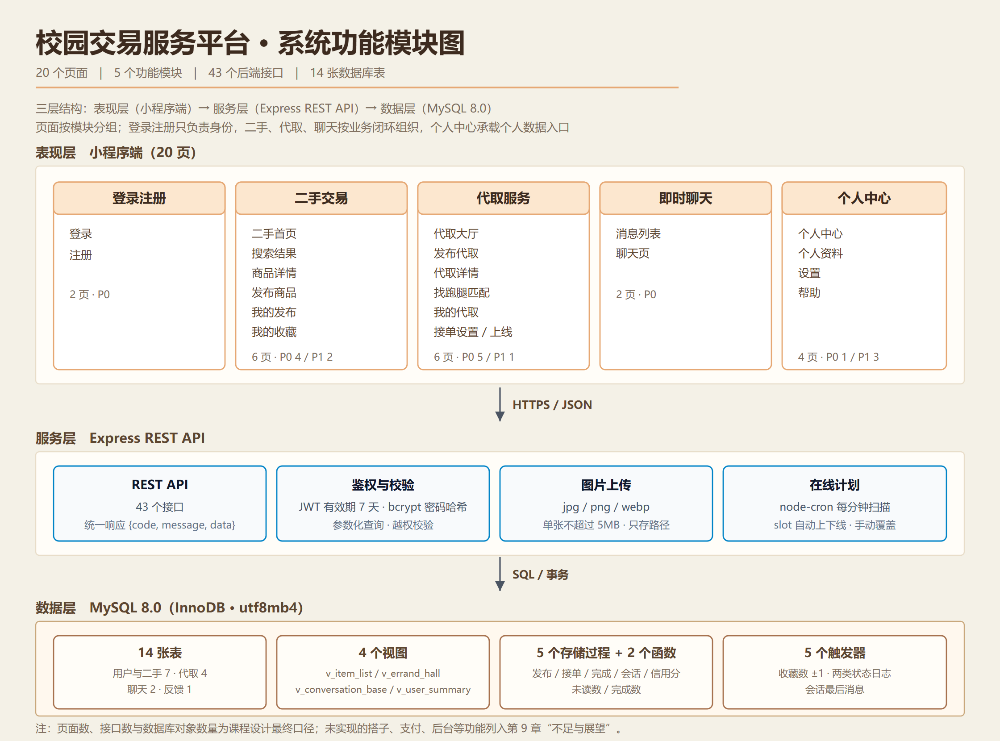

*图1-1系统功能模块图（20个页面、5个模块、43个接口、14张表）*

五个模块的职责如下：

登录注册模块负责学号、密码和昵称的注册与登录，登录后签发JWT，后续接口统一鉴权，它只负责身份，不承载业务。

二手交易模块包含二手首页、搜索结果、商品详情、发布商品、我的发布和我的收藏，买家可以浏览、搜索、收藏、联系卖家，卖家可以发布商品，并在商品详情页执行预订、下架、售出、重新上架等状态操作。

代取服务模块包含代取大厅、发布代取、代取详情、找跑腿匹配、我的代取和接单设置/上线，发布者可以选择直接发布到大厅，或先创建私单找跑腿沟通，跑腿可以配置服务片区、地标、可接规格和在线计划，在大厅接单或从私单会话直接接单。

即时聊天模块包含消息列表与聊天页，会话围绕商品或代取订单建立，支持文字和图片消息，聊天页顶部显示业务卡片，状态操作仍在商品详情或代取详情中完成。

个人中心模块包含个人中心、个人资料、设置和帮助，它是我的发布、我的收藏、我的代取、接单设置等入口的聚合页，不新增业务数据。

页面数量与优先级见表1-2。全项目共20页，其中P0 14页、P1 6页；A负责二手6页，B负责其余14页。底部tabBar保持4个：二手、代取、消息、我的；“上线”复用 `pages/mine/runner?mode=online`，不是独立页面。

**表1-2功能模块与页面**

| 模块 | 页面数 | 优先级 | 核心页面 | 负责人 |
| --- | --- | --- | --- | --- |
| 登录注册 | 2 | P0 2 / P1 0 | 登录、注册 | B |
| 二手交易 | 6 | P0 4 / P1 2 | 二手首页、搜索结果、商品详情、发布商品、我的发布、我的收藏 | A |
| 代取服务 | 6 | P0 5 / P1 1 | 代取大厅、发布代取、代取详情、找跑腿匹配、我的代取、接单设置/上线 | B（后端与数据库由A负责） |
| 即时聊天 | 2 | P0 2 / P1 0 | 消息列表、聊天页 | B（数据库对象由A交付） |
| 个人中心 | 4 | P0 1 / P1 3 | 个人中心、个人资料、设置、帮助 | B |
| 合计 | 20 | P0 14 / P1 6 | — | A 6页 / B 14页 |

### 1.4开发环境与技术选型

开发环境与主要依赖见表1-3。版本以实际安装为准，报告中的版本号用于说明技术栈，不作为部署锁定版本。

**表1-3开发环境与技术选型**

| 类别 | 选型 | 版本 | 用途与理由 |
| --- | --- | --- | --- |
| 操作系统 | Windows 11 | 10.0.26200 | 开发、调试与答辩演示环境 |
| 运行时 | Node.js | 24.x | 运行Express服务、种子脚本与冒烟脚本 |
| 数据库 | MySQL | 8.0.44 | InnoDB事务、外键、行锁；`utf8mb4` 支持中文和emoji；支持 `CHECK`、`JSON`、视图、存储过程和触发器 |
| 后端框架 | Express | 5.3.0 | 轻量REST框架，路由清晰，便于手写SQL展示数据库对象 |
| 数据库驱动 | mysql2 | 3.x | 连接池与参数化查询，避免字符串拼接SQL |
| 鉴权与密码 | jsonwebtoken + bcryptjs | 9.x / 3.x | JWT有效期7天；密码只存bcrypt哈希 |
| 图片上传 | multer | 2.x | 单张图片不超过5MB，只接受jpg/png/webp |
| 定时任务 | node-cron | 4.x | 每分钟扫描跑腿在线计划，避免使用MySQL事件，保持0事件口径 |
| 小程序端 | 微信开发者工具 | 稳定版 | 原生小程序，20个页面，减少框架和构建链风险 |
| 代码与版本 | VS Code + Git | Git 2.53 | 代码编辑、分支与提交历史 |
| 数据库客户端 | Navicat / `mysql` CLI | 8.0 | 建库、查询与对象测试 |
| 接口测试 | Postman + newman | newman 6.2.3 | 119个请求、387条断言，主库与干净测试库各跑通一次（覆盖43/43个接口） |

技术选型遵循两个原则。第一，**数据库能力要能被看见**：不使用ORM自动生成SQL，后端直接使用 `mysql2` 执行参数化SQL，视图、存储过程、函数、触发器和事务都能在代码与报告中一一对应。第二，**演示环境要稳定**：小程序采用原生写法，后端只保留Express、鉴权、上传和定时任务等必要依赖；在线计划由Node进程维护，数据库保持0个事件，避免答辩环境依赖额外调度器。MySQL 8.0的存储引擎、字符集和约束行为以官方手册为准[4]，Express路由与中间件参考官方文档[5]，小程序页面与网络请求遵循微信官方文档[6]，Node.js运行时与定时任务参考Node.js文档[8]。

### 1.5小组分工与协作方式

小组共2人，按“数据库与二手主线”和“小程序公共层与其余业务”分工，具体见表1-4。

**表1-4小组分工**

| 成员 | 主要职责 | 主要交付物 |
| --- | --- | --- |
| 成员A | 数据库DDL、视图、存储过程、函数、触发器、权限；Express基础设施、鉴权、上传；认证、用户、二手、收藏、代取API；二手6个页面；后端测试（并发、性能、安全）；报告第1/2/3/5/6/9章与参考文献；readme、dump、源码打包 | `database/*.sql`、`server/src/**`、A的6个页面、测试记录、A章节 |
| 成员B | 小程序公共层、`app.json`、样式与组件；登录注册、个人中心、代取前端、聊天前端；聊天API；报告第4/7/8/10章、封面、摘要、目录与最终排版；PPT、视频；UI与聊天测试 | B的14个页面、`app.wxss`、`utils/mock.js`、聊天接口、B章节、报告docx、PPT、视频 |

两人协作采用以下机制：

两人协作遵循接口先行原则。先定接口文档（最终v0.11）和统一响应格式，再并行开发；A负责后端实现，B负责mock、契约测试和前端联调，接口变更先同步文档再改代码。文件归属保持清晰：`database/` 只有A修改，`miniprogram/app.json`、公共层、组件和B的14个页面只有B修改，A只改自己的6个页面和列表公共模块；需要改对方文件时先在群里说明，冲突只报告、不擅自覆盖。

版本管理上，`dev` 为集成分支，功能与修复走 `feature/*`、`fix/*`、`docs/*` 分支，合并前检查diff，按M1（二手闭环）、M2（代取+聊天闭环）、M3（数据库对象与冻结）推进，提交信息写清“做了什么、怎么验证、影响谁”。每天固定15分钟同步进度、阻塞和接口变更，当天发现的P0缺陷当天修，P1记录到缺陷清单。质量门禁包括小程序冒烟脚本857条断言（16 脚本，11-28 全量实跑）、mock契约192条、29条核心测试用例、Postman 119个请求/387条断言；M1二手闭环与M2代取+聊天闭环均已通过（M2：阶段1订单 #40、2b API/并发复测、阶段3用户真机确认）。报告协作上，A只写Markdown，B负责合并进 `report/报告.docx` 并统一字体、页眉页脚、目录和页码，A的校对意见写在 `report/A校对意见.md` 或PR评论里，不直接编辑docx。

---

## 第2章 需求分析

### 2.1用户角色与权限

需求分析按软件工程的角色、流程、功能和非功能顺序展开[2]。系统不是按“账号类型”划分角色，而是按“当前用户与业务对象的关系”判断权限：同一个注册用户既可以是买家，也可以是卖家；开通接单设置后还可以作为跑腿接单。角色与权限见表2-1。

**表2-1用户角色与权限**

| 角色 | 进入方式 | 可以做什么 | 不能做什么 |
| --- | --- | --- | --- |
| 游客 | 未登录 | 访问登录、注册页面 | 不能浏览商品、发布商品、查看代取、发起会话；相关页面显示登录引导 |
| 注册用户（买家/卖家） | 学号 + 密码登录，接口携带JWT | 浏览、搜索、收藏商品；发布商品；管理本人商品状态；发布代取；参与会话；维护个人资料 | 不能修改他人商品；不能操作他人订单；不能查看自己未参与的会话；账号被禁用后接口返回403 |
| 跑腿（注册用户的一种能力） | 在“接单设置/上线”页保存服务片区、地标、规格和在线计划 | 在大厅接单；从私单会话直接接单；撤回或释放已接订单；维护本人接单设置 | 不能接自己发布的订单；不能确认完成（仅发布者可以）；不能修改他人设置或订单 |
| 数据库维护人员 | 不通过小程序；root建库与授权，`cs_readonly` 只读查询与备份 | 维护表、视图、过程、触发器与权限；只读排查数据 | 不参与业务操作；应用服务使用 `cs_app`，只有业务库增删改查权限 |

权限判断分两层。第一层是**身份**：除注册、登录和健康检查外，业务接口统一经过JWT中间件，未登录返回401，账号被禁用返回403。第二层是**对象归属**：商品状态只能由卖家修改，代取订单只有发布者能取消/确认完成、只有接单者能释放，会话只有参与者能读写。前端按 `isOwner`、`canTake`、`canEdit` 等计算字段显示按钮，后端仍会再次校验，不能依赖前端隐藏按钮来保证安全。

系统自动任务不是人类角色：`node-cron` 按在线计划自动上下线，触发器维护收藏数、状态日志和会话最后消息。它们没有登录用户，因此状态日志的 `changed_by` 允许为空，用户注销后按 `ON DELETE SET NULL` 保留日志。

### 2.2业务流程分析

#### 2.2.1二手商品交易流程

二手交易流程如图2-1所示。用户注册登录后，如果选择出售，进入发布商品页填写标题、描述、价格、成色、分类、交易地点和图片；发布成功后商品状态为在售（`on_sale`），出现在首页和搜索结果中。如果选择购买，可以从首页分类浏览，也可以进入搜索结果页；搜索页先展示书目卡片，再展示商品，同一本书的商品优先。进入商品详情后，买家可以收藏、联系卖家，双方线下交易，最后由卖家在详情页标记售出。

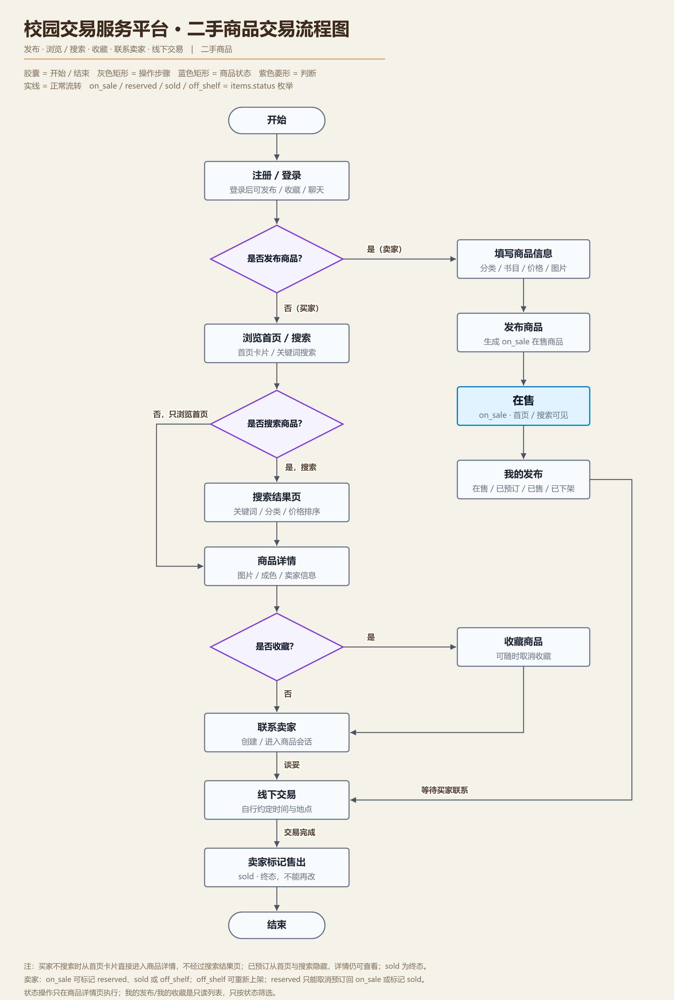

*图2-1二手商品交易流程*

商品有四个状态：在售（`on_sale`）、已预订（`reserved`）、已售出（`sold`）、已下架（`off_shelf`）。状态迁移规则是：在售可以转为已预订、已售出、已下架；已预订可以取消预订回到在售，或直接标记售出；已下架可以重新上架回到在售；已售出是终态。已预订商品从首页和搜索结果中隐藏，但在商品详情和收藏列表中仍能看到状态标签。卖家操作只在商品详情页执行：在售时显示“标记预订/下架/标记售出”，已预订时显示“取消预订/标记售出”，已下架时显示“重新上架”，已售出不显示底栏管理按钮。我的发布和我的收藏是只读列表，只按状态筛选，不提供任何状态操作按钮。

#### 2.2.2代取订单流程

代取订单流程如图2-2所示。发布者进入发布代取页，填写取件片区、具体地标、送达地点、物品规格、报酬和时间要求。默认直接发布到大厅，订单可见性为 `hall`、状态为待接单（`pending`）；如果选择“先找跑腿”，则创建 `private` 私单，私单不出现在大厅，只有发布者、接单者和与该单有会话的跑腿可以查看。

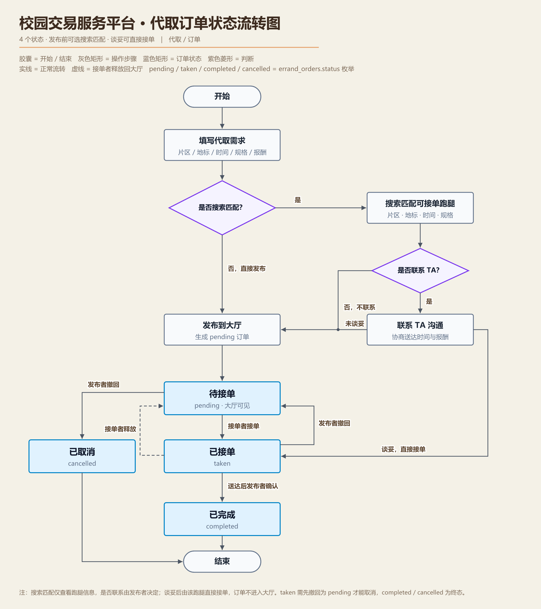

*图2-2代取订单状态流转*

发布者带 `orderId` 进入找跑腿页，按取件片区、地标、时间窗口和规格匹配跑腿，点击“联系TA”后用真实 `orderId` 创建代取会话。跑腿从聊天页顶部业务卡片进入代取详情，`canTake=true` 时可以直接接单，订单变为已接单（`taken`），从大厅消失并被锁单，其他跑腿不能再接。双方未谈妥时，发布者回到发布页按 `orderId` 回填原表单，保存后把同一订单的 `visibility` 从 `private` 改为 `hall`，状态仍是 `pending`，订单号不变。

已接单订单可以由发布者撤回，或由接单者释放，二者都回到待接单，清空 `runner_id` 和 `taken_at`，可见性保持不变；待接单可以由发布者取消，状态变为已取消（`cancelled`）；只有发布者可以确认完成，状态变为已完成（`completed`）。`taken` 不能一步到 `cancelled`。截止时间只是参考，系统不做超时自动取消，也不判定是否按时完成，是否继续由双方协商。

#### 2.2.3聊天流程

聊天流程如图2-3所示。用户从商品详情、代取详情或聊天卡片进入聊天；后端按“两个参与者 + 业务类型 + 业务ID”获取或创建会话，同一对用户在同一商品/订单上的会话唯一。进入聊天页后，前端每3秒轮询一次消息接口，用 `afterId` 只拉增量消息；退出页面停止轮询。发送文字或图片后，消息写入 `messages`，触发器更新会话的最后消息和最后时间；对方进入或停留在聊天页时，用 `lastMessageId` 调用已读接口。

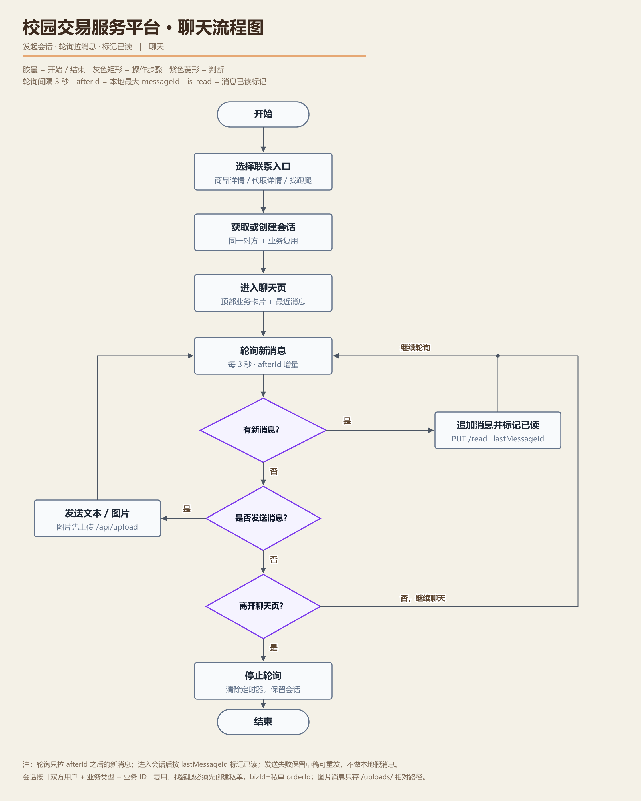

*图2-3聊天流程*

会话列表支持置顶、标记未读和删除：置顶只改 `is_pinned` 并按置顶优先排序，标记未读只改 `is_read`，删除会清理该会话及消息；三者都只对会话参与者开放，不改变对方的会话列表。聊天页顶部固定业务卡片，只展示和导航，不放状态按钮。商品会话显示封面、标题、价格和状态，点击跳到商品详情；代取会话显示规格、取片区、地标、报酬和状态，点击跳到代取详情。状态操作仍由卖家、发布者或接单者在详情页按角色完成，返回聊天页后 `onShow` 重新拉取业务上下文，卡片状态同步更新。图片消息只保存上传后的相对路径，`content` 不存二进制；业务对象被删除时上下文返回空摘要，聊天记录不受影响。

#### 2.2.4跑腿上线与接单设置流程

跑腿上线流程如图2-4所示。个人中心的“接单设置”和代取页的“上线”进入同一页面：前者不带参数，用于维护资料；后者带 `?mode=online`，用于快速上线。页面先回填已有设置，再选择服务片区（25个固定片区，必填）、具体地标（52条受控名称，可空，空表示整个片区都接）、可接规格（小件/中件/大件，可多选）、起步价和备注。

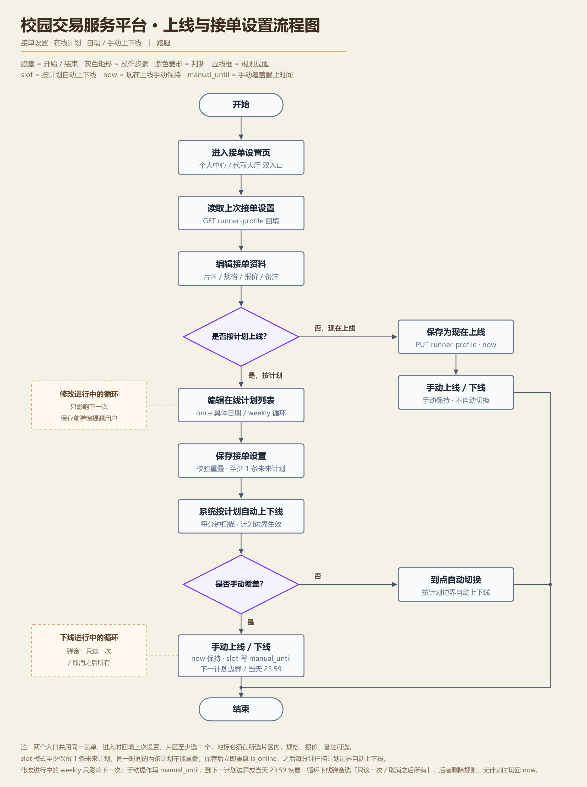

*图2-4上线与接单设置流程*

在线方式分两种：`slot` 按在线计划自动上下线，`now` 表示现在上线并手动保持。`slot` 的计划由 `time_slots` JSON数组保存，每条计划有稳定 `id`，类型为 `once`（具体日期 + 开始/结束时间，多选日期生成多条）或 `weekly`（星期几数组 + 开始/结束时间 + 生效日期）。同一天必须开始早于结束，不支持跨天；同一时间不允许计划重叠；`slot` 至少要有一条未来计划。服务端 `node-cron` 每分钟扫描 `availability_type='slot'` 的跑腿，按计划自动上下线；启动时补算一次。手动上下线会写入 `manual_until`，覆盖到“下一个计划边界或当天23:59”中较早者；保存资料会清空旧的手动覆盖。

进行中的循环计划下线时，前端询问“只提前结束这一次”还是“取消之后所有循环”：前者只结束本次occurrence，规则保留；后者删除该计划并立即下线。修改进行中的循环只影响下一次，前端必须提示“当前这次要结束请用提前下线”。自动下线只影响找跑腿和接新单，不影响已经接下的订单。

### 2.3功能需求

功能需求按模块列出，每条都落到输入、处理、输出和优先级，见表2-2。P0为课程设计必须演示的闭环，P1为完整体验所需的列表和个人资料功能；未实现的搭子、支付、担保、后台、实名认证、距离排序等不进入本表，统一在第9章说明。

**表2-2功能需求清单**

| 编号 | 功能 | 输入 | 处理 | 输出 | 优先级 |
| --- | --- | --- | --- | --- | --- |
| F-01 | 注册与登录 | 学号、密码、昵称 | 校验学号唯一，bcrypt哈希，签发JWT | 用户信息与token | P0 |
| F-02 | 商品列表与分类 | 页码、每页条数、分类、排序 | 查询 `v_item_list`，按最新/价格排序 | 商品卡列表与分页信息 | P0 |
| F-03 | 搜索与书目联想 | 关键词、ISBN、书名 | 查询书目和商品，书目卡片优先，同书商品优先 | 书目卡、商品列表、搜索建议 | P0 |
| F-04 | 发布商品 | 标题、描述、价格、成色、分类、图片、书目 | 校验字段，调用 `sp_publish_item` 事务写商品与图片 | 商品ID与详情 | P0 |
| F-05 | 商品详情 | 商品ID | 查 `v_item_list`、图片、卖家信息、收藏状态和 `isOwner` | 商品详情 | P0 |
| F-06 | 商品状态管理 | 商品ID、目标状态、当前用户 | 校验卖家身份与状态机，更新 `items.status`，触发器写日志 | 新状态与日志 | P0 |
| F-07 | 收藏与取消收藏 | 商品ID、当前用户 | 插入或删除 `favorites`，触发器维护收藏数 | 收藏状态与收藏数 | P0 |
| F-08 | 我的发布 | 当前用户、状态、页码 | 按卖家查询商品，只读列表 | 我的发布列表 | P1 |
| F-09 | 我的收藏 | 当前用户、状态、页码 | 收藏表关联商品表，按状态筛选 | 我的收藏列表 | P1 |
| F-10 | 代取大厅 | 片区、规格、时间类型、排序、页码 | 查询大厅可见且待接单的订单，按条件筛选 | 代取订单列表 | P0 |
| F-11 | 发布代取 | 取件片区/地标、送达地点、规格、图片、报酬、时间、可见性 | 校验片区与地标、时间组合、图片不超过3张，写入订单 | 订单ID与详情 | P0 |
| F-12 | 找跑腿匹配 | 订单ID、片区、地标、规格、时间窗口 | 匹配跑腿设置、可接规格和在线计划 | 候选跑腿列表 | P1 |
| F-13 | 接单、撤回与释放 | 订单ID、当前用户 | `sp_take_errand` 行锁接单；发布者撤回、接单者释放回待接单 | 新状态与订单详情 | P0 |
| F-14 | 完成与取消代取 | 订单ID、当前用户 | 发布者确认完成；待接单可由发布者取消 | 新状态与日志 | P0 |
| F-15 | 接单设置与上线 | 片区、地标、规格、在线计划、`slot`/`now` | 校验计划重叠和未来计划，保存设置并计算在线状态 | 接单设置与在线状态 | P0 |
| F-16 | 消息列表与会话创建 | 当前用户、业务类型、业务ID | 获取或创建会话，返回最后消息与未读数 | 会话列表 / 会话ID | P0 |
| F-17 | 聊天消息 | 会话ID、文字或图片、当前用户 | 校验会话参与者，写入消息，触发器更新会话 | 消息记录与新消息 | P0 |
| F-18 | 个人资料、设置与反馈 | 昵称、头像、学院、手机号、反馈内容 | 更新 `users`，写入 `feedback` | 最新资料与提交结果 | P1 |
| F-19 | 图片上传 | 图片文件 | 校验类型和大小，落盘并返回相对路径 | `/uploads/...` 路径 | P0 |
| F-20 | 会话置顶、标未读与删除 | 会话ID、置顶或未读状态 | 校验参与者，更新 `is_pinned`、`is_read` 或删除会话 | 新状态或删除结果 | P1 |

### 2.4非功能需求

非功能需求见表2-3，指标以课程设计的演示数据和本机环境为准。

**表2-3非功能需求**

| 类别 | 要求 | 实现与验证 |
| --- | --- | --- |
| 性能 | 商品列表接口目标小于300ms；页面首屏1s内可用；聊天3s内看到新消息 | 1000条商品造数后列表接口约14ms；`EXPLAIN` 走 `idx_items_status_created`，无filesort；聊天使用3s轮询和 `afterId` 增量拉取 |
| 安全 | 密码不可逆、接口不可越权、SQL不可注入、上传不可执行 | bcrypt哈希；JWT 7天过期；mysql2参数化查询；商品、订单、会话逐对象校验；上传限制5MB和jpg/png/webp；`cs_app` 只有增删改查，`cs_readonly` 只读 |
| 数据一致性 | 发布商品、接单、完成订单要么全部成功，要么全部回滚；收藏数和最后消息不能失真 | `sp_publish_item`、`sp_take_errand`、`sp_complete_errand` 使用事务；接单使用 `SELECT ... FOR UPDATE` 和条件更新；触发器维护 `favorite_count`、`last_message`、`last_time`；外键与 `CHECK` 兜底 |
| 可用性 | 列表有加载、空、错误三态；未登录有登录引导；表单错误能定位 | 页面统一加载/空态/重试；未登录不发业务请求；表单红字和滚动到首个错误；状态操作有确认弹窗 |
| 可维护性 | 接口格式统一、错误码清晰、文档与代码同步 | 统一响应 `{ code, message, data }`；接口文档v0.11；43个接口；mock契约192/0与857条冒烟断言；路由、工具函数分层 |
| 兼容性 | 小程序在iOS与Android微信中可用；中文和emoji正常 | 原生小程序；MySQL `utf8mb4` + `utf8mb4_0900_ai_ci`；Windows开发环境；MySQL 8.0 |

安全类需求的实现参考OWASP的参数化查询与最小权限建议[7]。

### 2.5数据流图

#### 2.5.1顶层图

顶层图把系统视为一个加工，只界定系统边界，如图2-5所示。外部实体是用户（买家、卖家、跑腿共用同一账号），用户向平台发出商品、代取、聊天请求，平台返回列表、状态和消息结果；平台与数据库之间是业务数据的读写。

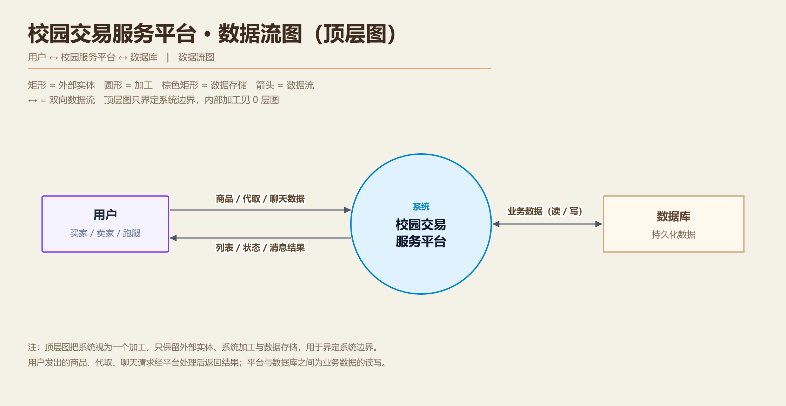

*图2-5顶层数据流图*

#### 2.5.2 0层图

0层图把系统拆成6个加工和4个数据存储，如图2-6所示。加工P1发布商品、P2浏览搜索、P3收藏、P4发布代取、P5接单、P6聊天；数据存储D1为商品与图片（`items`、`item_images`），D2为收藏（`favorites`），D3为代取订单（`errand_orders`），D4为会话与消息（`conversations`、`messages`）。同一个外部实体在图中重复绘制时标 `*`，避免连线交叉；聊天页顶部业务卡片读取商品/订单摘要的流没有展开，避免图中线条过密。

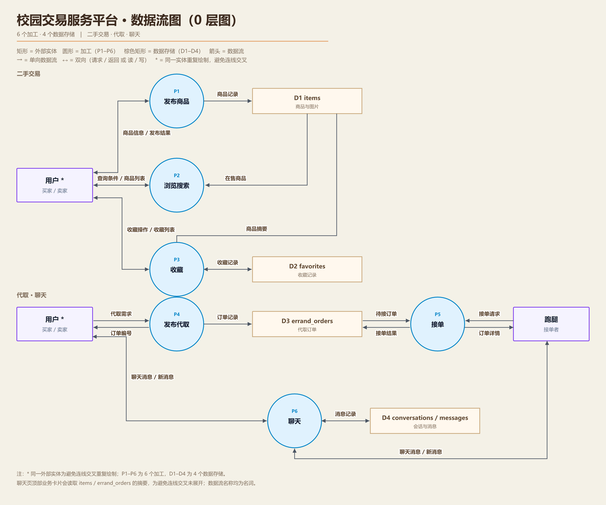

*图2-6 0层数据流图*

加工和数据存储的精确定义放在2.6.4和2.6.5，本节只给出系统边界和数据流向，避免与数据字典重复。0层图只覆盖二手、代取、聊天三条核心业务；登录注册、跑腿设置、反馈等支撑数据不在0层展开，但在数据字典的支撑表中说明。

### 2.6数据字典

数据字典按“数据项、数据结构、数据流、数据存储、处理过程”五部分组织。字段类型和约束与 `database/schema.sql` 一致；完整表结构、3NF论证和索引设计在第4、5章展开，本节只定义需求分析阶段需要说清的数据含义。

#### 2.6.1数据项

用户与商品域的核心数据项见表2-4，代取与聊天域见表2-5。`campus` 字段在用户表和商品表中保留为可空预留字段，课程设计只在北碚校区试点，注册和发布都不采集，保持 `NULL`。

**表2-4用户与商品域核心数据项**

| 数据项 | 含义 | 类型（长度） | 约束 | 来源 |
| --- | --- | --- | --- | --- |
| `user_id` | 用户编号 | BIGINT | 主键、自增 | `users.user_id` |
| `student_no` | 学号 | VARCHAR(20) | 非空、唯一 | `users.student_no` |
| `password_hash` | 密码哈希 | VARCHAR(100) | 非空 | `users.password_hash` |
| `nickname` | 昵称 | VARCHAR(50) | 非空 | `users.nickname` |
| `credit_score` | 信用分 | INT | 默认60，`CHECK 0~100` | `users.credit_score` |
| `status` | 账号状态 | ENUM | `active` / `disabled` | `users.status` |
| `item_id` | 商品编号 | BIGINT | 主键、自增 | `items.item_id` |
| `seller_id` | 卖家编号 | BIGINT | 非空，外键到 `users` | `items.seller_id` |
| `category_id` | 分类编号 | INT | 可空，外键到 `categories` | `items.category_id` |
| `book_id` | 书目编号 | BIGINT | 可空，外键到 `books` | `items.book_id` |
| `title` | 商品标题 | VARCHAR(100) | 非空 | `items.title` |
| `price` | 售价 | DECIMAL(10,2) | 非空，`CHECK >= 0` | `items.price` |
| `original_price` | 原价 | DECIMAL(10,2) | 可空，`CHECK >= 0` | `items.original_price` |
| `condition_level` | 成色 | ENUM | `new` / `like_new` / `good` / `fair` | `items.condition_level` |
| `item_type` | 商品类型 | ENUM | `normal` / `book` | `items.item_type` |
| `items.status` | 商品状态 | ENUM | `on_sale` / `reserved` / `sold` / `off_shelf` | `items.status` |
| `favorite_count` | 收藏数 | INT | 默认0，`CHECK >= 0`，触发器维护 | `items.favorite_count` |
| `image_id` | 图片编号 | BIGINT | 主键、自增 | `item_images.image_id` |
| `url` | 图片地址 | VARCHAR(255) | 非空 | `item_images.url` |
| `created_at` | 创建时间 | DATETIME | 默认当前时间 | `items.created_at` 等 |

**表2-5代取与聊天域核心数据项**

| 数据项 | 含义 | 类型（长度） | 约束 | 来源 |
| --- | --- | --- | --- | --- |
| `order_id` | 代取订单编号 | BIGINT | 主键、自增 | `errand_orders.order_id` |
| `publisher_id` | 发布者编号 | BIGINT | 非空，外键到 `users` | `errand_orders.publisher_id` |
| `runner_id` | 接单者编号 | BIGINT | 可空，外键到 `users` | `errand_orders.runner_id` |
| `pickup_area` | 取件片区 | VARCHAR(20) | 非空 | `errand_orders.pickup_area` |
| `pickup_place` | 取件地标 | VARCHAR(50) | 非空 | `errand_orders.pickup_place` |
| `delivery_location` | 送达地点 | VARCHAR(100) | 非空 | `errand_orders.delivery_location` |
| `item_size` | 物品规格 | ENUM | `small` / `medium` / `large` | `errand_orders.item_size` |
| `reward` | 报酬 | DECIMAL(10,2) | 非空，`CHECK >= 0` | `errand_orders.reward` |
| `images` | 物品图片 | JSON | 可空，数组且 ≤3项；每项 `{url,sortNo}` | `errand_orders.images` |
| `time_type` | 时间类型 | ENUM | `asap` / `deadline` / `range` | `errand_orders.time_type` |
| `time_start` | 开始时间 | DATETIME | 可空，`range` 时必填 | `errand_orders.time_start` |
| `deadline` | 截止时间 | DATETIME | 可空，`deadline`/`range` 时必填 | `errand_orders.deadline` |
| `errand_orders.status` | 代取状态 | ENUM | `pending` / `taken` / `completed` / `cancelled` | `errand_orders.status` |
| `visibility` | 可见性 | ENUM | `private` / `hall` | `errand_orders.visibility` |
| `conversation_id` | 会话编号 | BIGINT | 主键、自增 | `conversations.conversation_id` |
| `user_a_id` | 参与者A | BIGINT | 非空，外键到 `users`，`< user_b_id` | `conversations.user_a_id` |
| `user_b_id` | 参与者B | BIGINT | 非空，外键到 `users` | `conversations.user_b_id` |
| `biz_type` | 业务类型 | ENUM | `item` / `errand` | `conversations.biz_type` |
| `biz_id` | 业务编号 | BIGINT | 非空，默认0；多态引用，无外键 | `conversations.biz_id` |
| `last_message` | 最后消息摘要 | VARCHAR(255) | 可空，触发器维护 | `conversations.last_message` |
| `last_time` | 最后消息时间 | DATETIME | 可空，触发器维护 | `conversations.last_time` |
| `is_pinned` | 会话置顶 | TINYINT(1) | 非空，默认0，`CHECK IN (0,1)` | `conversations.is_pinned` |
| `message_id` | 消息编号 | BIGINT | 主键、自增 | `messages.message_id` |
| `sender_id` | 发送者编号 | BIGINT | 非空，外键到 `users` | `messages.sender_id` |
| `msg_type` | 消息类型 | ENUM | `text` / `image` | `messages.msg_type` |
| `content` | 消息内容 | TEXT | 非空；图片只存路径 | `messages.content` |
| `is_read` | 是否已读 | TINYINT(1) | 默认0，`CHECK IN (0,1)` | `messages.is_read` |
| `log_id` | 日志编号 | BIGINT | 主键、自增 | 两张状态日志表 |
| `changed_by` | 操作者编号 | BIGINT | 可空，用户注销后置空 | 两张状态日志表 |

#### 2.6.2数据结构

主要数据结构见表2-6。数据结构描述“一个业务对象由哪些数据项组成”，不重复表结构的全部字段。

**表2-6主要数据结构**

| 数据结构 | 组成 | 说明 |
| --- | --- | --- |
| 用户账号 | 用户编号 + 学号 + 密码哈希 + 昵称 + 头像 + 学院 + 手机号 + 信用分 + 状态 | 买家、卖家、跑腿共用；学号唯一 |
| 商品发布信息 | 标题 + 描述 + 售价 + 原价 + 成色 + 是否议价 + 分类 + 书目 + 交易地点 + 商品类型 + 图片列表 | 图片0~3张，第一张为封面；书籍模式可关联书目 |
| 商品列表项 | 商品编号 + 标题 + 价格 + 成色 + 交易地点 + 状态 + 封面 + 发布时间 | 由 `v_item_list` 组装，列表页复用 |
| 代取订单 | 发布者 + 接单者 + 取件片区 + 取件地标 + 送达地点 + 规格 + 物品图片列表 + 报酬 + 时间类型/开始/截止 + 状态 + 可见性 | 接单者可空；时间三列由 `CHECK` 约束组合；图片最多3张 |
| 跑腿接单设置 | 服务片区数组 + 服务地标数组 + 在线计划数组 + 在线方式 + 在线状态 + 手动覆盖时间 + 起步价 + 可接规格数组 | 片区必填；地标可空表示整个片区 |
| 在线计划项 | 计划ID + 类型（`once`/`weekly`）+ 日期或星期数组 + 开始时间 + 结束时间 + 生效日期 | `once` 为具体日期；`weekly` 为星期循环 |
| 会话摘要 | 会话编号 + 两个参与者 + 业务类型 + 业务编号 + 最后消息 + 最后时间 + 置顶标记 + 未读数 | 同一对用户在同一业务上的会话唯一 |
| 消息 | 消息编号 + 会话编号 + 发送者 + 消息类型 + 内容 + 是否已读 + 发送时间 | 图片消息只存相对路径 |
| 状态变更日志 | 日志编号 + 对象编号 + 原状态 + 新状态 + 操作者 + 变更时间 | 商品和代取各一张日志表，操作者可空 |

#### 2.6.3数据流

0层图中的主要数据流见表2-7。数据流名称用名词，加工名称用“动词 + 名词”，不把程序调用画成数据流。

**表2-7主要数据流**

| 数据流 | 来源 → 去向 | 组成 | 说明 |
| --- | --- | --- | --- |
| 商品信息 / 发布结果 | 用户 ↔ P1发布商品 | 商品发布信息、图片路径 | 发布成功后返回商品ID和详情 |
| 查询条件 / 商品列表 | 用户 ↔ P2浏览搜索 | 分类、关键词、排序、分页 | 列表只返回在售商品，详情按商品ID查询 |
| 收藏操作 / 收藏列表 | 用户 ↔ P3收藏 | 商品ID、用户ID、状态筛选 | 收藏和取消收藏都更新 `favorites` |
| 代取需求 / 订单编号 | 用户 ↔ P4发布代取 | 片区、地标、送达地点、规格、报酬、时间、可见性 | 大厅单直接可见，私单只对相关方可见 |
| 接单请求 / 接单结果 | 用户 ↔ P5接单 | 订单ID、当前用户 | 行锁接单，成功后状态变为 `taken` |
| 聊天消息 / 新消息 | 用户 ↔ P6聊天 | 会话ID、消息类型、内容、`afterId` | 文字或图片；轮询拉增量 |
| 商品记录 / 在售商品 | D1 ↔ P1、P2、P5 | 商品、图片、书目、分类 | 商品摘要供聊天卡片读取 |
| 收藏记录 | D2 ↔ P3 | 用户ID、商品ID、收藏时间 | 收藏数由触发器维护 |
| 订单记录 / 待接订单 | D3 ↔ P4、P5 | 代取订单、状态、可见性 | 大厅只查 `hall + pending` |
| 消息记录 | D4 ↔ P6 | 会话、消息、已读状态 | 会话最后消息由触发器更新 |

#### 2.6.4数据存储

数据存储分为0层图上的D1~D4和支撑存储S1~S4，见表2-8。D1~D4与图2-6一一对应；S1~S4是被多个加工共享、为避免连线过密没有在0层展开的支撑数据。

**表2-8数据存储**

| 编号 | 名称 | 组成表 | 关键字段 | 读 / 写加工 |
| --- | --- | --- | --- | --- |
| D1 | 商品与图片 | `items`、`item_images`、`books`、`categories` | `item_id`、`seller_id`、`status` | P1、P2、P5 |
| D2 | 收藏记录 | `favorites` | `(user_id, item_id)`、`created_at` | P3 |
| D3 | 代取订单 | `errand_orders` | `order_id`、`publisher_id`、`runner_id`、`status`、`visibility` | P4、P5 |
| D4 | 会话与消息 | `conversations`、`messages` | `conversation_id`、`message_id`、`biz_type`、`biz_id` | P6 |
| S1 | 用户账号 | `users` | `user_id`、`student_no`、`status` | 全部加工的鉴权与关联查询 |
| S2 | 跑腿设置 | `runner_profiles`、`runner_item_sizes` | `user_id`、`service_areas`、`time_slots` | P4（找跑腿）、P5（接单）、上线流程 |
| S3 | 状态日志 | `item_status_logs`、`errand_status_logs` | `log_id`、`old_status`、`new_status`、`changed_by` | 商品/订单状态变更 |
| S4 | 用户反馈 | `feedback` | `feedback_id`、`user_id`、`content` | 帮助页提交 |

#### 2.6.5处理过程

0层图的6个加工见表2-9。每个加工都说明输入、处理要点、输出和读写的存储，后续第6章会给出对应的存储过程、触发器和测试结果。

**表2-9处理过程**

| 编号 | 加工 | 输入 | 处理要点 | 输出 | 数据存储 |
| --- | --- | --- | --- | --- | --- |
| P1 | 发布商品 | 商品发布信息、图片路径 | 校验字段；`sp_publish_item` 在事务中写商品和图片；失败回滚 | 商品ID、发布结果 | D1写 |
| P2 | 浏览搜索 | 分类、关键词、排序、分页 | 查询 `v_item_list`；只返回在售；同书商品优先；分页排序 | 商品列表、商品详情 | D1读 |
| P3 | 收藏 | 商品ID、当前用户 | 校验商品存在；插入或删除 `favorites`；触发器维护收藏数 | 收藏状态、收藏列表 | D2读写、D1读 |
| P4 | 发布代取 | 代取需求 | 校验片区/地标、时间组合；默认 `hall`，私单为 `private` | 订单编号、订单详情 | D3写、S2读 |
| P5 | 接单 | 订单ID、当前用户 | 校验不是本人发布、状态为 `pending`；`sp_take_errand` 行锁并条件更新 | 接单结果、新状态 | D3写、S2读、S1读 |
| P6 | 聊天 | 会话ID、消息内容、`afterId` | 校验参与者；写 `messages`；触发器更新会话最后消息；按 `afterId` 增量拉取 | 新消息、消息记录 | D4读写 |

---

## 第3章 概念设计

### 3.1概念模型概述

概念设计采用Chen记法[1][3]，用矩形表示实体、菱形表示联系、椭圆表示属性，用双矩形、双菱形、虚线下划线分别表示弱实体、标识联系和部分键。项目最终得到 **12个实体、17条联系**，其中强实体6个、弱实体6个、多对多联系1条、多值属性5个、派生属性2个。

概念模型不是14张表的照搬：收藏在图中是“用户—商品”的M:N联系，落地才变成 `favorites` 表；跑腿的“可接规格”是多值属性，落地才变成 `runner_item_sizes` 表。因此12个实体对应12张表，再加这2张，正好14张表。这个“12 + 2 = 14”的口径贯穿第3章和第4章。

### 3.2局部ER图

为了让图在A4页面上可读，概念模型按三条业务主线拆成3张局部ER图，每张4~6个实体；“用户”在三张图中各出现一次，方便每张图独立阅读。

#### 3.2.1用户—商品—收藏局部ER图

二手交易局部ER图如图3-1所示，包含6个实体、7条联系。实体是用户、书目、分类、商品、商品图片和商品状态日志；联系是关联、属于、出售、收藏、包含、生成和操作。

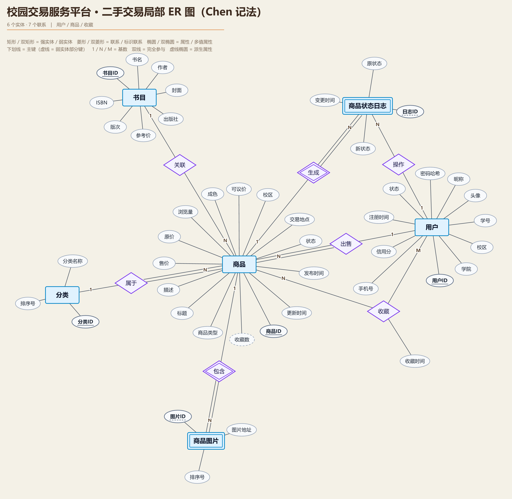

*图3-1二手交易局部ER图（6个实体、7条联系）*

书目与商品是1:N的“关联”，商品端的 `book_id` 可以为空，普通物品不必关联书目；分类与商品是1:N的“属于”，发布接口强制选择分类，数据库列可空只是为分类删除时的 `SET NULL` 留余地；用户与商品是1:N的“出售”，商品必须有卖家，用户可以只买不卖。用户与商品之间还有一条M:N的“收藏”，收藏时间挂在联系上，落地为 `favorites` 的复合主键和 `created_at`。

商品图片和商品状态日志是弱实体：图片离开商品没有意义，日志离开商品也没有意义，父商品删除时按 `ON DELETE CASCADE` 级联删除。图片和日志都用双矩形、标识联系用双菱形、部分键用虚线下划线表示；物理表仍然使用自增代理键，这是“概念上依附、物理上用代理键”的实现方式。商品状态日志还有一条“用户—操作—日志”的联系，操作者 `changed_by` 可空，因此用户端是单线（部分参与），日志端是双线（完全参与）。商品上的“收藏数”是派生属性，等于 `COUNT(favorites)`，表里的 `favorite_count` 是为列表性能保留的缓存列。

#### 3.2.2用户—跑腿设置—代取订单局部ER图

代取局部ER图如图3-2所示，包含4个实体、5条联系。实体是用户、跑腿设置、代取订单和代取状态日志；联系是配置、发布、接单、生成和操作。

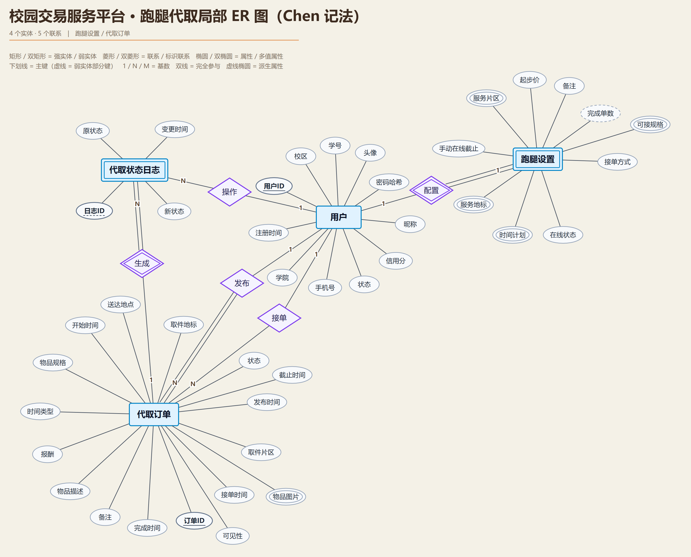

*图3-2跑腿代取局部ER图（4个实体、5条联系）*

用户与跑腿设置是1:1的“配置”，设置是弱实体：一个用户最多一条接单设置，`runner_profiles.user_id` 既是主键又是外键，用户删除时级联删除。用户与代取订单有两条1:N联系：“发布”对应 `publisher_id`，每单必有发布者；“接单”对应 `runner_id`，订单可以暂时没人接，所以订单端是单线（部分参与）。代取订单与代取状态日志是1:N的“生成”，日志是弱实体；用户与日志是1:N的“操作”，操作者可空。

跑腿设置上画了四个多值属性：服务片区、服务地标、时间计划和可接规格。可接规格落地为 `runner_item_sizes` 子表，使用 `(user_id, item_size)` 复合主键；服务片区、服务地标和时间计划总是整份设置一起读写，落地为JSON数组，控制在14张表的范围内。代取订单还画了物品图片、时间类型、开始时间、截止时间和可见性：物品图片最多3张，落地为 `errand_orders.images` JSON数组；时间类型、开始时间、截止时间对应 `asap`/`deadline`/`range` 三种时间要求，由表级 `CHECK` 保证组合合法；可见性与状态正交，私单转大厅只改 `visibility`，状态仍是 `pending`。

#### 3.2.3会话与反馈局部ER图

会话与反馈局部ER图如图3-3所示，包含4个实体、5条联系。实体是用户、会话、消息和反馈；联系是发起会话、加入会话、归属、发送和提交。

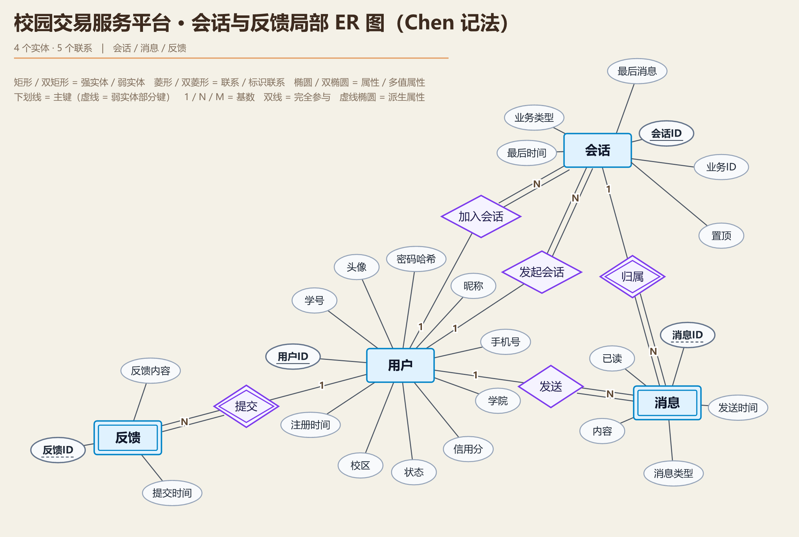

*图3-3会话与反馈局部ER图（4个实体、5条联系）*

二人会话没有画成一条M:N联系，而是拆成“发起会话”和“加入会话”两条1:N，分别对应 `user_a_id` 和 `user_b_id` 两个外键。如果画成M:N，就需要额外的“会话参与者”中间表，会变成15张表；两条1:N正好表达“每个会话必须有两个参与者”，会话端都是双线。这里的“发起/加入”只是概念角色，物理表不保存谁先发起，两列按用户ID大小归一化。

消息和反馈是弱实体：消息离开会话没有意义，反馈离开用户没有意义，父对象删除时级联删除。消息与用户是1:N的“发送”，每条消息必须有发送者；会话与消息是1:N的“归属”；用户与反馈是1:N的“提交”。会话的 `biz_id` 可能指向商品，也可能指向代取订单，是典型的多态引用，MySQL外键只能指向一张表，所以图上不画“会话—商品/订单”的联系，聊天页顶部卡片由后端按 `biz_type` 再查一次。会话的最后消息和最后时间是从消息汇总出来的冗余字段，为了保证会话列表性能而保留；会话还保存置顶标记 `is_pinned`，列表按置顶优先、最后时间倒序，置顶是用户偏好，不改变未读数，也不由触发器维护。

### 3.3全局ER图

把三张局部图合并、去掉重复的“用户”，得到全局ER图。全局图有12个实体、17条联系，隐藏普通属性的总览图如图3-4所示，用于正文阅读和答辩开场；完整属性视图如图3-5所示，供核对每个实体的属性。

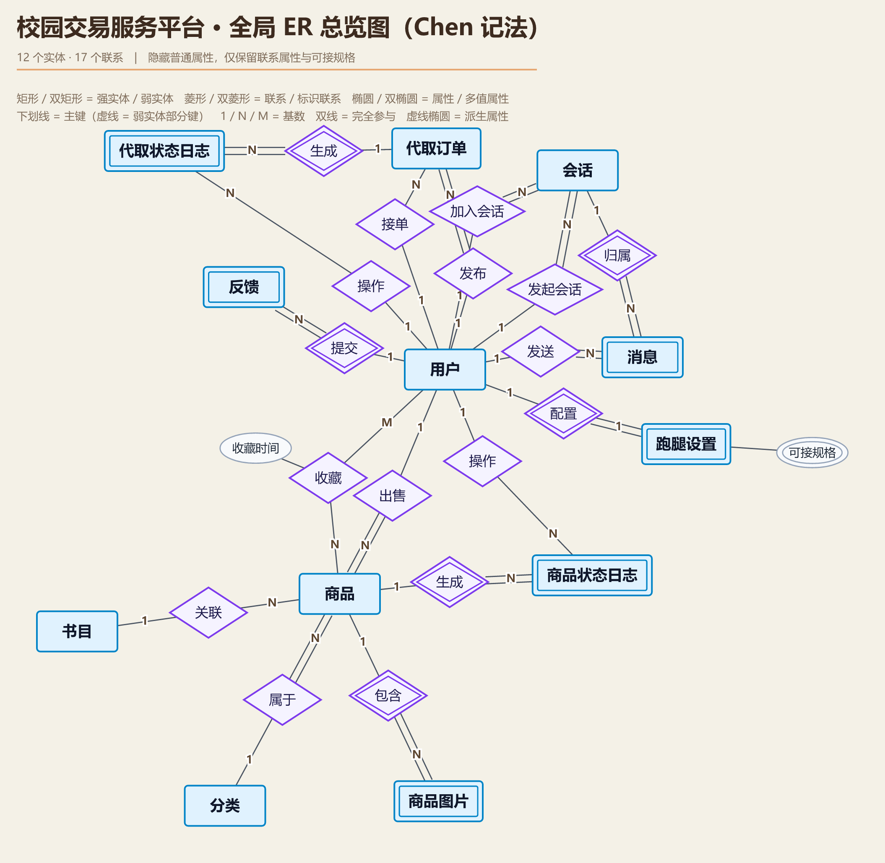

*图3-4全局ER图总览（12个实体、17条联系，隐藏普通属性）*

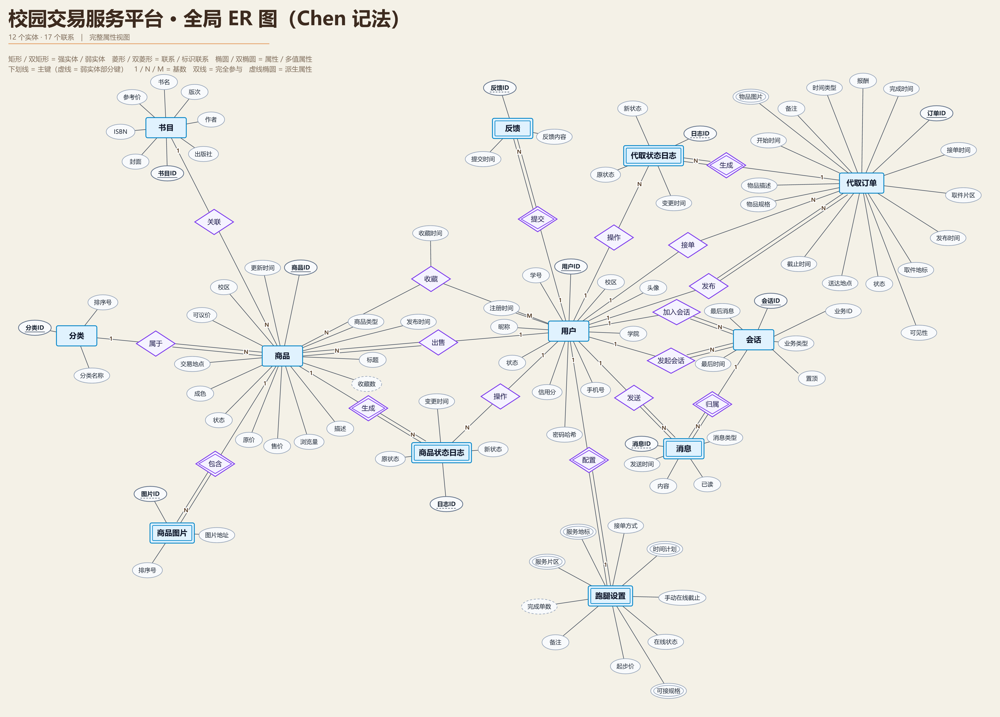

*图3-5全局ER图（12个实体、17条联系，完整属性视图）*

局部图的实体数是6 + 4 + 4 = 14，去重“用户”两次后是12。全局图不是局部图的简单拼接：它要保证同一个实体只出现一次、同一对实体之间的多条联系都能区分、联系的基数和参与度不矛盾。例如用户与代取订单之间有“发布”和“接单”两条1:N，不能用一条联系代替；用户与商品之间同时有“出售”和“收藏”，一个是1:N、一个是M:N，也必须分开画。

总览图回答“系统整体怎么连”，完整属性视图回答“每个实体有哪些属性”。两张图共享同一套编号和联系名称，正文以图3-4总览为主，核对属性时见图3-5。

### 3.4实体与联系说明

#### 3.4.1实体清单

12个实体的类型、主键和落地表见表3-1。强实体有独立身份；弱实体在概念上依附父对象，物理表使用自增代理键加父键外键。

**表3-1实体清单**

| # | 实体 | 类型 | 主键 / 部分键 | 落地表 | 说明 |
| --- | --- | --- | --- | --- | --- |
| 1 | 用户 | 强实体 | 用户ID | `users` | 买家、卖家、跑腿共用一张账号表 |
| 2 | 书目 | 强实体 | 书目ID | `books` | 同一本书的公版信息，供同书多卖复用 |
| 3 | 分类 | 强实体 | 分类ID | `categories` | 二手分类，名称唯一 |
| 4 | 商品 | 强实体 | 商品ID | `items` | 一次具体的二手交易 |
| 5 | 商品图片 | 弱实体 | 图片ID（部分键） | `item_images` | 商品的图片，业务上限3张 |
| 6 | 商品状态日志 | 弱实体 | 日志ID（部分键） | `item_status_logs` | 商品每次状态变化写一条 |
| 7 | 跑腿设置 | 弱实体 | 无独立主键，靠用户ID 1:1标识 | `runner_profiles` | 一个用户最多一条接单配置 |
| 8 | 代取订单 | 强实体 | 订单ID | `errand_orders` | 一次代取需求 |
| 9 | 代取状态日志 | 弱实体 | 日志ID（部分键） | `errand_status_logs` | 订单每次状态变化写一条 |
| 10 | 会话 | 强实体 | 会话ID | `conversations` | 两个人围绕一个商品或订单的聊天 |
| 11 | 消息 | 弱实体 | 消息ID（部分键） | `messages` | 会话里的一条消息 |
| 12 | 反馈 | 弱实体 | 反馈ID（部分键） | `feedback` | 用户提交的一条意见 |

#### 3.4.2联系清单

17条联系的两端、基数、类型和落地方式见表3-2。图上的每个菱形都能在表中找到一行；表中唯一的例外是 `runner_item_sizes.user_id`，它来自“可接规格”这个多值属性，图上没有单独画联系。

**表3-2联系清单**

| # | 联系 | 两端实体 | 基数 | 类型 | 落地表 / 外键 |
| --- | --- | --- | --- | --- | --- |
| 1 | 关联 | 书目 — 商品 | 1:N | 普通联系 | `items.book_id` |
| 2 | 属于 | 分类 — 商品 | 1:N | 普通联系 | `items.category_id` |
| 3 | 出售 | 用户 — 商品 | 1:N | 普通联系 | `items.seller_id` |
| 4 | 收藏 | 用户 — 商品 | M:N | 普通联系 | `favorites(user_id, item_id)` |
| 5 | 包含 | 商品 — 商品图片 | 1:N | 标识联系 | `item_images.item_id` |
| 6 | 生成 | 商品 — 商品状态日志 | 1:N | 标识联系 | `item_status_logs.item_id` |
| 7 | 操作 | 用户 — 商品状态日志 | 1:N | 普通联系 | `item_status_logs.changed_by` |
| 8 | 配置 | 用户 — 跑腿设置 | 1:1 | 标识联系 | `runner_profiles.user_id` |
| 9 | 发布 | 用户 — 代取订单 | 1:N | 普通联系 | `errand_orders.publisher_id` |
| 10 | 接单 | 用户 — 代取订单 | 1:N | 普通联系 | `errand_orders.runner_id` |
| 11 | 生成 | 代取订单 — 代取状态日志 | 1:N | 标识联系 | `errand_status_logs.order_id` |
| 12 | 操作 | 用户 — 代取状态日志 | 1:N | 普通联系 | `errand_status_logs.changed_by` |
| 13 | 发起会话 | 用户 — 会话 | 1:N | 普通联系 | `conversations.user_a_id` |
| 14 | 加入会话 | 用户 — 会话 | 1:N | 普通联系 | `conversations.user_b_id` |
| 15 | 归属 | 会话 — 消息 | 1:N | 标识联系 | `messages.conversation_id` |
| 16 | 发送 | 用户 — 消息 | 1:N | 普通联系 | `messages.sender_id` |
| 17 | 提交 | 用户 — 反馈 | 1:N | 标识联系 | `feedback.user_id` |

### 3.5冲突消除

三张局部图合并时，会出现命名、属性和结构三类冲突。冲突不是画图错误，而是不同业务视角对同一对象的不同叫法；概念设计阶段要把它们统一到一套口径。

#### 3.5.1命名冲突

`users` 在二手域叫“卖家”，在代取域叫“发布者/接单者”，在聊天域叫“发送者”，在日志里叫“操作者”。这些角色共用一张用户表，统一用 `user_id` 外键关联，不在数据库里建多张角色表。商品和代取订单都涉及“订单”一词，报告中统一写“商品”和“代取订单”，字段分别用 `item_id` 和 `order_id`，避免把 `items` 和 `errand_orders` 混为一谈。

#### 3.5.2属性冲突

商品售价和代取报酬都表示金额，统一用 `DECIMAL(10,2)`，单位为元，不使用 `FLOAT`。商品状态和代取状态都用ENUM，但取值集合不同：商品是 `on_sale`/`reserved`/`sold`/`off_shelf`，代取是 `pending`/`taken`/`completed`/`cancelled`，不能合并成一个状态字段。时间语义也不同：商品用 `created_at`/`updated_at` 记录发布和更新时间，代取订单用 `time_type`+`time_start`+`deadline` 表示三种时间要求，聊天用 `created_at` 记录发送时间。收藏数、完成单数、最后消息/最后时间是从其他表汇总出来的冗余属性，图中用虚线椭圆或普通属性标注，数据库里由触发器或存储过程维护。

#### 3.5.3结构冲突

结构冲突主要集中在四类。第一，多对多联系变表：收藏是M:N联系，落地为 `favorites` 复合主键表，它没有独立身份，不画成实体。第二，多值属性变表或JSON：可接规格拆成 `runner_item_sizes` 子表，服务片区、服务地标、在线计划、代取物品图片用JSON数组存；严格1NF会把它们都拆成子表，但会超过14张表的口径，JSON的取舍在第5、6章说明。第三，1:1与弱实体：跑腿设置与用户是1:1，直接把 `user_id` 作为主键兼外键；商品图片、消息、反馈和两张日志表在概念上是弱实体，物理表用自增代理键加父键外键实现。第四，多态引用：会话的 `biz_id` 可能指向商品或代取订单，MySQL外键只能指向一张表，所以不建外键、不画联系，聊天页顶部卡片由后端按 `biz_type` 再查，业务被删除时返回空摘要。

日志联系也做过一次结构取舍：一次状态变更同时涉及“商品/订单、用户、日志”三方，画成三元联系也说得通；但 `changed_by` 允许为空，三元联系不方便表达“操作者可以为空”，而两条二元联系正好对应日志表的两个外键，所以最终采用“对象—生成—日志”和“用户—操作—日志”两条二元联系。二人会话同理：用“发起会话 + 加入会话”两条1:N代替一条M:N，避免多一张会话参与者表。

### 3.6关系模式转换

把概念模型转换成关系模式时，强实体转一张表，主键照搬；1:N联系把“1端”主键放到“N端”做外键；1:1联系让一方主键兼作外键，并加唯一性约束；M:N联系单独建中间表，两个外键组成复合主键；多值属性拆子表或存JSON数组；弱实体用“父键 + 部分键”定位，物理上可用自增代理键加父键外键；派生属性不建列，查询时计算，为了性能保留的缓存列要有明确的维护者；联系属性放进联系对应的表。

按这些规则，12个实体和2个“由联系/多值属性变来的表”共映射为14张表，见表3-3。完整字段、3NF论证和表结构细节在第4章由B展开，本节只给出映射结果。

**表3-3概念模型到关系模式的映射**

| # | ER对象 | 类别 | 落地表 | 主键 | 关键外键 / 说明 |
| --- | --- | --- | --- | --- | --- |
| 1 | 用户 | 强实体 | `users` | `user_id` | 学号唯一 |
| 2 | 书目 | 强实体 | `books` | `book_id` | ISBN可空且唯一 |
| 3 | 分类 | 强实体 | `categories` | `category_id` | 分类名唯一 |
| 4 | 商品 | 强实体 | `items` | `item_id` | `seller_id`、`category_id`、`book_id` 三个外键 |
| 5 | 商品图片 | 弱实体 | `item_images` | `image_id` | `item_id` 外键，级联删除 |
| 6 | 商品状态日志 | 弱实体 | `item_status_logs` | `log_id` | `item_id`、`changed_by` 两个外键 |
| 7 | 跑腿设置 | 弱实体 | `runner_profiles` | `user_id` | `user_id` 同时是外键，1:1 |
| 8 | 可接规格 | 多值属性 | `runner_item_sizes` | `(user_id, item_size)` | `user_id` 外键到跑腿设置 |
| 9 | 代取订单 | 强实体 | `errand_orders` | `order_id` | `publisher_id`、`runner_id` 两个外键 |
| 10 | 代取状态日志 | 弱实体 | `errand_status_logs` | `log_id` | `order_id`、`changed_by` 两个外键 |
| 11 | 会话 | 强实体 | `conversations` | `conversation_id` | `user_a_id`、`user_b_id` 两个外键 |
| 12 | 消息 | 弱实体 | `messages` | `message_id` | `conversation_id`、`sender_id` 两个外键 |
| 13 | 反馈 | 弱实体 | `feedback` | `feedback_id` | `user_id` 外键，级联删除 |
| 14 | 收藏 | M:N联系 | `favorites` | `(user_id, item_id)` | 两个外键；`created_at` 是联系属性 |

数量核对：12个实体对应12张表，加上“收藏”和“可接规格”这2张，正好14张。第4章会在这14张表的基础上给出完整关系模式、3NF论证和表结构清单。

---

## 第 4 章 数据库逻辑设计

### 4.1 关系模式

14 张表的关系模式如下（表 4-1）。所有表均满足第三范式（3NF），论证见 4.2；金额类属性统一 `DECIMAL(10,2)`，状态类属性统一 ENUM 枚举并配套 CHECK 约束。

**表 4-1 关系模式一览**

| # | 表名 | 关系模式 | 主要外键 |
| --- | --- | --- | --- |
| 1 | 用户表 | users(**user_id**, student_no, password_hash, nickname, avatar_url, campus, college, phone, credit_score, status, created_at) | — |
| 2 | 书目表 | books(**book_id**, isbn, title, author, publisher, edition, price_ref, cover_url) | — |
| 3 | 二手分类表 | categories(**category_id**, name, sort_no) | — |
| 4 | 商品主表 | items(**item_id**, seller_id FK→users, category_id FK→categories, book_id FK→books, item_type, title, description, price, original_price, condition_level, negotiable, campus, location, status, view_count, favorite_count, created_at, updated_at) | seller_id / category_id / book_id |
| 5 | 商品图片表 | item_images(**image_id**, item_id FK→items, url, sort_no) | item_id |
| 6 | 收藏表 | favorites(**user_id** FK→users, **item_id** FK→items, created_at) | (user_id, item_id) 复合主键 |
| 7 | 跑腿接单设置表 | runner_profiles(**user_id** FK→users, is_online, availability_type, service_areas, service_places, time_slots, manual_until, base_price, remark, completed_count) | user_id（与用户 1:1） |
| 8 | 跑腿可接规格表 | runner_item_sizes(**user_id** FK→runner_profiles, **item_size**) | user_id |
| 9 | 代取订单表 | errand_orders(**order_id**, publisher_id FK→users, runner_id FK→users, pickup_area, pickup_place, delivery_location, item_size, item_desc, remark, reward, time_type, time_start, deadline, status, visibility, created_at, taken_at, completed_at) | publisher_id / runner_id |
| 10 | 会话表 | conversations(**conversation_id**, user_a_id FK→users, user_b_id FK→users, biz_type, biz_id, last_message, last_time) | user_a_id / user_b_id |
| 11 | 消息表 | messages(**message_id**, conversation_id FK→conversations, sender_id FK→users, msg_type, content, is_read, created_at) | conversation_id / sender_id |
| 12 | 商品状态日志表 | item_status_logs(**log_id**, item_id FK→items, old_status, new_status, changed_by FK→users, changed_at) | item_id / changed_by |
| 13 | 代取状态日志表 | errand_status_logs(**log_id**, order_id FK→errand_orders, old_status, new_status, changed_by FK→users, changed_at) | order_id / changed_by |
| 14 | 用户反馈表 | feedback(**feedback_id**, user_id FK→users, content, created_at) | user_id |

实体联系说明（对应图 4-1 关系模式图，可选绘制）：

- users 与 items 是 **1 : n**（一个用户发布多件商品）；users 与 runner_profiles 是 **1 : 1**（一个用户至多一份接单设置）。
- users 与 errand_orders 存在**两条** 1:n 联系（作为发布者 publisher_id、作为接单人 runner_id，接单人可为空）。
- users 与 users 通过 conversations 构成**多对多**的会话联系，并由 (biz_type, biz_id) 绑定到具体商品或代取单；conversations 与 messages 是 **1 : n**。
- items 与 item_images 是 **1 : n**；users、items 通过 favorites 构成**多对多**收藏联系（复合主键天然去重）。
- items / errand_orders 与各自的状态日志表是 **1 : n**，日志表记录状态机每次迁移的轨迹（审计用途）。

### 4.2 3NF 论证（挑 4 张核心表）

判定路径：1NF（属性原子）→ 2NF（非主属性完全函数依赖于候选键）→ 3NF（消除非主属性对候选键的传递依赖）。

#### 4.2.1 items（商品主表）

- **1NF**：所有属性均为不可再分的原子值；多值属性「图片」被拆出到 item_images，满足原子性。
- **2NF**：主键为单属性 item_id，不存在复合主键，部分依赖问题无从产生。
- **3NF 论证（消除传递依赖）**：最初的草稿把「分类名称 category_name」「书名 book_title」直接放进商品表，形成传递依赖
  `item_id → category_id → category_name`、`item_id → book_id → book_title`——分类一旦改名就要批量更新所有商品行，且存在插入异常（新分类没有商品时无处安放）。因此把分类名与书名分别归位到 categories、books 两张主表，items 只保留外键 category_id / book_id，**消除了这两条传递依赖**。同理，「卖家昵称 / 信用分」依赖 seller_id 而非 item_id，统一由 JOIN users 得到，不在 items 冗余存储。
- 另外价格类属性带 `CHECK (price >= 0)`，浏览量/收藏量 `CHECK >= 0`，保证用户自定义完整性。

#### 4.2.2 errand_orders（代取订单表）

- **1NF**：「取件片区 + 取件地标 + 送达地」拆为三个独立属性（pickup_area / pickup_place / delivery_location），不做「桃园 · 三食堂」式的拼串存储；时间拆为 time_type + time_start + deadline 三列。
- **2NF**：单属性主键 order_id，无部分依赖。
- **3NF 论证**：设计上容易出现的传递依赖是「接单人 → 接单人昵称/头像」，即 `order_id → runner_id → runner_nickname`。若在订单表冗余接单人昵称，用户改名后历史订单展示将不一致。本表只保留 runner_id 外键，展示字段经 JOIN users 获取，**消除了对 runner 的传递依赖**（会话卡片所需的发布者昵称快照由视图/查询层组装，不在表层冗余）。
- 表级 CHECK 同时约束了状态机与时间语义：`chk_errands_time` 保证 asap 不带时间、deadline 必有截止、range 必有起止且 `time_start < deadline`，把「非法组合」挡在数据库层而非只靠应用层。

#### 4.2.3 messages（消息表）

- **1NF**：消息内容整体为 TEXT 原子属性，图片消息只存 url 不存二进制。
- **2NF**：主键 message_id 单属性，无部分依赖。
- **3NF 论证**：会话的双方用户、业务对象等描述信息都依赖 conversation_id 而非 message_id。若把 user_a/user_b 或商品标题放进消息表，则每条消息都要冗余一份会话级数据——这是典型的传递依赖 `message_id → conversation_id → 会话属性`。消息表只保留 conversation_id 外键，**消除该传递依赖**。
- 未读数不在表内聚合存储（避免计数器维护不一致），由触发器 + `v_conversation_base` 视图按 `is_read = 0` 实时聚合，读侧一致性由数据库对象保证。

#### 4.2.4 runner_profiles（跑腿接单设置表）

- **1NF**：「服务片区」「服务地标」「在线时段」均为多值集合，拆为 JSON 数组列 + 独立的 runner_item_sizes 规格表（复合主键 (user_id, item_size)），不在一行里放逗号串，满足原子性。
- **2NF**：主键 user_id 单属性（与 users 1:1），无部分依赖。
- **3NF 论证**：完成单数 completed_count 是「由接单行为聚合出来的派生属性」，理论上可由 errand_orders 统计得出——若直接依赖订单表计算，它对 user_id 的依赖是通过 errand_orders 的传递依赖。设计上将其作为**可验证的冗余计数**保留（由触发器/事务维护），并以 `CHECK (completed_count >= 0)` 约束；这是「反规范化换查询性能」的明确取舍，其余属性均无传递依赖。
- `chk_runner_slot_requires_schedule` 保证「按计划上线」至少有一条未来时段，业务规则下沉到数据库层。

#### 小结

- 全库 14 张表满足 3NF；仅 completed_count 一处为有约束保障的反规范化冗余。
- 状态机（items.status、errand_orders.status）全部用 ENUM + 日志表 + 触发器三方固化，杜绝「字符串状态」。
- 金额统一 DECIMAL(10,2) 并 CHECK 非负，对应接口层 v0.10 的两位小数校验（前后端三层同口径）。

### 4.3 表结构（从 schema.sql 整理，表 4-2 ~ 4-15）

> 字段名/类型/约束与 `database/schema.sql` 完全一致，禁止手打；说明列为业务含义。

**表 4-2 users（用户表）**

| 字段 | 类型 | 约束 | 说明 |
| --- | --- | --- | --- |
| user_id | BIGINT | 主键自增 | 用户 ID |
| student_no | VARCHAR(20) | NOT NULL，唯一 uk_users_student_no | 学号（登录名） |
| password_hash | VARCHAR(100) | NOT NULL | 密码哈希 |
| nickname | VARCHAR(50) | NOT NULL | 昵称 |
| avatar_url | VARCHAR(255) | NULL | 头像地址 |
| campus | VARCHAR(50) | NULL | 校区（保留字段） |
| college | VARCHAR(100) | NULL | 学院 |
| phone | VARCHAR(20) | NULL | 手机号 |
| credit_score | INT | NOT NULL 默认 60，CHECK 0~100 | 信用分 |
| status | ENUM('active','disabled') | NOT NULL 默认 active | 账号状态 |
| created_at | DATETIME | NOT NULL 默认当前时间 | 注册时间 |

**表 4-3 books（书目表）**

| 字段 | 类型 | 约束 | 说明 |
| --- | --- | --- | --- |
| book_id | BIGINT | 主键自增 | 书目 ID |
| isbn | VARCHAR(20) | NULL，唯一 uk_books_isbn | ISBN（去重键） |
| title | VARCHAR(200) | NOT NULL | 书名 |
| author | VARCHAR(100) | NULL | 作者 |
| publisher | VARCHAR(100) | NULL | 出版社 |
| edition | VARCHAR(50) | NULL | 版次 |
| price_ref | DECIMAL(10,2) | NULL，CHECK ≥0 | 参考价 |
| cover_url | VARCHAR(255) | NULL | 封面地址 |

**表 4-4 categories（二手分类表）**

| 字段 | 类型 | 约束 | 说明 |
| --- | --- | --- | --- |
| category_id | INT | 主键自增 | 分类 ID |
| name | VARCHAR(50) | NOT NULL，唯一 | 分类名 |
| sort_no | INT | NOT NULL 默认 0 | 排序号 |

**表 4-5 items（商品主表）**

| 字段 | 类型 | 约束 | 说明 |
| --- | --- | --- | --- |
| item_id | BIGINT | 主键自增 | 商品 ID |
| seller_id | BIGINT | NOT NULL，FK→users，RESTRICT | 卖家 |
| category_id | INT | NULL，FK→categories，SET NULL | 分类 |
| book_id | BIGINT | NULL，FK→books，SET NULL | 书目（book 类商品） |
| item_type | ENUM('normal','book') | NOT NULL 默认 normal | 商品类型 |
| title | VARCHAR(100) | NOT NULL | 标题 |
| description | TEXT | NULL | 描述 |
| price | DECIMAL(10,2) | NOT NULL，CHECK ≥0 | 售价 |
| original_price | DECIMAL(10,2) | NULL，CHECK ≥0 | 原价 |
| condition_level | ENUM('new','like_new','good','fair') | NOT NULL 默认 good | 成色 |
| negotiable | TINYINT(1) | NOT NULL 默认 0，CHECK ∈(0,1) | 可议价 |
| campus | VARCHAR(50) | NULL | 校区（保留） |
| location | VARCHAR(100) | NULL | 交易地点 |
| status | ENUM('on_sale','reserved','sold','off_shelf') | NOT NULL 默认 on_sale | 状态 |
| view_count | INT | NOT NULL 默认 0，CHECK ≥0 | 浏览量 |
| favorite_count | INT | NOT NULL 默认 0，CHECK ≥0 | 收藏数 |
| created_at / updated_at | DATETIME | NOT NULL，自动维护 | 创建/更新时间 |

索引：idx_items_status_created(status,created_at)、idx_items_book_status_created、idx_items_category_price(category_id,price)、idx_items_seller_status。

**表 4-6 item_images（商品图片表）**

| 字段 | 类型 | 约束 | 说明 |
| --- | --- | --- | --- |
| image_id | BIGINT | 主键自增 | 图片 ID |
| item_id | BIGINT | NOT NULL，FK→items，CASCADE | 所属商品 |
| url | VARCHAR(255) | NOT NULL | 图片地址 |
| sort_no | INT | NOT NULL 默认 0 | 排序号（封面取最小） |

**表 4-7 favorites（收藏表）**

| 字段 | 类型 | 约束 | 说明 |
| --- | --- | --- | --- |
| user_id | BIGINT | 复合主键，FK→users，CASCADE | 收藏人 |
| item_id | BIGINT | 复合主键，FK→items，CASCADE | 被收藏商品 |
| created_at | DATETIME | NOT NULL 默认当前时间 | 收藏时间 |

**表 4-8 runner_profiles（跑腿接单设置表）**

| 字段 | 类型 | 约束 | 说明 |
| --- | --- | --- | --- |
| user_id | BIGINT | 主键，FK→users，CASCADE | 用户（1:1） |
| is_online | TINYINT(1) | NOT NULL 默认 0 | 当前是否上线 |
| availability_type | ENUM('slot','now') | NOT NULL 默认 slot | 在线方式 |
| service_areas | JSON | NOT NULL，CHECK 为非空数组 | 服务片区 |
| service_places | JSON | NOT NULL 默认 [] | 服务地标 |
| time_slots | JSON | NOT NULL 默认 [] | 在线计划 |
| manual_until | DATETIME | NULL | 手动上线截止 |
| base_price | DECIMAL(10,2) | NULL，CHECK ≥0 | 起步报价 |
| remark | VARCHAR(255) | NULL | 备注 |
| completed_count | INT | NOT NULL 默认 0，CHECK ≥0 | 完成单数（触发器维护） |

**表 4-9 runner_item_sizes（跑腿可接规格表）**

| 字段 | 类型 | 约束 | 说明 |
| --- | --- | --- | --- |
| user_id | BIGINT | 复合主键，FK→runner_profiles，CASCADE | 跑腿用户 |
| item_size | ENUM('small','medium','large') | 复合主键 | 可接规格 |

**表 4-10 errand_orders（代取订单表）**

| 字段 | 类型 | 约束 | 说明 |
| --- | --- | --- | --- |
| order_id | BIGINT | 主键自增 | 订单 ID |
| publisher_id | BIGINT | NOT NULL，FK→users，RESTRICT | 发布者 |
| runner_id | BIGINT | NULL，FK→users，SET NULL | 接单人 |
| pickup_area | VARCHAR(20) | NOT NULL | 取件片区 |
| pickup_place | VARCHAR(50) | NOT NULL | 取件地标 |
| delivery_location | VARCHAR(100) | NOT NULL | 送达地 |
| item_size | ENUM('small','medium','large') | NOT NULL | 物品规格 |
| item_desc | VARCHAR(500) | NULL | 物品描述 |
| remark | VARCHAR(255) | NULL | 备注 |
| reward | DECIMAL(10,2) | NOT NULL，CHECK ≥0 | 报酬 |
| time_type | ENUM('asap','deadline','range') | NOT NULL 默认 asap | 时间类型 |
| time_start / deadline | DATETIME | NULL，由 chk_errands_time 联动校验 | 起止时间 |
| status | ENUM('pending','taken','completed','cancelled') | NOT NULL 默认 pending | 状态 |
| visibility | ENUM('private','hall') | NOT NULL 默认 hall | 可见性 |
| created_at / taken_at / completed_at | DATETIME | 默认当前时间/NULL | 关键时间点 |

索引：idx_errands_visibility_status_created（大厅查询）、idx_errands_publisher_status、idx_errands_runner_status。

**表 4-11 conversations（会话表）**

| 字段 | 类型 | 约束 | 说明 |
| --- | --- | --- | --- |
| conversation_id | BIGINT | 主键自增 | 会话 ID |
| user_a_id | BIGINT | NOT NULL，FK→users（RESTRICT/RESTRICT） | 会话方 A（较小 ID） |
| user_b_id | BIGINT | NOT NULL，FK→users（RESTRICT/RESTRICT） | 会话方 B（较大 ID） |
| biz_type | ENUM('item','errand') | NOT NULL | 业务类型 |
| biz_id | BIGINT | NOT NULL 默认 0 | 业务对象 ID |
| last_message | VARCHAR(255) | NULL | 最后一条消息（触发器维护） |
| last_time | DATETIME | NULL | 最后消息时间 |

约束：chk_conversations_user_order（user_a_id < user_b_id，配合存储过程保证两端并发只建一条会话）、uk_conversations_pair_biz 四元组唯一。

**表 4-12 messages（消息表）**

| 字段 | 类型 | 约束 | 说明 |
| --- | --- | --- | --- |
| message_id | BIGINT | 主键自增 | 消息 ID（增量轮询锚点） |
| conversation_id | BIGINT | NOT NULL，FK→conversations，CASCADE | 所属会话 |
| sender_id | BIGINT | NOT NULL，FK→users，RESTRICT | 发送者 |
| msg_type | ENUM('text','image') | NOT NULL 默认 text | 消息类型 |
| content | TEXT | NOT NULL | 内容（≤500 字） |
| is_read | TINYINT(1) | NOT NULL 默认 0，CHECK ∈(0,1) | 已读标记 |
| created_at | DATETIME | NOT NULL 默认当前时间 | 发送时间 |

索引：idx_messages_conv_msg(conversation_id, message_id)——支撑「按会话取增量」的游标查询。

**表 4-13 item_status_logs（商品状态日志表）**

| 字段 | 类型 | 约束 | 说明 |
| --- | --- | --- | --- |
| log_id | BIGINT | 主键自增 | 日志 ID |
| item_id | BIGINT | NOT NULL，FK→items，CASCADE | 商品 |
| old_status | ENUM(四态) | NULL | 原状态（首建为 NULL） |
| new_status | ENUM(四态) | NOT NULL | 新状态 |
| changed_by | BIGINT | NULL，FK→users，SET NULL | 操作人 |
| changed_at | DATETIME | NOT NULL 默认当前时间 | 变更时间 |

**表 4-14 errand_status_logs（代取状态日志表）**

结构同表 4-13，主键 log_id、外键 order_id→errand_orders，枚举为代取四态（pending/taken/completed/cancelled）。

**表 4-15 feedback（用户反馈表）**

| 字段 | 类型 | 约束 | 说明 |
| --- | --- | --- | --- |
| feedback_id | BIGINT | 主键自增 | 反馈 ID |
| user_id | BIGINT | NOT NULL，FK→users，CASCADE | 反馈人 |
| content | TEXT | NOT NULL | 内容（≤200 字） |
| created_at | DATETIME | NOT NULL 默认当前时间 | 提交时间 |

索引：idx_feedback_user_time(user_id, created_at)。

---

---

## 第5章 物理设计

本章把第4章的关系模式落到MySQL 8.0的具体存储参数，包括存储引擎、字符集、数据类型、索引、冗余字段、安全、账号权限和备份。设计依据是 `database/schema.sql`、`database/objects.sql` 和实际执行过的测试记录；字段的完整含义见第4章，本章只说明“为什么这样选、代价是什么”。

### 5.1存储引擎与字符集

**表5-1存储引擎与字符集选择**

| 项目 | 选择 | 理由 |
| --- | --- | --- |
| 存储引擎 | InnoDB | 支持事务、外键、行锁和崩溃恢复；接单需要 `SELECT ... FOR UPDATE` 锁住订单行，MyISAM不支持事务和行锁 |
| 字符集 | `utf8mb4` | 覆盖中文、英文和emoji；聊天消息、商品描述都可能出现emoji |
| 排序规则 | `utf8mb4_0900_ai_ci` | 大小写不敏感、重音不敏感，学号、书名、昵称比较行为一致 |
| 外键检查 | 开启 | 由InnoDB保证引用完整性；建表脚本只在批量DROP时临时关闭 `FOREIGN_KEY_CHECKS` |
| `CHECK` 约束 | 使用 | MySQL 8.0.16起真正执行；项目用8.0.44，价格、信用分、时间组合等约束能落到数据库层 |
| 事件调度器 | 0个事件 | 跑腿在线计划由Node `node-cron` 每分钟维护，不使用MySQL事件，保持“0事件”口径 |
| 分区 | 不使用 | 课程数据量小（约35件商品、10条代取订单），分区带来的维护成本大于收益 |
| 事务隔离级别 | InnoDB默认REPEATABLE READ | 接单用行锁避免重复接单；当前查询没有跨行幻读依赖，默认级别足够 |

`schema.sql` 和 `objects.sql` 都执行 `SET NAMES utf8mb4`，14张表统一使用 `ENGINE=InnoDB DEFAULT CHARSET=utf8mb4 COLLATE=utf8mb4_0900_ai_ci`。项目没有使用MyISAM、没有分区表、没有MySQL事件；商品状态和代取状态的变更全部由用户操作触发，跑腿自动上下线由Node进程负责，避免答辩环境依赖额外的数据库调度器。InnoDB的事务、行锁与字符集行为以MySQL 8.0手册为准[4]。

### 5.2数据类型选择

数据类型选择见表5-2。

**表5-2数据类型选择**

| 场景 | 选型 | 示例字段 | 理由 |
| --- | --- | --- | --- |
| 主键、外键 | `BIGINT` | `user_id`、`item_id`、`order_id` | 容量大、顺序写入；外键类型与被引用列一致 |
| 分类编号 | `INT` | `category_id` | 分类数量少，`INT` 足够，节省索引空间 |
| 金额 | `DECIMAL(10,2)` | `price`、`original_price`、`reward` | 精确十进制，避免 `FLOAT` 的舍入误差；接口限制两位小数 |
| 状态 | `ENUM` | 商品四状态、代取四状态、`visibility` | 取值受限、存储紧凑、可读性好；新增状态需要 `ALTER TABLE`，当前状态机已冻结 |
| 时间 | `DATETIME` | `created_at`、`deadline`、`taken_at` | 业务时间，不做时区转换；范围满足课程演示 |
| 布尔 | `TINYINT(1)` | `negotiable`、`is_online`、`is_read`、`is_pinned` | 只存0/1，配合 `CHECK IN (0,1)`；比字符串省空间 |
| 短文本 | `VARCHAR(n)` | `student_no(20)`、`pickup_area(20)`、`pickup_place(50)`、`title(100)` | 有明确上限，按业务长度取值；`books.title` 的 `title(50)` 前缀索引用于书名联想 |
| 长文本 | `TEXT` | `items.description`、`messages.content`、`feedback.content` | 长度不固定，不参与普通索引；商品描述最多2000字，消息和反馈由接口限制 |
| 图片地址 | `VARCHAR(255)` | `item_images.url`、`avatar_url` | 只存 `/uploads/...` 相对路径，不存二进制 |
| 多值属性 | `JSON` | `service_areas`、`service_places`、`time_slots`、`errand_orders.images` | 整组读写、不需要按单个元素查询；严格1NF的替代方案在第3、6章说明 |
| 学号、ISBN | `VARCHAR(20)` | `student_no`、`isbn` | 学号是字符串，不能当整数；ISBN可带连字符，按字符串比较 |

有几个容易出错的字段口径。金额统一用 `DECIMAL(10,2)`，数据库允许 `0`（`CHECK >= 0`），但发布接口要求售价 `> 0`，这是“数据库兜底、接口更严”的分工；`books.isbn` 可空且唯一，MySQL唯一索引允许多个 `NULL`，所以“没有ISBN的旧书”可以共存；`items.category_id` 在表结构上可空，是为了分类删除时的 `SET NULL`，发布接口仍然强制选择分类；`errand_orders.deadline` 可空，`asap` 不带时间、`deadline` 只带截止、`range` 必须起止都有且 `time_start < deadline`，由表级 `CHECK` 保证组合合法；`users.campus`、`items.campus` 是可空预留字段，课程设计只在北碚校区试点，注册和发布不采集，保持 `NULL`。

### 5.3索引设计

索引按“真实查询的WHERE、ORDER BY、JOIN”设计，不为每一列都建索引。14张表的索引见表5-3；外键列由InnoDB自动建立索引，表中只列命名索引和业务索引。

**表5-3索引设计**

| 表 | 索引 / 约束 | 字段 | 对应查询 |
| --- | --- | --- | --- |
| `users` | `uk_users_student_no` | `student_no` | 登录、注册防重复 |
| `books` | `uk_books_isbn` | `isbn` | ISBN精确查重、发布页复用书目 |
| `books` | `idx_books_title` | `title(50)` | 书名联想、前缀匹配 |
| `categories` | `uk_categories_name` | `name` | 分类防重复 |
| `items` | `idx_items_status_created` | `(status, created_at)` | 首页在售列表按发布时间倒序 |
| `items` | `idx_items_book_status_created` | `(book_id, status, created_at)` | 搜索结果“同书商品优先” |
| `items` | `idx_items_category_price` | `(category_id, price)` | 分类 + 价格排序/筛选 |
| `items` | `idx_items_seller_status` | `(seller_id, status)` | 我的发布按卖家 + 状态 |
| `item_images` | `idx_item_images_item_sort` | `(item_id, sort_no)` | 首图、详情图片按顺序取 |
| `favorites` | `PRIMARY KEY` | `(user_id, item_id)` | 我的收藏、防重复收藏 |
| `runner_profiles` | `idx_runner_online` | `is_online` | `asap` 找跑腿先筛在线 |
| `runner_profiles` | `idx_runner_availability` | `availability_type` | 定时任务扫描 `slot`、找跑腿按类型取候选 |
| `runner_item_sizes` | `PRIMARY KEY`、`idx_runner_sizes_size_user` | `(user_id, item_size)`、`(item_size, user_id)` | 按规格筛选可接跑腿 |
| `errand_orders` | `idx_errands_visibility_status_created` | `(visibility, status, created_at)` | 大厅只查 `hall + pending`，按时间排序 |
| `errand_orders` | `idx_errands_publisher_status` | `(publisher_id, status)` | 我的代取（发布者） |
| `errand_orders` | `idx_errands_runner_status` | `(runner_id, status)` | 我的代取（接单者） |
| `conversations` | `uk_conversations_pair_biz` | `(user_a_id, user_b_id, biz_type, biz_id)` | 同一对用户同一业务的会话唯一，防重复创建 |
| `messages` | `idx_messages_conv_msg` | `(conversation_id, message_id)` | 按 `afterId` 增量拉消息、按会话倒序 |
| `item_status_logs` | `idx_item_logs_item_time` | `(item_id, changed_at)` | 商品状态日志按时间查 |
| `errand_status_logs` | `idx_errand_logs_order_time` | `(order_id, changed_at)` | 代取状态日志按时间查 |
| `feedback` | `idx_feedback_user_time` | `(user_id, created_at)` | 用户反馈按时间查 |

复合索引遵守最左前缀。例如 `idx_items_status_created(status, created_at)` 既能用于 `WHERE status = 'on_sale'`，也能用于 `WHERE status = 'on_sale' ORDER BY created_at DESC`，但不能只用于 `WHERE created_at = ...`。首页列表、搜索同书商品和代取大厅都按“状态/可见性 + 时间”查询，因此把选择性较高的状态列放在复合索引左边，时间列放在右边。会话列表按 `is_pinned DESC, last_time DESC` 排序，课程数据量小（最终演示库0条会话），没有单独建索引；会话量上来后可以加 `(is_pinned, last_time)` 复合索引。

索引是否生效用 `EXPLAIN` 验证。2026-11-20在1000条商品造数、在售1029条的条件下，列表查询执行计划如下：

```sql
EXPLAIN SELECT *
FROM items
WHERE status = 'on_sale'
ORDER BY created_at DESC
LIMIT 10;
```

实际结果为 `key = idx_items_status_created`、`rows = 1029`、`Extra = Backward index scan; Using index`，没有 `Using filesort`；第1页接口耗时34.97ms / 14.29ms / 14.49ms，第50页14.28ms / 14.58ms / 13.73ms，均低于300ms目标，见6.8。视图 `v_item_list` 的 `EXPLAIN` 需要root权限（`cs_app` 对 `DEFINER=root` 的视图会报1345），因此报告以底层 `items` 的执行计划作为走索引证据。

索引的局限也写清楚：搜索使用 `LIKE '%关键词%'`，前面的 `%` 会让B树索引失效；课程数据量小可以接受，数据量大时应上FULLTEXT或搜索引擎。`books.title` 是 `title(50)` 前缀索引，适合 `LIKE '高数%'`，不适合 `%高数%`。`service_areas`、`service_places`、`time_slots` 是JSON数组，不能直接按数组元素建普通索引；找跑腿先用 `is_online` 或 `availability_type` 缩小范围，再用 `JSON_CONTAINS` 精确筛选，在线计划在应用层解析。

### 5.4冗余字段与反规范化

第4章的关系模式满足3NF，但为了列表性能保留了几个冗余字段。冗余不是随意重复，而是“有明确维护者、能核对、能修复”的缓存，见表5-4。

**表5-4冗余字段与一致性维护**

| 冗余字段 | 位置 | 维护方式 | 为什么保留 | 核对 / 修复 |
| --- | --- | --- | --- | --- |
| `favorite_count` | `items` | 收藏、取消收藏触发器 +1/-1 | 列表页每行 `COUNT(*)` 收藏表太慢 | 用 `favorites` 重新计数 |
| `last_message` | `conversations` | 新消息触发器更新 | 会话列表每行查最后一条消息太慢 | 取该会话 `MAX(message_id)` 重建 |
| `last_time` | `conversations` | 新消息触发器更新 | 同上 | 与 `last_message` 一起重建 |
| `completed_count` | `runner_profiles` | `sp_complete_errand` 完成时 +1 | 跑腿列表/个人页要显示完成单数 | 从 `errand_orders` 重新计数 |
| `view_count` | `items` | 详情接口每次浏览 +1 | 详情页显示热度；只增不减 | 事件计数，不做反向修复；测试数据可重置 |
| `credit_score` | `users` | 完成订单时 +2（上限100）；`sp_refresh_user_credit` 可全量重算 | 个人页展示信用分，避免每次聚合订单 | 按“60 + 完成单数 × 2”重算 |

一致性修复SQL如下，演示前或发现计数异常时可以执行：

```sql
-- 收藏数重建
UPDATE items i
SET favorite_count = (
  SELECT COUNT(*) FROM favorites f WHERE f.item_id = i.item_id
);

-- 跑腿完成单数重建
UPDATE runner_profiles rp
SET completed_count = (
  SELECT COUNT(*) FROM errand_orders e
  WHERE e.runner_id = rp.user_id AND e.status = 'completed'
);

-- 信用分全量重算（游标过程，内部调用 fn_completed_errands）
CALL sp_refresh_user_credit();
```

`last_message`/`last_time` 的一致性由 `trg_message_after_insert` 维护；如果手工导入历史消息，可以按会话取最大 `message_id` 重建。`view_count` 不是派生字段，而是浏览事件计数，测试时只增不减，不能和收藏数一样直接 `COUNT` 修复。冗余的代价是写路径变长：每次收藏、发消息、完成订单都要额外更新一行；收益是列表页不需要N+1聚合。课程设计选择“先保证列表性能，再用触发器和存储过程保证一致”，这一取舍在第9章还会作为难点说明。

### 5.5安全设计

#### 5.5.1认证与密码

密码使用 `bcryptjs` 哈希，cost为10，数据库只存 `password_hash`，不存明文；登录时用 `bcrypt.compare` 校验。登录成功后签发JWT，有效期7天，密钥放在 `server/.env` 的 `JWT_SECRET`，不提交到Git。除注册、登录和 `/api/health` 外，业务接口统一经过鉴权中间件：无token返回401，token过期返回401，账号 `disabled` 返回403。接口返回的用户信息不包含密码哈希。

#### 5.5.2 SQL注入与参数校验

所有业务SQL使用 `mysql2` 的占位符参数化执行，不把用户输入拼进SQL；模糊搜索先用 `escapeLike` 转义 `%` 和 `_`，再加 `LIKE` 参数。排序、状态、时间类型等枚举参数走白名单，非法值返回400，不把用户输入直接拼到 `ORDER BY` 或 `WHERE`。存储过程和视图的参数也是占位符传入，动态SQL只用于固定白名单，不拼接用户文本。

#### 5.5.3越权与对象归属

接口先判断“是不是你的”，再判断“能不能做”。商品状态只能由卖家修改；代取订单只有发布者能修改、取消和确认完成，只有接单者能释放；会话只有参与者能读写，私单详情对无关用户返回404。前端按后端返回的 `isOwner`、`canTake`、`canComplete`、`canCancel`、`canRelease` 显示按钮，但后端仍会重新校验，不能依赖前端隐藏按钮保证安全。

#### 5.5.4图片上传

上传只接受jpg/png/webp，单张不超过5MB，文件名由时间戳 + 随机字节生成，数据库只存 `/uploads/...` 相对路径，不存二进制。超过5MB返回413，类型不符返回400，上传失败不落盘。图片消息的 `content` 也只存路径，触发器把会话预览写成 `[图片]`。上传目录不提交Git，部署时需要对上传目录做静态访问和备份。

#### 5.5.5敏感信息与错误处理

演示账号密码只用于课程演示，不是真实用户凭据；`server/.env`、上传文件、数据库dump不提交仓库。接口统一返回 `{ code, message, data }`，错误信息是面向用户的提示，不把SQL、堆栈或数据库结构返回给前端。数据库dump只含结构和演示数据，不含 `server/uploads` 图片。

#### 5.5.6当前局限

课程环境使用本机HTTP，未做HTTPS、接口限流、WAF和管理员审计；这些属于部署层面的安全措施，部署到公网时需要由网关或反向代理补充。当前也没有管理员后台，账号禁用只能由数据库维护人员操作。报告在第9章“不足与展望”中会继续说明。

### 5.6数据库账号与权限

数据库使用三个账号，按最小权限分工，见表5-5。

**表5-5数据库账号与权限**

| 账号 | 权限 | 用途 | 限制 |
| --- | --- | --- | --- |
| `root` | 全部权限 | 建库、建表、建视图/过程/函数/触发器、授权、备份恢复 | 只在维护和初始化时使用，不配置到后端 |
| `cs_app` | `SELECT`、`INSERT`、`UPDATE`、`DELETE`、`EXECUTE` | 后端Express服务运行 | 不能建表、改表、删表，不能授权；视图/过程以 `DEFINER=root` 创建，需要 `EXECUTE` |
| `cs_readonly` | `SELECT`、`SHOW VIEW` | 只读查询、答辩权限演示 | 不能增删改，不能执行过程；用于证明“只读账号写不进去” |

授权语句如下（密码用强密码，不写进报告和Git）：

```sql
CREATE USER 'cs_app'@'localhost' IDENTIFIED BY '<强密码>';
GRANT SELECT, INSERT, UPDATE, DELETE, EXECUTE ON campus_service.* TO 'cs_app'@'localhost';

CREATE USER 'cs_readonly'@'localhost' IDENTIFIED BY '<另一个强密码>';
GRANT SELECT, SHOW VIEW ON campus_service.* TO 'cs_readonly'@'localhost';

FLUSH PRIVILEGES;
```

验证步骤与预期结果见表5-6。权限测试已于2026-11-28完成，`cs_readonly` 查询正常、写入和删除返回1142，`cs_app` 建表同样被拒绝；详细结果见6.9.1。

**表5-6权限验证步骤**

| 步骤 | 命令 | 预期结果 |
| --- | --- | --- |
| 查看授权 | `SHOW GRANTS FOR 'cs_app'@'localhost';` | 只有业务库的增删改查 + `EXECUTE` |
| 查看只读授权 | `SHOW GRANTS FOR 'cs_readonly'@'localhost';` | 只有 `SELECT`、`SHOW VIEW` |
| 只读查询 | `SELECT COUNT(*) FROM items;`（`cs_readonly`） | 成功返回数量 |
| 只读写入 | `INSERT INTO categories(name, sort_no) VALUES ('test', 99);`（`cs_readonly`） | 失败，`ERROR 1142` |
| 应用账号建表 | `DROP TABLE feedback;`（`cs_app`） | 失败，拒绝DDL |
| 应用账号业务 | 登录、发布、收藏、接单（`cs_app`） | 正常，说明最小权限不影响业务 |

### 5.7备份策略

备份使用 `mysqldump`，必须带 `--routines` 和 `--triggers`，否则恢复后视图、过程、函数、触发器会缺失；项目没有事件，不使用 `--events`。备份时机和产物见表5-7。

**表5-7备份策略**

| 时机 | 方式 | 产物 | 检查 |
| --- | --- | --- | --- |
| 回归测试后（2026-11-20） | `mysqldump` 全库 | 历史基线dump | 对象名称、数量与源库一致 |
| 功能冻结（11-21/11-22） | 同上 | 冻结基线dump | 对象名称、数量与源库一致 |
| 大改 `schema.sql` 之前 | 同上 | 改前快照 | 改前能恢复 |
| 最终打包前（2026-11-28） | 同上 + 三处备份 | `database/campus_service_dump.sql`；U盘、网盘、邮箱各一份 | 14表 / 4视图 / 5过程 / 2函数 / 5触发器 / 118行；断网也能打开；不含 `.env` 和上传图片 |

导出命令：

```bash
mysqldump -u root -p --databases campus_service \
  --routines --triggers --single-transaction \
  --set-gtid-purged=OFF --default-character-set=utf8mb4 \
  --result-file=database/campus_service_dump.sql
```

恢复时先新建空库，把dump里的 `CREATE DATABASE` 和两处 `USE` 改成测试库名，再导入；不要直接覆盖演示库。`--single-transaction` 保证InnoDB表在一致性快照上导出，不阻塞业务读。dump不含 `server/uploads` 图片，恢复后图片路径仍然有效的前提是上传目录一起备份；最终打包时需要单独带上上传目录的演示图片。

2026-11-28已完成最终空库恢复测试：dump 62,726字节 / 1159行，恢复库与源库的14张表、4个视图、5个存储过程、2个函数、5个触发器名称和数量一致，14表总行数均为118；`fn_unread_count`、`fn_completed_errands` 可执行，事务内插入收藏后 `favorite_count` 0→1，`ROLLBACK` 后回0；`errand_orders.images`、`conversations.is_pinned` 新列存在。详细对象和行数核对见6.9.2。

---

## 第6章 数据库实施

本章按“建库建表 → 视图 → 存储过程 → 函数 → 触发器 → 代取状态机 → 事务与并发 → 测试数据与性能 → 权限与备份”的顺序说明数据库实施。所有SQL与 `database/schema.sql`、`database/objects.sql` 一致，测试结果按“PASS”“历史验证”两类标注，M2已于2026-11-28通过。

### 6.1建库与建表

#### 6.1.1执行顺序与建表脚本

数据库初始化分三步：先执行 `database/schema.sql` 建库建表，再执行 `database/objects.sql` 创建视图、函数、存储过程和触发器，最后执行 `server/scripts/seed.js` 写入演示数据。`schema.sql` 开头先 `DROP` 14张表，再按依赖顺序重建；批量DROP时临时关闭外键检查，正常业务写入时保持外键开启。

```sql
CREATE DATABASE IF NOT EXISTS campus_service
  CHARACTER SET utf8mb4
  COLLATE utf8mb4_0900_ai_ci;

USE campus_service;
SET NAMES utf8mb4;
```

14张表的建表顺序与依赖见表6-1。被引用的表必须先建：`users`、`books`、`categories` 先于 `items`，`items` 先于 `item_images`、`favorites` 和商品日志，`users` 先于 `runner_profiles` 和 `errand_orders`，`runner_profiles` 先于 `runner_item_sizes`，`conversations` 先于 `messages`。

**表6-1建表顺序与依赖**

| 顺序 | 表 | 依赖 | 作用 |
| --- | --- | --- | --- |
| 1 | `users` | — | 用户账号，买家/卖家/跑腿共用 |
| 2 | `books` | — | 书目公共信息 |
| 3 | `categories` | — | 二手分类 |
| 4 | `items` | `users`、`categories`、`books` | 商品主表 |
| 5 | `item_images` | `items` | 商品图片，一行一张 |
| 6 | `favorites` | `users`、`items` | 收藏关系，复合主键 |
| 7 | `runner_profiles` | `users` | 跑腿接单设置，1:1 |
| 8 | `runner_item_sizes` | `runner_profiles` | 跑腿可接规格，复合主键 |
| 9 | `errand_orders` | `users` | 代取订单，发布者/接单者两个外键 |
| 10 | `conversations` | `users` | 会话，两个参与者 |
| 11 | `messages` | `conversations`、`users` | 消息 |
| 12 | `item_status_logs` | `items`、`users` | 商品状态变更日志 |
| 13 | `errand_status_logs` | `errand_orders`、`users` | 代取状态变更日志 |
| 14 | `feedback` | `users` | 用户反馈 |

以商品表为例，建表时把价格、状态、收藏数等约束和列表索引一起落下：

```sql
-- 商品主表：价格、状态、收藏数约束与列表索引
CREATE TABLE items (
  item_id BIGINT PRIMARY KEY AUTO_INCREMENT,
  seller_id BIGINT NOT NULL,
  category_id INT NULL,
  book_id BIGINT NULL,
  item_type ENUM('normal','book') NOT NULL DEFAULT 'normal',
  title VARCHAR(100) NOT NULL,
  description TEXT NULL,
  price DECIMAL(10,2) NOT NULL,
  original_price DECIMAL(10,2) NULL,
  condition_level ENUM('new','like_new','good','fair') NOT NULL DEFAULT 'good',
  negotiable TINYINT(1) NOT NULL DEFAULT 0,
  campus VARCHAR(50) NULL,
  location VARCHAR(100) NULL,
  status ENUM('on_sale','reserved','sold','off_shelf') NOT NULL DEFAULT 'on_sale',
  view_count INT NOT NULL DEFAULT 0,
  favorite_count INT NOT NULL DEFAULT 0,
  created_at DATETIME NOT NULL DEFAULT CURRENT_TIMESTAMP,
  updated_at DATETIME NOT NULL DEFAULT CURRENT_TIMESTAMP ON UPDATE CURRENT_TIMESTAMP,
  CONSTRAINT fk_items_seller FOREIGN KEY (seller_id) REFERENCES users(user_id)
    ON DELETE RESTRICT ON UPDATE CASCADE,
  CONSTRAINT fk_items_category FOREIGN KEY (category_id) REFERENCES categories(category_id)
    ON DELETE SET NULL ON UPDATE CASCADE,
  CONSTRAINT fk_items_book FOREIGN KEY (book_id) REFERENCES books(book_id)
    ON DELETE SET NULL ON UPDATE CASCADE,
  CONSTRAINT chk_items_price CHECK (price >= 0),
  CONSTRAINT chk_items_original_price CHECK (original_price IS NULL OR original_price >= 0),
  CONSTRAINT chk_items_favorite_count CHECK (favorite_count >= 0),
  KEY idx_items_status_created (status, created_at),
  KEY idx_items_book_status_created (book_id, status, created_at),
  KEY idx_items_category_price (category_id, price),
  KEY idx_items_seller_status (seller_id, status)
) ENGINE=InnoDB DEFAULT CHARSET=utf8mb4 COLLATE=utf8mb4_0900_ai_ci;
```

#### 6.1.2约束与完整性

建表阶段的完整性分为四层。

实体完整性要求每张表都有主键，自增代理键用于有独立生命周期的实体，`favorites`、`runner_item_sizes` 用复合主键天然防重复。

参照完整性要求除会话 `biz_id` 这种多态引用外，所有引用列都有外键；商品卖家、订单发布者、会话参与者、消息发送者用 `RESTRICT` 保护历史，图片、收藏、日志、消息、反馈等子记录用 `CASCADE`，分类、书目、接单者、日志操作者用 `SET NULL` 保留主记录。

用户定义完整性要求价格、原价、报酬、信用分、收藏数、浏览数用 `CHECK`，商品/代取状态用 `ENUM`，代取时间组合用表级 `CHECK`，会话参与者用 `CHECK (user_a_id < user_b_id)` 归一化。

业务唯一性要求学号、分类名、ISBN唯一，会话用 `UNIQUE(user_a_id, user_b_id, biz_type, biz_id)` 防重复，收藏和可接规格用复合主键防重复。

有几个约束是“数据库兜底、接口更严”的例子：`items.price` 允许 `0`，但发布接口要求 `> 0`；`items.category_id` 允许 `NULL`，是为了分类删除时 `SET NULL`，发布接口仍强制选择分类；`books.isbn` 允许 `NULL` 且唯一，多个无ISBN的旧书可以共存。代取订单的物品图片用JSON数组存，`chk_errands_images` 限制数组类型且不超过3项；会话置顶 `is_pinned` 用 `CHECK IN (0,1)` 限制。`errand_orders` 的时间组合由 `chk_errands_time` 保证：

```sql
CONSTRAINT chk_errands_time CHECK (
  (time_type = 'asap' AND time_start IS NULL AND deadline IS NULL)
  OR (time_type = 'deadline' AND time_start IS NULL AND deadline IS NOT NULL)
  OR (time_type = 'range' AND time_start IS NOT NULL AND deadline IS NOT NULL AND time_start < deadline)
)
```

#### 6.1.3测试数据

演示数据由 `server/scripts/seed.js` 重建，可重复执行。2026-11-28最终dump时点的数据规模见表6-2；最终演示库为35件商品、29件在售、3条收藏、9条大厅待接单代取，会话、消息、状态日志和反馈在打包前已清理为0，具体数量以接口实时返回为准。

**表6-2演示数据规模（2026-11-28最终dump）**

| 表 | 行数 | 说明 |
| --- | --- | --- |
| `users` | 3 | 学号2023001 / 2023002 / 2023003，密码123456 |
| `books` | 16 | 含高等数学、数据结构等教材 |
| `categories` | 6 | 图书教材、数码电子、生活用品、服饰鞋包、运动户外、其他 |
| `items` | 35 | 29件在售，其余为已预订/已售/已下架 |
| `item_images` | 37 | 商品图片，0~3张/件 |
| `favorites` | 3 | 用户收藏 |
| `item_status_logs` | 0 | 测试日志已清理 |
| `conversations` | 0 | 测试会话已清理 |
| `messages` | 0 | 随会话清理 |
| `errand_orders` | 9 | 9条大厅待接单 |
| `errand_status_logs` | 0 | 测试日志已清理 |
| `runner_profiles` | 3 | 3套接单设置 |
| `runner_item_sizes` | 6 | 小/中/大件组合 |
| `feedback` | 0 | 反馈表为空 |
| 合计 | 118 | 与最终dump恢复测试一致 |

### 6.2视图

项目有4个视图，分别服务商品列表/详情、代取大厅、会话列表和用户统计。视图把多表JOIN封装在数据库层，接口只关心业务字段，避免每个列表接口重复写连接和首图子查询。

#### 6.2.1 v_item_list：商品列表与详情

`v_item_list` 把商品、卖家、分类、书目和首图拼成一行，供首页、搜索、我的发布和商品详情复用。首图用相关子查询取 `sort_no` 最小的图片，避免列表接口对每件商品再查一次图片表。

```sql
-- 商品列表/详情：商品、卖家、分类、书目与首图
CREATE OR REPLACE VIEW v_item_list AS
SELECT
  i.item_id            AS itemId,
  i.seller_id          AS sellerId,
  u.nickname           AS sellerNickname,
  u.avatar_url         AS sellerAvatar,
  u.credit_score       AS sellerCreditScore,
  i.category_id        AS categoryId,
  c.name               AS categoryName,
  i.book_id            AS bookId,
  b.title              AS bookTitle,
  b.author             AS bookAuthor,
  i.item_type          AS itemType,
  i.title              AS title,
  i.description        AS description,
  i.price              AS price,
  i.original_price     AS originalPrice,
  i.condition_level    AS conditionLevel,
  i.negotiable         AS negotiable,
  i.location           AS location,
  i.status             AS status,
  i.view_count         AS viewCount,
  i.favorite_count     AS favoriteCount,
  i.created_at         AS createdAt,
  i.updated_at         AS updatedAt,
  (SELECT img.url
     FROM item_images img
    WHERE img.item_id = i.item_id
    ORDER BY img.sort_no, img.image_id
    LIMIT 1)           AS firstImage
FROM items i
JOIN users u ON u.user_id = i.seller_id
LEFT JOIN categories c ON c.category_id = i.category_id
LEFT JOIN books b ON b.book_id = i.book_id;
```

测试：dump时点查询返回35行；首页、搜索、我的发布、我的收藏和商品详情都通过该视图或等价查询取字段。列表接口在视图结果上按 `status` 过滤，首页/搜索只取在售，我的发布/收藏按状态筛选；详情按 `itemId` 取一行，并另外查图片列表、卖家信息和收藏状态。首图字段 `firstImage` 在列表卡和聊天卡片中复用，避免N+1查询。

#### 6.2.2 v_errand_hall：代取大厅

`v_errand_hall` 只保留已发布到大厅且仍待接单的订单，并带发布者昵称、头像和信用分。条件写在视图里，业务查询不需要每次重复 `visibility='hall' AND status='pending'`。

```sql
-- 代取大厅：只保留已发布到大厅的待接单订单
CREATE OR REPLACE VIEW v_errand_hall AS
SELECT
  e.order_id           AS orderId,
  e.publisher_id       AS publisherId,
  u.nickname           AS publisherNickname,
  u.avatar_url         AS publisherAvatar,
  u.credit_score       AS publisherCreditScore,
  e.pickup_area        AS pickupArea,
  e.pickup_place       AS pickupPlace,
  e.delivery_location  AS deliveryLocation,
  e.item_size          AS itemSize,
  e.item_desc          AS itemDesc,
  e.remark             AS remark,
  e.reward             AS reward,
  e.time_type          AS timeType,
  e.time_start         AS timeStart,
  e.deadline           AS deadline,
  e.status             AS status,
  e.visibility         AS visibility,
  e.created_at         AS createdAt
FROM errand_orders e
JOIN users u ON u.user_id = e.publisher_id
WHERE e.status = 'pending'
  AND e.visibility = 'hall';
```

测试：seed数据中大厅待接单9条，视图查询返回这9条；接口大厅查询使用相同的 `status='pending' AND visibility='hall'` 条件，视图主要用于Navicat核对和报告演示。私单不会出现在视图中，符合“私单不出大厅”的规则。

#### 6.2.3 v_conversation_base：会话列表

`v_conversation_base` 把会话双方的用户信息拼好，供消息列表显示双方昵称和头像。会话表只存两个用户ID，视图负责JOIN `users` 两次，避免聊天列表接口每行再查用户。

```sql
-- 会话列表：双方昵称/头像 + 最后消息
CREATE OR REPLACE VIEW v_conversation_base AS
SELECT
  c.conversation_id    AS conversationId,
  c.user_a_id          AS userAId,
  ua.nickname          AS userANickname,
  ua.avatar_url        AS userAAvatar,
  c.user_b_id          AS userBId,
  ub.nickname          AS userBNickname,
  ub.avatar_url        AS userBAvatar,
  c.biz_type           AS bizType,
  c.biz_id             AS bizId,
  c.last_message       AS lastMessage,
  c.last_time          AS lastTime
FROM conversations c
JOIN users ua ON ua.user_id = c.user_a_id
JOIN users ub ON ub.user_id = c.user_b_id;
```

测试：聊天功能测试时创建4条会话，视图返回4行；最终dump清理为0条。B的聊天列表使用该视图，聊天鉴权冒烟15/15，消息列表能正确显示双方昵称、头像和最后消息。`last_message`/`last_time` 由消息触发器维护，视图只负责组装展示字段。

#### 6.2.4 v_user_summary：用户维度统计

`v_user_summary` 汇总每个用户的发布商品数、收藏数、完成跑腿数和发布代取数，供个人中心或演示查询使用。当前个人中心接口仍分接口查询，视图作为统计口径和答辩演示对象。

```sql
-- 用户维度统计：商品、收藏、完成代取、发布代取
CREATE OR REPLACE VIEW v_user_summary AS
SELECT
  u.user_id            AS userId,
  u.student_no         AS studentNo,
  u.nickname           AS nickname,
  u.avatar_url         AS avatarUrl,
  u.credit_score       AS creditScore,
  (SELECT COUNT(*) FROM items i WHERE i.seller_id = u.user_id) AS itemCount,
  (SELECT COUNT(*) FROM favorites f WHERE f.user_id = u.user_id) AS favoriteCount,
  (SELECT COUNT(*)
     FROM errand_orders e
    WHERE e.runner_id = u.user_id AND e.status = 'completed') AS completedErrandCount,
  (SELECT COUNT(*)
     FROM errand_orders e
    WHERE e.publisher_id = u.user_id) AS publishedErrandCount
FROM users u;
```

测试：dump时点返回3个用户；抽查的 `itemCount`、`favoriteCount`、`completedErrandCount`、`publishedErrandCount` 与分表 `COUNT` 一致。视图使用相关子查询，数据量小的情况下可读性优先；数据量大时应改为预聚合或缓存列。

四个视图的测试结果见表6-3。

**表6-3视图测试结果**

| 视图 | 使用位置 | 测试结果 | 证据 |
| --- | --- | --- | --- |
| `v_item_list` | 首页、搜索、我的发布、我的收藏、详情 | PASS（间接） | 35行；列表/详情字段正确 |
| `v_errand_hall` | 大厅查询核对、报告演示 | 结构核对 + seed查询 | 9条hall+pending |
| `v_conversation_base` | 消息列表 | PASS（间接） | 聊天测试4条会话；最终dump 0条；冒烟15/15 |
| `v_user_summary` | 个人统计、Navicat演示 | 查询结果一致 | 3个用户 |

视图的代价是定义者权限：对象由root创建，`DEFINER=root`，`cs_app` 可以查询，但对视图做 `EXPLAIN` 需要root（`cs_app` 会报1345）。因此性能测试以底层 `items` 的执行计划为准，不把视图权限问题误判成索引失效。

### 6.3存储过程

5个存储过程分别覆盖发布商品、接单、完成订单、获取或创建会话、刷新信用分。过程把事务、行锁和状态校验封装在数据库层，路由只负责参数校验、权限前置和错误码转换。

下面的调用示例先用学号查出 `user_id` 再调用。参数要的是数据库主键 `user_id`，不是学号 `2023001`；示例中的订单号 `20` 也要替换成实际 `order_id`。

#### 6.3.1 sp_publish_item：发布商品

作用：在一个事务里写 `items` 和 `item_images`，任何一步失败整体回滚，避免“商品建了但图片只写了一半”。接口 `POST /api/items` 调用该过程，图片以JSON数组传入，过程内用 `JSON_TABLE` 展开。

```sql
DELIMITER $$
-- 发布商品：商品与多图在同一事务内完成
CREATE PROCEDURE sp_publish_item(
  IN p_seller_id BIGINT,
  IN p_category_id INT,
  IN p_book_id BIGINT,
  IN p_item_type VARCHAR(10),
  IN p_title VARCHAR(100),
  IN p_description TEXT,
  IN p_price DECIMAL(10,2),
  IN p_original_price DECIMAL(10,2),
  IN p_condition_level VARCHAR(20),
  IN p_negotiable TINYINT,
  IN p_location VARCHAR(100),
  IN p_images JSON,
  OUT p_item_id BIGINT
)
BEGIN
  DECLARE EXIT HANDLER FOR SQLEXCEPTION
  BEGIN
    ROLLBACK;
    RESIGNAL;
  END;

  START TRANSACTION;

  -- 先写商品主表，再取回自增商品 ID
  INSERT INTO items
    (seller_id, category_id, book_id, item_type, title, description,
     price, original_price, condition_level, negotiable, campus, location, status)
  VALUES
    (p_seller_id, p_category_id, p_book_id, p_item_type, p_title, p_description,
     p_price, p_original_price, p_condition_level, p_negotiable, NULL, p_location, 'on_sale');

  SET p_item_id = LAST_INSERT_ID();

  -- 图片 JSON 数组展开为一行一张，sortNo 保留前端顺序
  IF p_images IS NOT NULL AND JSON_LENGTH(p_images) > 0 THEN
    INSERT INTO item_images (item_id, url, sort_no)
    SELECT p_item_id, jt.url, jt.sort_no
      FROM JSON_TABLE(p_images, '$[*]' COLUMNS (
        url VARCHAR(255) PATH '$.url',
        sort_no INT PATH '$.sortNo'
      )) AS jt;
  END IF;

  COMMIT;
END$$
DELIMITER ;
```

调用示例：

```sql
SET @seller_id = (SELECT user_id FROM users WHERE student_no = '2023001');

CALL sp_publish_item(
  @seller_id, 1, 1, 'book',
  '高等数学（第七版）上册 M1验收',
  '九成新，无笔记。',
  12.34, 45.00, 'like_new', 1, '桃园',
  JSON_ARRAY(JSON_OBJECT('url', '/uploads/demo.png', 'sortNo', 1)),
  @item_id
);
SELECT @item_id;
```

测试：M1验收发布 `item_id=1163`，商品、图片和书目关联正确，详情页显示1张图；商品初始状态为 `on_sale`，`item_images` 按 `sortNo` 保存。该项为 **PASS（M1真实发布链路）**。参数非法时路由先返回400，过程内的 `EXIT HANDLER` 负责数据库异常回滚；未单独做故障注入测试。

设计说明：商品和图片必须在同一事务；`JSON_TABLE` 让前端一次传0~3张图，不需要循环调用接口。`campus` 固定写 `NULL`，因为课程设计只在北碚校区试点，注册和发布都不采集校区。

#### 6.3.2 sp_take_errand：接单

作用：跑腿接单时锁住订单行，校验“不是自己发布、状态为待接单、私单有会话”，再用条件更新把状态改为已接单。两个跑腿同时接同一单时，只有一个能成功。

```sql
DELIMITER $$
-- 接单：锁订单行，校验发布者/状态/私单会话
CREATE PROCEDURE sp_take_errand(
  IN p_order_id BIGINT,
  IN p_runner_id BIGINT,
  OUT p_code INT
)
BEGIN
  DECLARE v_publisher_id BIGINT DEFAULT NULL;
  DECLARE v_status VARCHAR(20) DEFAULT NULL;
  DECLARE v_visibility VARCHAR(10) DEFAULT NULL;
  DECLARE v_chat_peer INT DEFAULT 0;
  DECLARE v_allowed INT DEFAULT 1;

  DECLARE EXIT HANDLER FOR SQLEXCEPTION
  BEGIN
    ROLLBACK;
    RESIGNAL;
  END;

  START TRANSACTION;

  -- 锁住订单行，避免两个跑腿同时读到 pending
  SELECT publisher_id, status, visibility
    INTO v_publisher_id, v_status, v_visibility
    FROM errand_orders
   WHERE order_id = p_order_id
   FOR UPDATE;

  IF v_publisher_id IS NULL THEN
    SET p_code = 404;
    ROLLBACK;
  ELSEIF v_publisher_id = p_runner_id THEN
    SET p_code = 403;
    ROLLBACK;
  ELSEIF v_status <> 'pending' THEN
    SET p_code = 409;
    ROLLBACK;
  ELSE
    IF v_visibility = 'private' THEN
      SELECT COUNT(*)
        INTO v_chat_peer
        FROM conversations
       WHERE biz_type = 'errand'
         AND biz_id = p_order_id
         AND user_a_id = LEAST(v_publisher_id, p_runner_id)
         AND user_b_id = GREATEST(v_publisher_id, p_runner_id);

      IF v_chat_peer = 0 THEN
        SET v_allowed = 0;
        SET p_code = 4031;
        ROLLBACK;
      END IF;
    END IF;

    IF v_allowed = 1 THEN
      SET @current_user_id = p_runner_id;

      -- 条件更新：只有仍为 pending 且命中 1 行才算接单成功
      UPDATE errand_orders
         SET runner_id = p_runner_id,
             status = 'taken',
             taken_at = NOW()
       WHERE order_id = p_order_id
         AND status = 'pending';

      IF ROW_COUNT() = 1 THEN
        SET p_code = 0;
        COMMIT;
      ELSE
        SET p_code = 409;
        ROLLBACK;
      END IF;
    END IF;
  END IF;
END$$
DELIMITER ;
```

调用示例：

```sql
SET @runner_id = (SELECT user_id FROM users WHERE student_no = '2023002');

CALL sp_take_errand(20, @runner_id, @code);
SELECT @code;
```

返回码见表6-4。路由把 `4031` 转成HTTP 403，把 `409` 转成HTTP 409，`404` 转成404。

**表6-4 sp_take_errand返回码**

| `p_code` | 含义 | 对应HTTP | 处理 |
| --- | --- | --- | --- |
| 0 | 接单成功，状态变为 `taken` | 200 | 返回订单详情 |
| 403 | 发布者接自己的单 | 403 | 提示无权接单 |
| 4031 | 私单没有与该单的会话 | 403 | 先联系发布者再接单 |
| 404 | 订单不存在 | 404 | 订单不存在 |
| 409 | 状态不是 `pending`，或条件更新未命中 | 409 | 订单已被接走/状态冲突 |

测试：M2验收（2026-11-28）已通过。新建大厅单 #49，2023002和2023003同时调用接单，一个返回200、一个返回409，数据库只有2023002的 `runner_id`；发布者接自己发布的单返回403，重复接单返回409。具体步骤见6.7.2。

设计说明：`FOR UPDATE` 锁住订单行，避免两个事务同时读到 `pending`；`WHERE status='pending'` 再加一层条件更新，`ROW_COUNT()=1` 才提交，防止锁等待后重复接单。`@current_user_id` 必须在同一连接上设置，触发器才能把接单人写进 `errand_status_logs.changed_by`。

#### 6.3.3 sp_complete_errand：完成订单

作用：只有发布者能确认完成；订单从 `taken` 变为 `completed`，同一事务里给跑腿完成单数 +1、信用分 +2。跑腿没有资料时兜底插入一条最小资料，保证 `runner_profiles.service_areas` 的非空约束不被破坏。

```sql
DELIMITER $$
-- 完成订单：订单、完成数、信用分同一事务
CREATE PROCEDURE sp_complete_errand(
  IN p_order_id BIGINT,
  IN p_publisher_id BIGINT,
  OUT p_code INT
)
BEGIN
  DECLARE v_publisher_id BIGINT DEFAULT NULL;
  DECLARE v_runner_id BIGINT DEFAULT NULL;
  DECLARE v_status VARCHAR(20) DEFAULT NULL;

  DECLARE EXIT HANDLER FOR SQLEXCEPTION
  BEGIN
    ROLLBACK;
    RESIGNAL;
  END;

  START TRANSACTION;

  SELECT publisher_id, runner_id, status
    INTO v_publisher_id, v_runner_id, v_status
    FROM errand_orders
   WHERE order_id = p_order_id
   FOR UPDATE;

  IF v_publisher_id IS NULL THEN
    SET p_code = 404;
    ROLLBACK;
  ELSEIF v_publisher_id <> p_publisher_id THEN
    SET p_code = 403;
    ROLLBACK;
  ELSEIF v_status <> 'taken' THEN
    SET p_code = 409;
    ROLLBACK;
  ELSE
    SET @current_user_id = p_publisher_id;

    UPDATE errand_orders
       SET status = 'completed',
           completed_at = NOW()
     WHERE order_id = p_order_id
       AND status = 'taken';

    IF ROW_COUNT() = 1 THEN
      -- 同一事务维护跑腿完成数；没有资料时兜底插入
      INSERT INTO runner_profiles
        (user_id, availability_type, service_areas, service_places, time_slots, completed_count)
      VALUES
        (v_runner_id, 'now', JSON_ARRAY('北区其他'), JSON_ARRAY(), JSON_ARRAY(), 1)
      ON DUPLICATE KEY UPDATE completed_count = completed_count + 1;

      UPDATE users
         SET credit_score = LEAST(100, credit_score + 2)
       WHERE user_id = v_runner_id;

      SET p_code = 0;
      COMMIT;
    ELSE
      SET p_code = 409;
      ROLLBACK;
    END IF;
  END IF;
END$$
DELIMITER ;
```

调用示例：

```sql
SET @publisher_id = (SELECT user_id FROM users WHERE student_no = '2023001');

CALL sp_complete_errand(20, @publisher_id, @code);
SELECT @code;
```

测试：M2阶段1（2026-11-26）订单 #40完成：2023001发布，2023002接单，发布者确认完成后订单状态为 `completed`、`completed_at` 非空、跑腿 `completed_count` 从0变为1、信用分从62变为64，`errand_status_logs` 新增 `pending → taken → completed` 轨迹。

设计说明：完成订单涉及订单、跑腿资料、用户信用三张表，必须在一个事务里；`FOR UPDATE` 锁订单行，避免与撤回/释放并发。`INSERT ... ON DUPLICATE KEY UPDATE` 兼容“跑腿没有资料”的边界；兜底资料使用 `北区其他` 只是为了满足非空约束，不改变用户原有设置。

#### 6.3.4 sp_get_or_create_conversation：获取或创建会话

作用：把两个用户ID归一化为 `(较小, 较大)`，按“两个参与者 + 业务类型 + 业务ID”获取或创建会话；同一个业务重复联系不会产生多条会话。

```sql
DELIMITER $$
-- 获取或创建会话：参与者 ID 归一化，唯一键防重
CREATE PROCEDURE sp_get_or_create_conversation(
  IN p_user1 BIGINT,
  IN p_user2 BIGINT,
  IN p_biz_type VARCHAR(10),
  IN p_biz_id BIGINT,
  OUT p_conversation_id BIGINT
)
BEGIN
  DECLARE v_user_a BIGINT;
  DECLARE v_user_b BIGINT;

  SET v_user_a = LEAST(p_user1, p_user2);
  SET v_user_b = GREATEST(p_user1, p_user2);

  IF v_user_a = v_user_b THEN
    SET p_conversation_id = NULL;
  ELSE
    INSERT INTO conversations (user_a_id, user_b_id, biz_type, biz_id)
    VALUES (v_user_a, v_user_b, p_biz_type, COALESCE(p_biz_id, 0))
    ON DUPLICATE KEY UPDATE conversation_id = LAST_INSERT_ID(conversation_id);

    SET p_conversation_id = LAST_INSERT_ID();
  END IF;
END$$
DELIMITER ;
```

调用示例：

```sql
SET @u1 = (SELECT user_id FROM users WHERE student_no = '2023001');
SET @u2 = (SELECT user_id FROM users WHERE student_no = '2023002');

CALL sp_get_or_create_conversation(@u1, @u2, 'item', 1163, @conversation_id);
SELECT @conversation_id;
```

测试：会话列表、聊天页和聊天鉴权冒烟15/15通过；聊天测试时创建4条会话，最终dump清理为0条。`user_a_id < user_b_id` 的归一化让相同两人无论谁先发起都命中同一条唯一键。私单接单要求 `biz_type='errand'` 且 `biz_id=真实orderId`；`biz_id=0` 只是历史兼容，不作为新私单口径。

#### 6.3.5 sp_refresh_user_credit：刷新信用分

作用：用游标遍历所有用户，按“60基础 + 完成单数 × 2，最高100”重算信用分。它不接入业务接口，作为维护/演示对象，用于修复信用分或答辩展示游标。

```sql
DELIMITER $$
-- 游标刷新信用分：60 + 完成单数 × 2，最高 100
CREATE PROCEDURE sp_refresh_user_credit()
BEGIN
  DECLARE done INT DEFAULT 0;
  DECLARE v_user_id BIGINT;

  DECLARE cur CURSOR FOR SELECT user_id FROM users;
  DECLARE CONTINUE HANDLER FOR NOT FOUND SET done = 1;

  OPEN cur;

  read_loop: LOOP
    FETCH cur INTO v_user_id;
    IF done = 1 THEN
      LEAVE read_loop;
    END IF;

    UPDATE users
       SET credit_score = LEAST(100, 60 + fn_completed_errands(v_user_id) * 2)
     WHERE user_id = v_user_id;
  END LOOP;

  CLOSE cur;
END$$
DELIMITER ;
```

调用示例：

```sql
CALL sp_refresh_user_credit();
SELECT user_id, nickname, credit_score FROM users ORDER BY user_id;
```

测试：结构与依赖核对通过，可在Navicat手工执行。该过程是维护脚本，不影响正常业务；正常完成订单时由 `sp_complete_errand` 增量 +2。

存储过程的测试结果汇总见表6-5。

**表6-5存储过程测试结果**

| 存储过程 | 使用接口/场景 | 测试结果 | 说明 |
| --- | --- | --- | --- |
| `sp_publish_item` | 发布商品 | PASS（M1） | 商品1163 + 1张图 |
| `sp_take_errand` | 接单 | PASS（M2） | 并发 #49：200/409，runner唯一 |
| `sp_complete_errand` | 确认完成 | PASS（M2） | 订单 #40：完成数0→1，信用分62→64 |
| `sp_get_or_create_conversation` | 建会话 | PASS（间接） | 聊天冒烟15/15；测试时4条会话 |
| `sp_refresh_user_credit` | 维护/演示 | 结构核对 | Navicat手工执行 |

### 6.4函数

两个函数都是只读统计：一个算某会话中当前用户的未读数，一个算某用户作为跑腿完成的订单数。函数不修改数据，返回INT，便于在SQL和存储过程中复用。

#### 6.4.1 fn_unread_count：会话未读数

```sql
DELIMITER $$
-- 未读数：别人发来且未读的消息
CREATE FUNCTION fn_unread_count(p_conversation_id BIGINT, p_user_id BIGINT)
RETURNS INT
READS SQL DATA
BEGIN
  DECLARE v_count INT DEFAULT 0;

  SELECT COUNT(*) INTO v_count
    FROM messages
   WHERE conversation_id = p_conversation_id
     AND sender_id <> p_user_id
     AND is_read = 0;

  RETURN v_count;
END$$
DELIMITER ;
```

调用示例：

```sql
SET @u1 = (SELECT user_id FROM users WHERE student_no = '2023001');

SELECT fn_unread_count(1, @u1) AS unread;
```

测试：`GET /api/conversations/unread-count` 返回200；聊天鉴权冒烟15/15。未读数只统计“别人发给当前用户且未读”的消息，不把自己的消息算进去。

#### 6.4.2 fn_completed_errands：完成单数

```sql
DELIMITER $$
-- 完成单数：作为接单者且状态 completed
CREATE FUNCTION fn_completed_errands(p_user_id BIGINT)
RETURNS INT
READS SQL DATA
BEGIN
  DECLARE v_count INT DEFAULT 0;

  SELECT COUNT(*) INTO v_count
    FROM errand_orders
   WHERE runner_id = p_user_id
     AND status = 'completed';

  RETURN v_count;
END$$
DELIMITER ;
```

调用示例：

```sql
SET @u2 = (SELECT user_id FROM users WHERE student_no = '2023002');

SELECT fn_completed_errands(@u2) AS completed;
```

测试：结构核对通过，作为 `sp_refresh_user_credit` 的依赖使用。查询只统计“该用户作为接单者且订单已完成”，不统计发布者身份。

函数的测试结果见表6-6。

**表6-6函数测试结果**

| 函数 | 使用位置 | 测试结果 | 说明 |
| --- | --- | --- | --- |
| `fn_unread_count` | 未读数接口、会话列表 | PASS（间接） | 接口200；聊天冒烟15/15 |
| `fn_completed_errands` | `sp_refresh_user_credit` | 结构核对 | 由游标过程调用 |

### 6.5触发器

5个触发器分三类：收藏数维护（2个）、状态日志（2个）、会话最后消息（1个）。触发器能拿到 `NEW`/`OLD` 行，但拿不到登录用户，所以状态日志的操作者通过会话变量 `@current_user_id` 传入；存储过程内部会设置，路由更新状态时也必须用同一连接先 `SET` 再 `UPDATE`。

#### 6.5.1收藏数维护：trg_fav_after_insert / trg_fav_after_delete

```sql
DELIMITER $$
-- 收藏后收藏数 +1
CREATE TRIGGER trg_fav_after_insert
AFTER INSERT ON favorites
FOR EACH ROW
BEGIN
  UPDATE items
     SET favorite_count = favorite_count + 1
   WHERE item_id = NEW.item_id;
END$$

-- 取消收藏后收藏数 -1，最低为 0
CREATE TRIGGER trg_fav_after_delete
AFTER DELETE ON favorites
FOR EACH ROW
BEGIN
  UPDATE items
     SET favorite_count = GREATEST(favorite_count - 1, 0)
   WHERE item_id = OLD.item_id;
END$$
DELIMITER ;
```

测试：2026-11-16验证收藏 +1/-1；M1验收中买家收藏后 `favorite_count` 0→1，取消后回到0，且无残留收藏行。删除用 `GREATEST(..., 0)` 防止计数变成负数。

#### 6.5.2商品状态日志：trg_item_status_log

```sql
DELIMITER $$
-- 商品状态变化写日志，操作人取 @current_user_id
CREATE TRIGGER trg_item_status_log
AFTER UPDATE ON items
FOR EACH ROW
BEGIN
  IF OLD.status <> NEW.status THEN
    INSERT INTO item_status_logs (item_id, old_status, new_status, changed_by, changed_at)
    VALUES (NEW.item_id, OLD.status, NEW.status, @current_user_id, NOW());
  END IF;
END$$
DELIMITER ;
```

测试：M1验收中商品1163产生6条状态日志，轨迹为 `on_sale → reserved → on_sale → reserved → on_sale → off_shelf → on_sale`（用户重复做了一次预订/取消）；`changed_by` 正确记录操作者。只有状态真正变化才写日志，普通更新（标题、浏览量）不会产生日志。

#### 6.5.3代取状态日志：trg_errand_status_log

```sql
DELIMITER $$
-- 代取状态变化写日志，操作人取 @current_user_id
CREATE TRIGGER trg_errand_status_log
AFTER UPDATE ON errand_orders
FOR EACH ROW
BEGIN
  IF OLD.status <> NEW.status THEN
    INSERT INTO errand_status_logs (order_id, old_status, new_status, changed_by, changed_at)
    VALUES (NEW.order_id, OLD.status, NEW.status, @current_user_id, NOW());
  END IF;
END$$
DELIMITER ;
```

测试：M2阶段1订单 #40产生 `pending → taken → completed` 三条日志；M2阶段2的私单 #41和并发单 #49也分别写入对应轨迹，`changed_by` 正确记录操作者。最终dump在打包前清理了测试日志，所以表6-2中该表行数为0。

#### 6.5.4会话最后消息：trg_message_after_insert

```sql
DELIMITER $$
-- 新消息更新会话最后消息；图片预览固定 [图片]
CREATE TRIGGER trg_message_after_insert
AFTER INSERT ON messages
FOR EACH ROW
BEGIN
  IF NEW.msg_type = 'image' THEN
    UPDATE conversations
       SET last_message = '[图片]',
           last_time = NEW.created_at
     WHERE conversation_id = NEW.conversation_id;
  ELSE
    UPDATE conversations
       SET last_message = LEFT(NEW.content, 255),
           last_time = NEW.created_at
     WHERE conversation_id = NEW.conversation_id;
  END IF;
END$$
DELIMITER ;
```

测试：2026-11-16验证 `last_message`/`last_time` 正常；图片消息预览固定为 `[图片]`，文字消息截取前255字符，避免会话列表被长文本撑开。消息写入和会话更新在同一个触发器事务中完成，不需要接口再手写UPDATE。

触发器的测试结果汇总见表6-7。

**表6-7触发器测试结果**

| 触发器 | 作用 | 测试结果 | 证据 |
| --- | --- | --- | --- |
| `trg_fav_after_insert` | 收藏数 +1 | PASS | 11-16历史验证；M1 0→1 |
| `trg_fav_after_delete` | 收藏数 -1，最低0 | PASS | M1取消收藏1→0 |
| `trg_item_status_log` | 商品状态日志 | PASS | M1 6条日志 |
| `trg_errand_status_log` | 代取状态日志 | PASS（M2） | 订单 #40/#41/#49轨迹；最终dump已清理 |
| `trg_message_after_insert` | 会话最后消息 | PASS | 11-16验证；图片预览 `[图片]` |

`@current_user_id` 的用法如下。关键点是 `SET` 和 `UPDATE` 必须走同一个连接，连接池的两次 `pool.query` 可能换连接，会话变量会丢：

```js
const conn = await pool.getConnection();
try {
  await conn.query('SET @current_user_id = ?', [req.user.userId]);
  await conn.query('UPDATE items SET status = ? WHERE item_id = ? AND seller_id = ?', [
    status, itemId, req.user.userId
  ]);
} finally {
  conn.release();
}
```

存储过程内部会自己 `SET @current_user_id`，调用方不需要重复设置；手工SQL没有设置时，`changed_by` 允许 `NULL`，不会触发外键错误。这正是日志表 `changed_by` 可空、用户端为部分参与的原因。

### 6.6代取状态机与撤回/释放

代取订单有四个状态：待接单（`pending`）、已接单（`taken`）、已完成（`completed`）、已取消（`cancelled`）。状态迁移见表6-8。

**表6-8代取订单状态迁移**

| 当前状态 | 操作 | 角色 | 下一状态 | 副作用 | 实现 |
| --- | --- | --- | --- | --- | --- |
| `pending` | 接单 | 非发布者的跑腿 | `taken` | 写 `runner_id`、`taken_at`；订单从大厅消失；写日志 | `sp_take_errand` |
| `pending` | 取消 | 发布者 | `cancelled` | 订单不再可接；写日志 | 取消接口 |
| `taken` | 撤回 | 发布者 | `pending` | 清空 `runner_id`、`taken_at`；可见性不变；写日志 | 撤回接口 |
| `taken` | 释放 | 接单者 | `pending` | 清空 `runner_id`、`taken_at`；可见性不变；写日志 | 释放接口 |
| `taken` | 确认完成 | 发布者 | `completed` | 写 `completed_at`；跑腿完成数 +1；信用分 +2；写日志 | `sp_complete_errand` |
| `taken` | 取消 | — | 禁止 | 不能从 `taken` 一步到 `cancelled`；返回409 | 状态校验 |
| `private` | 发布到大厅 | 发布者 | `pending`（状态不变） | 只改 `visibility` 为 `hall`，订单号不变；不写状态日志 | 发布接口 |

`taken` 本身就是锁单：订单从大厅消失，不能被其他跑腿接；要回到大厅必须先由发布者撤回或接单者释放。`visibility` 与 `status` 正交：私单转大厅只改可见性，状态仍是 `pending`，不新增第五个状态。截止时间只是参考，系统不做超时自动取消，也不判定是否按时完成；`taken` 不能直接取消，避免已接单的跑腿被发布者单方面取消。

逐项验证清单见表6-9。

**表6-9代取状态机验证清单**

| 场景 | 操作 | 预期 | 当前状态 |
| --- | --- | --- | --- |
| 发布大厅单 | 发布者提交，`visibility='hall'` | `pending`，进入大厅 | PASS（M2 #40/#49） |
| 发布私单 | 发布者选“先找跑腿” | `private + pending`，不出现在大厅 | PASS（M2 #41） |
| 私单转大厅 | 发布者按同一 `orderId` 保存并发布 | `visibility='hall'`，状态仍 `pending`，订单号不变 | PASS（Postman 119/387） |
| 非发布者接单 | 跑腿接大厅单 | `200`，状态 `taken` | PASS（M2 #40） |
| 发布者接自己的单 | 发布者接单 | `403` | PASS（Postman用例14） |
| 双人并发接单 | 两个跑腿同时接同一单 | 一个 `200`、一个 `409`，数据库只有一个 `runner_id` | PASS（M2 #49） |
| 发布者撤回 | `taken → pending` | 清空 `runner_id`、`taken_at`，可见性不变 | PASS（Postman用例23） |
| 接单者释放 | `taken → pending` | 同上 | PASS（Postman用例24） |
| 发布者取消待接单 | `pending → cancelled` | 状态 `cancelled` | PASS（审计A-09） |
| 发布者确认完成 | `taken → completed` | 完成时间、完成数、信用分、日志正确 | PASS（M2 #40） |
| 接单者确认完成 | 非发布者调用完成 | `403` | PASS（Postman用例16） |
| `taken` 直接取消 | 对已接单订单取消 | `409` | 接口校验；未单独断言 |

这些场景已通过M2双账号复测和Postman 119/387覆盖，真机界面以用户反馈为准；`taken` 直接取消只有接口状态校验，没有单独的负向断言，答辩前可以补一条断言。测试时按“发布 → 接单 → 撤回/释放 → 再接 → 完成/取消”顺序执行，并同时保存接口响应、订单行和两张状态日志。

### 6.7事务与并发控制

#### 6.7.1三处事务边界

三处事务边界见表6-10。

**表6-10事务边界与ACID**

| 业务 | 事务内操作 | 失败处理 | ACID体现 |
| --- | --- | --- | --- |
| 发布商品 | 写 `items` + 写 `item_images` | `EXIT HANDLER` 回滚并 `RESIGNAL` | 原子性：商品和图片同成同败；一致性：价格、分类、图片约束 |
| 接单 | `SELECT ... FOR UPDATE` + 条件更新 + 写日志 | 状态不符返回409，回滚 | 隔离性：行锁避免重复接单；一致性：只有一个 `runner_id` |
| 完成订单 | 更新订单 + 完成数 +1 + 信用分 +2 + 写日志 | 状态/角色不符回滚 | 原子性：三张表同一事务；持久性：提交后redo log落盘 |

发布商品用 `sp_publish_item`：`START TRANSACTION` 后先插 `items`，再用 `LAST_INSERT_ID()` 作为 `item_id`，用 `JSON_TABLE` 批量插图片；任何SQL异常进入 `EXIT HANDLER`，先 `ROLLBACK` 再 `RESIGNAL`，接口返回500，不会留下半条商品。

接单用 `sp_take_errand`：`SELECT ... FOR UPDATE` 锁订单行，依次校验“存在、不是自己发布、状态为pending、私单有会话”，再用 `UPDATE ... WHERE status='pending'` 和 `ROW_COUNT()` 判断是否真的接单成功。锁等待结束后如果订单已被别人接走，条件更新命中0行，返回409。

完成订单用 `sp_complete_errand`：锁订单行，校验发布者和 `taken` 状态，更新订单、跑腿完成数和信用分，三张表在同一个事务里；任意一步失败全部回滚。

#### 6.7.2并发接单测试

测试目的是验证“两个跑腿同时接同一单，只能有一个成功”。步骤与预期见表6-11。

**表6-11并发接单测试步骤**

| 步骤 | 操作 | 预期 |
| --- | --- | --- |
| 1 | 2023001发布一条大厅代取单，记下 `orderId` | 订单 `pending + hall` |
| 2 | 2023002、2023003分别登录，保存token | 两个跑腿账号可用 |
| 3 | 两个Postman标签页同时 `POST /api/errands/:id/take` | 一个200，一个409 |
| 4 | 查询 `SELECT order_id, runner_id, status FROM errand_orders WHERE order_id=?` | 只有一个 `runner_id`，状态 `taken` |
| 5 | 查询 `errand_status_logs` | 只有一条 `pending → taken` 日志 |

2026-11-28 M2并发实测已执行：新建大厅单 #49，2023002和2023003同时接单，一个请求返回200、另一个返回409，数据库 `runner_id` 只为2023002；并发创建会话（item 118）两次都返回200，且 `conversationId` 同为58，唯一键防重。测试时必须用 `pool.getConnection()` 在同一连接上执行 `CALL sp_take_errand(?, ?, @code)` 和 `SELECT @code`，否则会话变量 `@code` 会丢。路由把 `4031` 转成403、`409` 转成409，前端据此提示“订单已被接走”或“无权接单”。

#### 6.7.3隔离级别与锁

隔离级别与锁行为参考数据库系统概念[3]和MySQL 8.0手册[4]。InnoDB默认 `REPEATABLE READ`。接单和完成订单只锁一行订单，使用主键 `order_id` 定位，锁范围小；两个事务的加锁顺序一致（先订单行，再触发器写日志），设计上不会形成交叉等待。状态日志触发器只做INSERT，不反向锁业务表；收藏数触发器只更新对应商品行，锁范围也可控。未做专门的死锁压测；如果后续出现，按“缩短事务、固定加锁顺序、减少事务内非数据库操作”处理。

`@code`、`@current_user_id` 都是MySQL会话变量，只属于当前连接。Node侧必须用同一个连接执行 `CALL`、`SELECT @code` 和后续查询；`pool.query` 两次可能换连接，变量会丢。这是实现事务和触发器时最容易踩的坑。

### 6.8测试数据与性能测试

#### 6.8.1性能测试

用递归CTE在2023001名下插入1000条 `PerfTest商品-n`（`on_sale`），`ANALYZE TABLE items` 后总在售1029条。列表接口各执行3次，结果见表6-12。

**表6-12商品列表性能测试结果**

| 查询 | 第1次 | 第2次 | 第3次 | 目标 |
| --- | --- | --- | --- | --- |
| 第1页 | 34.97ms | 14.29ms | 14.49ms | < 300ms |
| 第50页 | 14.28ms | 14.58ms | 13.73ms | < 300ms |

执行计划：`key = idx_items_status_created`，`rows = 1029`，`Extra = Backward index scan; Using index`，没有 `Using filesort`；`COUNT` 查询同样走该索引（`Extra = Using index`）。测试后已删除1000条PerfTest商品，演示库恢复为35件商品、29件在售、3条收藏、9条大厅待接单代取。

```sql
EXPLAIN SELECT *
FROM items
WHERE status = 'on_sale'
ORDER BY created_at DESC
LIMIT 10;
```

视图 `v_item_list` 的 `EXPLAIN` 需要root（`cs_app` 对 `DEFINER=root` 的视图报1345），所以报告以底层 `items` 的执行计划作为索引证据。搜索使用 `LIKE '%关键词%'`，前面的 `%` 使B树索引失效，这是课程数据量下的已知取舍；数据量大时应上FULLTEXT或搜索引擎。

#### 6.8.2聊天消息性能测试

聊天场景造了5000条消息，执行首屏拉取、`afterId` 增量拉取和会话列表查询。首屏20条约3.5ms，增量50条约0.7ms，会话列表约13.8ms，均低于300ms；`EXPLAIN` 走 `idx_messages_conv_msg`，增量查询按 `(conversation_id, message_id)` 定位，不需要回表扫描全表。测试事务回滚后没有残留消息。

### 6.9权限验证与备份恢复

#### 6.9.1权限验证

数据库账号设计见5.6，验证步骤见表5-6。2026-11-28已完成权限实测：`cs_readonly` 查询 `users` 返回3行、`v_item_list` 返回35行正常，`INSERT` 和 `DELETE` 均返回1142拒绝；`cs_app` 执行 `CREATE TABLE` 也被1142拒绝，主库业务增删改查与 `EXECUTE` 正常。只读账号密码由用户另行保存，不写入仓库。

#### 6.9.2备份与恢复验证

2026-11-28已完成最终dump导出与空库恢复测试。导出使用 `--routines --triggers --single-transaction --set-gtid-purged=OFF --default-character-set=utf8mb4`，产物62,726字节 / 1159行；恢复库 `campus_service_test` 与源库的对象和行数一致，见表6-13、表6-14。

**表6-13备份恢复对象核对**

| 对象类型 | 源库 `campus_service` | 恢复库 `campus_service_test` | 结果 |
| --- | --- | --- | --- |
| 表（BASE TABLE） | 14 | 14 | PASS（名称一致） |
| 视图 | 4 | 4 | PASS（名称一致） |
| 存储过程 | 5 | 5 | PASS（名称一致） |
| 函数 | 2 | 2 | PASS（名称一致） |
| 触发器 | 5 | 5 | PASS（名称与触发事件一致） |
| 14表总行数 | 118 | 118 | PASS（逐表一致） |

**表6-14 14张表恢复行数核对**

| 表 | 行数 | 表 | 行数 |
| --- | --- | --- | --- |
| `users` | 3 | `books` | 16 |
| `categories` | 6 | `items` | 35 |
| `item_images` | 37 | `favorites` | 3 |
| `item_status_logs` | 0 | `conversations` | 0 |
| `messages` | 0 | `errand_orders` | 9 |
| `errand_status_logs` | 0 | `runner_profiles` | 3 |
| `runner_item_sizes` | 6 | `feedback` | 0 |

恢复后还做了抽查：`v_item_list` 35行可查，`fn_unread_count`、`fn_completed_errands` 可执行，事务内插入收藏后 `favorite_count` 0→1、`ROLLBACK` 后回0；`errand_orders.images` 和 `conversations.is_pinned` 新列存在，`objects.sql` 在测试库连续执行两次对象数量不变；干净测试库启动3001实例后Postman 119/387全过。恢复库里的对象带 `DEFINER=root@localhost`，换机器用非root恢复前需要改库名和用户；dump不含 `server/uploads` 图片，图片目录要单独备份。

#### 6.9.3测试记录方式

数据库对象不单独附截图，测试结果以本章表格和 `docs/A测试记录.md` 为准：视图、存储过程、函数以调用结果和影响行数记录，触发器以操作前后的计数/日志记录，权限以 `SHOW GRANTS` 和1142错误码记录，备份以对象数量、行数和恢复抽查记录。系统页面截图由B统一放入第7章。

### 6.10本章小结

数据库对象已全部落地：14张表、4个视图、5个存储过程、2个函数、5个触发器；发布商品、接单、完成订单、代取状态日志、收藏、会话最后消息、5000条消息性能、权限和dump恢复都有实际测试记录，M1与M2均已通过。数据库对象不单独附截图，测试结果以本章表格和A测试记录为准；系统页面截图由B统一放入第7章。第7、8章由B从系统实现和测试角度继续展开，A的数据库章节以本章的对象、事务和测试数据为准。

---

## 第 7 章 系统实现

### 7.1 系统总体架构

系统采用「小程序端 + 后端服务 + 数据库」三层架构（图 7-1）：

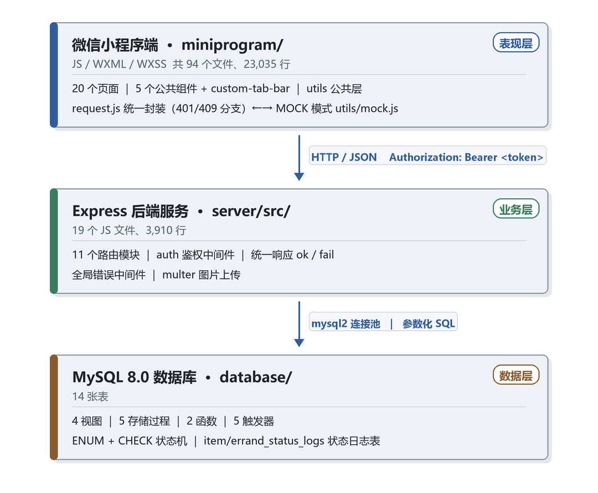

图 7-1 系统总体架构图：表现层（小程序 20 页）/ 业务层（Express 11 路由模块）/ 数据层（MySQL 14 表）三层，HTTP + Bearer 鉴权与 mysql2 连接池衔接

三个关键设计决策：

1. **统一响应契约**：后端所有接口返回 `{ code, message, data }`，`code === 0` 成功；`fail()` 的 `code` 即 HTTP 状态码，前端据此做 401/403/404/409 分支，两端无需各自的错误字典。
2. **契约同构的 MOCK 层**：`miniprogram/utils/mock.js` 与 A 的真实路由逐字对齐（含错误文案、分页上限 50、两位小数校验），由 `scripts/mock-contract-test.js` 192 条断言锁定。后端未联调时前端可独立开发演示，切换只需改 `config.MOCK`。
3. **权限判断前置后端**：详情/订单类接口直接返回 `canTake/canEdit/canPublish/canComplete/canCancel/canRelease` 布尔字段，前端不自行推导权限，避免两端规则漂移。

### 7.2 小程序端实现

**代码量统计（表 7-1）**

| 部分 | 文件数 | 行数 | 说明 |
| --- | --- | --- | --- |
| miniprogram JS | 39 | 12,686 | 页面逻辑、公共层、custom-tab-bar |
| miniprogram WXML | 27 | 3,372 | 页面结构 |
| miniprogram WXSS | 28 | 6,977 | 全局设计令牌 + 页面样式 |
| **小程序端合计** | **94** | **23,035** | — |
| server/src JS | 19 | 3,910 | A 主笔（B 参与 chat.js） |
| scripts 测试脚本 | 20 | 5,390 | 16 个冒烟脚本 + 契约测试 + 建库辅助（不入小程序包） |

**公共层（miniprogram/utils/）**：

- `request.js`：统一网络封装。约定（与 A 后端一致）：响应体 `{code,message,data}`、code 0 成功 resolve、401 清登录态跳登录（`skipAuthRedirect` 例外）、403「账号已被禁用」特判、其余 code 默认 toast；支持 `silent/loading/auth` 选项。MOCK 模式只走 mock，路由未登记明确报错，绝不回落真实网络。
- `adapter.js`：图片地址适配（相对路径 `/uploads/...` 与 `fullUrl` 拼接）。
- `mock.js`：与 A 路由逐字对齐的契约层（见 7.4 关键功能 2）。
- `campus.js`：25 片区 + 52 地标唯一数据源（与 `server/src/utils/campus.js` 同步）。
- `placeholder.js`：无图占位统一入口——二手商品无封面、代取订单（无图片字段）按 `itemId/orderId` 稳定哈希取 `assets/placeholder/ph-1..7.png` 一张，同一条目在列表、详情、刷新之间恒为同一张图。
- `util.js` / `version.js`：时间格式化等工具与版本号。

**公共组件（miniprogram/components/，5 个）**：`item-card`（商品卡）、`status-tag`（状态标签）、`empty-state`（空态）、`nav-top`（自定义导航）、`place-picker`（片区/地标联动选择）。另有 `custom-tab-bar` 实现半透明模糊底栏。

**页面结构**：20 个页面，其中 B 独立负责 14 页（登录、注册、代取大厅、发布代取、代取详情、找跑腿、我的代取、接单设置、聊天列表、聊天详情、我的、个人资料、设置、帮助），A 负责 6 页（首页、搜索、商品详情、发布商品、我的发布、我的收藏）。页面按「登录门 → 业务页」组织，受限页通过 `app.requireLogin(path)` 守卫，登录成功带 `redirect` 回跳。

### 7.3 后端接口实现

> 本节由 B 依据 A 的代码归纳，代码归 A。

**路由分层**：11 个路由模块挂载于 `/api` 前缀——`auth`（登录/注册）、`users`（资料）、`items`（商品）、`books`（书目）、`categories`、`favorites`、`errands`（代取）、`runners`（跑腿）、`chat`（会话/消息）、`upload`、`feedback`。固定路由注册在 `/:id` 之前（如 chat 的 `/unread-count`），避免路径参数误吞。

**鉴权中间件**：`middleware/auth.js` 校验 `Authorization: Bearer <token>`，失败统一 401；禁用账号固定返回 403 +「账号已被禁用」文案（前端据此清会话踢回登录页）。路由按需挂载，公开接口（登录、注册）不挂。

**统一响应**：`ok(res, data)` / `fail(res, code, message)` 两个助手，`fail` 的 code 直接作为 HTTP 状态码（400 参数错 / 401 未登录 / 403 越权 / 404 不存在 / 409 状态冲突），保证全站错误语义一致。

**全局错误中间件**：兜底 500，固定返回「服务器错误」，不向外泄漏堆栈；业务校验失败则透出可读的 `message`（如「该单已被别人接走」）。

### 7.4 关键功能实现

每个关键功能按「需求 → 设计 → 代码片段 → 效果截图」四段写，代码只放最关键的判断。

#### 7.4.1 登录鉴权（前端请求层）

**需求**：token 过期自动踢回登录页；但登录接口自身的 401（「学号或密码错误」）不能被误当成「登录过期」而清掉用户已有的会话。

**设计**：`request.js` 在响应拦截处区分两种 401——调用方传 `skipAuthRedirect`（登录接口专用）时走普通错误分支只 toast；其余 401 统一 `clearSessionEverywhere()`（走 `app.clearSession`，连同未读数、tabBar 角标一起清）后带 redirect 跳登录页。

```js
// miniprogram/utils/request.js（节选）
if ((status === 401 || body.code === config.UNAUTHORIZED_CODE)
    && !opts.skipAuthRedirect) {
  handleUnauthorized();            // 清登录态（含角标/未读）+ 跳登录页
  reject({ code: 401, message: '登录已失效，请重新登录' });
  return;
}
// 403 + 「账号已被禁用」：清会话回登录页，不留假登录态
if (status === 403 && (body && body.message) === '账号已被禁用') { ... }
```

**效果**：输错密码只出 toast 不跳页（TC-U02）；token 过期任何请求自动回登录页且并发只跳一次（TC-U07）。登录界面见图 7-2。

#### 7.4.2 代取/商品状态机

**需求**：状态流转只能沿合法路径进行（如已售出是终态），非法流转必须 409；前端按钮随权限字段显隐。

**设计**：状态机用「映射表 + 白名单判定」固化，与 A 的 `errands.js` / `items.js` 语义一致；前端不自推权限，按钮显隐信任接口返回的 `canXxx` 字段。

```js
// miniprogram/utils/mock.js（与 A 路由逐字对齐）
const STATUS_TRANSITIONS = {
  on_sale:  ['reserved', 'sold', 'off_shelf'],
  reserved: ['on_sale', 'sold'],
  off_shelf: ['on_sale'],
  sold: []                                // 终态
};
// PUT /api/items/:id/status（节选）
const allowed = STATUS_TRANSITIONS[found.status] || [];
if (allowed.indexOf(status) < 0) return fail(409, '当前状态不能变更为目标状态');
```

**效果**：sold → on_sale 409（A 的 Postman API-17 PASS）；前端连点接单由 `submitting` 守卫只发 1 次请求（负向场景 9）。订单详情底部按钮随 `canXxx` 权限字段显隐的效果见图 7-9。

#### 7.4.3 聊天会话建立（B 参与 chat.js，A 文件）

**需求**：同一对用户对同一业务对象（商品/代取单）只建一条会话；任何登录用户都可就任意订单发起会话（「先聊后接」）——私单发布者把订单 ID 分享给同学后，对方点进对话即可直接沟通、接单。

**设计**：会话表以 `chk_conversations_user_order` 约束 `user_a_id < user_b_id` 归一化 + 四元组唯一键去重；路由层调存储过程 `sp_get_or_create_conversation`，存储过程内部先查后插，配合唯一键在两端并发创建时也只留一条。服务端 `chat.js` 保留「对方用户存在」「商品/订单存在」校验，不再按发布者/接单者身份拦截会话创建（11-26 定稿）。

```js
// server/src/routes/chat.js（B 参与实现，节选；11-26 起不按身份拦私单）
const [orderRows] = await pool.query(
  `SELECT order_id AS orderId FROM errand_orders WHERE order_id = ?`, [bizId]
);
if (!orderRows.length) return fail(res, 404, '订单不存在');
// 存储过程保证 user_a_id < user_b_id 归一化 + 唯一键去重
conn = await pool.getConnection();
await conn.query('CALL sp_get_or_create_conversation(?, ?, ?, ?, @conversationId)',
  [userId, peerId, bizType, bizId]);
const [outRows] = await conn.query('SELECT @conversationId AS conversationId');
```

**效果**：同一商品反复「联系对方」不产生重复会话（TC-C 系列）；私单点进对话直接进入会话、不再被 403 拦回；会话 ID 幂等复用（负向场景 8 已改为此口径）。会话界面见图 7-15，私单详情的「联系发布者」入口见图 7-9。

**连带授权说明**：代取详情可见性与 `canTake` 依赖 `isErrandChatPeer`（存在该单会话即可见/可接），因此放开会话发起后，私单对知道订单 ID 的用户开放——与「分享单号邀请同学」的产品口径一致（口径变化已在接口文档与手册留痕）。

#### 7.4.4 消息轮询与增量拉取

**需求**：聊天页无 WebSocket 依赖，用定时轮询保持消息新鲜；页面隐藏必须停止轮询，进出 10 次不留定时器。

**设计**：`onLoad` 拉全量，此后以 `messageId` 为游标只拉增量（后端索引 `idx_messages_conv_msg(conversation_id, message_id)` 支撑游标查询）；`onShow` 起轮询、`onHide`/`onUnload` 均 `clearInterval`，`_pollTimer` 守卫防止叠加；隐藏时顺手标记已读。

```js
// miniprogram/pages/chat/detail.js（节选）
startPoll() {
  if (this._pollTimer || !this.data.conversationId) return;   // 守卫不叠加
  this._pollTimer = setInterval(() => this.pollTick(), POLL_INTERVAL);
},
stopPoll() {
  if (this._pollTimer) { clearInterval(this._pollTimer); this._pollTimer = null; }
},
onHide() { this.stopPoll(); this.markRead(); }   // 隐藏即停轮询 + 标已读
```

**效果**：快速进出聊天页 10 次后定时器集合为空（负向场景 10，`smoke_negative.js` [10] 断言）。聊天界面见图 7-15（含文字与图片消息气泡）。

**图片消息（11-24 补齐，11-26 加固）**：输入栏「＋」选图（`wx.chooseMedia`，相册/拍照、压缩图）→ `wx.uploadFile` 上传得 `/uploads/` 相对路径 → 以 `msgType: 'image'` 发送；乐观气泡先显示本地临时图，上传成功后换服务端 URL；点击图片气泡 `wx.previewImage` 全屏预览；发送阶段失败重发不重新上传（已传 URL 直发），上传失败则从本地临时文件重传。真机上若手机端加载不到图片源（回环地址/域名校验/服务未启动），`<image>` 的 `binderror` 把气泡降级为「图片加载失败·点击重试」占位——重试优先回退本地临时图，否则加时间戳破缓存；不再留 240rpx 空白泡。契约 `[13]` 节 + 冒烟 `[13b]` 节锁定（最终基线：契约 192/0、冒烟 857/0）。

**键盘适配（11-26 定稿）**：聊天输入框关闭 `adjust-position`（默认行为会把整页连同 nav-top 顶出屏幕），改监听 `bindkeyboardheightchange` 给输入条按键盘实高垫 `padding-bottom`；同时键盘弹起时页面底部 `env(safe-area-inset-bottom)` 归零，避免与键盘高度双重抬升出约 34px 的空隙——键盘与输入框贴紧、导航与消息区位置不变。

### 7.5 数据库访问

> 数据库对象归 A，本节写访问侧的关键约定与调用点。

- **连接与参数化**：全部经 `mysql2/pool` 连接池访问，语句一律 `?` 占位符传参（如 7.4.3、7.4.4 的 `pool.query(sql, [params])`），杜绝字符串拼接注入。
- **视图调用点**：`chat.js` 的会话列表/详情读 `v_conversation_base`（一次 JOIN 出双方昵称头像），商品列表读 `v_item_list`（聚合首图/浏览数），未读数由 `fn_unread_count(conversationId, userId)` 按行计算；其余视图由 A 在 `/api/users/me` 等入口使用（共 4 视图）。
- **存储过程调用点**：`sp_get_or_create_conversation`（7.4.3）是会话创建唯一入口，保证归一化与并发去重。
- **触发器维护**：messages 插入后由触发器回写 conversations 的 `last_message/last_time`，未读数不冗余存储、读时聚合，写侧一致。
- **状态日志**：items/errands 状态变更由触发器写入两张状态日志表，形成完整审计轨迹。
- **事务/乐观锁**：接单等并发敏感操作由 A 在 errands 层以条件 UPDATE（影响行数判定）处理，竞态失败返回 409「该单已被别人接走」（8.5 详述）。

### 7.6 界面展示

以下真机截图按「登录 → 二手 → 代取 → 聊天 → 个人中心」的演示主线排列（图 7-2 ~ 图 7-18），全部为开发版真机运行实拍。

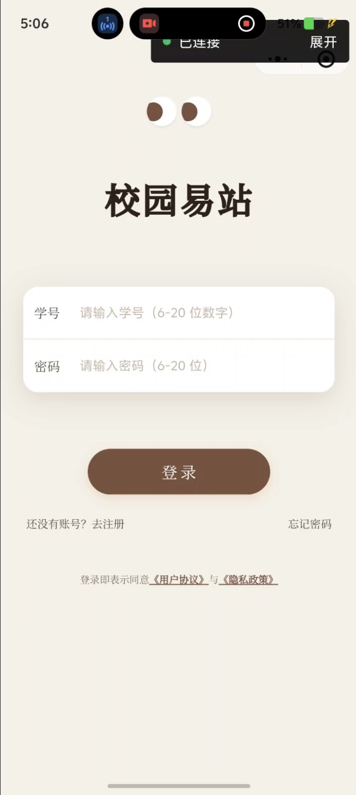

图 7-2 登录页：学号 + 密码登录，奶油纸感设计令牌与眼睛条开场

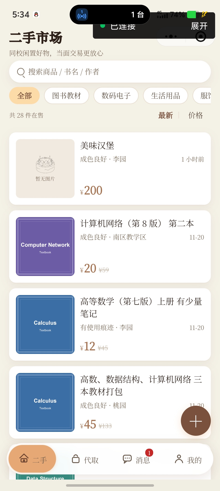

图 7-3 二手市场首页：分类宫格与商品瀑布流

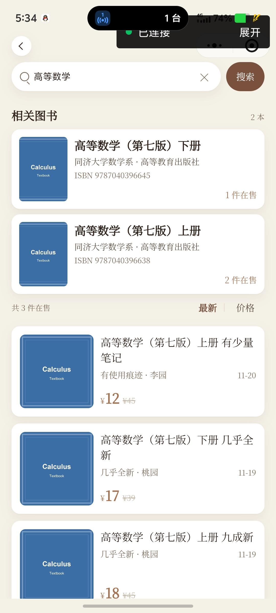

图 7-4 二手搜索页：关键词检索与结果列表

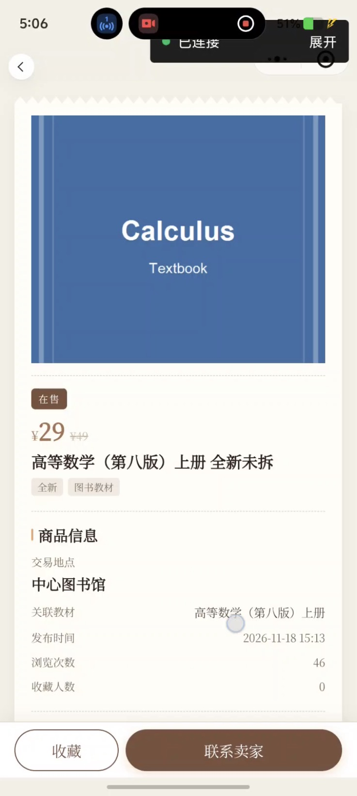

图 7-5 商品详情页：图片、成色/价格与收藏、联系卖家操作

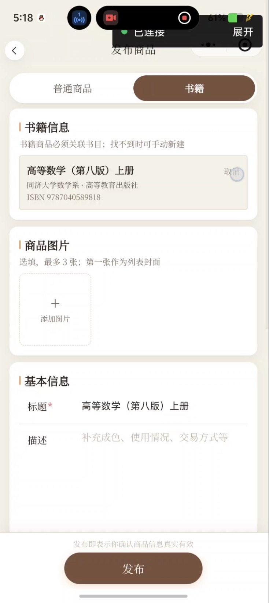

图 7-6 发布商品页：选择书目后自动带出 ISBN 与参考价

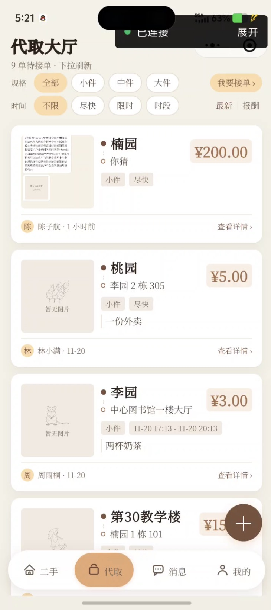

图 7-7 代取大厅：待接单订单卡（取件→送达路线与报酬）

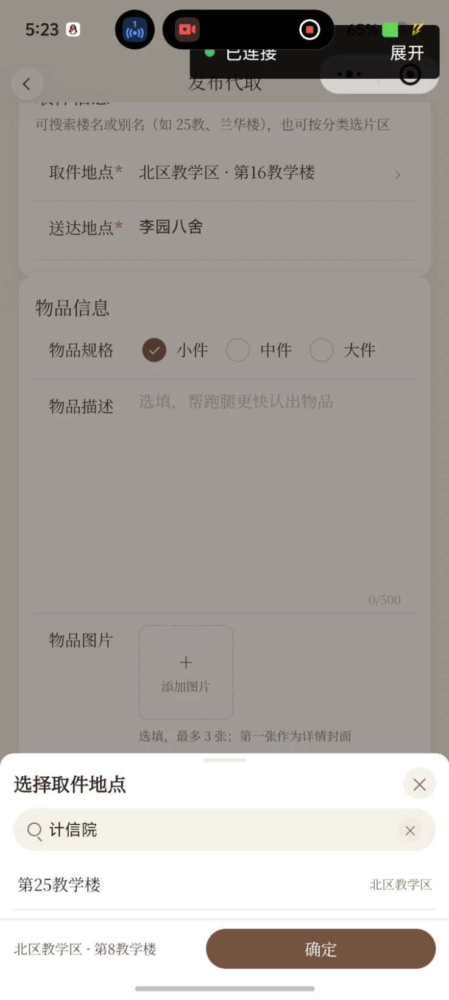

图 7-8 发布代取页：片区/地标联动选择与时间类型

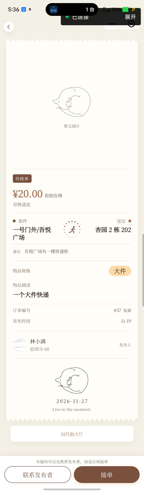

图 7-9 代取详情页：状态条、路线信息与接单操作；订单无图时以线条图案占位

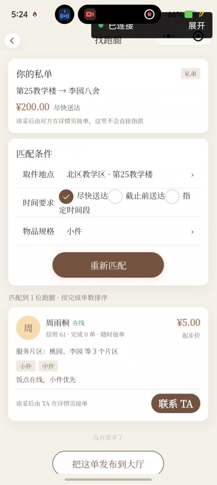

图 7-10 找跑腿页：当前在线的跑腿列表（effectiveOnline 口径）

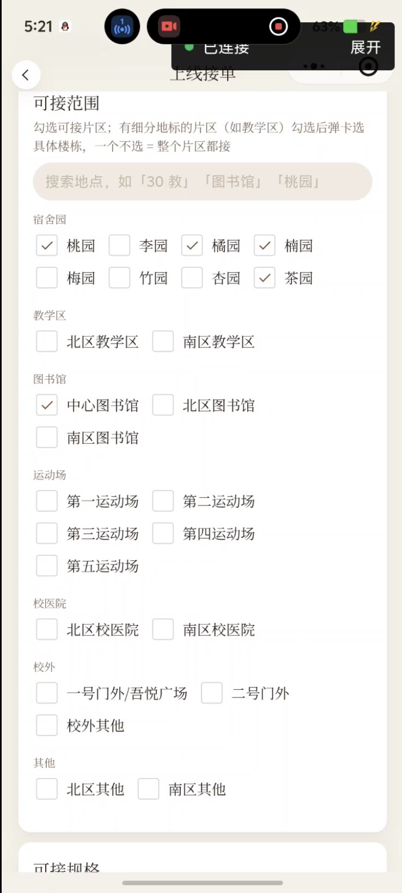

图 7-11 接单设置页：服务片区多选与在线方式

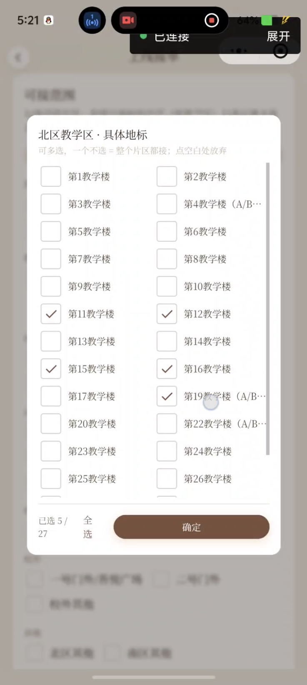

图 7-12 接单片区选择浮窗：按校区片区分组勾选具体地标

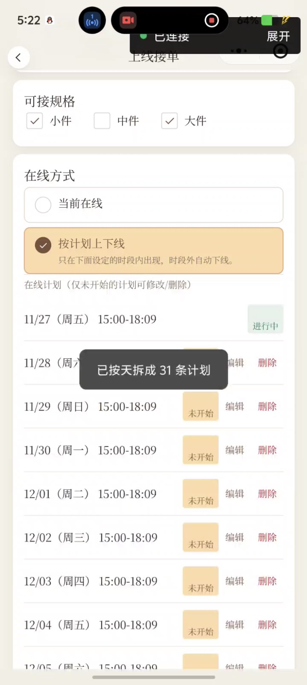

图 7-13 在线计划配置：每周/单次在线时段拆解设置

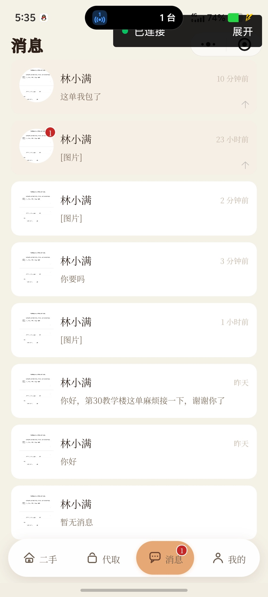

图 7-14 聊天列表：会话卡与未读角标


图 7-15 聊天详情页：业务卡片 + 文字/图片气泡 + 输入栏

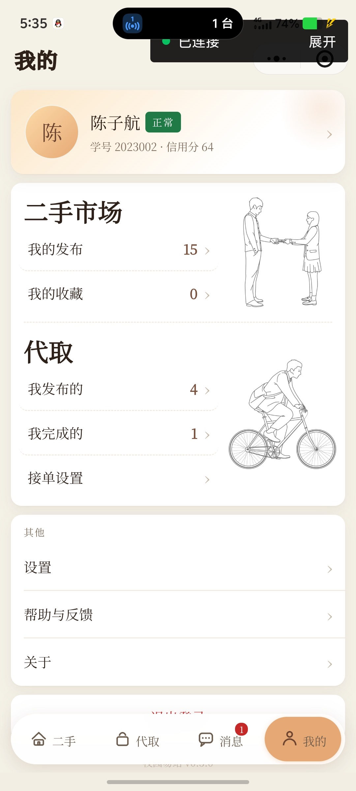

图 7-16 我的页面：用户卡、二手/代取统计与功能入口

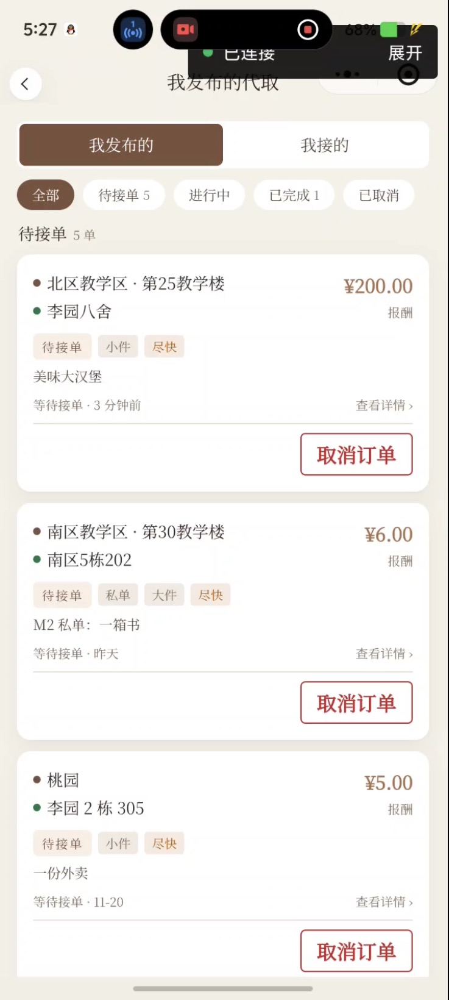

图 7-17 我发布的代取：按角色（我发布/我接单）切换的订单列表

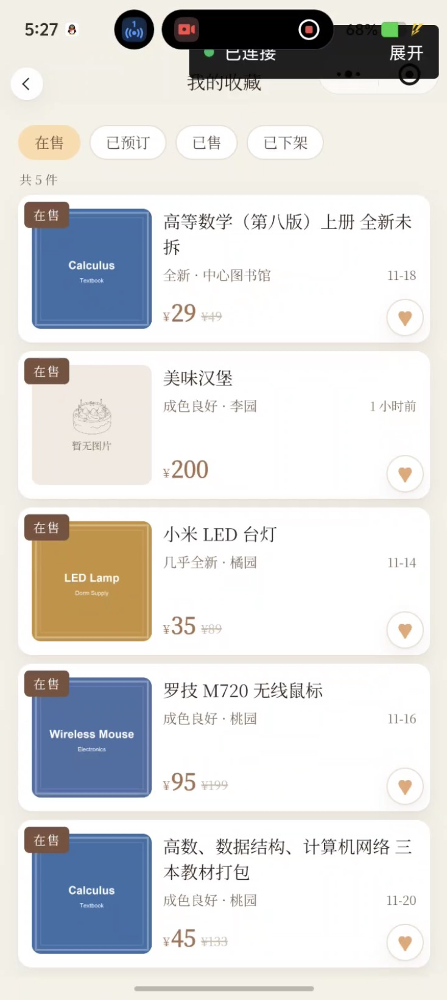

图 7-18 我收藏的二手商品：收藏列表与取消收藏

---

---

## 第 8 章 系统测试

### 8.1 测试环境与方法

| 项 | 内容 |
| --- | --- |
| 环境 | Windows 11 + 微信开发者工具（小程序端）；Node.js + Express + MySQL 8.0（后端，A 维护） |
| 方法 | ① **代码级冒烟测试**：16 个自写 Node 脚本（`scripts/smoke/`）直接解析 WXML/JS 断言交互逻辑，合计 **857 条断言**；② **契约测试**：`scripts/mock-contract-test.js` **192 条断言**锁定 mock 与 A 真实路由逐字一致；③ **接口测试**：A 的 Postman 集合（newman 6.2.3，终版 **119 请求 / 387 断言**，主库与干净测试库各跑通一次）；④ **走查 + 负向测试**：两轮 UI 走查 + 12 条异常场景 + 多轮真机回归；⑤ **用例管理**：`docs/测试用例.md` 66 条（B 49 / A 17），全部执行通过 |
| 证据约定 | B 侧「实际结果」必须落到冒烟脚本编号 / 契约断言编号 / 走查记录章节，不接受口头「过了」 |

### 8.2 测试用例设计

用例按「模块 × 正反向」设计，正向覆盖主流程闭环，反向覆盖参数校验、越权、状态冲突。P0（阻塞演示路径）必须在演示前 100% 通过。全表见 `docs/测试用例.md`（66 条），模块分布如表 8-1：

**表 8-1 用例模块分布**

| 模块 | 用例数 | B（UI/聊天） | A（后端/数据库） |
| --- | --- | --- | --- |
| 用户与登录 | 12 | 8 | 4 |
| 二手商品 | 11 | 8 | 3 |
| 收藏 | 5 | 4 | 1 |
| 代取 | 15 | 12 | 3 |
| 聊天 | 11 | 9 | 2 |
| 公共与全局 | 12 | 8 | 4 |
| **合计** | **66** | **49** | **17** |

### 8.3 功能测试结果

**表 8-2 功能测试结果统计**（与 `docs/测试用例.md` §七 一致）

| 模块 | B 通过 / B 用例 | A 通过 / A 用例 |
| --- | --- | --- |
| 用户与登录 | 8 / 8 | 4 / 4 |
| 二手商品 | 8 / 8 | 3 / 3 |
| 收藏 | 4 / 4 | 1 / 1 |
| 代取 | 12 / 12 | 3 / 3 |
| 聊天 | 9 / 9 | 2 / 2 |
| 公共与全局 | 8 / 8 | 4 / 4 |
| **合计** | **49 / 49（100%）** | **17 / 17（100%）** |

- **B 侧 49 条全部通过，P0 用例全量 100%**（证据链：`docs/B测试记录.md` 三链映射）。
- **A 侧 17 条已全部执行通过**（A 报告 §9.1：29 条核心用例中 27 条 Postman 自动断言 + 用例 6/22 手工补测；Postman 集合 **119/119 请求、387/387 断言**通过，M1 于 11-21、M2 于 11-28 PASS）。
- **自动化基线（终版）**：冒烟 **857 / 0**（16 个脚本，11-28 全量实跑）、契约 **192 / 0**、WXML 配平检查全 PASS。每次回归数字以仓库最新提交为准。

### 8.4 异常与边界测试

12 条负向场景全部通过（详见 `docs/负向测试记录-B.md`，自动化断言 `smoke_negative.js` 43/0），摘要如表 8-3：

**表 8-3 负向测试摘要**

| # | 场景 | 结果与关键证据 |
| --- | --- | --- |
| 1 | token 过期/被删 | ✅ 清会话（含角标）→ 带 redirect 回登录页 |
| 2 | 未登录点受限页 | ✅ 拦截跳登录，登录后回原页 |
| 3 | 断网刷列表 | ✅ 错误态 + 重试；翻页失败只 toast 保留已有列表 |
| 4 | 后端 500 | ✅ 固定「服务器错误」，不漏堆栈；业务错误透出可读 message |
| 5 | 提交空表单 | ✅ 字段级红字拦截，请求数为 0 |
| 6 | 报酬 abc / -1 / 9999 | ✅ 前端全部拦截（0 < r ≤ 200） |
| 7 | 消息发空 / 501 字 | ✅ 前端 maxlength 截断 + 后端 400 双层 |
| 8 | 私单会话发起（11-26 口径） | ✅ 取消发布者/接单者限制后，任何登录用户可就私单直接建会话（幂等复用既有会话）；保留「订单不存在 404」「越权读他人会话 403」两层校验（TC-G03） |
| 9 | 快速连点接单 3 次 | ✅ `submitting` 守卫，只发 1 次请求 |
| 10 | 聊天页快速进出 10 次 | ✅ 定时器集合为空，无泄漏 |
| 11 | 长昵称 / 长标题 | ✅ 省略号截断，不撑破布局 |
| 12 | 无数据新账号 | ✅ 空态组件 + 引导按钮 |

**口径备注（写进报告避免歧义）**：① 报酬上限是两层口径——后端按 `DECIMAL(10,2)` 上限放行，**前端收紧到 200 元**，填 9999 时到不了后端；② 401 有双语义（登录密码错 vs 登录过期），由 `skipAuthRedirect` 区分；③ 500 文案由 A 的错误中间件统一，400/403/409 才透出后端 message；④ 会话发起权限与会话内容权限是两层——任何用户可就私单发起会话，但**读他人会话内容仍受参与者校验 403**。

### 8.5 并发测试

按计划设计了两类并发场景，执行状态如实区分：

1. **商品状态机并发**：已覆盖。已售出终态再上架返回 409（A 的 Postman API-17 PASS）；`STATUS_TRANSITIONS` 白名单（7.4.2）保证任意非法流转 409。
2. **双账号并发接单（409 竞态）**：**用例已立（API-24）、双账号真机端到端待执行**（A 测试记录 M2 待办，与 M2 真机验收同批）。代码层已有三重保障：接单按钮 `submitting` 守卫防连点（负向场景 9）；后端接单为条件 UPDATE、影响行数判定，失败 409「该单已被别人接走」；会话创建走存储过程 + 唯一键，两端并发建会话只留一条。

### 8.6 缺陷统计与修复

开发全程缺陷登记于 `docs/bug清单.md`。累计缺陷 13 个（P0×3、P1×5、P2×5），**已全部修复关闭，当前 Open 为 0**，另有 3 条「口径备注」（非缺陷）单独留痕。

**表 8-4 缺陷清单（Fixed 留痕，节选自 bug 清单）**

| 编号 | 位置 | 现象 | 修复 | 级别 |
| --- | --- | --- | --- | --- |
| F-1 | `chat.js`（A 文件，B 修复） | `router.use(auth)` 缺失 → 会话列表/未读数 500 | `edf392d` 补挂 auth，15/0 回归 | P0 |
| F-7 | 全局对比度 | 亮橙底白字 ≈2:1（4 处） | 统一压深棕 `#79513D` | P0 |
| F-2 | mock 用户表 | 代取单发布人缺失 → 联系发布者 404 | `bf70a17` 补 3 用户 | P0 |
| F-3 | `mine/profile` | 头像链路两处断（取错路径字段 + 相对路径直绑） | `efec4cc` 双修 | P1 |
| F-6 | `mine/runner` | 加载中渲染空表单、失败只 toast | `bec9651` 骨架屏 + 错误卡 + 重试 | P1 |
| F-8 | `mine/items` / `mine/favorites` | 两页占位；取消收藏列表不即时移除 | `48a90a8` / `e9fc5b4` | P1 |
| F-4 | 全局样式 | `--color-surface-2` 未定义，hover 失效 | `efec4cc` 正式定义 | P2 |
| F-5 | 冒烟脚本 | 硬编码绝对路径不可移植 | `efec4cc` 改 `__dirname` | P2 |
| F-9 | 全局 `.page` | 非 tab 页底部多 150rpx 空白 | `.page`/`.page--tab` 拆分 | P2 |
| F-10 | `utils/mock.js` | 未同步 A 的 v0.10 契约（5 组校验） | 逐字对齐 + 契约 `[12]` 节 16 条 | P2 |
| F-11 | B 侧全站按压反馈 | 按压时文字抖动（u-enter 与 scale 冲突 + 小元素缩放重栅格化） | 两步分级修复：摘列表卡入场动画；卡片级 scale / 行控件 opacity | P1 |
| F-12 | 发布代取 `place-picker` | 漏传 `place-required`，有下级地标的片区确认被静默吞掉（「选不了取件地点」） | 发布页补传 + 兜底 toast 提示 | P1 |
| F-13 | 发布代取/找跑腿 radio-group | radio 的 value 字符串被当索引转换，选中弹回首项且**提交值恒为首项**（大件单实际发 small） | 3 处 handler 改按 value 反查索引；冒烟桩改真实字符串并新增 payload 断言 | P0 |

**复验记录**：11-19 负向测试 12/12 通过；11-20 A 复核 4 项全部闭环；11-23 契约 161/0、冒烟 497/0；11-26~27 多轮真机回归后终版 **契约 192/0、冒烟 857/0**（16 脚本），全部通过。

**表 8-4 之后补充（11-25~26 真机走查修复，不计入 F-1~F-13 编号）**：登录页开场穿帮与待机断档、登录转场果冻与水波纹、tabBar 连续切换频闪（三轮：同帧渲染 → 恢复滑动 + 红点确认窗 → 缓存实例广播根治）、聊天图片空泡兜底、键盘顶飞导航与键盘间距、发布代取返回键固定、接单设置备注换行、私单会话限制取消、无图线条占位。修复过程逐条留痕于 `docs/开发日志.md` v0.59~v0.64 与《AI 使用说明/B端会话1.md》，均配套冒烟断言回闸。

---

---

## 第9章 总结与展望

### 9.1完成情况

课程设计按“20个页面、14张表、4个视图、5个存储过程、2个函数、5个触发器、43个接口”的口径完成。二手交易、代取服务和即时聊天三条业务闭环均已打通，个人中心提供我的发布、我的收藏、我的代取、接单设置等入口；数据库对象全部接入接口或在演示脚本中使用，没有只存在于SQL文件、业务从不调用的对象。

完成情况见表9-1。

**表9-1完成情况清单**

| 项目 | 目标 | 完成情况 | 证据 |
| --- | --- | --- | --- |
| 小程序页面 | 20页 | 20/20，A 6页、B 14页 | `app.json`、页面文件 |
| 数据库表 | 14张 | 14/14 | `database/schema.sql` |
| 数据库对象 | 4视图 / 5过程 / 2函数 / 5触发器 | 全部落地 | `database/objects.sql` |
| 后端接口 | 43个 | 43/43 | 接口文档v0.11、Postman集合 |
| 二手闭环 | M1 | PASS（2026-11-21） | A测试记录 §10 |
| 代取 + 聊天 | M2 | PASS（2026-11-28） | A测试记录 §11 |
| 性能 | 列表 <300ms；5000条消息可增量拉取 | 列表约14ms；首屏3.5ms、增量0.7ms、会话列表13.8ms | A测试记录 §12 |
| 权限与备份 | 只读账号写拒绝；空库可恢复 | PASS | A测试记录 §12 |

最终测试与演示数据见表9-2。Postman集合在主库和干净测试库各跑通一次，均为119/119请求、387/387断言；本机16个冒烟脚本合计857/0，差的6条属于脚本版本统计差异，最终以交付包实测为准。

**表9-2测试结果摘要**

| 测试项 | 结果 | 说明 |
| --- | --- | --- |
| Postman接口回归 | 119/119请求、387/387断言 | 覆盖43/43个接口；主库与干净测试库各一次 |
| 小程序冒烟 | 857/0（16脚本） | 含聊天、代取、发布、负向等；B文档记录857/0 |
| mock契约 | 192/0 | 接口v0.11 |
| 核心用例 | 29条 | 27条在Postman中有对应断言，用例6/22手工补测 |
| M1 / M2 | 均PASS | M1 2026-11-21；M2 2026-11-28 |
| 权限 | PASS | 只读账号 `SELECT` 正常，`INSERT`/`DELETE` 1142 |
| 备份恢复 | PASS | 14表 / 4视图 / 5过程 / 2函数 / 5触发器，118行 |

最终演示库为3个用户、16本书目、35件商品（29件在售）、3条收藏、9条大厅待接单代取；测试产生的会话、消息、状态日志和反馈在打包前已清理。最终dump为62,726字节 / 1159行，包含 `errand_orders.images` 和 `conversations.is_pinned` 新列，空库恢复后对象数量与行数一致。

### 9.2主要难点与解决过程

#### 9.2.1并发接单与状态一致性

代取接单最初的风险是两个人同时看到待接单，然后都点击接单，最后把同一单写成两个接单人。解决办法不是在接口层加锁，而是把判断和更新放进 `sp_take_errand`：先 `SELECT ... FOR UPDATE` 锁订单行，再校验存在、发布者、状态和私单会话，最后用 `UPDATE ... WHERE status='pending'` 加 `ROW_COUNT()=1` 判断是否真的抢到。锁等待结束后如果订单已被接走，条件更新命中0行，返回409。M2用订单 #49做了双账号并发测试，一个200、一个409，数据库只有一个 `runner_id`。这个问题让我理解了“先查后改”在并发下不可靠，条件更新和行锁必须配合使用。

#### 9.2.2触发器维护冗余与操作者上下文

收藏数、商品/代取状态日志和会话最后消息都由触发器维护。触发器能拿到 `NEW`/`OLD` 行，却拿不到登录用户，`changed_by` 一开始不知道写谁。最终的方案是应用层在同一个数据库连接上先 `SET @current_user_id`，再执行更新；存储过程内部则自己设置这个变量。关键点是 `SET` 和 `UPDATE` 必须走同一个连接，连接池的两次 `pool.query` 可能换连接，变量会丢。触发器让列表页不用每行聚合收藏数和最后消息，但代价是写路径变长、触发器逻辑必须正确；为此在第5章补了收藏数、完成单数和信用分的重建SQL，出现问题可以核对和修复。

#### 9.2.3私单、会话权限与多态引用

代取订单同时有 `visibility` 和 `status` 两个维度，私单不出现在大厅，也不允许无关用户查看；私单接单还要求接单者与发布者之间已经有该订单的会话。为了表达“会话关联商品或代取订单”，`conversations.biz_id` 做成多态引用，没有外键，查询业务卡片时按 `biz_type` 再查一次；私单接单时用 `biz_type='errand' AND biz_id=orderId` 检查会话，没有会话返回4031。这个设计避免了为两种业务建两套会话表，代价是无法用外键保证 `biz_id` 一定存在，业务被删除时只能返回空摘要。M2阶段2的私单 #41/会话22验证了这条链路，并发创建会话也命中同一个唯一键。

#### 9.2.4两人Git协作与文件归属

两人并行开发最大的风险不是代码难，而是互相覆盖：`database/`、`app.json`、公共层和对方的页面都可能被误改。项目一开始就按文件归属拆分，A只改数据库、后端和二手6页，B改小程序公共层和其余14页；接口先定文档，再并行实现；分支按功能拆，合并前检查diff。报告阶段同样按“A写Markdown、B合Word”分工，A不直接编辑docx，避免Word二进制冲突。实际推送时也遇到过远端已有新提交、push被拒绝的情况，先fetch比较、再rebase到最新dev，确认没有触碰对方文件后才推送。这个过程让我体会到，协作规范不是形式，而是减少返工的手段。

#### 9.2.5报告与开发并行的证据管理

课程设计后段同时做功能、测试和报告，最容易出现“报告里的数字和实际测试对不上”。解决办法是测试当天记录命令、输入、实际结果和证据路径，报告只引用有记录的数字；M1、M2、Postman、冒烟、权限和备份分别有独立记录，最后统一核对20页、14表、43接口、119/387等口径。遇到M2首次失败时，先确认是3000运行旧代码导致私单会话403，重启加载新代码后复测通过，而不是把失败改写成通过。

### 9.3存在的不足

搜索仍然使用 `LIKE '%关键词%'`，前面的通配符会让B树索引失效，数据量大时查询会变慢；课程数据量下可以接受，但没有上全文索引或搜索引擎。搜索也没有按真实距离排序，地点只是文本匹配，不是地理坐标计算。

聊天采用3秒轮询和 `afterId` 增量拉取，不是WebSocket；消息延迟最多约3秒，服务端和客户端都会产生额外请求。消息类型只有文字和图片，没有语音、视频、文件，也没有离线推送；聊天图片只存路径，上传目录需要单独备份。

交易仍然是线下自主交易，没有平台担保、支付、退款和仲裁；平台只提供信息发布、状态记录和沟通工具，无法保证买卖双方履约。没有管理员后台、实名认证和内容审核，账号禁用只能由数据库维护人员操作；这些在真实运营场景中都是必需能力。

跑腿自动上下线依赖Node进程常驻，进程停止期间不会按计划切换在线状态，重启后会补算一次；数据库保持0个事件，代价是调度能力绑定在应用进程上。`time_slots`、`service_areas`、`service_places` 和 `errand_orders.images` 使用JSON存储，严格来说不是1NF的原子列，这是为了不超过14张表、减少关联而做的取舍；如果以后要按单个时段或单张图片反查，需要拆子表。

安全方面，课程环境使用本机HTTP，没有HTTPS、接口限流、WAF和管理员审计；JWT、bcrypt、参数化查询和对象归属校验已经落地，但部署到公网还需要网关层补强。权限演示只覆盖 `cs_app` 和 `cs_readonly` 两个账号，没有更细的列级权限和审计日志。

测试方面，29条核心用例中27条在Postman有自动化断言，用例6/22是手工补测；UI真机以用户反馈为准，个别负向分支（例如 `taken` 直接取消）还没有单独的接口断言。数据规模是演示级（35件商品、9条代取），性能测试用1000件商品和5000条消息造数，不能等同于生产环境压测。

### 9.4未来工作

检索方向可以把 `LIKE` 搜索升级为MySQL FULLTEXT或独立搜索引擎，增加分词、同义词和拼音匹配；地点从文本升级为经纬度或校园地标坐标，支持按真实距离排序和范围筛选。商品推荐可以基于浏览、收藏和成交记录做简单排序，但需要先保证数据量和隐私边界。

聊天方向可以把轮询升级为WebSocket，增加离线推送、已读回执、语音和文件消息；会话置顶、标未读、删除已经落地，后续可以增加免打扰、消息搜索和举报。支付与担保需要引入平台订单、资金托管、退款和仲裁流程，这会新增多张表和状态机，不能再沿用当前14张表的边界。

平台治理方向需要管理员后台、实名认证、内容审核、信用分规则和申诉流程；数据库层可以增加操作审计、软删除和更细的权限角色。工程层面可以引入连接池监控、慢查询日志、接口限流、HTTPS、备份加密和自动恢复演练；数据量上来后可以按业务拆库、加只读副本或缓存，JSON字段也可以按查询需求拆成子表。

### 9.5收获与体会

这次课程设计最大的收获是把“数据库设计”从画表和写SQL扩展到了完整的数据链路。概念设计阶段要考虑实体、联系、弱实体和多值属性；逻辑设计要论证3NF、外键动作和唯一约束；物理设计要选存储引擎、字符集、数据类型和索引；实施阶段要写视图、存储过程、函数、触发器，处理事务、并发、权限和备份。每一步都能在系统里找到对应的接口、页面或测试记录，而不是停留在纸面。

第二个收获是理解了“约束”和“测试”的价值。价格、状态、时间组合、会话唯一键这些约束看起来是细节，但正是它们挡住了非法数据和重复接单；M1、M2、Postman、冒烟、权限和备份测试让报告里的结论有证据。遇到失败时先查根因、再决定是否修复，比把失败写成通过更有意义。

第三个收获是协作和取舍。两人分工、文件归属、接口先行、Git分支和报告分工减少了冲突；14张表、JSON字段、轮询聊天、Node定时任务都是在课程周期内做出的范围控制。系统还有搜索、支付、后台、实名认证等不足，但核心闭环已经可用，数据库对象、事务和测试记录能够支撑答辩。这些经验会比一份“看起来很大”的功能清单更有用。

---

## 第 10 章 系统使用简介

### 10.1 运行环境

**表 10-1 运行环境**

| 层 | 环境 | 说明 |
| --- | --- | --- |
| 小程序端 | 微信开发者工具（最新稳定版） | 原生小程序，无需构建；AppID 可用测试号（工程内为占位 `touristappid`） |
| 后端 | Node.js + Express（`server/`） | 监听 `http://127.0.0.1:3000`；图片存本地 `server/uploads/` |
| 数据库 | MySQL 8.0（InnoDB，`utf8mb4`） | 导入 `database/campus_service_dump.sql` 即含 14 张表 + 4 视图 + 5 存储过程 + 2 函数 + 5 触发器及演示数据 |
| 辅助 | Node.js 16+（跑 `scripts/` 冒烟与契约测试） | 测试脚本不入小程序包 |

系统不依赖云服务、域名或备案，普通笔记本即可完整演示；真实支付未接入，交易由双方在站内会话沟通后自主完成。

### 10.2 启动步骤

1. **导入数据库**：MySQL 8.0 中执行 `database/campus_service_dump.sql`（或先执行 `schema.sql` 再执行 `objects.sql`）；确认字符集为 `utf8mb4`。
2. **启动后端**：在 `server/` 目录按 `package.json` 安装依赖后启动服务，确认 `GET /api/health` 返回正常；默认端口 3000，与 `miniprogram/config.js` 的 `BASE_URL` 对应。
3. **导入小程序**：微信开发者工具 → 导入项目 → 选择**仓库根目录**（不是 `miniprogram/` 子目录，见 `project.config.json` 的 `miniprogramRoot`）。
4. **本地设置**：详情 → 本地设置 → 勾选「不校验合法域名、web-view、TLS 版本以及 HTTPS 证书」（后端在本机 HTTP 上运行）。
5. **选择数据模式**：
   - **离线演示**：`miniprogram/config.js` 保持 `MOCK: true`，无需后端，登录用本地假 token；
   - **联调演示**：改 `MOCK: false`（`BASE_URL` 默认 `http://127.0.0.1:3000`，端口不同则同步修改），重新编译即可，页面代码无需改动。
6. **真机预览**：`127.0.0.1` 在手机上指向手机自身，须改为电脑局域网 IP（如 `http://192.168.1.100:3000`），手机与电脑连同一 Wi-Fi；真机需在开发版打开调试模式绕过域名校验。

### 10.3 演示账号

**表 10-2 演示账号（均来自 seed 演示数据，无真实个人信息）**

| 用途 | 学号 | 密码 | 说明 |
| --- | --- | --- | --- |
| 通用演示 | `202321010100001` | `123456` | 接口测试与契约测试常用账号，具备二手商品、代取订单、会话等演示数据 |
| 新建用户 | 任意未注册学号 | 6 位以上 | 注册页自填昵称与两次密码，可体验空态新账号流程 |

> `MOCK` 模式下任意学号 + 6 位以上密码即可登录（假 token）；联调模式请用表中 seed 账号。图片与账号均为演示数据。

### 10.4 操作步骤（演示主线）

**表 10-3 演示路径**

| # | 主线 | 操作路径 | 观察要点 |
| --- | --- | --- | --- |
| 1 | 登录与首页 | 打开工程 → 登录页输学号/密码 → 进二手首页 | 输错密码只 toast 不跳页；token 过期自动回登录页并带回跳 |
| 2 | 二手交易 | 首页分类/关键词/排序筛商品 → 进详情看轮播与成色 → 收藏 → 点「联系卖家」进会话 | 收藏计数同步；商品状态四态展示；无图商品显示线条占位图 |
| 3 | 发布二手 | 「我的」→ 我的发布 → 发布商品 → 选书目自动带出 ISBN/参考价 → 传图 → 提交 | 金额最多两位小数；必填项红字拦截；提交后跳商品详情 |
| 4 | 发布代取 | 代取 tab → 发布代取 → 选片区与具体地标 → 选规格/时间类型 → 填报酬 → 提交（可直接进大厅或先建私单找跑腿） | 有下级地标的片区必须选到具体教学楼；报酬 0~200 元 |
| 5 | 接单与沟通 | 大厅待接单订单 → 详情看 canTake 按钮 → 接单 → 会话沟通 → 完成后状态更新 | 接单者按钮由后端权限字段控制；并发抢单失败返回「该单已被别人接走」 |
| 6 | 跑腿上线 | 「我的」→ 接单设置 → 选服务片区/地标与规格 → 选「当前在线」或「按计划上线」并配时段 → 保存 | 按计划上线需有未来时段；找跑腿页只显示此刻在线的跑腿 |
| 7 | 私单会话 | 私单详情点「联系」→ 直接进会话（无需发布者身份）→ 谈妥后接单 | 私单点进去即可对话；会话创建幂等，同一对不重复 |
| 8 | 消息与图片 | 聊天列表进会话 → 发文字（≤500 字）/「＋」选图发送 → 点图片放大预览 | 3 秒增量轮询；图片失败显示「点击重试」占位；键盘弹起导航固定 |
| 9 | 个人中心 | 「我的」→ 个人资料改昵称/头像 → 设置切通知开关 → 帮助与反馈提交 | 昵称按码点 2~12；头像超限自动压缩；退出登录二次确认 |

### 10.5 常见问题

- **页面全空/报「无法连接后端」**：联调模式下后端未启动或端口不一致；检查 `GET /api/health` 与 `config.js` 的 `BASE_URL`。
- **真机图片不显示**：`127.0.0.1` 未改局域网 IP，或未开开发版调试；图片气泡加载失败时点「点击重试」占位回退本地临时图。
- **请求被 400 拒绝**：检查分页 `pageSize ≤ 50`、金额两位小数、报酬范围 0~200 元、文本长度上限。
- **想离线演示**：把 `config.js` 的 `MOCK` 改回 `true` 重新编译；MOCK 模式下未登记的接口会明确报错，不会静默回落真实网络。

---

## 参考文献

[1] 王珊, 萨师煊. 数据库系统概论[M]. 5版. 北京: 高等教育出版社, 2014.

[2] 张海藩, 牟永敏. 软件工程导论[M]. 6版. 北京: 清华大学出版社, 2013.

[3] SILBERSCHATZ A, KORTH H F, SUDARSHAN S. Database System Concepts[M]. 7th ed. New York: McGraw-Hill, 2019.

[4] Oracle Corporation. MySQL 8.0 Reference Manual[EB/OL]. [2026-11-25]. https://dev.mysql.com/doc/refman/8.0/en/.

[5] OpenJS Foundation. Express.js Documentation[EB/OL]. [2026-11-25]. https://expressjs.com/.

[6] 腾讯公司. 小程序开发指南[EB/OL]. [2026-11-25]. https://developers.weixin.qq.com/miniprogram/dev/framework/.

[7] OWASP Foundation. SQL Injection Prevention Cheat Sheet[EB/OL]. [2026-11-25]. https://cheatsheetseries.owasp.org/cheatsheets/SQL_Injection_Prevention_Cheat_Sheet.html.

[8] OpenJS Foundation. Node.js Documentation[EB/OL]. [2026-11-25]. https://nodejs.org/en/docs/.

---

## 附录 A  A 的 AI 辅助开发记录

> 负责人：A ｜ 记录时间：2026-11-16 ~ 2026-11-19 ｜ 工具：Qoder Agent（本仓库内会话式开发）
>
> 本文记录 A 在数据库、后端、二手页面和文档工作中使用 AI 的真实场景，包括提示方式、AI 产出、人工修正和验证结果。B 的 AI 记录由 B 独立维护，最后由 B 合并进报告附录。

### 1. 使用范围与原则

| 项 | 说明 |
| --- | --- |
| 使用范围 | 设计讨论、代码生成、测试脚本、文档审查、接口只读验证、问题定位 |
| 不交给 AI 的事 | 最终产品决策、真实 DevTools 视觉验收、数据库结构定稿、共享数据破坏性操作、提交/推送决定 |
| 文件边界 | 只改 A 的页面 / 后端 / 文档；B 的文件只读和报告问题，不直接修改 |
| 数据边界 | 不重建数据库、不删除数据；状态测试使用可恢复商品并恢复；上传测试文件测后删除 |
| 结果口径 | AI 产出必须经过语法、WXML、契约、冒烟或真实接口验证；未验证的内容写成“待验收”，不写成通过 |

### 2. 典型使用场景

#### 2.1 发布商品页：先做设计评审，再实现

**背景**：`pages/item/publish` 当时是占位页，后端 `POST /api/items`、`/api/books`、`/api/books/search`、`/api/upload` 已实现。

**使用方式**：

1. 先让 AI 阅读 A 手册、接口文档、B 的 `item-card` / `form` 样式和现有页面，输出待确认的设计点；
2. 用逐项问答确认：图片选完即传、0-3 张、第一张封面、地点自由文本 + 11 个宿舍园/图书馆 chip 多选、书籍模式防抖联想和手动新建、标题/分类自动带出、底部固定发布按钮、发布成功跳详情、系统返回询问等；
3. AI 按确认结果实现页面，再写临时 Node 冒烟覆盖校验、图片、书目、手动建书、跳转；
4. 用真实后端验证分类、书目、ISBN 复用、上传，真实发布留给 DevTools 验收。

**AI 产出**：`publish.js / wxml / wxss / json`；43 项 Node 冒烟通过；提交 `3752f88`。

**人工修正**：

- 用户指出“交易地点选项太少” → 从 5 个扩成 10 个常用片区；
- 用户进一步指出“教学楼/其他不能用” → 只保留 8 个宿舍园 + 3 个图书馆；
- 用户要求“做成多选，中间自动加逗号” → 改为 chip 多选、中文逗号连接，并保留手动输入中的合法片区高亮；
- 用户要求“返回图标不要跟着页面跑” → `nav-top` 改为 `fixed`。

#### 2.2 我的发布页：设计评审、实现和 bug 回归

**背景**：`pages/mine/items` 是 A 最后一个 M1 功能缺口，后端 `GET /api/items/mine`、`PUT /api/items/:id/status` 已实现。

**使用方式**：

1. AI 逐项确认列表形态（`item-card` list + 底部操作条）、分页（10 条/页、上拉加载）、tab 数量展示、空态、登录拦截、顶部吸附；
2. 用户明确：顶部状态筛选复用首页横滑椭圆条；卡片保留状态标签；**列表只读，状态操作只能进详情页**；
3. AI 删除列表操作条和 `ACTION_MAP`，恢复状态标签，保留卡片点击进详情；
4. 用户反馈“从详情页回在售页面时骨架屏不结束”，AI 通过生命周期模拟定位到重复 onShow、旧 loading、`pageScrollTo` 同步抛错等风险，加入单请求守卫、loading 复位、10 秒看门狗和异常兜底；
5. 用真实后端模拟进入 / 返回，确认列表 5 条正常、连续 onShow 只发一次请求。

**AI 产出**：`items.js / wxml / wxss / json`；提交 `48a90a8`；定向生命周期和真实接口检查通过。

**人工修正**：

- AI 初版按“tab 已区分状态”隐藏了卡片状态标签，用户纠正“不要去掉卡片上的状态标签，我的意思是只能进详情操作”；
- AI 之前把“更多片区”扩成 25 个，用户按实际可用性砍掉教学楼 / 其他；
- 顶部状态样式按用户要求从深色分段控件改为首页同款横滑椭圆条。

#### 2.3 文档审查与同步

**使用方式**：

1. 拉取 B 的 `bec9651` 后，AI 按 A 的文件边界逐项审查代码、接口字段和文档声明；
2. 发现并报告：个人资料头像 `chooseMedia` 取错字段、头像相对路径未拼 `BASE_URL`、B 冒烟脚本硬编码 `E:/Qin`、`--color-surface-2` 未定义、UI 走查 #32 误报；
3. B 在 `efec4cc` 中修复 R1-R4；A 未修改 B 文件；
4. AI 继续检查 A 手册、课程计划、接口文档、数据库详解、方案总结、README 中“我的发布可操作”的旧口径，统一改为“详情页改状态、我的发布只读筛选”，提交 `cfc81cd`。

**人工修正**：

- 用户明确“不要改 B 文档，只报告”；
- 用户明确“我的发布只读、状态操作只在详情页”，AI 按此更新文档，不保留旧的“两处共用”说法。

#### 2.4 后端 / 数据只读验证

**使用方式**：

- AI 用 Node / curl 对真实后端跑只读和负向用例：健康检查、登录、无 token 401、错误密码、分类、书目、ISBN 复用、上传文件类型、超大页码、我的发布、收藏、代取大厅、接单设置、非卖家 403、已售出 409、非法状态 400、不存在商品 404；
- 状态机测试只对商品 94 做 `reserved → on_sale`，测后恢复；上传测试文件测后删除；
- 不新增商品、不重建库、不执行 `init-dev-db.js`。

**结果**：接口返回符合接口文档；mock 契约 145/145；B 的 chat 鉴权冒烟 15/15、我的三页冒烟 30/30；详见 `docs/A测试记录.md`。

#### 2.5 我的收藏页：列表、右下角心形与取消分支

**背景**：`pages/mine/favorites` 是 A 最后一个页面；`GET /api/favorites` 按收藏时间倒序，`DELETE /api/items/:id/favorite` 幂等。

**使用方式**：

1. AI 逐项确认：复用 item-card list、全部状态可用顶部四状态横滑筛选切换、卡片保留状态标签、显示发布时间、右下角悬浮心形取消收藏、每页 10 条、onShow 静默刷新；
2. 用户先选“心形压卡片右下角”，随后要求“心形放右边、状态标签放左边”；AI 隐藏 item-card 自带标签，在卡片左上角用 `status-tag` 显示状态，心形回右下角并改奶茶橙色；
3. 用户要求“和我的发布一样按状态切换”，AI 给 `GET /api/favorites` 增加可选 `status` 过滤，前端增加首页同款横滑状态条与分状态空态；
4. 取消收藏走确认弹窗 → DELETE → 本地移除并静默刷新；404 直接移除、网络失败保留卡片；
5. 用 Node 冒烟覆盖四状态切换、取消/404/空态/分页/登录；用真实接口做 DELETE→3→重新收藏→4 的可恢复验证；重启 3000 后验证 status 四状态查询与非法状态 400。

**AI 产出**：`favorites.js / wxml / wxss / json`（工作区），以及 A 的 `server/src/routes/favorites.js` 可选 `status` 过滤；没有改 B 文件。

**人工修正**：

- AI 初始提供“卡片下方按钮 / 右侧心形 / 只进详情取消”三案，用户选择右侧心形；
- 用户进一步指定“悬浮右下角”，AI 提示会和状态标签冲突，用户确认“压卡片右下角”，按此实现；
- 用户最终要求“心形放右边、状态标签放左边”，AI 改为隐藏 item-card 自带标签、页面左上角 status-tag、心形回右下角。

#### 2.6 2026-11-19 全量审计与修订

- AI 按 A 的后端、A 的 6 个页面、A/共同文档、B 最新提交分别审计；
- 前端发现收藏空态文案写死、详情 `view_count` 重复计数、发布页 focus 无法复位、首页旧文案，并修复；
- 后端发现 favorites status 非字符串、items 排序原型键、errands visibility/status 边界、价格小数、上传错误字段、runnerOnline manual_until 竞态、PUT 校验顺序，并修复；接口文档升 v0.10；
- 重启后复测 10 项边界（含新建私单 20 验证非发布者 PUT 403、runnerOnline 守卫 SQL）；另抽出 `pages/mine/list-common.js`，串行刷新并修复收藏取消失败回退，专项 13/13；
- 文档修正收藏/M1/seed.sql/接口版本等矛盾；B 的新负向测试提交 `f499f00` 已拉入并跑通 40/0，B 文件不改；B 的 mock/契约尚未同步 v0.10，已记 bug清单 B-4。

### 3. AI 产出的验证方式

| 层级 | 验证手段 | 结果 |
| --- | --- | --- |
| 语法 | `node --check` | A 页面 / 后端路由通过 |
| 结构 | `wxml_check.js` | 全项目 26 个 wxml PASS |
| 契约 | `mock-contract-test.js` | 145/145 |
| 页面逻辑 | 临时 Node 冒烟（不提交） | 发布页 43/43；我的发布列表 / 生命周期定向检查通过 |
| 真实接口 | Node / curl 只读 + 负向 | 健康、鉴权、分类、书目、上传、列表、权限均通过 |
| 协作脚本 | B 的 `chat-auth-smoke` / `smoke_mine_pages` | 15/15、30/30 |
| 产品验收 | 微信开发者工具 / 真机 | **待人工验收**，AI 不能替代 |

### 4. 效果与局限

**有效的地方**

- 把长设计问题拆成逐项选择，减少了“AI 直接给一版 UI、再反复推翻”的成本；
- 生成可执行的测试脚手架，覆盖表单、权限、分页、状态和异常分支；
- 代码审查能发现平台 API 字段和文档口径不一致，例如 `chooseMedia` 的 `tempFilePath` 与 `<image>` 的 `BASE_URL` 问题；
- 文档同步可以批量定位旧口径，避免报告、README、接口文档互相矛盾。

**局限与风险**

- AI 不能操作微信开发者工具，不能替代视觉、手势、真机网络和跨账号验收；
- AI 生成的 Node 冒烟会 stub `wx` / `request`，只能证明页面逻辑，不证明真实平台行为；
- AI 可能给出“看起来合理”的接口或文档表述，必须用代码、接口或文档原文核对；
- 平台 API 的字段差异（如 `chooseMedia` 返回 `tempFilePath`）需要查官方文档或真实运行，不能凭记忆；
- AI 不应直接改 B 文件、共享数据库结构或提交/推送；这些由人决定。

### 5. 提示词样例（可复现）

```text
按定稿做发布页。只改 A 的 pages/item/publish 四个文件，不改后端和 B 文件；
图片选完即传，地点 chip 多选并用逗号连接，书籍模式支持联想和手动新建。
```

```text
我的发布页改成只读列表：卡片保留状态标签，列表里不要标记预订/售出/下架按钮；
状态操作只能进详情页。顶部状态筛选复用首页的横滑椭圆条。
```

```text
从详情页回在售页面时会一直停在骨架屏，帮我定位并修复；
改完用真实后端模拟一次 onShow，确认列表能出来。
```

```text
检查文档是否有需要修改跟进的地方，修改完后提交并推送；
B 的文档不要改，只报告。
```

### 6. 时间线与提交

| 日期 | 工作 | AI 参与 | 结果 |
| --- | --- | --- | --- |
| 11-16 | 发布商品页设计与实现 | 设计问答、代码、43 项冒烟、接口核对 | `3752f88` |
| 11-17 | B 的 UI 走查第二轮代码审查 | 审查 B 的 profile / smoke / CSS / 文档 | 报告 R1-R4；B 在 `efec4cc` 修复 |
| 11-18 | 我的发布页、我的收藏页、返回骨架屏修复、文档同步 | 设计问答、代码、生命周期回归、收藏接口恢复测试、文档修改 | `48a90a8`、`cfc81cd`、`530d37c`；我的收藏工作区；测试记录见 `docs/A测试记录.md` |
| 11-19 | 全量审计与修订 | 后端/前端/文档并行审计、修复、接口文档 v0.10、P2 列表公共化 | 工作区；详见 `docs/A测试记录.md` 的 DEF-04~08 |

### 7. 结论

AI 在本项目中主要承担“对话式结对”：把设计问题拆开、生成可验证的代码与测试、审查跨文件口径、定位可复现的异常。产品决策、DevTools 验收、数据库结构和提交推送仍由人完成。A 的 6 个二手页面现已全部实现（我的收藏在工作区），但 M1 / M2 尚未正式验收；未完成的 DevTools 视觉、真实 UI 发布、我的收藏 DevTools 真实 UI 取消、后端修订后的重启复测和双账号流程应在后续人工验收中补齐。

---

## 附录 B  B 的 AI 辅助开发记录

> 负责人：B ｜ 记录时间：2026-11-05 ~ 2026-11-28 ｜ 工具：WorkBuddy（本仓库内会话式开发，共 2 个主会话 + 13 个短会话）
>
> 本文记录 B 在公共层、14 个页面、mock 契约、冒烟体系、文档与报告工作中使用 AI 的真实场景，包括提示方式、AI 产出、人工修正和验证结果。A 的记录见 `docs/AI辅助开发记录-A.md`；两份记录由 B 合并进报告附录。逐会话原始记录见 `AI使用说明/B端会话1.md`、`B端会话2.md`。

### 1. 使用范围与原则

| 项 | 说明 |
| --- | --- |
| 使用范围 | 设计讨论与定口径、代码生成、mock 契约、冒烟脚本、文档审查、报告写作、图片绘制、问题定位 |
| 不交给 AI 的事 | 产品功能取舍（片区数量、按钮文案等由用户拍板）、真机验收、数据库结构定稿、共享数据破坏性操作、提交/推送时机 |
| 文件边界 | 只改 B 专属文件（`miniprogram/**`、`scripts/**`、`docs/B*`、报告 B 章节）；A 专属文件（`database/**`、除 `chat.js` 外的 `server/src/**`、A 的手册与测试记录）只读不写；`chat.js`、接口文档、README 属共有，改后群里同步 A |
| 质量门 | 每次改动必跑 `node --check` + `wxml_check` + mock 契约 + 16 个冒烟脚本；未过不提交 |
| 结果口径 | 数字不沿用草稿：契约/冒烟实测采集，报告数字以终版实测为准；截图图题按手册 §9.7.1「图题在图下」 |

### 2. 典型使用场景

#### 2.1 公共层与契约同构的 mock（11-05 ~ 11-20）

**背景**：A 的后端路由先就绪，B 需要在无后端时独立开发 14 个页面。

**使用方式**：

1. AI 先读 A 手册、接口文档与 `schema.sql`，建立 `utils/campus.js`（25 片区 + 52 地标，唯一来源）、`request.js` 统一封装；
2. `utils/mock.js` 与 A 的真实路由逐字对齐（路径、错误文案、分页上限 50、两位小数校验），由 `scripts/mock-contract-test.js` 192 条断言锁定；
3. 切后端只改 `config.MOCK`，页面零改动；契约测试随接口 v0.10 五组、图片消息、私单口径放开多次扩写，168 → 192 条。

**AI 产出**：`utils/campus.js`、`request.js`、`mock.js`、`mock-contract-test.js`；契约终版 192/0。

**人工修正**：

- 用户明确「片区/地标只有 25 + 52，不能自己造」→ 删去 AI 初版多余的候选点；
- 用户明确「卡片短地名用地标优先、详情页用全量片区·地标」→ 落 `campus.shortPlace` / `displayArea` 双口径；
- 发现契约测试非严格模式会让 mock 重复 function 声明假绿 → 补 `node --check` + ESM 严格模式双验证。

#### 2.2 代取大厅到接单闭环（11-12 ~ 11-16）

**背景**：代取是课程设计主闭环，规格复杂（状态机、可见性、权限字段、时间计划）。

**使用方式**：

1. 按 A 的接口逐页实现大厅、详情、发布、接单设置/上线、我的代取、找跑腿；权限一律用后端 `canTake/canEdit/canPublish/canComplete/canCancel/canRelease`，前端不推导；
2. 在线计划 timeSlots 的 id 强制字符串（后端 `readTrimmed` 对数字 id 返回 400）；once 需 date、weekly 需 from + weekdays，计划两两不重叠；
3. `slot` 上线只看「此刻是否在计划段内」（后端 `effectiveOnline`），front-end 文案必须先算 `hasActiveSlot`，否则找跑腿列表看不到人；
4. 每页配 smoke 脚本，断言菜单路径键、分页、状态分支；冒烟从 12 脚本 596/0 逐步扩到 16 脚本 857/0。

**AI 产出**：代取 6 页 + 我的 4 页 + 聊天 2 页 + 公共组件（item-card、empty-state、status-tag）+ custom-tab-bar + 16 个 smoke 脚本。

**人工修正**：

- 用户指出「tabBar 频闪」三轮反馈 → AI 依次做同帧渲染、保留动画、最终用 `badgeTargets` 注册表广播选中态根治缓存旧帧；
- 用户指出「接单备注不换行」→ input 改 textarea auto-height；
- 用户指出「发布代取返回键不固定」→ nav-top 加 fixed。

#### 2.3 聊天：私单口径放开与真机修复（11-24 ~ 11-26）

**背景**：TC-C11 图片消息在 11-24 补齐；11-26 用户要求「点进对话直接聊，取消私单只能发布者发起的限制」，并报三个真机 bug。

**使用方式**：

1. `server/src/routes/chat.js`（B 唯一可改的服务端文件）删 403 把关、保留 404 存在性校验，连带 `errands.js` 的 `isErrandChatPeer` 授权改为「存在该单会话即可见可接」；
2. 同步 `mock.js`、契约 [9]、smoke_negative [8]、接口文档、开发日志；在四处留痕「此口径变化需群里同步 A」；
3. 聊天图片空泡：前端链路逐环核对全通，判定真机 src 不可达 → 加 `binderror` 兜底「点击重试」，重试优先回退本地临时图，否则时间戳破缓存；
4. 键盘顶飞导航：`adjust-position=false` + `bindkeyboardheightchange` 按实高垫 padding，键盘弹起时 `cd-page--kb` 置零安全区避免双重抬升 34px；
5. 冒烟桩 setData 升级为路径键支持（`messages[0].imgError`），与真机语义对齐。

**AI 产出**：chat.js / mock / 契约 / 冒烟 / 接口文档同步；smoke_chat_detail 终版 74/0。

**人工修正**：

- 用户明确「先聊后接，取消 403」→ 前后端与文档多处联动改口径；
- 用户明确「图片空泡不要只换文案，要能看到失败并重试」→ 做可见兜底而非继续猜链路；
- 用户给 7 张线条图案 → 做 `utils/placeholder.js` 稳定哈希占位（同条目恒同图）。

#### 2.4 质量门与冒烟体系（持续）

**使用方式**：AI 每改一处代码即补对应 smoke 断言，形成可回归基线：16 脚本从 596/0 经 682、682→857 逐步增长；契约 145→161→168→192。脚本内的时间字段全部动态生成（曾因硬编码 deadline 变时间炸弹），setData 桩支持路径键。

**AI 产出**：`scripts/smoke/*.js` 16 个、`scripts/mock-contract-test.js`；终版 857/0 + 192/0。

**人工修正**：用户强调「冒烟脚本要在仓库 scripts/ 下，别用 Temp」，全体入库。

#### 2.5 课程报告 B 章节与配图（11-27 ~ 11-28）

**背景**：A 已写第 1/2/3/5/6/9 章，B 负责封面/摘要/目录 + 第 4/7/8/10 章。

**使用方式**：

1. AI 按手册 §9.7 排版口径写 B 章节，所有数字实测采集（94 文件 23,035 行、19 文件 3,910 行、16 脚本 857/0、契约 192/0）；
2. 用户发 17 张真机截图 → AI 入库 `report/assets/ch7/fig7-2~18`、写图题（图题在图下）、7.6 按演示主线排图、7.4 四处 ⬜ 改真实图引用；
3. 用户要求「按 7.1 把图 7-1 画出来」→ 用 Pillow + 微软雅黑绘制三层架构图（1080×890，打印风格），Vision 抽查成图发现 `⇌` 豆腐块改 `←→`、画布留白裁掉；
4. 合稿前批量核对 8 处旧口径数字（168/0、491/0、161/0、480/0、851 vs 857、49/17、私单 403、M2 状态）。

**AI 产出**：`report/B章节.md`、`report/assets/ch7/fig7-1~18`、`docs/开发日志.md` v0.62~v0.67、`docs/B成员开发计划与Git协作手册.md` §0.4-53~58。

**人工修正**：

- 用户明确「大模型专题只是报告不写，现有文档不用删」→ AI 不动 A 专属文档；
- 用户发截图清单指定每图对应页面 → AI 按清单命名与配文；
- 用户追问 851/857 差异 → AI 实跑 16 脚本确认 857，核定 A 报告 851 系 11-27 脚本更新前的旧基线。

#### 2.6 文档口径交叉审查（11-28）

**使用方式**：AI 逐文件 grep 旧数字（168/0、491/0、161/0、480/0、49/17、私单 403、M2 进行中），逐处改为终版实测口径；负向记录第 8 条按新会话权限口径重写并补第 4 条备注；接口文档聊天段与实现核对一致。

**人工修正**：用户指出「截图放这里面」→ 经询问确认目录为 docs/，与 A 记录同目录。

### 3. AI 产出的验证方式

| 层级 | 验证手段 | 结果 |
| --- | --- | --- |
| 语法 | `node --check`（含 ESM 严格模式复核 mock） | 16 脚本 + mock 全过 |
| 结构 | `scripts/smoke/wxml_check.js` | 改动 wxml 全 PASS |
| 契约 | `mock-contract-test.js` | 192/0 |
| 页面逻辑 | 16 个 smoke 脚本 | 857/0（11-28 全量实跑） |
| 报告配图 | Node 校验脚本（图引用/图题/文件存在性） | 图 7-1~7-18 共 18 张 0 失败；⬜ 清零 |
| 绘制配图 | Pillow 绘制 + Vision 抽查成图 | 图 7-1 豆腐块/留白两处缺陷已修 |
| 产品验收 | 微信开发者工具 / 真机 | 用户人工完成（17 张真机截图即验收证据） |

### 4. 效果与局限

**有效的地方**

- 契约同构的 mock + 192 条断言让无后端开发期的页面逻辑可回归；
- 冒烟体系把 16 个页面/组件的关键路径固化，每次改动即时知回归；
- 文档批量口径审查能一次定位 8 处旧数字，避免报告/测试记录/README 互相矛盾；
- 报告配图从「⬜ 占位」到「17 张真机图 + 自绘架构图」全程可由 AI 完成入库、图题和引用校验。

**局限与风险**

- AI 不能做真机体验判断——tabBar 频闪、键盘间距、图片空泡都是用户在真机发现的；
- 冒烟桩 stub 了 `wx` / `request`，只能证明页面逻辑与文本结构，不证明真机渲染；
- 契约测试非严格模式会掩盖重复声明，要靠 `node --check` 补；
- 视觉产物（架构图）需 Vision 抽查，符号缺字形（豆腐块）曾出问题；
- 数字必须以实测为准——A 报告的 851 与 B 的 857 差异源于脚本版本，合稿前必须实跑核定。

### 5. 提示词样例（可复现）

```text
今天提交的那一版 tabBar 修复后在真机测试上仍会频闪，
本次要求在保留滑动动画的情况下连续切换不频闪。
```

```text
取消"私单只能由发布者发起会话"这个限制，点进对话就能直接聊；
输入框和键盘间距太大，尽量缩小挨近一点；
代取和二手没有上传图片时用这 7 张线条图案随机占位。
```

```text
把本会话所有交互记录整理成 md 文档放 AI使用说明 文件夹，命名为 b端会话1。
```

```text
大模型专题只是写课程报告的时候不写这一章，不用删除任何东西。
```

```text
按 7.1 把图 7-1 绘制出来。
```

### 6. 时间线与提交

| 日期 | 工作 | AI 参与 | 结果 |
| --- | --- | --- | --- |
| 11-05 ~ 11-11 | 公共层、样式与组件、tabBar、契约同构 mock | 代码、契约、wxml_check | 公共层与 20 页注册完成 |
| 11-12 ~ 11-16 | 代取大厅/详情/发布/接单设置、聊天 7 接口、冒烟 12 脚本 | 逐页实现、冒烟、联调 | M2 开发完成（11-28 验收 PASS） |
| 11-19 ~ 11-24 | 负向测试、TC-C11 图片消息、F-1~F-12 缺陷 | 负向断言、图片链路、契约扩写 | 契约 168/0、冒烟 491/0 |
| 11-25 ~ 11-26 | tabBar 三修、真机四连修、私单会话放开、7 张占位图 | 广播机制、键盘适配、口径联动 | 提交 `7418e0e`、`402528b`、`b9507da` |
| 11-27 | B 章节报告、17 张真机截图归档、图 7-1 绘制 | 报告写作、图题引用、Pillow 绘图 | 提交 `b1a1d90`、`4127cc7`、`f680a8e` |
| 11-28 | 8 处旧数字口径核对、负向记录/手册 M2 修订、本文 | grep 批量改口径、实跑核定 | 契约 192/0、冒烟 857/0 |

### 7. 结论

AI 在 B 侧主要承担「结对实现 + 回归脚本 + 文档审查 + 报告配图」：14 个页面、16 个冒烟脚本、契约体系、报告 B 章节与 18 张配图均在对话中完成，所有数字以本机实跑为准。产品取舍（片区/地标、按钮文案、会话权限口径）、真机验收和提交推送由用户决定；AI 不直接改 A 专属文件，跨边界改动均留痕并群里同步 A。

---
